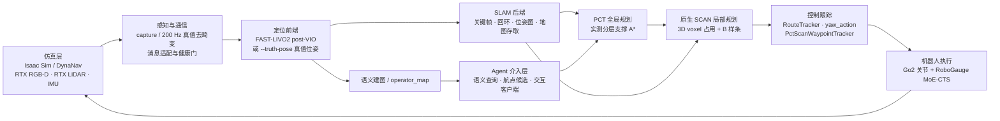

# Embodied Navigation · 具身导航

> 盘点日期：2026-11-21 · 集成基线 `main` `2144e5f`（已推送 `origin/main`） · 当前开发推进分支 `exp/startup-walk-imu-bias` `9e3408d`（本地领先 `origin/exp/startup-walk-imu-bias` 6 个提交） · 活体文档

Unitree Go2 在 **Isaac Sim / DynaNav** 中的具身导航系统：仿真传感器 → FAST-LIVO2 定位建图 → PCT 全局 + 原生 SCAN 局部规划 → RouteTracker 跟踪 → RoboGauge MoE-CTS 关节执行，上层挂载 Agent 感知与控制介入层。

## 0. 新接手者 3 分钟导读

1. **读**（按顺序）：本文件 → [开发路线图](docs/plan/ROADMAP.md)（阶段状态、**活跃分支关键提交 Log 摘要**、数据卷约定）→ [活体任务板](docs/plan/TASKS.md)（已完成 / 进行中 / 下一阶段主线）→ 架构决策记录 [ADR-0001](docs/plan/adr/0001-livo-yaw-pipeline-overlap.md) · [ADR-0002](docs/plan/adr/0002-embodied-agent-async-and-map-outlook.md) · [ADR-0003](docs/plan/adr/0003-streaming-fork-control-and-semantic-scene-graph.md) · [ADR-0004](docs/plan/adr/0004-incremental-mesh-3dgs-and-layered-backend-eval.md) → 需要的模块 `README.md`；协作与提交规则见 [AGENTS.md](AGENTS.md)。
2. **核**：开工先跑 `git status --short --branch` 与 `git branch -avv`，核对实际分支、HEAD 与远端同步状态，不要只看旧结论。
3. **验**（仓库根，CPU 离线，约 30 s；完整入口见 §4.5）：

   ```bash
   PYTHONPATH=src python3 -B -m unittest discover -s tests/unit        # 679 条 OK、0 跳过
   PYTHONPATH=src python3 -B -m unittest discover -s tests/regression  # 60 条 OK（本机 3 条按环境 skip）
   ```

4. **接手切入点**：下一阶段主线是 **Phase 4 SLAM 后端优化**（见 [ROADMAP](docs/plan/ROADMAP.md) 与 [TASKS](docs/plan/TASKS.md)）：先做离线关键帧抽取缓存 + 三层轨迹评测器，再做三项后端修复（重力 Roll/Pitch 强先验、原地/近邻过密回环抑制、Agent 停驻期 ZUPT）。两份评测数据集入口在 `$PROJECT_DATA_ROOT/embodied-navigation/runs/20261121-noisy-imu-rgb-twofloor-explore/`。

## 1. 项目定位与端到端架构

项目唯一主线是 **D 路径：Isaac Sim / DynaNav**。Gazebo 旧主线（A 路径，`start.py` / `launch/` / `control/` / 私有 Fast DDS）已在干净底座中整块退役删除，仅保全于历史分支；动态行人支线已移出到参考分支 `ref/dynanav-dynamic-pedestrian`。



一条命令内的数据流：

1. **仿真层**在 Isaac Sim 中渲染 RTX RGB-D、RTX LiDAR 与 IMU；`--truth-pose` 时额外提供仿真真值位姿与 200 Hz 真值去畸变点云。
2. **感知与通信层**完成传感器消息适配、时间同步、去畸变配对与健康门；`common/` 提供几何、运行时 IO、进程日志与遥测基础设施。
3. **定位建图层**默认用 FAST-LIVO2 前端产出 post-VIO 位姿与实测点云，后端做关键帧、回环、位姿图与地图存取；语义建图与 `operator_map` 生成可查询的分层语义地图。
4. **规划层**用实测分层支撑做 PCT 全局路线，原生 SCAN 在 3D voxel 占用上生成 B 样条局部轨迹；规划输出不含直线兜底。
5. **控制跟踪层**把全局路线/局部曲线跟踪为身体速度命令：平台无关的 `navigation/` 提供 `RouteTracker` 与 `yaw_action`，仿真侧的 `PctScanWaypointTracker` + `ContinuousScanFollower`（在 `simulation/dynanav/pct_scan_waypoints.py`）负责连续 SCAN 曲线的采样跟随；**机器人执行层**由 RoboGauge MoE-CTS 策略把命令变成 Go2 关节目标。
6. **Agent 介入层**通过 `scripts/explore_waypoint_client.py` 与 `.agents/skills/dynanav-explore/` 下发稀疏航点、查询状态、读取回执；它不写速度命令、不读仿真真值。

## 2. 顶层目录与职责总览

```text
embodied-navigation/
├── README.md · README_zh.md · AGENTS.md · CLAUDE.md   # 总览、中文入口、协作规则
├── pyproject.toml · requirements-*.lock/.txt          # 包元数据与 CPU/探索依赖
├── .env.example                                       # PROJECT_DATA_ROOT 等环境模板
├── .agents/skills/dynanav-explore/                    # Agent 自主探索 SOP（skill + 参考 + 脚本）
├── configs/                                           # 仿真/GD 相机/LIO 前端/可视化配置（base，非运行期有效值）
├── docker/                                            # CPU / Native 镜像、原生源码 pin 校验与构建脚本
├── docs/                                              # 架构、术语、计划、实验历史、审查与验证回执
├── scripts/                                           # 薄 CLI 入口：启动、探索、重建、评测
├── src/embodied_navigation/                           # 自有实现（七层包结构）
├── tests/                                             # unit / regression / native
└── third_party/                                       # vendored：FAST-LIVO2、SCAN、PCT、Livox 驱动、Vikit
```

Linux 检出还会有数据卷软链 `assets/`、`models/`、`runs/`，以及本地构建输出 `install/`；`dynanav/`、`history/`、`perception_history/`、`.dsh-subagents/` 是本地历史/协作材料，不进 Git、不进 Docker 输入。

| 顶层目录 | 职责 | 入口文档 |
| --- | --- | --- |
| `src/embodied_navigation/` | 自有代码，按仿真 / 感知 / 定位建图 / 规划 / 控制 / 机器人 / Agent 七层组织 | [源码模块索引](src/embodied_navigation/README.md) |
| `scripts/` | 启动器与 CLI：默认探索入口、PCT/SCAN worker、Agent 客户端、重建与评测脚本 | [scripts/README.md](scripts/README.md) |
| `configs/` | base 配置与契约数据；运行期以 run 目录冻结副本为准 | [configs/README.md](configs/README.md) |
| `third_party/` | vendored 开源算法与驱动，逻辑修改走 `patches/` | [third_party/README.md](third_party/README.md)、[依赖与构建](docs/dependencies/README.md) |
| `tests/` | 离线 CPU 单测与回归，以及原生 C++ fixture | [tests/README.md](tests/README.md) |
| `docs/` | 架构、术语、开发计划、实验历史、审查与验证回执 | [docs/README.md](docs/README.md) |
| `docker/` | CPU / Native 镜像构建、源码 pin 与 PCT 原生编译校验 | [依赖与构建](docs/dependencies/BUILD.md) |
| `.agents/skills/dynanav-explore/` | Agent 自主探索 SOP、参考接口与辅助脚本 | [SKILL.md](.agents/skills/dynanav-explore/SKILL.md) |

> 说明：实验定义与结论已不在仓库内单独建目录，统一放数据卷 `$PROJECT_DATA_ROOT/embodied-navigation/` 的 `runs/`、`experiments/`；仓库只保留代码、配置、文档与不超过 300 行的结论报告。

## 3. 核心模块导航

下表列出的活跃模块均有自己的 `README.md`，逐文件职责以该 README 为准；`robot/unitree/policy/` 只是只有 `__init__.py` 的命名空间，其内容并入 `robot/unitree/README.md`。

| 层 | 模块 | 职责一句话 | 文档 |
| --- | --- | --- | --- |
| 包索引 | `embodied_navigation` | 七层包结构与端到端数据流 | [README](src/embodied_navigation/README.md) |
| 基础设施 | `common/` | 几何、运行时 IO、进程日志、遥测、状态契约 | [README](src/embodied_navigation/common/README.md) |
| 感知 | `perception/` | 深度包与位姿/速度契约适配 | [README](src/embodied_navigation/perception/README.md) |
| 定位建图 | `localization_mapping/` | 前端接入、后端 SLAM、语义建图 | [README](src/embodied_navigation/localization_mapping/README.md) |
| 定位建图 | `localization_mapping/backend/` | 关键帧、回环、位姿图、地图存取、严格配置加载 | [README](src/embodied_navigation/localization_mapping/backend/README.md) |
| 定位建图 | `localization_mapping/semantic_mapping/` | 语义点层、关键帧锚定 3D 场景图（`KeyframeSceneGraph`）、后端适配器与调度（离线 CLI `scripts/build_semantic_scene_graph.py`；在线回环需显式调用 `sync_backend_loop_update`，暂未自动接在线 `backend.py`） | [README](src/embodied_navigation/localization_mapping/semantic_mapping/README.md) |
| 规划 | `planning/` | PCT 全局、SCAN 局部、扫描交接与来源 | [README](src/embodied_navigation/planning/README.md) |
| 规划 | `planning/pct/` | 实测分层支撑 tomogram 与原生 PCT A* 接入 | [README](src/embodied_navigation/planning/pct/README.md) |
| 规划 | `planning/exploration/` | 航点候选、路线信息、Habitat 适配与世界守护 | [README](src/embodied_navigation/planning/exploration/README.md) |
| Agent 运行时 | `agent_runtime/` | 通用多轮 Tool-Calling 运行时、Prefix-Stable 200K 上下文、压缩与 Hooks | [README](src/embodied_navigation/agent_runtime/README.md) |
| 控制跟踪 | `navigation/` | `RouteTracker` 路线跟踪与 `yaw_action` 转向动作（平台无关纯策略，不依赖 ROS/Isaac） | [README](src/embodied_navigation/navigation/README.md) |
| 控制跟踪 | `navigation/robogauge/` | RoboGauge 路线跟踪接口 | [README](src/embodied_navigation/navigation/robogauge/README.md) |
| 机器人执行 | `robot/` | Go2 观测、关节契约、策略执行 | [README](src/embodied_navigation/robot/README.md) |
| 机器人执行 | `robot/unitree/` | Unitree Go2 机器人层 | [README](src/embodied_navigation/robot/unitree/README.md) |
| 机器人执行 | `robot/unitree/robogauge/` | MoE-CTS 策略契约与运行时 | [README](src/embodied_navigation/robot/unitree/robogauge/README.md) |
| 机器人执行 | `robot/unitree/policy/native/` | 原生观察向量与策略契约数据 | [README](src/embodied_navigation/robot/unitree/policy/native/README.md) |
| 仿真 | `simulation/` | Isaac / DynaNav 仿真接入层 | [README](src/embodied_navigation/simulation/README.md) |
| 仿真 | `simulation/dynanav/` | 场景、采集、真值去畸变、PCT/SCAN worker、连续 SCAN 跟随适配、operator map | [README](src/embodied_navigation/simulation/dynanav/README.md) |
| 仿真 | `simulation/dynanav/capture/` | 采集编排：暂停、传感器、帧、LiDAR、策略与回执 | [README](src/embodied_navigation/simulation/dynanav/capture/README.md) |

## 4. 快速启动与验证入口

### 4.1 前置条件

- Linux + ROS 2 Jazzy + Isaac Sim（默认路径由 `--isaac-root` 覆盖）；无 Isaac/ROS 时只能做 CPU 单测与文档工作。
- `cp .env.example .env.local`，填入 `PROJECT_DATA_ROOT`；数据卷布局与清理规则见 [AGENTS.md 第 6 节](AGENTS.md) 与数据根 `AGENTS.md`。
- Python 3.12，`PYTHONPATH=src`；原生构建需要 CMake 与 ROS Jazzy 环境。
- 需要数据卷软链时执行 `python3 scripts/configure_data.py --data-root <数据根目录> --link`。

### 4.2 默认自主探索（FAST-LIVO2 前端 + PCT/SCAN + RoboGauge）

```sh
# 默认写入数据卷 runs/native-exploration/<UTC 时间戳>/，也可显式传一个不存在的新目录
bash scripts/run_dynanav_native_exploration.sh
bash scripts/run_dynanav_native_exploration.sh "$PROJECT_DATA_ROOT/embodied-navigation/runs/native-exploration/my-run"
```

启动器负责构建/装配原生 SCAN 闭包、起 FAST-LIVO2 与 PCT/SCAN worker、绑定采集与估计器进程，并打印 run 目录。可选参数：`--until-stopped`、`--scan-prefix`、`--isaac-root`、`--pct-max-grid-cells`、`--overview-eye-base`、`--overview-focus-base`。完整边界见 [PCT/SCAN 说明](docs/dynanav-pct-scan.md)。

### 4.3 真值位姿调试模式

```sh
bash scripts/run_dynanav_native_exploration.sh --truth-pose
```

`--truth-pose` 跳过 SLAM，直接用 `simulation_truth` 的 `go2_imu` 位姿 + 200 Hz 真值去畸变 RTX 点云驱动 PCT + SCAN。它用于隔离规划问题，**不能**当作 SLAM 链路或实机可复现的证据。第一优先验证（地下室→二楼大厅 +3.25 m 净爬升）即在该模式下完成，见 [ROADMAP Phase 2](docs/plan/ROADMAP.md)。

### 4.4 Agent 交互探索

```sh
# 保持操作者心跳，然后下发一个航点
python3 scripts/explore_waypoint_client.py heartbeat --run-dir <RUN> --loop --duration 600
python3 scripts/explore_waypoint_client.py goto --run-dir <RUN> --x 3.0 --y -1.5 --z -3.3 --ttl 30
python3 scripts/explore_waypoint_client.py observe --run-dir <RUN>
python3 scripts/explore_waypoint_client.py map --run-dir <RUN> --pose-source lio_estimate
python3 scripts/explore_waypoint_client.py stop --run-dir <RUN>
```

子命令包括 `heartbeat`、`goto`、`yaw`、`maneuver`、`scan`、`observe`、`map`、`stop`；`goto`/`yaw`/`maneuver` 支持 `--wait --timeout` 阻塞等结构化结果。Agent 侧 SOP 见 [dynanav-explore skill](.agents/skills/dynanav-explore/SKILL.md) 与其 [原生接口参考](.agents/skills/dynanav-explore/references/native-interface.md)。

### 4.5 CPU 测试、回归与原生校验

```sh
# 语法编译检查
PYTHONPATH=src python3 -B -m compileall -q src scripts

# 单元测试：当前工作树 679 条全绿（0 失败 0 跳过；集成基线 main 为 650 条）
PYTHONPATH=src python3 -B -m unittest discover -s tests/unit

# 回归测试：当前基线 60 条全绿 0 失败（本机 3 条按环境 skip）
PYTHONPATH=src python3 -B -m unittest discover -s tests/regression

# 原生源码 pin 校验与 PCT CPU 编译冒烟（不联网、不加载模型）
python3 docker/verify_native_sources.py --compile-pct

# 原生闭包构建（默认只计划，--execute 才真正构建）
python3 docker/build_native.py --execute
```

测试边界：不覆盖 Isaac/ROS 图、GPU 推理与实机；`run` 成功只代表进程/计划成功，不代表物理到达。测试细节与 skip 语义见 [tests/README.md](tests/README.md)。

## 5. 开发计划、分支与数据管理

### 5.1 开发计划

| 文档 | 内容 |
| --- | --- |
| [docs/plan/ROADMAP.md](docs/plan/ROADMAP.md) | 唯一主线、七层边界、Phase 1–4 里程碑与状态、分支归属表、数据卷约定 |
| [docs/plan/TASKS.md](docs/plan/TASKS.md) | 活体任务板：已完成 / 进行中 / 待办队列，含建议角色、模块与验收标准；Phase 4 后端评测数据集入口 |
| [docs/plan/TEST_PLANS.md](docs/plan/TEST_PLANS.md) | 活跃分支测试与验收计划：合入底线、`exp/startup-walk-imu-bias` 核销表、Phase 4 统一数据集矩阵（D1/D2/D3）与三层评测口径 |
| [docs/plan/adr/](docs/plan/adr/) | 架构决策记录 ADR-0001–ADR-0004：yaw 延迟边界、具身 Agent 异步与语义地图、流式 Fork + 关键帧语义图、增量 Mesh/3DGS 与三层后端评测口径 |
| [AGENTS.md](AGENTS.md) | 硬规则、测试与分支验收、数据卷规则、README 维护要求 |
| [docs/README.md](docs/README.md) | 文档分类索引（权威说明 / 计划 / 实验历史 / 审查 / 验证 / 依赖） |

### 5.2 分支管理（摘要，2026-11-21）

| 分支 | HEAD / 远端同步 | 用途 |
| --- | --- | --- |
| `main` / `origin/main` | `2144e5f`（一致） | 集成、发布与独立验收入口；已含 `fix/livo-yaw-and-imu-patch`（`5049ec7`，merge `9b6dc85`）、ADR-0001/0002（`9816a2b`）与 RViz 实时点云配置/录制 CLI（`ca754ab`、`2144e5f`） |
| **`exp/startup-walk-imu-bias`**（当前开发分支） | `9e3408d`（领先 origin 6） | 起步预热稳态门 + 物理级带噪 IMU、RViz RGB8 彩色重建图层、局部滑窗建图与 `--backend-pose` 订阅、PCT 净空 0.95 m、不依赖 PCT/SCAN 的直通脱困 `maneuver`、ADR-0003/0004；共 12 个提交（基线 `main`） |
| `refactor/00-plan-docs` … `refactor/06-clean-base` | 已验收栈 | 分包重构历史；`06-clean-base`（`f061a7e`）是干净底座，Phase 1/2 成果所在 |
| `exp/slam-measured-submaps` / `exp/slam-surface-gate` / `exp/slam-visual-retrieval` | `5b300b0` / `958ec01` / `16883d1`（与远端一致） | Phase 4 三条后端对照分支（Codex 审计后，待同输入、同时间轴评测）；均基于 `9816a2b` 切出 |
| `exp/pct-scan-stairs-truth` | `bb2eef2`（已并入 `refactor/06-clean-base` 历史） | 真值闭环复现入口（Phase 2） |
| `fix/livo-yaw-and-imu-patch` | `5049ec7`（已并入 `main`） | LIVO 独立 `yaw` 延迟修复 + 0011 IMU patch 原生构建接线，保留作证据 |
| `ref/dynanav-dynamic-pedestrian` | `f62c83c` | 动态行人参考分支，按需提取重构 |
| `exp/loop-*`、`refactor/05-loop-evidence-base`、`archive/*`、`backup/*`、`wip/*` | 历史 | 历史回环对照、审查前档案与在途快照，只读查证 |

各活跃分支的完整关键提交 Log 摘要见 [ROADMAP 第 3 节](docs/plan/ROADMAP.md)；分支复核要求见 [AGENTS.md 第 5 节](AGENTS.md)。agent 只提交本地分支，**合并与推送由用户完成**。

### 5.3 数据卷

工程数据根：`$PROJECT_DATA_ROOT/embodied-navigation/`（由 `.env.local` 提供，缺失时脚本 fail-closed，不回退仓库内路径）。

| 路径 | 内容 |
| --- | --- |
| `runs/<批次>/<run-id>/` | 新原生运行与回放：冻结配置、`runtime_context.json`、日志、回执、`manifest.json` |
| `runs/20261121-noisy-imu-rgb-twofloor-explore/` | 两份带噪 IMU 13 话题双层评测包（Phase 4 输入）：`20261121T133734Z`（一楼窄角前后端双失效，≈9.3 GB）与 `20261121T142308Z`（双层 46 分钟 70 m × 27 m，≈80 GB） |
| `experiments/<run>/` | DynaNav / Isaac 历史实验产物（capture、observer、点云与逐帧回执） |
| `build_cache/` | 原生 SCAN / LIO 构建与安装前缀 |
| `runtime_assets/{assets,models,runs}/` | 仓库根 `assets/`、`models/`、`runs/` 软链指向的资产、权重与历史运行 |
| `reports/`、`deliverables/` | 整理后的报告与交付物 |

规则：运行产物不进仓库；单个文件 >200 KB 默认不提交；开跑前用 `findmnt -T` 与 `df` 核对挂载和容量。详见 [AGENTS.md 第 6 节](AGENTS.md)。

## 6. 边界与限制

- 本仓库只做仿真与 CPU 离线验证；不包含实机安全后端，`REAL_SENSOR` 仅为保留类型。
- Isaac Sim 版本与场景资产需按配置另行提供，仓库不含权重、场景与运行数据。
- Fast DDS UDP 端口映射要求 `ROS_DOMAIN_ID` 在 `0..232`；启动器会拒绝越界值。
- 规划/SCAN 的原生输出、CPU 测试通过、CLI 退出 0 都不等于物理到达或完整探索覆盖；结论必须绑定 run 目录、时间轴与回执。
- 许可证与来源边界见 [docs/dependencies](docs/dependencies/README.md)，公开发布前需逐项核对。
