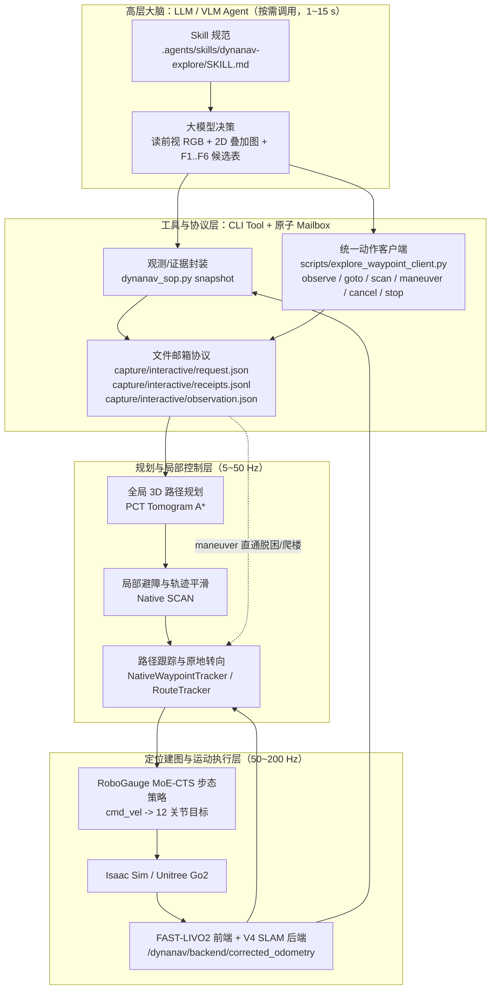

# 01. 当下具身 Agent 的 Skill、Tool 与控制全链路解析

> 本文完整梳理本仓库目前真实可运行的 **Agent → Skill → Tool → Mailbox → 规划/控制 → 机器狗执行** 全链路，帮助你快速看清：Agent 到底能看到什么、能调哪些工具、哪些安全边界由底层死守、哪些决策交给了大模型。

---

## 1. 整体分层：为什么 Agent 不直接输出速度指令？

具身导航里最容易踩的坑，是让大模型（响应延迟 `1–15 s`）直接输出底盘速度 `(vx, vy, wz)`。本仓库采用严格解耦的**高层语义决策与底层实时运动控制分离**架构：



**核心设计原则（三条红线）**：
1. **零“上帝视角”作弊**：Agent 只能读取当前这一代（generation）的真实传感器产物（前视 RGB、实测 RTX/LIO 点云、基于实测点云累加的 2D 占据栅格与高度分片图、估计位姿与 SLAM 后端状态），严禁读取仿真器真值、USD 场景几何或历史跑次的旧坐标。
2. **工具只传意图，收据才算事实**：`explore_waypoint_client.py` 退出码为 `0` 只代表把请求写进了邮箱，**绝不代表到达目标**；必须核对 `receipts.jsonl` 里的 `waypoint_accepted` / `waypoint_reached` / `waypoint_failed` / `maneuver_complete`。
3. **底层守安全，高层做语义**：步态平衡、关节限幅、超时停机（stale measurement zero-command）、跌倒与物理状态监控全由底层负责；大模型专注「识别门洞/楼梯/死角、决定探索拓扑顺序、识别卡困并选择脱困策略」。

---

## 2. Skill 体系详解（`.agents/skills/dynanav-explore/`）

Skill 是给大模型加载的「具身操作手册 + 标准化辅助脚本包」，当前目录结构如下：

| 文件 | 角色与职责 |
|---|---|
| [SKILL.md](file:///home/hyh001/projects/1.Project/embodied-navigation/.agents/skills/dynanav-explore/SKILL.md) | **主规则与战术手册**：定义传感器真源红线、3D/2D 读图规范、ZUPT 停驻卫生（思考时保持静止避免微抖）、360° 全景 `scan` 时机、`maneuver` 门框脱困与直接爬楼流程、以及诚实覆蓋率台账要求。 |
| [references/native-interface.md](file:///home/hyh001/projects/1.Project/embodied-navigation/.agents/skills/dynanav-explore/references/native-interface.md) | **接口契约与 SOP 命令速查**：精确列出每个状态文件（`observation.json`、`receipts.jsonl`、`operator_map/latest.json`、`operator_grid/*.npz`）的字段语义、坐标系约定和启动/退出校验步骤。 |
| [references/two-floor-exploration-prompt.md](file:///home/hyh001/projects/1.Project/embodied-navigation/.agents/skills/dynanav-explore/references/two-floor-exploration-prompt.md) | **跨楼层长任务 Prompt 模板**：固化两层楼（地下室 + 楼梯 + 二楼全房间）自主探索的任务编排模板与预算参数（`--until-stopped --backend-pose --pct-max-grid-cells 8000000`）。 |
| `scripts/dynanav_sop.py` | **标准操作封装脚本**：提供 `status` / `launch` / `snapshot` / `goto` / `wait` / `cancel` / `stop` / `note` / `verify-exit` 子命令；自动保存原始证据清单（provenance manifest），生成视觉优先的 2D 标注地图与 3D 多视角投影。 |
| `scripts/record_current_lio_cloud.py` | **只读实测点云采集器**：严格按整数时间戳配对 `/dynanav/rtx_livo/cloud_registered_full` 与 `/dynanav/rtx_livo/aft_mapped_to_init`，输出 `measured_partial_cloud.npz/.ply` 供 3D 视图渲染，不发任何控制指令。 |

> **Skill 与硬编码逻辑的边界**：Skill 里写的所有规则（例如“进门洞前先对准门中线 1 m”“不要写临时的 `.npz` 探测脚本”）都是**行为策略指导**，不修改任何底层运动控制准入门槛。

---

## 3. 当下 Agent 调用的全部 Tool 清单

### 3.1 核心控制客户端：`scripts/explore_waypoint_client.py`

这是 Agent 与仿真/控制器交互的**唯一官方动作入口**，所有动作都通过原子写入 `capture/interactive/request.json` 与递增序列号 `seq` 投递给底层工作线程：

| 子命令（Action） | 底层走哪条路 | 核心参数与用途 | 适用场景与关键收据 |
|---|---|---|---|
| `observe` | 只读查询 | `--run-dir <capture>` | 读取当前位姿、yaw、活跃序列号、进度、最新前视 RGB 路径、失败原因与 SLAM 后端状态。 |
| `goto` | **PCT 全局 + SCAN 局部 + RouteTracker** | `--x --y --z --pose-source <src> [--wait]` | 常规平地/大空间自主导航。自动做 3D 路径规划与局部避障。收据：`waypoint_accepted` → `waypoint_reached` 或 `waypoint_failed`。 |
| `scan` | **PCT/SCAN 旋转安全检查 + 原地步进转向** | `--steps 6 --step-deg 60 --settle-s 0.8 --ttl 90 --timeout-per-step 90` | 在房间中心、岔路口、楼梯平台或 `travel_since_last_loop_m > 15 m` 时原地慢速 360° 环扫，采集多视角 RGB + LiDAR 关键帧（落盘到 `interactive/scan/seq_XXXX/`），丰富视觉回环证据。 |
| `maneuver` | **直通底盘速度脉冲（绕过 PCT/SCAN）** | `--forward [-v,v] --lateral [-0.05,0.05] --yaw-rate [-0.15,0.15] --duration [0.1,2.0] --wait` | **两大杀手场景**：<br>1. 门板/墙角卡困脱困（`cancel` → 短脉冲后退+微转）；<br>2. **爬楼梯直通脉冲**（对齐楼梯中线后 `forward=0.45, duration=2.0` 逐段平稳上楼，绕过 PCT 扶手/窄净空误判）。收据：`maneuver_accepted` → `maneuver_complete`。 |
| `cancel` | 立即清队列 | `--run-dir <capture>` | 中断卡死或不再需要的活跃 `goto`，清掉当前与排队目标，让机器人回到空闲待命状态。收据：`cancel_accepted`。 |
| `stop` | 终端泊车 | `--run-dir <capture>` | 结束本次探索任务，触发原生终端泊车流程（线速度 `< 0.02 m/s` 且角速度 `< 0.05 rad/s` 维持 $\ge 1\text{ s}$），直到产出 `navigation_terminal_and_parked`。 |

### 3.2 感知增强与视觉优先辅助工具

| 工具 / 模块 | 路径 | 输入 → 输出 | 核心价值 |
|---|---|---|---|
| **视觉优先 2D 叠加图渲染器** | [visual_map_overlay.py](file:///home/hyh001/projects/1.Project/embodied-navigation/src/embodied_navigation/planning/exploration/visual_map_overlay.py) | 实测 `operator_grid` + 估计轨迹 + 机器人位姿 → `height_chart_000.png`（全局）+ `height_chart_000_local.png`（±6 m 局部特写）+ `candidates` 坐标表 | 把 Go2 真实机身轮廓（`0.70 m × 0.31 m` 按 yaw 旋转）、`0.60 m` 原地转向安全圆（绿=可原地 `scan`、红=狭窄禁转）、同层已走轨迹、以及程序自动投影的 2D 可达候选点（`F1..F6` 未探索前沿、`W1..W4` 开阔方向）直接画在图上，让 VLM **“看图直接选点”**，彻底省去手写脚本算坐标。 |
| **只读前沿候选生成器** | [scripts/dynanav_exploration.py](file:///home/hyh001/projects/1.Project/embodied-navigation/scripts/dynanav_exploration.py) + [waypoint_candidates.py](file:///home/hyh001/projects/1.Project/embodied-navigation/src/embodied_navigation/planning/exploration/waypoint_candidates.py) | `operator_map/level_*.json` + 实测点云 → 按信息增益排序的候选点列表 | 纯只读建议工具（绝不自动下发 `goto`），在离开当前楼层前做 2D 前沿漏检审计，避免遗漏半掩房门后的未访区域。 |
| **路由信息增益评估** | [route_information.py](file:///home/hyh001/projects/1.Project/embodied-navigation/src/embodied_navigation/planning/exploration/route_information.py) | 候选轨迹 + 实测占据网格 → 沿途未知区域覆盖增益分数 | 量化评估哪条探索支路能看到最多新空间。 |
| **一键仿真探索启动器** | [scripts/run_dynanav_native_exploration.sh](file:///home/hyh001/projects/1.Project/embodied-navigation/scripts/run_dynanav_native_exploration.sh) | `--until-stopped --backend-pose --backend-config <json> --pct-max-grid-cells 8000000` | 统一拉起 Isaac Sim、FAST-LIVO2 前端、V4 SLAM 后端、PCT/SCAN 规划器、RouteTracker、OperatorMap 与（可选）RViz2。 |

---

## 4. 当前单步探索闭环（回合制）伪代码

```text
while not mission_complete:
    1. snapshot = run("dynanav_sop.py snapshot --tag step_k")
       # 产出：前视 RGB + 全局/局部标注 2D 占据图 (F1..F6, W1..W4) + 3D 四视图 + backend_status

    2. VLM Agent 阅读多模态证据：
       - 前视 RGB：识别门洞开合、楼梯扶手/踏步、斜顶障碍、纹理丰富度
       - 2D 局部/全局叠加图：检查安全圆颜色（绿/红）、已走轨迹、未访前沿 F1..F6
       - backend_status：检查 travel_since_last_loop_m、zupt_active、loops 计数

    3. 决策分支：
       if 到达新大厅中心 or 岔路口 or travel_since_last_loop_m > 15m (且安全圆为绿):
           run("explore_waypoint_client.py scan --steps 6 --step-deg 60 ...")
       elif 前视 RGB 确认到达楼梯正入口且决定跨层:
           run("explore_waypoint_client.py maneuver --forward 0.45 --duration 2.0 --wait")
       elif 上一步 goto 返回 waypoint_failed (卡门板/墙角):
           run("explore_waypoint_client.py cancel")
           run("explore_waypoint_client.py maneuver --forward -0.35 --yaw-rate 0.15 --duration 1.5 --wait")
       else:
           从 F1..F6 / W1..W4 选择最优语义目标 (x, y, z)
           run("explore_waypoint_client.py goto --x X --y Y --z Z --wait")

    4. 核验 receipts.jsonl（区分 accepted / reached / failed / timeout），更新覆盖率台账
```

---

## 5. 当下回合制架构的 4 大核心瓶颈（为什么需要下一代演进）

这套 Skill + Tool 架构已经跑通了两层楼多房间全自主探索，但实测中暴露出四个结构性天花板：

1. **“走一步 → 停 15 秒 → 思考 → 再走一步”的节奏割裂**：
   - 大模型每步思考要 `5~25 s`，机器人只能傻站着等。尽管 V4 后端有 ZUPT 护航，但整体探索效率被拖慢数倍，而且直线走廊根本不需要停下来反复拍快照。
2. **行进中“睁眼瞎”，缺乏语义级实时抢占**：
   - 机器人按一个 8 米长的 `goto` 往前走时，半路左侧闪过一扇刚露出缝隙的房间门、或前方出现一个低矮斜顶死角，主 Agent 只有在走完这 8 米或撞停触发 `waypoint_failed` 后才看得到。
3. **上下文窗口随时间爆炸，缺乏结构化外部记忆**：
   - 如果把探索 86 分钟里的几百张 RGB 图和坐标全塞进对话历史，Token 很快爆表、推理变慢且出现严重空间幻觉；而且一旦任务变成**“回答刚才二楼西侧房间里有什么”**或**“再去检查一遍昨天走过的消防栓有没有变化”**，纯聊天记录完全无能为力。
4. **只面向“单次探索”，尚未抽象出通用具身任务接口**：
   - 未来的业务不只是探索，还包括**问答召回（QA）**、**指定目标导航（Object-Goal Nav）**、**周期巡检与跨时刻找不同（Inspection / Change Detection）**——这些任务需要统一的空间记忆底座与持续视频流感知能力。

下一篇 [02_streaming_video_control_and_memory_system.md](02_streaming_video_control_and_memory_system.md) 将系统讲解我们已经落地的两条实验分支（流式可抢占哨兵 + 关键帧锚定 3D 语义场景图）以及面向未来四大任务的完整演进蓝图。
