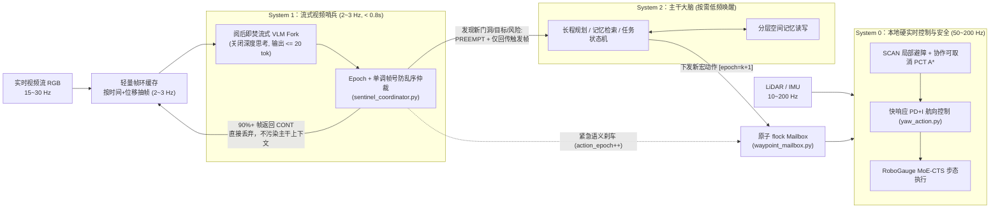
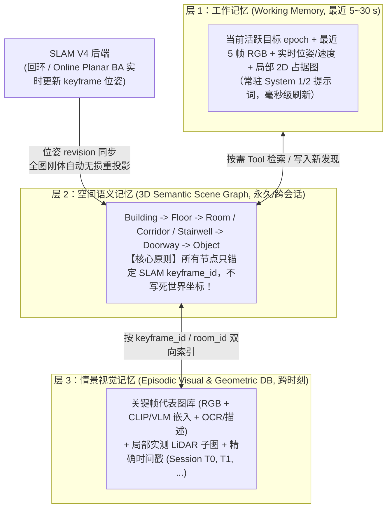

# 02. 面向未来的演进：实时视频流控制与分层空间记忆系统

> 本文面向下一阶段具身智能演进，系统梳理两根支柱：
> 1. **实时视频流控制（Streaming Video Control）**：如何从“停下来截图再思考”演进到“边走边看、毫秒级安全避障 + 秒级语义抢占改道”（含 `feat/agent-preemptable-active-slam` 已落地模块解析）；
> 2. **分层空间记忆系统（Spatial & Episodic Memory）**：如何基于 SLAM V4 的厘米级位姿底座与 `feat/semantic-keyframe-graph` 的 3D 语义场景图，统一支撑 **探索 / 问答召回 / 语义导航 / 周期巡检与找不同** 四大高阶任务。

---

## 第一部分：实时视频流控制（Streaming Video Control）

### 1.1 为什么不能只靠“一个大模型直连视频流”？

实时视频流（`15–30 FPS`）与底盘控制（`50–200 Hz`）存在天然的**时间尺度鸿沟**：
- 物理防撞、防跌倒、急停必须在 **5–20 ms** 内完成；
- 语义级“突然发现新门洞 / 目标物体 / 异常漏水”需要在 **0.3–1.0 s** 内触发抢占；
- 长程拓扑决策（“先把二楼东翼扫完再下楼去检查变电箱”）允许 **3–10 s** 的深度思考。

因此最合理的控制架构不是单一模型包打天下，而是 **System 0 / System 1 / System 2 三层协同**（见 [ADR-0003](../plan/adr/0003-streaming-fork-control-and-semantic-scene-graph.md)）：

### 1.2 我们已在 `feat/agent-preemptable-active-slam`（`8aebc95`）落地的核心基建

为了支撑真正的边走边看与实时抢占，我们已经在独立实验分支里补齐了四块关键底座（均已通过 Codex 审计与单测）：

| 模块 | 文件位置（分支 `feat/agent-preemptable-active-slam`） | 解决的核心工程难题 |
|---|---|---|
| **原子 Epoch 邮箱协议** | `src/embodied_navigation/planning/exploration/waypoint_mailbox.py` | 用 `fcntl.flock` 文件锁 + 单调递增 `action_epoch` 取代裸 JSON 读写。一旦发生抢占或新宏动作下发，`action_epoch` 递增，所有旧 epoch 的在途请求、过时视频帧判定自动作废，杜绝“旧帧慢半拍返回把新动作冲掉”（Stale Frame Preemption）。 |
| **真 SSE 流式哨兵客户端** | `src/embodied_navigation/planning/exploration/llm_agent_client.py` + `sentinel_coordinator.py` | 接入无思考快速多模态流式接口（如 `deepseek-flash` / `qwen3.8-flash`），以 **2–3 Hz 时间+位移混合节拍**消费实时前视 RGB + 迷你局部顶视图，硬截断输出受控枚举（`CONT` / `STOP_NEW_DOOR` / `STOP_STAIRS` / `STOP_DEAD_END` / `BEAR_LEFT` / `BEAR_RIGHT`）。90%+ 的 `CONT` 帧阅后即焚，**绝不撑爆主干上下文**。 |
| **可协作取消的 PCT 规划器** | `src/embodied_navigation/planning/pct/measured_tomogram.py` + `simulation/dynanav/pct_scan_worker.py` | 当哨兵触发抢占时，正在耗时搜索长路径的 `pct_astar` 会立即收到取消信号并在毫秒级退出，避免“已经喊停了规划器还在傻算旧路径”。 |
| **低抖动 PD+I 航向控制** | `src/embodied_navigation/navigation/yaw_action.py` | 加速原地对准与转向收敛，缩短 `scan` 和转向等待时间，减少高动态抖动对前端 SLAM 的干扰。 |

### 1.3 下一步走向「真正连续视频流控制」的关键演进

当未来需要接原生实时视频流模型（如 Gemini Live / Qwen-Omni / 端到端连续视频 VLA）时，在现有三层骨架上只需平滑升级 System 1：

1. **自适应事件抽帧（Event-Driven Video Sampler）**：
   - 不固定死 10 FPS 盲发（既烧钱又造成队列拥堵），而是按「**位移 $\ge 0.25\text{ m}$ 或 航向变化 $\ge 8^\circ$ 或 画面光流/感知哈希突变**」动态推送视频帧；静止时自动降频到 `0.2 Hz` 保活。
2. **双路视频流分流（Fast Stream + Archival Keyframes）**：
   - **快路（Low-Res 336×336）**：直通 System 1 流式哨兵做实时语义监控、动态人/车意图识别、门开合检测与语音交互；
   - **慢路（Full-Res RGB + Depth/LiDAR）**：仅在 SLAM 关键帧或哨兵标记的高价值瞬间绑定 `keyframe_id` 写入外部记忆库，用于精细读表、文字 OCR 与事后找不同。
3. **无停顿“行进中动态重规划”（Rolling Horizon Re-goal）**：
   - 目前抢占多是 `STOP → 重新思考 → 下发新 goto`；下一阶段支持哨兵输出方向偏置（`BEAR_LEFT`）或热替换下一个中间航点，直接把新目标平滑拼接到 SCAN 当前曲线尾部，实现机器人**丝滑拐进路过的新房门而不必先刹停**。

---

## 第二部分：面向多任务的「分层空间记忆系统（Memory System）」

探索只是具身智能的第一课。一旦进入**问答召回、目标导航、周期巡检与找不同**，大模型靠自身有限的上下文窗口根本记不住一整栋楼几小时前的细节。**记忆必须放在外部结构化数据库里，由大模型按需检索（Embodied RAG）**。

### 2.1 三层记忆架构总览

### 2.2 我们已在 `feat/semantic-keyframe-graph`（`46e0b48`）落地的底座能力

在 `src/embodied_navigation/localization_mapping/semantic_mapping/` 中，我们已经实现并审计通过了**关键帧锚定 3D 语义场景图**：
- **核心设计——锚定 `keyframe_id` 而非写死坐标**：每个房间、走廊、楼梯段、门洞（`DoorwayEdge`）与物体观测都记录它所属的 `keyframe_id` 及在该关键帧局部系下的相对位姿。每当 SLAM V4 后端发生回环或 Planar BA 更新位姿，调用 `sync_backend_loop_update` 即可按原子 revision 把**整栋楼的所有房间、门洞、楼梯折线和物体坐标整体重投影**，永远不会出现“地图修正了 20 cm，但记忆里的门洞还留在老坐标”的脱节！
- **自动几何拓扑提取**：
  - 按轨迹局部坡度 $|dz/ds|$ 与平台支撑自动切分楼层（`Floor`）与楼梯段（`Stairwell`）；
  - 用局部窄口 BFS + 机身扇区视线（LOS）检测门洞（`DoorwayEdge`），严格防止把隔墙相邻的两条平行走廊误合并；
  - 每个房间自动维护去重后的精选代表图（`representative_rgb_paths`）与全部关键帧引用（`keyframe_rgb_paths`），并用 `cKDTree` 加速空间邻近与遮挡查询。

### 2.3 这套记忆系统如何统一支撑未来四大具身任务？

| 未来任务类型 | 需要扩展的记忆索引 / Tool | 典型执行链路（Agent 如何调用记忆） | 为什么离不开 SLAM V4 的 1~2 cm 精度？ |
|---|---|---|---|
| **1. 自主探索（当下）** | `query_unvisited_frontiers()` `list_rooms(visited=False)` | 查场景图中 `visited=False` 的门洞和未闭环支路，结合 2D 前沿图规划全局巡游顺序，避免反复进同一个房间。 | 跨楼层与长走廊不重影，门洞位置稳定，不把同一扇门认成两扇。 |
| **2. 问题构建、问答与召回（Embodied QA & Recall）** | `search_memory(text_query, floor, time_range)` （结合文本/多模态向量检索 CLIP/SigLIP + 房间图谱多跳过滤） | 例如用户问：**“二楼会议室白板旁边有没有放红色背包？”** ① 查语义图定位 `Floor_2 → Room_meeting`； ② 召回该房间下与“白板/背包”向量相似度 Top-K 的代表图（附拍摄时间戳与精确 3D 坐标）； ③ VLM 直接看这几张原图作答（必要时输出「需要回去复看该坐标」）。 | 若只靠聊天记录，10 分钟后就会遗忘或串楼层；绑定 `keyframe_id` 的图+图库检索可做到跨小时零遗忘、可溯源到具体原图。 |
| **3. 语义目标导航（Object-Goal / Instruction Nav）** | `locate_object(label)` `rank_candidate_rooms_for_object(label)` | 例如指令：**“去拿一下刚才在茶水间看到的灭火器”** ① **记忆命中**：直接从场景图取 `灭火器` 最新重投影的 `(x, y, z)`，交给 `PCT` 跨楼层一步规划直达； ② **记忆未命中**：由 LLM 按常识对已知未细看房间排序（茶水间/走廊拐角 > 会议室），逐个导航并触发局部 `scan` 搜寻。 | 物体 3D 坐标误差决定机器人能否准确停在目标正前方 `1 m` 观测位而不是撞墙或停到隔壁房间。 |
| **4. 周期巡检与跨时刻找不同（Inspection & Change Detection）** | `align_to_prior_map(session_T0)` `diff_room_geometry(room_id, T0, T1)` `diff_viewpoint_rgb(kf_T0, kf_T1)` | **最适合发挥本系统优势的杀手级应用**： ① **建立基线（Session T0）**：用 SLAM V4 建出 `1.4 cm` 级高精度双层地图 + 语义场景图 + 关键巡检点代表图库； ② **二次巡检（Session T1）**：`SlamBackend(prior_map=T0)` 加载先验图重定位，机器人沿各房间关键锚点复拍； ③ **双模态找不同**： &nbsp;&nbsp;- **3D 几何差分（LiDAR Voxel/TSDF 相减）**：不受光照阴影干扰，精准检出「新增箱子/占道障碍/椅子被搬走/门由关变开」； &nbsp;&nbsp;- **2D 同视角视觉差分（对齐位姿后 VLM 双图对比）**：精准检出「地面漏水、警示灯变红、仪表指针偏移、海报脱落」等纯雷达看不出的细微变化； ④ 汇总生成带 **房间名 + 3D 坐标 + T0/T1 对比图 + 异常级别** 的巡检报告。 | **找不同成败的生死线就是跨时刻对齐精度！** 如果基线图本身歪了 30 cm，两帧点云相减全是墙面重影假警报；而 V4 在线定向 Planar BA 把跨两层地图压到 **`1.4 cm`（Z 轴 `7 mm`）**，正是做 3D 几何找不同与同视角视觉找不同的硬前提！ |

---

## 第三部分：建议的演进路线（从当下到完整具身 Agent）

1. **阶段 1（当下即将验证）**：将 `exp/slam-v4-oriented-planar-ba`（厘米级在线后端）与 `feat/sliding-window-and-backend-global-map`（前端滑窗 + 实时全局图）合流，在 Isaac Sim 完成双层实机闭环，拿到第一张全楼 `~2 cm` 级实机底图。
2. **阶段 2（记忆层接线）**：把 `feat/semantic-keyframe-graph` 接到在线 `BackendNode`，每次后端回环/BA 自动同步 `sync_backend_loop_update`，对外暴露 3 个轻量只读 Tool：`list_rooms`、`search_memory`、`get_room_views`。
3. **阶段 3（视频流哨兵上线）**：合并 `feat/agent-preemptable-active-slam`，在直线推进阶段开启 `2~3 Hz` SSE 流式哨兵 + `action_epoch` 抢占，把探索从“走停回合制”升级为“流畅边走边看”。
4. **阶段 4（巡检与找不同闭环）**：基于 `MapStore.load(prior_map)` 重定位模式 + 房间关键视角复访，上线「LiDAR 3D 几何差分 + 同视角 RGB VLM 找不同」双模态巡检工作流。
