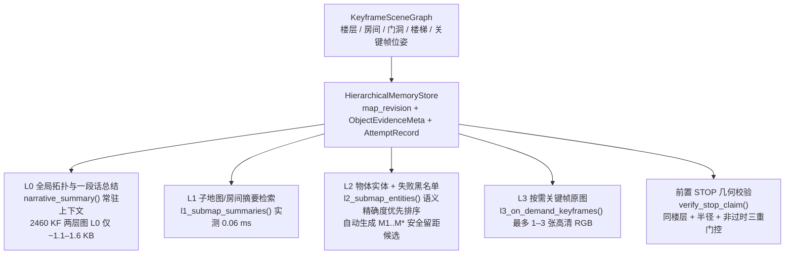

# 03 · L0–L3 层次空间记忆、六分区上下文、30 题消融评测与 0.2 s 流式延迟算力账

> **整理日期**：2026-11-25 · **对应分支**：`feat/static-memory-streaming`（基线 `exp/live-v4-ba-sliding-window` + 完整合流 `feat/semantic-keyframe-graph` 与 `feat/agent-preemptable-active-slam`）
>
> **前序文档**：[01 Skill / Tool 与控制链路](01_skills_tools_and_control_pipeline.md) · [02 实时视频流控制与记忆蓝图](02_streaming_video_control_and_memory_system.md) · [VLN 评测真相与三轴演进总纲](../plan/research/2026-11-vln-perception-memory-strategy-synthesis.md)

---

## 1. 这一阶段把什么真正落地了？

前两篇教程分别梳理了同步探索链路和异步/记忆架构设计。本阶段（`feat/static-memory-streaming`）完成了四件闭环落地工作，全部受 **870+ 项单测与 60 项回归测试** 保护：

1. **三线底座合流**：将 V4 统一目标在线平面 BA（[SLAM 教程 07](../slam-tutorial/07_branch_v4_gravity_and_online_planar_ba.md)）、关键帧锚定 3D 场景图（`scene_graph.py`）和异步可抢占邮箱/哨兵（`llm_agent_client.py` / `sentinel_coordinator.py`）无损合流到同一代码底座。
2. **L0–L3 版本化层次空间记忆（`hierarchical_memory.py`）**：落地一段话自然语言记忆总结、语义精确匹配排序、全局安全留距 `M*` 记忆导航候选、`Attempt & Failure Ledger` 地理黑名单（随回环位姿偏移自动失效），以及前置 `verify_stop_claim` 几何校验。
3. **六分区上下文解耦与 OpenCode Go 双模型 SSE 流式闭环（`streaming_task_agent.py`）**：严格隔离 `[SYSTEM]` / `[SKILL]` / `[TASK]` / `[MEMORY_SUMMARY]` / `[INTERMEDIATE_STATE]` / `[TOOL_RESULTS]`，打通 `qwen3.8-flash`（强视觉主干）+ `deepseek-v4.1-flash (high)`（按需深度回想）+ `glm-5.3-flash`（行进中异步流式哨兵），并在 Isaac Sim 静态闭环拿到首个 `verified_stop_success`。
4. **30 题三梯度任务集与 90 回合消融（`static_task_suite.py`）**：在真实 `D-Indoor-2F`（`2,460 KF / 2 层 / 14 房间 / 20 门洞 / 1 楼梯`）拓扑上完成 3 组记忆策略同台消融，实证量化过时信念门控与全局 `M*` 候选的真实收益。

---

## 2. L0–L3 层次空间记忆与版本失效治理

核心源码：[hierarchical_memory.py](../../src/embodied_navigation/localization_mapping/semantic_mapping/hierarchical_memory.py)（包装 `KeyframeSceneGraph`）。

### 2.1 四项关键工程机制
1. **一段话记忆总结（`narrative_summary`）替代裸 JSON 倾倒**：
   - 主干规划器每步只看一段精炼中文总结（含当前 `map_revision`、楼层/房间/门洞/楼梯数、机器人最近房间、全局命中的目标地标及活跃黑名单数量），并明确提示“需要详细房间物体列表、精确坐标或历史原图时调用 `query_memory` 工具回想”。
   - 避免 `MemoryAgentBench` 揭示的“上下文塞太满导致准确率反降”的记忆税。
2. **多词语义精确度优先排序（`_label_match_score`）**：
   - 修复了单靠任意单词重合导致 `"red fire hose cabinet"` 误匹配更近的 `"red double door"` 的真实检索缺陷：
     - 精确全等（`100`）> 完整子串包含（`50–60`）> 多词召回率 $\ge 50\%$（`20·recall + 10·jaccard`）；
     - 检索 `L2` 与生成 `M*` 候选严格按 `(-match_score, distance_m)` 排序。
3. **全局安全留距 `M1..M*` 记忆候选（`memory_goal_candidates`）**：
   - 不受局部 `8 m` 窗口截断；一旦目标曾在任何楼层/房间被记住且未过时，自动沿“物体 → 机器人”方向后退 `standoff_m`（默认 `1.0 m`）生成安全抵近坐标并置顶为 `M1/M2`，避免机器人试图站进墙体或家具内部。
4. **版本化过时治理与失败地理黑名单（`sync_poses` + `Attempt & Failure Ledger`）**：
   - 后端回环更新位姿调用 `sync_poses(...)` 时自动递增 `map_revision`；若某失败记录锚定关键帧发生 $\ge 0.25\,\text{m}$ 位移，旧黑名单自动标为 `stale=True` 解除误封。
   - 被搬移或复检缺席的物体调用 `mark_object_stale(...)` 标废，`L2` 默认查询与 `verify_stop_claim(require_fresh=True)` 均拒绝依赖过时信念早停。

---

## 3. 六分区上下文解耦与 OpenCode Go 双模型流式链路

核心源码：[llm_agent_client.py](../../src/embodied_navigation/planning/exploration/llm_agent_client.py)、[streaming_task_agent.py](../../src/embodied_navigation/planning/exploration/streaming_task_agent.py)、[sentinel_coordinator.py](../../src/embodied_navigation/planning/exploration/sentinel_coordinator.py)、薄 CLI [scripts/run_static_streaming_task.py](../../scripts/run_static_streaming_task.py)。

### 3.1 六分区 Prompt 架构（最大化 Prefix KV-Cache 命中）

| 分区 | 所在消息角色 | 变化频率 | 承载内容 |
| :--- | :---: | :---: | :--- |
| `## [SYSTEM]` | `system` | 全程不变 | 角色定位、七层安全边界（禁止虚构坐标/读真值）、单行 JSON 动作契约 |
| `## [SKILL]` | `system` | 全程不变 | 6 条导航与记忆技能（优先 `M*`、探索 `F*/W*`、按需 `query_memory`、视觉地标上报、脱困/爬楼 `maneuver`、主动 `stop_claim`） |
| `## [TASK]` | `user` | 单任务不变 | 自然语言任务指令、`target_label`、同楼层与 `stop_radius_m` 验收口径 |
| `## [MEMORY_SUMMARY]` | `user` | 随建图缓变 | `narrative_summary()` 输出的**一段话**全局空间记忆总结 |
| `## [INTERMEDIATE_STATE]` | `user` | 每步实时更新 | 当前步号、位姿/航向、已行里程、过滤黑名单后的 `M*` + `F*/W*` 候选表 |
| `## [TOOL_RESULTS]` | `user` | 每步实时更新 | 上一步邮箱动作回执 + 最近一次 `query_memory` 工具回想到的 L1/L2/L3 结构化结果 |

### 3.2 OpenCode Go 协议与流式坑修复
- **端点与官方会话缓存**：`opencode` / `opencode_go` preset 指向 `https://opencode.ai/zen/go/v1`，按官方要求自动注入稳定会话 UUID 头 `x-opencode-session`（用于路由会话亲和与 Prompt Caching）和显式 `User-Agent`。
- **零明文泄露凭据回退链**：显式参数 → 环境变量 `OPENCODE_API_KEY` → 文件指针 `OPENCODE_API_KEY_FILE` → OpenCode 标准 XDG 存储 `$XDG_DATA_HOME/opencode/auth.json`；`repr()` 与 `to_safe_dict()` 严格脱敏。
- **嵌套 JSON 提前截断修复（`_extract_outer_json_object`）**：当规划器输出含嵌套 `observed_objects: [{...}]` 的 JSON 时，普通正则会在第一个内层 `}` 误触发 SSE 断流；改为维护字符串转义感知的顶层大括号深度计数器，直到外层 `depth == 0` 才结束流式读取。
- **双模型分工**：
  - **视觉主干**：`qwen3.8-flash`（`enable_thinking: False`，强视觉定位，实测 `4.7–8.2 s`）；
  - **深度思考回想**：`deepseek-v4.1-flash / deepseek-v4-pro`（`--thinking-mode high`，实测在两层先验记忆中 `8.18 s` 主动先调 `query_memory` 查 1 层路线再规划）；
  - **行进中异步流式哨兵**：`glm-5.3-flash`（`thinking: disabled`，实测 `p50 = 3.73–3.82 s / p95 = 4.69–4.86 s`，49 + 13 次实机调用 0 超时，已实盘触发 `action_epoch: 0 → 1` `PREEMPT` 抢占）。

---

## 4. 实测验证结果（严格区分实时物理闭环与离线 30 题记忆消融）

### 4.1 实时 Isaac Sim + V4 BA 物理闭环（静态寻物验收）
- **产物路径**：`$PROJECT_DATA_ROOT/embodied-navigation/runs/20261125-static-streaming-task/static_task_qwen_20261125T085027Z/`
- **实测过程**（`qwen3.8-flash` 主干 + `glm-5.3-flash` 异步哨兵 + V4 在线 BA `--backend-pose`）：
  - Step 1 识别 `5.0 m` 处 `red double door` 写入 3D 记忆并前进至 `[2.79, 0.17, 0.01]`；
  - Step 2–3 从一段话记忆摘要自动生成 `M1` 抵近候选，连续两次 `goto_candidate M1` 精准走至门前 `[3.74, -0.11, 0.01]`；
  - Step 4 视觉确认 `1.28 m, 0.0°` 处为目标双开门，调用 `stop_claim("door")` 并通过 `verify_stop_claim`（`allowed=True, same_floor=True, evidence_stale=False`），**4 步 / `82.56 s` 达成 `verified_stop_success`，`0` 失败、`0` fallback、安全停车 `exit 0`**。

### 4.2 30 题三梯度 × 3 组记忆消融（90 个真实 `qwen3.8-flash` 回合）
- **评测脚本**：[scripts/eval_static_task_suite.py](../../scripts/eval_static_task_suite.py)（基于 `D-Indoor-2F` `2,460 KF / 2 层 / 14 房间 / 20 门洞 / 1 楼梯` 拓扑，采用房间图测地最短路计算诚实 `SPL`）
- **产物路径**：`$PROJECT_DATA_ROOT/embodied-navigation/runs/20261125-static-task-suite-30/qwen38_flash_30tasks_ablation.json`

| 记忆策略模式（每组 30 题） | 总 SR | Tier 1 单层 (10) | Tier 2 多目标链 (10) | Tier 3 跨层+对抗 (10) | 总 SPL | `OSR − SR` | 过时记忆误停 | 平均步数 | 延迟 p50 |
| :--- | :---: | :---: | :---: | :---: | :---: | :---: | :---: | :---: | :---: |
| **`hierarchical_6zone`（完整方案）** | **96.7%** (`29/30`) | 90.0% | **100.0%** | **100.0%** | **0.919** | `0.033` | **0 / 3** | **3.13** | `4.64 s` |
| **`stale_unfiltered`（无过时过滤）** | **86.7%** (`26/30`) | 90.0% | 100.0% | **70.0%** | **0.823** | `0.033` | **3 / 3（100%）** | 3.10 | `4.68 s` |
| **`no_memory_targets`（无 `M*` 直达）** | **0.0%** (`0/30`) | 0.0% (`OSR 30%`) | 0.0% | 0.0% (`OSR 40%`) | **0.000** | `0.233` | 0 | **8.20**（`20` 次回想） | `4.97 s` |

> **口径边界说明**：本 30 题基准为**离线拓扑记忆与决策评测**，用于无物理随机干扰地定量验证记忆表达、检索与过时治理；真实物理碰撞、足式爬楼与实时定位抖动仍须由 Isaac Sim 物理闭环独立验收。

---

## 5. 流式调用要达到 `0.2 s`（200 ms）端到端延迟，模型到底要多快 `token/s`？

单看 `token/s` 会掉进误区。一次端到端流式调用的真实延迟必须拆成四段：

$$T_{\text{total}} = T_{\text{net}} + T_{\text{vision}} + T_{\text{prefill}} + \frac{N_{\text{out}}}{R_{\text{decode}}}$$

### 5.1 为什么任何公网云端 API 物理上都做不到 `0.2 s`？
我们在本机对 OpenCode Go 做了最小化纯文本流式拆解实测（提示 ~`214 tok`、0 图片、输出 ~`15–28 tok`）：
- `qwen3.8-flash`：`TCP+TLS = 250 ms`、`TTFT = 3,274 ms`、`Decode = 384 ms`、总计 `3,658 ms`；
- `glm-5.3-flash`：`TCP+TLS = 234 ms`、`TTFT = 3,102 ms`、`Decode = 269 ms`、总计 `3,371 ms`。

**结论**：哪怕云端解码速度达到 $\infty\;\text{token/s}$，仅跨网建连（`~240 ms`）与云端网关排队/预填充（`~3,000 ms`）就已远超 `200 ms` 红线。**要做到 `0.2 s` 级流式响应，必须采用本地/局域网常驻推理（HTTP Keep-Alive / IPC，$T_{\text{net}} \le 5\,\text{ms}$）+ Prefix KV-Cache 复用。**

### 5.2 本地部署下，不同输出负载达成 `200 ms` 所需的最低 `token/s`

| 流式场景 | 输入构成（命中固定前缀 KV-Cache） | $T_{\text{net}} + T_{\text{vision}} + T_{\text{prefill}}$ 估算 | 留给 Decode 的时间 | 输出长度 $N_{\text{out}}$ | **所需最低 $R_{\text{decode}}$** | 本机 RTX 5070 Ti（16 GB, ~896 GB/s）可行性 |
| :--- | :--- | :---: | :---: | :---: | :---: | :--- |
| **A. 首 Token / 极简哨兵拦截**（如仅输出 `{"act":"STOP","id":null}`，去掉 `reason`） | 1 张 `336×336` RGB（~144–256 视觉 tok）+ ~180 增量状态 tok | `40 – 75 ms` | `125 – 160 ms` | `8 – 12 tok`（首动作仅 `4–5 tok`） | **`50 – 96 token/s`**（首动作抢占仅需 **`30 – 40 token/s`**） | **完全可行**：`3B–4B INT4/FP4` VLM 实测可达 `200–320 tok/s`（占 `3–4 GB` 显存，全链路 **`100–150 ms`**）；`7B–8B INT4` 可达 `100–150 tok/s`（卡在 **`160–210 ms`**） |
| **B. 带短理由的完整哨兵 JSON** | 同上 | `50 – 85 ms` | `115 – 150 ms` | `20 – 30 tok` | **`135 – 260 token/s`** | **仅 `3B–4B INT4/FP4` 可达**；`7B+` 会落到 `250–350 ms` |
| **C. 主干规划器全量 JSON**（含 `observed_objects` + `reason` + 2 张图） | 2 张 `512×512` 图（~512–1024 视觉 tok）+ ~300 增量状态 tok | `70 – 120 ms` | `80 – 130 ms` | `60 – 90 tok` | **`460 – 1,125 token/s`** | **单卡消费级 GPU 无法达成**（除非 `≤1.5B` 专用模型 + 投机解码或专用推理芯片） |

### 5.3 工程落地的正确架构结论
不要强求云端大模型或完整规划器压进 `0.2 s`，而应坚持**三层频率解耦**：
- **System 0（`50 Hz / 20 ms`）**：PCT / SCAN / `RouteTracker` / `MoE-CTS` 纯数值闭环安全控制；
- **System 1（`5 Hz / ≤ 200 ms`，本地小模型）**：后续若需 `0.2 s` 级实时流式拦截，在本地部署 **`3B–4B INT4/FP4` VLM**（如 `Qwen2.5-VL-3B` / `InternVL-2B/4B` + SGLang/vLLM/TensorRT-LLM + Prefix Cache），**输出砍掉 `reason`、只吐 `8–12 tok` 枚举动作**（甚至 4–5 tok 首动作提前触发抢占），在 RTX 5070 Ti 上即可稳定压进 `120–180 ms`；
- **System 2（`0.1–0.25 Hz / 4–8 s`，云端强模型）**：继续用 OpenCode Go `qwen3.8-flash` / `deepseek-v4.1-flash (high)` 负责长程语义理解、地标入库、跨楼层记忆回想与复杂规划。
