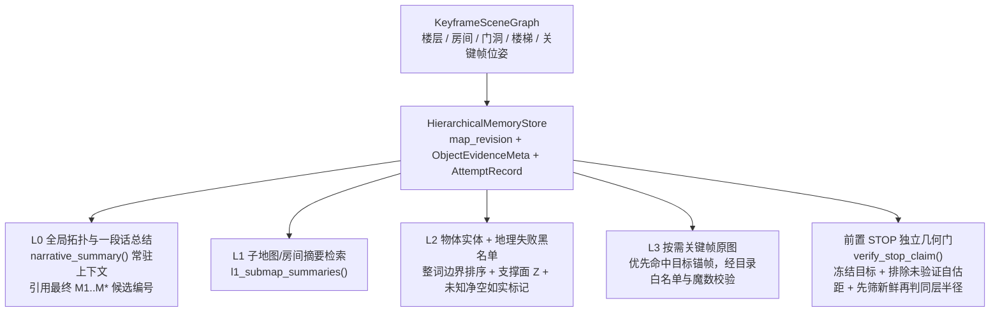

# 03 · L0–L3 层次空间记忆、六分区上下文、公平 30 题消融与 0.2 s 流式延迟预算

> **整理日期**：2026-11-25 · **对应分支**：`feat/static-memory-streaming`（基线 `exp/live-v4-ba-sliding-window` + 完整合流 `feat/semantic-keyframe-graph` 与 `feat/agent-preemptable-active-slam`，已按 `gpt-6.2-astra` 审查完成全部 P0/P1/P2 修复与复验）
>
> **前序文档**：[01 Skill / Tool 与控制链路](01_skills_tools_and_control_pipeline.md) · [02 实时视频流控制与记忆蓝图](02_streaming_video_control_and_memory_system.md) · [VLN 评测真相与三轴演进总纲](../plan/research/2026-11-vln-perception-memory-strategy-synthesis.md)

---

## 1. 这一阶段把什么真正落地了？

本阶段（`feat/static-memory-streaming`）完成四项闭环落地并通过 **`904` 项单元测试与 `60` 项回归测试** 保护：

1. **三线底座合流**：将 V4 统一目标在线平面 BA（[SLAM 教程 07](../slam-tutorial/07_branch_v4_gravity_and_online_planar_ba.md)）、关键帧锚定 3D 场景图（`scene_graph.py`）和异步可抢占邮箱/哨兵（`llm_agent_client.py` / `sentinel_coordinator.py`）无损合流到同一底座，并消除有序邮箱 `inbox` 与 `request.json` 镜像间的跳序窗口及 PCT 重试节流前的冗余点云拷贝。
2. **L0–L3 版本化层次空间记忆（`hierarchical_memory.py`）**：落地一段话自然语言记忆总结、整词边界语义排序、全局支撑面安全留距 `M*` 记忆候选、地理/非地理失败分离的 `Attempt & Failure Ledger`（支持 SE(3) 锚点重投影与累计漂移失效）、以及前置独立证据 `verify_stop_claim` 门控。
3. **六分区上下文解耦与可替换主干 + 并行哨兵（`streaming_task_agent.py`）**：严格隔离 `[SYSTEM]` / `[SKILL]` / `[TASK]` / `[MEMORY_SUMMARY]` / `[INTERMEDIATE_STATE]` / `[TOOL_RESULTS]`；在线主干使用冻结任务目标 + 实测 `height_chart_*.npz` LiDAR 射线独立测距作为 STOP 几何依据，并行哨兵真实携带在线 `front_rgb` 与有界 `memory_l0`，且 `STOP / PREEMPT / SPIN` 全部闭合到邮箱回执。
4. **修复版 30 题公平评测基准（`static_task_suite.py`）**：在真实 `D-Indoor-2F`（`2,460 KF / 2 层 / 14 房间 / 20 门洞 / 1 楼梯`）拓扑上，使用**私有真值与先验记忆分离**、**真实门洞/楼梯折线可达路径（断图禁瞬移）**和**单变量控制消融**，并将两个无模型确定性图搜索策略纳入正式对照基线。

---

## 2. L0–L3 层次空间记忆与版本失效治理

核心源码：[hierarchical_memory.py](../../src/embodied_navigation/localization_mapping/semantic_mapping/hierarchical_memory.py)（包装 `KeyframeSceneGraph`）。

### 2.1 关键工程与安全契约
1. **一段话记忆总结与 `M*` 候选严格对齐**：
   - `narrative_summary()` 直接复用 `memory_goal_candidates()` 的最终排序结果并引用 `M1..M*` 编号，避免摘要二次排序导致上下文和候选表错位。
   - `M*` 候选的目标高度 `z` 取锚点关键帧/所属房间的可行走支撑面高度，净空未知时如实标为 `clearance_m=None, clearance_known=False, turn_safe=None`，交由下游 PCT/SCAN 做运动准入。
2. **整词边界语义匹配与严格 STOP 验收**：
   - `_label_match_score` 与 `_label_strict_match` 均基于完整词边界匹配（避免 `"board"` 误匹配 `"cardboard"`）。
   - `verify_stop_claim` 冻结任务 `target_label` / 显式 `target_aliases`，排除未验证的纯 VLM 估距（`excluded_producers=("opencode_vlm_unverified",)`），先筛选新鲜有效证据再在同楼层中取最近距离；请求物体目标时绝不回退到房间占用放行。
3. **SE(3) 锚点重投影与地理/非地理失败分离**：
   - 仅导航类地理失败（`stuck`、`timeout`、`failed`、几何 `rejected`）进入地理黑名单；`stop_claim` 拒绝、`cancelled` 及 `stale_action_epoch` 等协议拒绝记入尝试日志但**不污染黑名单**。
   - 失败记录保存创建时的锚点局部坐标 `anchor_local_xyz` 与原始世界坐标 `recorded_goal_xyz`；后端回环调用 `sync_poses(...)` 时按完整 SE(3) 重投影计算累计位移（可捕获纯 180° 旋转与多次小幅累计漂移），重复调用相同位姿保持幂等。
4. **跨信任边界与持久化安全**：
   - 外部图像（含 `--prior-memory` L3 `rgb_path`）必须通过 `validate_image_path` 的软链解析、允许目录白名单（`--prior-evidence-root` 显式授权）、10 MB 上限与 PNG/JPEG/WEBP 真实魔数校验。
   - 换主机覆盖 `base_url` 时禁止自动附带原 preset 凭据；非 `localhost` 的明文 `http://` 拒绝发送云端 `api_key`；HTTP 错误正文绝不写入异常、决策 `reason` 或任务报告。
   - 记忆与报告持久化均复用 `atomic_write_json`（先原子落盘版本化记忆，再原子发布引用该 `map_revision` 的报告）。

---

## 3. 六分区上下文解耦与可替换主干 + 并行哨兵链路

核心源码：[llm_agent_client.py](../../src/embodied_navigation/planning/exploration/llm_agent_client.py)、[streaming_task_agent.py](../../src/embodied_navigation/planning/exploration/streaming_task_agent.py)、[sentinel_coordinator.py](../../src/embodied_navigation/planning/exploration/sentinel_coordinator.py)、薄 CLI [scripts/run_static_streaming_task.py](../../scripts/run_static_streaming_task.py)。

### 3.1 六分区上下文布局

| 分区 | 所在消息角色 | 变化频率 | 承载内容 |
| :--- | :---: | :---: | :--- |
| `## [SYSTEM]` | `system` | 全程不变 | 角色定位、七层安全边界、单行顶层 JSON 契约 |
| `## [SKILL]` | `system` | 全程不变 | 6 条导航与记忆技能（优先 `M*`、探索 `F*/W*`、按需 `query_memory`、地标上报、脱困 `maneuver`、主动 `stop_claim`） |
| `## [TASK]` | `user` | 单任务不变 | 任务指令、冻结 `target_label`、同楼层与 `stop_radius_m` 验收口径 |
| `## [MEMORY_SUMMARY]` | `user` | 随建图缓变 | `narrative_summary()` 输出的一段话全局空间记忆总结 |
| `## [INTERMEDIATE_STATE]` | `user` | 每步更新 | 步号、经鲜度校验的实时位姿/航向、已行里程、过滤黑名单后的候选表（全拦时不回退可执行黑名单） |
| `## [TOOL_RESULTS]` | `user` | 每步更新 | 上一步动作回执 + 最近一次本地 `query_memory` 回想到的 L1/L2/L3 结果 |

> **实现边界说明**：CLI 每次启动绑定**一个可替换主干模型**（如 `qwen3.8-flash` 视觉主干或 `deepseek-v4.1-flash --thinking-mode high` 深度思考主干）加**一个可选并行哨兵**（如 `glm-5.3-flash`）；`query_memory` 在本地内存执行，不存在运行期自动跨模型动态路由；`x-opencode-session` 请求头已按官方要求携带，实际前缀缓存加速收益尚待冷暖请求对比测试单独量化。

### 3.2 流式解析与回执闭合关键修复
- **严格顶层 JSON 与单调绝对期限**：SSE 流式解析只认 `_extract_outer_json_object` 闭合后的顶层对象，截断流或解析异常返回无移动 `noop`（绝不从内层 `observed_objects` 误提动作，也不盲走 `M1`）；单调绝对 `deadline` 覆盖建连、响应头与 `readline()` 全程。
- **独立 LiDAR 测距投影**：在线视觉上报的 `observed_objects` 自动对当前快照的 `height_chart_*.npz`（`0.05 m` 去畸变 LIO 占据栅格）沿相机方位角做射线测距；命中实测障碍物时标记 `producer="vlm_lidar_grounded"`、`range_source="height_chart_lidar_raycast"` 并记录 `evidence_frame` 与 `evidence_stamp_s`；无实测支撑时标为 `opencode_vlm_unverified`，禁止用于 `stop_claim` 自证。
- **哨兵回执闭合与竞态消除**：行进等待循环中严格**先 `poll_and_dispatch()` 消费已完成判决，再按周期 `submit_observation()`**；实时帧统一读取 `latest_sim_frame()["latest"]`，且 `build_visual_first_messages` 实际序列化有界 `memory_l0`（`<= 1 KB`）；哨兵触发 `STOP` 时立即锁死主循环并同步等待 `stop_accepted`，触发 `PREEMPT / SPIN` 时切换到新 `seq / action_epoch` 继续跟踪直到终态回执。

---

## 4. 修复后实测验证结果（严格区分实机物理闭环与离线公平基准）

### 4.1 实时 Isaac Sim + V4 BA 物理闭环（两轮独立实盘验证）

1. **实盘 A · 视觉哨兵闭环与安全停车锁死验证**：
   - 产物：`$PROJECT_DATA_ROOT/embodied-navigation/runs/20261125-static-streaming-task/static_task_qwen_verified_20261125T105150Z/`
   - 配置：`qwen3.8-flash` 主干 + `glm-5.3-flash` 并行哨兵 + V4 在线 BA `--backend-pose`
   - 实证结果：
     - 哨兵真实收到在线图像与拓扑摘要（`last_request_modalities: {"has_memory_l0": true, "images": ["front_rgb"], "l0_rev": 0}`，`10` 次调用 `0` 超时，`p50 = 3.76 s`）；
     - Step 1 目标 `red double door` 经独立 LiDAR 射线测距入库（`producer="vlm_lidar_grounded"`, `range_source="height_chart_lidar_raycast"`, `[8.33, -1.86]`）；
     - Step 2 哨兵基于实时前视画面主动下发 `STOP`（`seq=3, action_epoch=1`），主循环立即锁死（`terminal_status="sentinel_stop_locked"`），同步收到 `stop_accepted` 回执后干净退出（`CAPTURE_EXIT=0`）。

2. **实盘 B · 独立 LiDAR 测距 STOP 端到端成功验收**：
   - 产物：`$PROJECT_DATA_ROOT/embodied-navigation/runs/20261125-static-streaming-task/static_task_qwen_lidar_stop_20261125T105416Z/`
   - 配置：`qwen3.8-flash` 主干 + V4 在线 BA `--backend-pose`（`stop_radius_m = 1.5`）
   - 实证结果：
     - 机器人从 `[0.01, 0.01, 0.01]` 实走 **`7.22 m`** 抵近至 `[7.22, -0.12, 0.02]`（修复前仅走到 `3.74 m` 即靠 VLM 自猜 `1.28 m` 早停）；
     - Step 4 前视 `rgb.png` 近距离正对红色双开门及推杆，通过独立 LiDAR 测距校验（`distance_m = 1.178 m <= 1.5 m`, `range_source = "height_chart_lidar_raycast"`, `evidence_frame = "map"`, `evidence_stamp_s = 6.975`, `same_floor = True`）；
     - **4 步 / `87.22 s` 达成 `verified_stop_success`**，`0` 失败、`0` fallback，退出清理同步取得 `stop_accepted`（`seq=4`），`CAPTURE_EXIT=0`。

### 4.2 修复版 30 题公平离线评测（独立私有真值 + 门户路径 + 单变量消融）

- **评测脚本**：[scripts/eval_static_task_suite.py](../../scripts/eval_static_task_suite.py)（基于 `D-Indoor-2F` 真实拓扑，私有真值与先验记忆分离；含 4 题未重访搬移题、3 题未发现探索题、3 题黑名单绕行题与 10 题跨层/双目标题；断图不可达返回 `unreachable` 且路程不增长；解析/API 失败记 `fallback_noop` 不盲走 `M1`）
- **产物路径**：`$PROJECT_DATA_ROOT/embodied-navigation/runs/20261125-static-task-suite-30/qwen38_flash_30tasks_fair_ablation_v2.json`

| 对照组 / 消融模式（每组 30 题） | 总 SR | 无回退 SR | T1 已知 (10) | T2 治理+探索 (10) | T3 跨层 (10) | OSR | 总 SPL | 过时误停 | 回退步数 | 单请求 p50 / p95 |
| :--- | :---: | :---: | :---: | :---: | :---: | :---: | :---: | :---: | :---: | :---: |
| `baseline: det_m1_greedy`（无模型 BFS） | `100.0%` | `100.0%` | `100%` | `100%` | `100%` | `100.0%` | `0.758` | `0` | `0` | `1 / 1 ms` |
| `baseline: det_recall_goto_xyz`（无模型） | `100.0%` | `100.0%` | `100%` | `100%` | `100%` | `100.0%` | `0.725` | `0` | `0` | `1 / 1 ms` |
| **`mode: hierarchical_6zone`（完整方案）** | **`76.7%`** (`23/30`) | `70.0%` | **`100%`** | **`60%`** | `70%` | `83.3%` | **`0.690`** | **`0`** | `12` | `3.23 / 5.53 s` |
| `mode: no_m_candidates`（仅去 `M*` 候选） | `13.3%` (`4/30`) | `6.7%` | `0%` | `30%` | `10%` | `33.3%` | `0.110` | `0` | `269` | `3.41 / 25.02 s` |
| `mode: no_stale_gate`（仅关过时门） | `73.3%` (`22/30`) | `70.0%` | `100%` | **`40%`** | `80%` | `80.0%` | `0.684` | **`6`** | `3` | `3.26 / 5.21 s` |
| `mode: no_blacklist_gate`（仅关黑名单） | `80.0%` (`24/30`) | `73.3%` | `100%` | `60%` | `80%` | `86.7%` | `0.723` | `0` | `6` | `3.08 / 5.90 s` |

**诚实结论与局限性解读**：
1. **结构化空间落地（`M*` 候选）收益显著**：在保留完全相同一段话记忆摘要与 `query_memory` 工具的前提下，仅去掉 `M*` 候选，`qwen3.8-flash` 成功率从 **`76.7%` 骤降至 `13.3%`**（且出现 `269` 次超时/解析失败），说明当前轻量 VLM 很难仅靠自由文本坐标可靠下发 `goto_xyz`，将记忆实体投影为结构化安全留距候选是高价值的工程设计。
2. **过时信念门控把搬移误停从 `6` 次清零至 `0` 次**：关闭 `stale_gate` 后，6 道搬移未重访题全部在旧位置误停（T2 SR 从 `60%` 降至 `40%`）；开启后误停降为 `0`。
3. **当前短板已暴露清晰**：在未发现/搬移后的未知房间搜索题中，`qwen3.8-flash`（`76.7%`）显著落后于自带图遍历记忆的确定性 BFS 基线（`100%`），主要因为 LLM 在多房间搜索时容易重复进出已访房间；后续在 `[INTERMEDIATE_STATE]` 中显式提供房间访问计数/未访前沿优先级即可针对性补强。
4. **`no_blacklist_gate` 与完整方案差距在 1 题随机波动内**（`24/30` vs `23/30`）：原因是已知目标 `M1` 本身优先级高于陷阱 `W1`，模型未主动选择 `W1`，本基准尚不足以单独证明黑名单在大规模真实窄道中的全部收益（窄道避障需结合实机物理探索验证）。

---

## 5. 流式调用达到 `0.2 s`（200 ms）延迟的理论容量预算与链路瓶颈

### 5.1 延迟公式与吞吐边界
单次模型请求从发起到生成 $N$ 个输出 token 的耗时可近似写为：
- 若固定开销 $T_f$ **止于首个输出 token 生成前**（网络传输 + 视觉编码 + 文本 Prefill），则所需最低解码速率：
  $$R_{\min} = \frac{N}{0.200 - T_f}$$
- 若使用客户端实测、**已包含首 token 到达**的 `TTFT`（其中已覆盖本次请求的 `TCP/TLS` 与首 token 生成），则剩余解码耗时约为 $(N-1)/R_{\text{decode}}$。

### 5.2 关于云端实测与不同通道差异的客观说明
- 此前在 OpenCode Go 通道上对短提示纯文本流式做的两次采样中：`qwen3.8-flash` 实测 `TTFT = 3,274 ms`、`Decode = 384 ms`（总 `3,658 ms`，其中 `TCP+TLS = 250 ms` 已计入 `TTFT`）；`glm-5.3-flash` 实测 `TTFT = 3,102 ms`、`Decode = 269 ms`（总 `3,371 ms`，`TCP+TLS = 234 ms`）。
- **重要纠偏**：这两次采样只说明 OpenCode Go 当下网关排队/限速明显超出 `200 ms` 预算，**不能推出“所有公网 API 物理上都做不到”**。例如在解码速度维度，**本机实测 DSH 通道已经可以达到 `133–261 token/s`**，而 OpenCode Go 侧 DeepSeek 变慢主因是网关限速与队列延迟。要评估具体云端或本地服务能否达标，必须以实际 Keep-Alive 连接下的冷/暖启动 `TTFT` 与持续负载分位数为准。

### 5.3 本地推理容量预算表（理论推算，待本机实测标定）

下表保留为**单次模型调用的理论吞吐预算**（假设局域网/本地 Keep-Alive 常驻，$T_f$ 为首 token 前固定开销）：

| 负载档位 | 输出长度 $N$ | 假设固定开销 $T_f$ | 留给解码时间 | 理论所需最低 $R_{\min}$ | 说明（非本机实测值） |
| :--- | :---: | :---: | :---: | :---: | :--- |
| **A1. 动作前缀抢占**（需流式前缀触发器） | `4 – 5 tok` | `40 – 75 ms` | `125 – 160 ms` | **`25 – 40 token/s`** | 当前哨兵仍等待完整 JSON，前缀触发入口尚未实现 |
| **A2. 极简哨兵 JSON**（去 `reason`） | `8 – 12 tok` | `40 – 75 ms` | `125 – 160 ms` | **`50 – 96 token/s`** | 轻量量化 VLM（如 `3B–4B`）理论容量区间，待 RTX 5070 Ti 实测冷暖 p50/p95 |
| **B. 带短理由哨兵 JSON** | `20 – 30 tok` | `50 – 85 ms` | `115 – 150 ms` | **`133.3 – 260.9 token/s`** | 仅解码速率一项，DSH 等高速通道已可达该区间；端到端 `200 ms` 仍受限于 `TTFT` |
| **C. 主干规划器全量 JSON** | `60 – 90 tok` | `70 – 120 ms` | `80 – 130 ms` | **`461.5 – 1,125 token/s`** | 单卡消费级 GPU 难以在 `200 ms` 内完成，应留在慢速 System 2 |

### 5.4 从“模型推理 200 ms”到“机器人闭环 200 ms”的系统工程缺口
对机器人控制真正有意义的验收量是 **`控制器接受动作时刻 − 传感器采样时刻`**，除模型推理外还包含：
1. 等待下一帧哨兵采样（当前默认 `sentinel_poll_interval_s = 4.0 s`）；
2. 图像落盘/读取与 Base64 编码；
3. 主循环判决轮询间隔（当前已从 `250 ms` 压至 `100 ms`）与邮箱文件消费；
4. 当前哨兵解析器等待完整 JSON 对象闭合，尚无 4–5 token 前缀抢占执行入口。

因此，**坚持 System 0（`50 Hz` 纯数值安全控制）/ System 1（高频本地轻量哨兵 + 压缩采样/轮询/前缀触发）/ System 2（慢速强语义主干）三层解耦**仍是正确路线；在完成本地 GPU 同一模型/量化/图像负载的端到端传感器到回执 p50/p95 实测前，不宣称硬件已达标。
