# Phase 4 SLAM 后端各分支机制、参数配比与数学公式手册

> **盘点日期**：2026-11-22  
> **覆盖分支**：`main` 旧默认基线（`B0_default`）、`exp/slam-backend-stabilization`（`2b77a5d`）以及 3 个正交 v2 分支（`exp/slam-v2-measured-submaps@59c60a4`、`exp/slam-v2-surface-gate@0e98406`、`exp/slam-v2-visual-retrieval@2aeea82`）。  
> **代码路径约定**：下文 `backend/` 均指 `src/embodied_navigation/localization_mapping/backend/`；完整 30 组干净对照（`dirty=False`、统一机身原点）见 [experiments/slam-backend-phase4/REPORT.md](../../experiments/slam-backend-phase4/REPORT.md)。

---

## 1. 总体架构与正交分层

五个方案共享同一套 `SlamBackend` 主链路，只在**互不重叠（或显式解耦）**的环节介入：

```mermaid
flowchart LR
    KF["Keyframe\n(T_odom_body, LiDAR, optional RGB)"] --> ZUPT["① B3 纯传感器 ZUPT\n(backend.py)"]
    ZUPT --> PG_ADD["插入节点 + 里程计/ZUPT边\n(+可选图重力先验)"]
    PG_ADD --> B1["② B1 回环节流门\n(travel / spacing / ZUPT)"]
    B1 --> RET["③ 候选检索\nScanContext (+视觉全局检索)"]
    RET --> SUB["④ 点云构造\n单帧 vs 实测多帧子图"]
    SUB --> ICP["⑤ 粗-精点对面 ICP\n(+B2 重力先验 / 质心居中)"]
    ICP --> GATE["⑥ 几何与语义准入门\nB2倾角门 / 里程预算 / 表面门 / 视觉3D验证"]
    GATE --> OPT["⑦ 回环触发全图稀疏 LM\n(精确 SE(3) 雅可比 + Cauchy)"]
    OPT --> ADM["⑧ CorrectionAdmission\n时间窗 + 跳变门 -> 经确认发布 C"]
```

> **重要边界**：离线评测中的 `Online` 指标是每关键帧同步 `ingest` 完成后采得的**离线关键帧因果估计**，不包含实时 ROS 发布延迟；当前 `scripts/run_dynanav_native_exploration.sh` 未传 `--config`（默认实例化 `BackendConfig()`），且导航端当前订阅原始里程计。

---

## 2. 公共底座：`B0_default` / `B0_aniso`（`main` 及稳定化基础求解器）

### 2.1 位姿图（`backend/pose_graph.py`）
- **状态与扰动**：节点 $i$ 维护 $T_i = T_{w,b_i} \in SE(3)$，首节点 $T_0$ 固定（Gauge）。切向量排序为 $\xi = (\rho, \phi)^\top \in \mathbb{R}^6$（前 3 维平移，后 3 维旋转），右乘更新 $T_i \leftarrow T_i \exp(\delta_i^\wedge)$。
- **边残差与精确 SE(3) 雅可比**：对边 $(a, b, Z_{ab})$，令 $E = Z_{ab}^{-1} T_a^{-1} T_b$，残差 $e_{ab} = \log(E) \in \mathbb{R}^6$。右扰动下的精确导数为：
  $$J_b = \frac{\partial e_{ab}}{\partial \delta_b} = \mathcal{J}_r^{-1}(e_{ab}), \qquad J_a = \frac{\partial e_{ab}}{\partial \delta_a} = -\mathcal{J}_r^{-1}(e_{ab})\,\mathrm{Ad}(T_b^{-1} T_a)$$
  其中 $\mathcal{J}_r^{-1}(\xi)$ 采用 Barfoot 闭式分块上三角公式并在 $\|\phi\| < 10^{-2}$ 时切换高阶泰勒展开，避免数值消去。
- **各向异性信息矩阵**（`backend.py:anisotropic_information`）：
  $$\Omega = \mathrm{diag}\!\left(\frac{1}{\sigma_{xy}^2},\;\frac{1}{\sigma_{xy}^2},\;\frac{1}{\sigma_{z}^2},\;\frac{1}{\sigma_{rp}^2},\;\frac{1}{\sigma_{rp}^2},\;\frac{1}{\sigma_{\text{yaw}}^2}\right)$$
- **Cauchy 鲁棒核与 IRLS**：令马氏距离平方 $s = e^\top \Omega e$，尺度 $c = \texttt{cauchy\_scale}$：
  - 普通边代价：$J_{\text{ord}} = s$；
  - 鲁棒回环边代价：$J_{\text{rob}}(s) = c^2 \ln\!\left(1 + \frac{s}{c^2}\right)$，IRLS 权重 $w(s) = \frac{1}{1 + s/c^2}$。
  - 求解采用稀疏阻尼正规方程 $(H + \lambda\,\mathrm{diag}(H))\Delta = -g$（初始 $\lambda = 10^{-4}$，成功 $\lambda / 10$，失败 $10\lambda$，最多 20 轮）。
- **SO(3) 投影**：`project_so3(R)` 用 SVD $U V^\top$ 修正旋转矩阵并在 $\det < 0$ 时翻转 $U$ 末列。

### 2.2 ScanContext 检索 + 质心居中点对面 ICP（`scan_context.py`, `registration.py`）
- **ScanContext**：将车身系点云按 `20` 环 × `60` 扇区（半径 `25 m`）编码为最大高度网格（下限截断为 `0`，即非负高度），用 ring-key 预筛前 `50` 名，再取余弦距离最小的 `5` 个候选（阈值 `max_scan_context_distance = 0.3`）。
- **质心居中点对面 ICP**：将目标点云平移至局部质心 $c = \bar{q}$ 构造 $q_c = q - c$ 与 $T_c$，在局部中心系下线性化左扰动 $r_i = n_i^\top (\exp(\delta^\wedge) T_c p_i - q_{c,i})$，单点雅可比 $J_i = [n_i^\top,\; (p'_i \times n_i)^\top]$。退化检查对旋转列按点云 RMS 半径缩放做无量纲特征值比判定（$\lambda_{\min} \le 10^{-9}\lambda_{\max}$ 拒收），保证算法对任意世界原点平移不变。默认粗/精两阶段（体素 `0.50 / 0.25 m`，对应半径 `2.5 / 0.6 m`，准入门 `fitness >= 0.4`、`rmse <= 0.25 m`）。

### 2.3 里程计一致性预算与时间窗准入（`backend.py`, `correction.py`）
- **候选级里程预算**：按单调不减累计里程差 $d = L(k_{\text{curr}}) - L(k_{\text{cand}})$ 构造预算：
  $$\Delta t_{\max}(d) = 0.5 + 0.15\,d,\qquad \Delta \theta_{\max}(d) = 0.2 + 0.02\,d$$
  在候选排序**之前**对每个候选逐一检查，避免最优候选超预算时丢弃合格次优候选。
- **CorrectionAdmission**：比较当前机身位姿处的修正差 `pose_difference(C1 @ T_odom_body, C2 @ T_odom_body)`。要求时间戳非倒退（$0 \le \Delta t \le 10\text{ s}$）、单次跳变门（建图 `1.0 m / 0.35 rad`，首次跳变参考在 `backend.py:878` 启用 ZUPT 建图时传入）与时间窗内 `confirmations` 个**两两互一致**候选确认（`0.15 m / 0.05 rad`），确认后直接替换发布的 $C = T_{w,o}$。

### 2.4 `B0_default` vs `B0_aniso` 参数对比

| 参数 | `B0_default` (`BackendConfig()`) | `B0_aniso` (`slam_backend_aniso.json`) | 物理作用 |
|---|---:|---:|---|
| `odometry_sigma_m / _z_m` | `0.20 / 0.20 m` | `0.20 / 0.20 m` | 里程平移标准差 |
| `odometry_sigma_rad / _yaw` | `0.02 / 0.02 rad` | `0.02 / 0.02 rad` | 里程姿态标准差 |
| `loop_sigma_m / _z_m` | `0.05 / 0.05 m` | `0.05 / 0.05 m` | 回环平移权（里程的 16×） |
| `loop_sigma_rad` (R/P) | **`0.01 rad`**（权 `10000`） | **`0.03 rad`**（权 `1111`） | 放松 Roll/Pitch 回环刚度 9×，抑制倾角拉歪 |
| `loop_sigma_yaw_rad` | `0.01 rad`（权 `10000`） | `0.01 rad`（权 `10000`） | 保持 Yaw 强约束 |
| `cauchy_scale` | **`10.0`** | **`3.0`** | 提前对异常回环边降权 |

---

## 3. 稳定化新底座：`exp/slam-backend-stabilization`（`2b77a5d`）

在 `B0_aniso` 上叠加 **B1（回环节流）+ B2（重力先验与倾角门）+ B3（纯传感器 ZUPT）**，预设为 `configs/localization_mapping/slam_backend_stabilized.json`（另保留 `slam_backend_stabilized_nospacing.json`、`slam_backend_stabilized_sparse.json` 与 `slam_backend_stabilized_graph_grav.json`）。

### 3.1 B1：回环节流与旅行距离门
- **停驻跳过**：`zupt_skip_loop_search = true` 时，停驻/原地转向帧跳过回环搜索。
- **相邻回环间距**：累计里程 $\Delta L < \texttt{min\_loop\_spacing\_m}$ 或时间 $\Delta t < \texttt{min\_loop\_interval\_s}$ 跳过。
- **候选最小旅行距离**：要求 $L(k_{\text{curr}}) - L(k_{\text{cand}}) \ge \texttt{min\_loop\_travel\_m}$；同时正确处理 `exclude_recent = 0`（空集合）。

### 3.2 B2：ICP 精确 MAP 重力先验 + 倾角门 + 可选图重力先验
- **统一重力基准**：每关键帧经 `_add_node` 由验证后的相对旋转递推得到单位向量 $g_b \in \mathbb{R}^3$（存于 `_up_body`），供 ICP 重力先验、倾角门与图先验共享，避免 B2 与 B3 出现基准冲突。
- **ICP 软重力先验**（`registration.py:76-86`）：令 $u = R_{c}\, g_b$，三维残差 $r_g = u - e_z \in \mathbb{R}^3$。左扰动下 $u(\exp(\delta^\wedge)T_c) \approx u - [u]_\times \phi$，故：
  $$J_g = \begin{bmatrix} 0_{3\times 3} & -[u]_\times \end{bmatrix}, \qquad w_g = \left(\frac{\sigma_p}{\sigma_g}\right)^2 = \left(\frac{0.05}{0.02}\right)^2 = 6.25$$
  正规方程累加 $H \mathrel{+}= w_g J_g^\top J_g$、$g \mathrel{+}= w_g J_g^\top r_g$。由于 $J_g$ 仅耦合世界 Roll/Pitch（对 $e_z$ 旋转 $u \times e_z = 0$ 时无约束），Yaw 与平移完全自由；注：在精确倒置奇点 $u = -e_z$ 处仍有 $J_g^\top r_g = 0$，实际由正常初始姿态远离倒置点保证。
- **倾角硬门**：要求 $\theta_{\text{tilt}} = \mathrm{atan2}(\sqrt{u_x^2 + u_y^2}, u_z) \le \texttt{max\_loop\_tilt\_rad}$ (`0.06 rad ≈ 3.44°`)。
- **图一元重力先验**（`pose_graph.py:191-207`，默认预设关闭 `null`）：右扰动下 $J_{\text{rot}} = -R[g_b]_\times$，权重 $1/\sigma_g^2$。开启（`0.02 rad`）会把全图节点拉向前端俯仰偏置（D2 终图 `0.0554 → 0.0752 m`），因此默认仅在 ICP 与倾角门启用 B2。

### 3.3 B3：纯传感器几何 ZUPT（`backend.py:387-625`）
1. **水平里程预筛**：当前帧相对上一帧与停驻锚点在里程计水平面位移均需 $\le \texttt{zupt\_max\_odom\_xy\_m}$ (`0.08 m`)。
2. **点云近邻与旋转匹配**：在体素化点云上比较锚点相对旋转（`R_prev_step` 与 `R_odom_anchor` 择优），要求内点率 `>= 0.80`（阈值 `0.10 m`）且中位距离 `<= 0.04 m`。
3. **3D 零位移验证**：用 3 轮点对面高斯-牛顿求 3D 平移 $\hat{s}$，要求 $H_t = N^\top N$ 满秩（$\lambda_{\min} > 0.02\lambda_{\max}$），**在最终 $\hat{s}$ 上重算残差 RMS**，仅当 $\|\hat{s}\| \le 0.03\text{ m}$ 且 $\|\hat{s}\| \le 2.5\,\mathrm{RMS} + 0.005\text{ m}$ 时判定零平移。
4. **模式与边构造**：
   - `pivot`（默认 `zupt_full_stop_rot_rad = 0.0`）：边由锚点连向当前帧，平移置零、旋转采用云验证 `R_pivot`，信息矩阵为 `anisotropic_information(zupt_sigma_m=0.01, 0.01, odometry_sigma_rad=0.02, odometry_sigma_yaw_rad)`（平移强锁、旋转保持有限里程计信息，`_path_m` 单调不减保持不变）。
   - `full_stop`（仅当 `zupt_full_stop_rot_rad > 0`）：6-DoF 均采用 `zupt_sigma_m / zupt_sigma_rad` 强锁。
   - 退出 ZUPT 时由 `_estimate_anchor_exit_delta` 依据点云恢复锚点到退出帧的实测位移。

### 3.4 稳定化分支完整参数表

| 参数键（精确名称） | `stabilized.json` | `stabilized_nospacing.json` | `stabilized_sparse.json` | `stabilized_graph_grav.json` |
|---|---:|---:|---:|---:|
| `odometry_sigma_m / _rad` | `0.2 / 0.02` | `0.2 / 0.02` | `0.2 / 0.02` | `0.2 / 0.02` |
| `loop_sigma_m / _rad / _yaw_rad` | `0.05 / 0.03 / 0.01` | `0.05 / 0.03 / 0.01` | `0.05 / 0.03 / 0.01` | `0.05 / 0.03 / 0.01` |
| `cauchy_scale` | `3.0` | `3.0` | `3.0` | `3.0` |
| `min_loop_travel_m` | `5.0 m` | `5.0 m` | `5.0 m` | `5.0 m` |
| `min_loop_spacing_m / interval_s` | `0.5 m / 0.0 s` | `0.0 m / 0.0 s` | `1.5 m / 4.0 s` | `0.5 m / 0.0 s` |
| `icp_gravity_sigma_rad` | `0.02 rad` | `0.02 rad` | `0.02 rad` | `0.02 rad` |
| `graph_gravity_sigma_rad` | `null` | `null` | `null` | `0.02 rad` |
| `max_loop_tilt_rad` | `0.06 rad` | `0.06 rad` | `0.06 rad` | `0.06 rad` |
| `zupt_enabled / zupt_full_stop_rot_rad` | `true / 0.0` | `true / 0.0` | `true / 0.0` | `true / 0.0` |

---

## 4. 三路正交 v2 分支机制、公式与实证

### 4.1 分支一：`exp/slam-v2-measured-submaps`（`59c60a4`，实测多帧局部子图）
- **核心机制**（`backend/submaps.py`）：绕过全局图位姿拼接导致的重影，直接用**前端局部相对里程计**把锚点周围的实测帧拼成局部刚体子图：
  $$P_{\text{sub}}^{(a)} = \mathrm{Voxel}_{v}\!\left(\bigcup_{i \in \mathcal{W}(a)} T_{o,a}^{-1} T_{o,i}\, P_{\text{body}}^{(i)}\right)$$
  相邻帧时间差须 $\le \texttt{max\_gap\_s}$；相对锚点的平移、高度差、旋转分别受 `max_translation_m`、`max_height_m`、`max_rotation_rad` 约束，最多拼 `max_frames` 帧。v2 预设采用 `anchor_mode = "candidate"`，将入图边直接锚定到定义目标子图坐标系的候选节点，避免换锚导致因子与配准目标分离。
- **关键参数**：`max_frames=5, max_translation_m=2.0, max_height_m=0.5, max_rotation_rad=0.35, max_gap_s=3.0, voxel_m=0.15, anchor_mode="candidate"`，叠加 `stabilized.json` 参数（`nospacing` 与 `sparse` 仅调 `min_loop_spacing_m / interval_s`）。
- **时间窗边界说明**：仿真采集桥（`snapshot_bridge.cpp`）按最短间隔、运动阈值和最长间隔选帧，D2 关键帧实际间隔为 `1.0–2.1 s`。由于 `max_gap_s=3.0` 比较的是**相邻帧**，现配置在 D2 上每个子图的实际跨度中位数为 `5.3 s`、最大 `8.1 s`；因此盲目压缩至 `1.0 s` 会使绝大多数（`1471/1567`）D2 锚点退化为单帧，调参需按实际帧间隔核对窗口覆盖率。
- **干净实证**：
  - **D3（低噪声 IMU 多层）**：`v2_ms` (`0.5 m`) 终图 **`0.1268 m`**（Online `0.1924 m`、Z `0.1211 m`、cum `1.661 m`）；`v2_ms_nospacing` (`0.0 m`) 终图 **`0.1126 m`**（Z **`0.0990 m`**），大幅优于单帧基线 `0.1882 / 0.1771 m`。
  - **D2（高噪声 IMU）**：`v2_ms` (`0.5 m`) 因多帧长跨度噪声涂抹退化至 `0.1741 m`；`v2_ms_sparse` (`1.5 m`) 在线 **`0.0731 m`**（优于前端 `0.0772 m`），终图 `0.1124 m`。

### 4.2 分支二：`exp/slam-v2-surface-gate`（`0e98406`，平面与表面覆盖门）
- **核心机制**（`backend/surfaces.py`）：在 ICP 收敛后、入图前执行结构语义一致性校验：
  1. 体素降采样（`map_voxel_m = 0.05 / 0.10 m`），同时 B3 ZUPT 内部固定使用 `max(map_voxel_m, 0.2)` 与表面建模分辨率解耦，保证不改变停驻检测行为。
  2. 将点云划分为 `cell_m = 0.3 m` 网格，在点数 $\ge 6$ 的网格内做 PCA 拟合平面，筛选满足 `rmse <= 0.025 m` 且展布 $\sigma_2 \ge 0.025\text{ m}$ 的平面元，按 `gravity_aligned` 分为 `floor/ceiling` 与 `wall`；再通过六邻域区域生长合并（每步均与种子格平面比较法向夹角 $\le 0.2\text{ rad}$ 与平面距离 $\le 0.04\text{ m}$）。
  3. 仅对查询帧中实际存在的平面类别校验：法向一致性 $|\hat{n}_q^\top \hat{n}_t| \ge \cos(0.2)$、点到面残差 $\le 0.06\text{ m}$、以及有效表面覆盖率 $\ge \texttt{min\_coverage}$。
- **关键参数**：严格预设 `slam_v2_surface_gate.json`（`map_voxel_m=0.05, min_coverage=0.6`），柔和预设 `slam_v2_surface_gate_soft.json`（`map_voxel_m=0.10, min_coverage=0.35`）。
- **干净实证**：
  - **D2**：已存 `map.json` 点云本身为 `0.2 m` 体素，严格门 `cov=0.6` 有 `163/214` 次因平面观测不足拒检（仅 `23` 边，终图 `0.1013 m`）；柔和门 `cov=0.35`（`57` 边，剔除 `21` 次失配）终图 **`0.0608 m`**（Z `0.0415 m`、Tilt **`0.28° / 1.79°`**）。
  - **D3**：严格门 `cov=0.6`（`159` 边，剔除 `15` 次失配）将在线压至 **`0.1927 m`**、终图 `0.1774 m`（Z `0.1550 m`）、`IQR95` 从 `0.169` 降至 **`0.073 m`**；柔和门（`164` 边，剔除 `3` 次）终图 `0.1828 m`。

### 4.3 分支三：`exp/slam-v2-visual-retrieval`（`2aeea82`，视觉检索 + 实测 LiDAR 3D 几何验证）
- **核心机制**（`backend/visual_retrieval.py`, `backend/visual.py`, `backend/node.py`, `backend/map_store.py`）：
  1. **全局视觉检索**：提取局部特征描述子 $D \in \mathbb{R}^{M\times d}$，经固定随机投影矩阵 $P \in \mathbb{R}^{d\times 128}$ 生成全局向量（`visual_retrieval.py:118-130`）：
     $$v = \mathrm{L2Norm}\!\left(\tilde{v} - \bar{\tilde{v}}\right), \qquad \tilde{v}_k = \sqrt{\frac{1}{M}\sum_{m=1}^{M}\max\!\big(0,\,(D P)_{m,k}\big)^2}$$
     以余弦距离 $\le 0.35$ 召回前 `3` 名候选。
  2. **像素特征绑定实测 LiDAR 3D 点**：将车身系实测点云投影到已标定相机像面，在每个 AKAZE 特征点 `6.0 px` 邻域内绑定**深度最近的实测 LiDAR 回波**（不做单目深度猜测），并校验图-云时间差 $\le 0.05\text{ s}$。
  3. **局部匹配与去重 3D RANSAC**：匹配采用**正向 Lowe 比率检验**（`< 0.78`）加**反向最近邻**（`k=1` 互为最近，`visual.py:239-253`）。200 轮 3 点刚体 Kabsch RANSAC（内点阈值 `0.15 m`）后执行 Kabsch 重拟合，对内点按 **1 mm 量化 3D 对应对去重**（防止多像素点依附少数 LiDAR 回波虚增内点数与展布），再复核独立 3D 内点数 $\ge 8$、内点率（$\ge 25\%$ 或 $\ge 16$ 个）与非共线奇异值 $\sigma_2 \ge 0.1\text{ m}$。
  4. **视觉-ICP 一致性校验**：以视觉刚体变换作 ICP 初值精修，若精修偏移超 `0.30 m / 0.08 rad` 则拒收。
  5. **在线入口与存图**：`BackendNode.ingest` 按配置开启 `read_keyframe(..., load_visual=...)`，`MapStore.save/load` 可选持久化 `kf_*_visual.npz`。
- **两种模式与干净实证**：
  - **`slam_v2_visual_akaze.json`（SC + 视觉并集）**：SC 候选不经视觉验真直接入图，D2 `0.0756 m`（`67` 边，含 `4` 条视觉边），但 D3 被未验真的低质量 SC 边拖累至 `0.2161 m`（`176` 边）。
  - **`slam_v2_visual_akaze_only.json`（全量视觉验真，`use_visual_verification=true`）**：D1 `0.0997 m`（`0` 边、`5.9 s`）；D3 仅用 **`77` 条高置信边**在 **`84.1 s`** 内达到 **Online `0.1022 m` / Final `0.0825 m` / Z `0.0561 m` / `IQR95 0.048 m`**（`nospacing` 变体 `109` 边、`103.8 s`、`0.0913 m`）；但在反向重访居多的 D2 上受限于前视单目视场角，仅召回 `11` 条边（`nospacing` `23` 条），虽全为正向边（`L2 -/+ = 0/1`），后半程开环漂移使终图停在 `0.1837 m`（`nospacing` `0.1348 m`）。

---

## 5. 五方案横向对比与工程选用边界（全基于 30 组干净实证）

| 方案（分支 / 预设） | D1 终图 | D2 在线 / 终图 | D3 在线 / 终图（耗时） | 适用条件与已知限制 |
|---|---:|---:|---:|---|
| `B0_default` (`BackendConfig()`) | `0.2206 m` (`8.48°`) | `0.2558 / 0.1858 m` | `0.2101 / 0.1442 m` (328 s) | 无节流/无 ZUPT/弱 Cauchy；D1 倾角失稳、D3 修订路程 `4.19 m` |
| **`stabilized`** (`stabilized.json`) | **`0.0997 m`** | `0.0880` / **`0.0554 m`** | `0.2317 / 0.1882 m` (253 s) | **全场景默认候选底座**；360° 召回、D1/D2 终图最优，D3 单帧受限于楼梯几何 |
| **`v2_ms`** (`v2_measured_submaps.json`) | **`0.0997 m`** | `0.1329 / 0.1741 m` | **`0.1924 / 0.1268 m`** (246 s) | 低噪声 IMU 多层收益明显（`nospacing` `0.1126 m`）；高噪声 IMU 长帧间隔会涂抹 |
| **`v2_sg_soft`** (`v2_surface_gate_soft.json`) | **`0.0997 m`** | `0.1002` / **`0.0608 m`** | `0.2253 / 0.1828 m` (343 s) | 压低 D2 倾角至 `0.28°`；严格版 `cov=0.6` 需 `<0.1 m` 原始点云避免过度拒检 |
| **`v2_visual_akaze_only`** (`v2_visual_akaze_only.json`) | **`0.0997 m`** | `0.1876 / 0.1837 m` (`nospacing` `0.1348`) | **`0.1022 / 0.0825 m` (84 s)** | **同向重访多层 D3 最优**；反向重访受前视单目 FOV 限制召回不足（D2 仅 11 边） |

> **下一步待验证假设（非已定论）**：在独立新录制多层数据集上验证“视觉验真优先 + 反向大视角/弱纹理回退 360° 表面门或单帧 LiDAR”的互补策略，并在 Isaac Sim / ROS 2 实时链路下验收发布延迟与先验地图重载。
