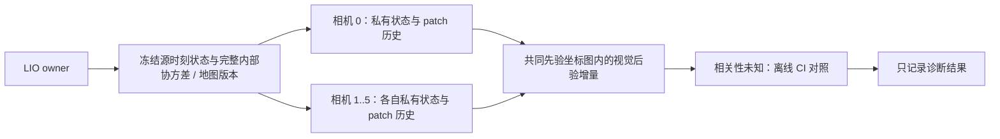

# 方案 A 的视觉修正分支：源码审查、旁路原型与相关性对照

结论：可以复用 FAST-LIVO2 的一个 LIO 几何来源，为每台相机运行独立视觉修正分支；不能把多个 `VIOManager` 直接接到同一份可写状态，也不能把各分支含共同先验的后验当作独立位姿测量再次累加。

本轮完成了原生视觉求解器的合成输入隔离验证和离线 CI（Covariance Intersection）原型。**尚未接入 Isaac 实时六路视觉修正，也未回写估计器或导航控制。** 前一份六视角 RGB/深度真实仿真报告仍只证明观察与投影链路。

## 源码审查

- `LIVMapper::processImu` 将 `state_propagat` 指向当前阶段的传播结果；same-pair VIO 准备阶段的零时长传播保持当前 LIO 后验和协方差。既有 `test_same_pair_handoff.cpp` 明确检查这点。共同分支先验应从这个阶段冻结，不能混用 pre-LIO、post-VIO 或另一张图的状态。
- `VIOManager` 保存 `StatesGroup* state/state_propagat`。`updateState*` 原地更新状态，`computeJacobianAndUpdateEKF` 原地更新协方差；浅拷贝或共享这些指针会把第二个相机变成第一个相机后验上的顺序更新，已经改变了旁路分支的定义。
- 视觉地图 `feat_map`、`VisualPoint`、`Feature`、参考 patch、曝光和选择缓存具有所有权和历史状态，必须每相机独立。`processFrame` 还会原地把输入 RGB 转灰度，所以必须拥有独立图像。
- 原生物理姿态为 `R_WI,p_WI`，增量约定是 `R <- R Exp(delta_theta)`；19 维状态顺序是旋转 0..2、世界位置 3..5、逆曝光 6、速度 7..9、gyro bias 10..12、acc bias 13..15、gravity 16..18。ROS pose 的位置优先、固定轴协方差不能直接当这个矩阵的左上角。
- `/post_vio_odometry` 的 pose/twist covariance 对角 `1e12` 是明确的 unavailable 占位值，status 中 `pose_covariance_available=false`。本轮不读取或融合这些值。
- 逆曝光是每台相机的 nuisance state，不能作为多相机共同物理状态。生产配置默认 exposure-on，其物理-曝光交叉协方差也不能直接转给另一台相机。
- `Frame::frame_counter_` 为非 atomic 的进程级静态变量；地图容器的 const 引用又不使 `VoxelOctoTree*` 指向对象递归不可变。本阶段只能串行调用分支，完整地图必须在稳定的 owner 阶段被借用或导出，不把现有接口称为可安全多线程共享。

FAST-LIVO2 原论文也将几何与图像 patch 建立在统一 voxel map 上，以顺序 ESIKF 更新异构传感器；这支持“复用几何”的方向，但不提供现成本仓库多相机后验融合接口。[FAST-LIVO2 原论文](https://arxiv.org/abs/2408.14035)

## 可实施的数据与所有权设计

每份输入应绑定 generation、整数源纳秒、prior ID、map snapshot ID、camera calibration ID、`T_CI` 及相机内参。prior/map ID 最终需由 native exporter 的内容校验与版本生成；仅比较调用者提供的字符串并不能证明来源。本原型的 identity 校验是接入契约，不是已完成的真实数据 provenance 验证。

第一阶段只接收图像与共同先验**完全同源时刻**的数据。不同步图像不能用相邻位姿替代或重写 stamp。后续异步支持需要各时刻的真实 IMU 状态传播、过程噪声、状态转移及共同基准间交叉协方差，或显式延迟状态方案；不能靠“容许 30ms 差值”把不同状态称作一个先验。

各分支保留自己的视觉历史，只从 owner 接收当前先验与几何；不各自跑一遍 IMU/LIO，也不把分支结果发布成可被导航误认的正式位姿。分支接收相同完整点集，由原生相机模型和外参做选择，不先按方位永久分割点云。

## 已加入的旁路代码

- `src/embodied_navigation/localization_mapping/frontend/native/multicamera_shadow.hpp`：实验性串行 `Branch`，拥有独立 camera、19 维 local/propagated state、RGB 与 patch cache。共享点向量进入求解前复制，拒绝错误 epoch、跨代缓存、ROS unavailable covariance 和曝光交叉相关先验。没有 mapper/控制器调用此类。
- `src/embodied_navigation/localization_mapping/frontend/multicamera_fusion.py`：共同坐标图上的只读 CI，拒绝不同 prior/map/generation、异步 epoch、重复 camera、未保留视觉更新、非 SPD/非有限矩阵或 ROS 占位协方差来源。
- `tests/native/dynanav_lio/test_multicamera_shadow.cpp` 与追加 CMake target：调用真正已构建的 `VIOManager::processFrame`，测试六个独立相机分支。
- `tests/unit/test_multicamera_fusion.py`：六项共同先验、协方差、身份、坐标图与重复信息测试。

原型采用固定曝光、`normal_en=false`、`raycast_en=false`、三层 patch。生产配置为曝光估计开启、normal 开启、四层 patch；**原型不是生产前相机的数值等价实现**。只有先通过接口及相关性检查，才有理由进一步实现物理 18 维状态与每相机曝光参数分离、完整 plane-map 快照及生产配置等价对照。

## 相关性处理

对共同先验附近的各分支局部后验 `(delta_i,P_i)`，先把每个后验的右扰动旋转协方差变换到共同先验的 Log 坐标图，世界位置仍为加法坐标。旋转部分使用 `J_r^-1(delta_theta_i)`，并以数值差分验证。当前小增量原型超过 0.2rad 就拒绝；该界限是实验范围，不是精度保证。

CI 使用 `sum(w_i)=1,w_i>=0`：

`P_CI^-1 = sum(w_i P_i^-1)`，`delta_CI = P_CI sum(w_i P_i^-1 delta_i)`。

若各分支具有同一线性先验精度 `I0`，凸组合中的先验只出现一次；不会再把 LIO pose 加作一个独立测量。重复的相同后验不会无故把协方差缩小为原来的六分之一。

CI 针对未知交叉相关；它的一致性结论要求输入均值/协方差本身满足相应条件。**它不能把未经验证、低估误差的原生 ESIKF 模型协方差自动变成可信误差上界。** 实现固定返回 `confidence_calibrated=false` 和 `estimator_feedback_enabled=false`。这与相关性文献中对输入一致性的前提相符。[相关性未知估计的原始研究与 CI 公式](https://arxiv.org/html/1610.01045)

减去重复共同先验的 information subtraction，仅在新增测量满足条件独立等假设时有意义。共有几何、不确定的地图点、重叠视场、历史 patch 与先前视觉反馈会产生额外相关，因此本轮不把这种相减实现为生产融合路径。

## 原生求解与对照结果

原生测试使用合成的六方向带纹理平面、3mm/2mm 的已知先验位置扰动、显式声明的合成协方差模型。六个 camera 私有缓存先独立建立参考，第二时刻都产生 retained numerical update，分别跟踪 **33/33/32/32/32/33** 个点。

测试还检查共有先验和协方差、点位置/法向/协方差、调用者 RGB 均不变；每分支 patch cache 地址不同。独立前相机控制分支放到其余五个之后运行，结果与先运行的前相机误差小于 `1e-13`。相机源时刻不匹配、占位协方差来源和共有曝光交叉项均被拒绝。共享 plane-map 在该测试中为空；不能据此声称完整真实 voxel/octree 地图的不可变性已验证。

仓库 native CMake target 构建和 CTest **1/1 通过**（约 0.14s）；Python **6/6 通过**。这些是实际 native solver 执行与 CPU 契约测试，不是实际传感器性能实验。

原生合成分支输出也实际送入离线 CI，平移修正约 `[-2.9974,-1.9994,+0.0034] mm`，旋转修正很小；这仅展示链路和数值求解，不能称为真实相机定位精度。

另做 100,000 样本、6 物理维、6 分支的解析模型 Monte Carlo。共同先验误差方差和单路新测量方差均为 1，每个分支后验模型方差 0.5；新增测量间相关系数 rho 分别为 0/0.5/1。下表为标称 95% 椭球的实际覆盖率：

| 新测量 rho | 忽略共同先验，把后验当独立 | 正确相减共同先验但假设新测量独立 | 等权 CI |
| --- | ---: | ---: | ---: |
| 0 | 26.678% | 94.989% | 99.840% |
| 0.5 | 14.947% | 32.215% | 98.573% |
| 1 | 8.930% | 12.018% | 94.824% |

各方法使用自身相应的 information-form 均值，未用同一不适用均值去比较 covariance。完全相关时 CI 保持方差 0.5，而简单独立后验融合声称 0.08333；相减共同先验又忽略新增相关的路径声称 0.14286，但实际 MSE 约 0.75709。CI 更保守，不能据此推断它在真实数据上一定更准确。

## 当前阻碍与后续顺序

没有权限拒绝。本轮没有新启动 Isaac 或修改驱动、安全配置，也没有改动 FAST-LIVO2 核心源码/缓存二进制。已有六相机采集和用户未提交工作保留，未提交或推送 Git。

尚未完成的是具体实现和数据契约，而非已证实无法实现：

1. native owner 的同代完整状态/19×19 协方差、`pointWithVar` 法向和点协方差、稳定 plane-map 的导出或 owner 内冻结借用接口。现有 ROS pose 和前轮仅 XYZ 的地图不够，不能填造这些数据。
2. 公共物理状态与各相机曝光的分离，以及 normal/patch 等设置对齐后的单相机等价对照。当前原型明确拒绝曝光交叉相关先验。
3. 真实多相机源时间绑定与 branch history。只有完全同源时刻先实现，随后才能选择异步传播方案。
4. 同代真实数据的“单前相机 shadow / 六 shadow / 离线 CI”资源、残差、失效和相关性对照，随后才考虑一次性回写 owner。回写还要正确处理物理全状态交叉项和历史地图/patch 的一致性，不只替换六维 pose。

下一步应先实现只读 native snapshot 接口，使用真实六相机冻结数据运行 shadow，保留原先正式定位输出；在真实协方差一致性与时间/地图绑定没有证据前，维持不回写状态。

## 证据

本轮目录：`/home/hyh001/Documents/Codex/2026-11-12/task/multicamera_shadow`。

- `native_test.log`、`native_packets.json`、`native_ci_result.json`：实际原生合成输入分支及离线输出。
- `repo_configure.log`、`repo_build.log`、`repo_ctest.log`：从仓库 native target 构建与运行的结果。
- `correlation_comparison.json`、`compare_correlation.py`：可复现解析模型对照。
- `initial.patch`、`initial_hashes.json`：开始前 tracked diff 和关键已有采集文件校验。三份已有六相机采集/投影文件未改变，既有 native CMake 只追加一项目标。

Python 复现：`PYTHONPATH=src python3 -B -m unittest discover -s tests/unit -p test_multicamera_fusion.py -v`。Native 使用既有 native-test 的 ROS/dependency prefix 配置，构建 `test_multicamera_shadow`，运行 `ctest -R dynanav_multicamera_shadow_native --output-on-failure`。
