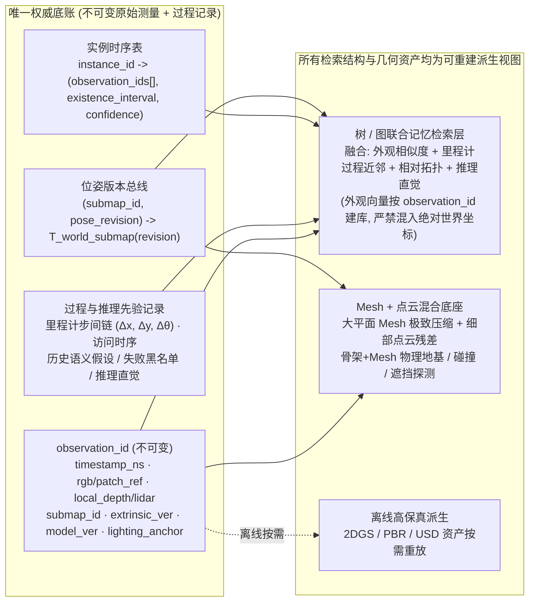

# 3D/4D 空间表征、混合记忆检索、动态视觉-LiDAR 与算力策略深度权衡（2026-11-28）

> 修订日期：2026-11-28 · 配套文档：[开发路线图 ROADMAP](../ROADMAP.md) · [七层冻结基线 BASELINES](../BASELINES.md) · [2026-11 学术创新查重总评](2026-11-novelty-audit-and-directions.md) · [VLN 评测真相与三轴演进总纲](2026-11-vln-perception-memory-strategy-synthesis.md) · [ADR-0003](../adr/0003-streaming-fork-control-and-semantic-scene-graph.md) · [ADR-0004](../adr/0004-incremental-mesh-3dgs-and-layered-backend-eval.md) · [ADR-0005](../adr/0005-causal-keyframe-memory-hybrid-retrieval-and-4d-evolution.md)
>
> 本文把 2026-11-27 至 2026-11-28 的架构讨论、`2026.1–2026.11` 最新研究进展、以及独立审计结果，按“**大白话讲透本质 + 保留全部精确口径、公式、数字与边界**”的方式重新梳理，方便后续各分支直接照着施工。

---

## 开篇导读：3 分钟看懂核心结论（5 条白话拍板）

1. **手头已有两张硬牌，“草台感”主要来自两件事**：D 路径上已有 **2 cm 级两层物理+SLAM 硬底座**（`exp/live-v4-ba-sliding-window`），Habitat 上刚跑出 **81% 成功率的独立 Agent+关键帧记忆运行时**（`feat/static-memory-streaming`）。系统看起来还像“拼装草台班子”，不是因为底座弱，而是因为**① 两栈缺少统一的数据读写契约（谁在什么时刻能读哪一版位姿、迟到视觉包归谁），② 还缺两三个针对难例训出来的专用轻量头模型**。
2. **明确否决的 4 条低性价比方向（不再浪费算力和时间）**：
   - ❌ 仅靠“粗糙 Mesh + 游戏引擎单材质库（Blender/UE5）”当在线主记忆（会丢光真实微观纹理，真要补细又退回繁重多视图分割，留给离线资产即可）；
   - ❌ 在线主循环硬跑全场景 `3DGS / 4DGS`（反传抢显存、长轨迹和回环极易模糊或崩）；
   - ❌ 一上来就对走廊行人全量拟合 `SMPL` 3D 人体骨架（半身遮挡会瞎脑补腿的位置，普通避障用时效占据+速度，需要精细姿态交互时再升级）；
   - ❌ 把 `Google Colab 1,000 CU` 扔去从头训端到端大模型/世界模型，或对着 `5` 个 Dev 场景反复调参、或对验证场景离线跑满 GS/PBR（破坏因果评测）。
3. **正式确认押注的 4 条核心方向**：
   - ✅ **Mesh + 点云混合压缩与“骨架 + Mesh”物理预测地基**：大墙面、地板等平面用 Mesh 极致压缩掉冗余点云（细部才留点云残差）；静态支撑骨架 + 运动物体刚体/铰接骨架搭配 Mesh，构成可建模、可前向预测的低维物理底座（3 天实验只裁决“在线遮挡重排”这一子项是否值得接入，绝不否定前两项根基）；
   - ✅ **保留过程记忆、里程计先验与推理直觉的「树检索 / 图检索」**：绝不只拿冷冰冰的“纯外观向量”硬搜！**绝对世界坐标**随回环会变，不能硬拼进外观特征；但**SE(3) 刚体不变的里程计步间位移链 $(\Delta x,\Delta y,\Delta\theta)$、访问时间先后、局部相对拓扑和历史推理产生的语义直觉**不仅不能丢，还是记忆检索最宝贵的先验；
   - ✅ **路线一（先把 Habitat 公开榜单真打穿）**：对齐官方 `HM3D-OVON` / `GOAT-Bench` 评分器，补齐 `16-bit` 深度、360° 视野与语义前沿探索，并用 `Colab 1,000 CU` 训“同屋同类实例重排小模型”，正面冲公开可复核成绩；
   - ✅ **路线二（回到 Isaac Sim 打通真物理 4D 动态闭环）**：按 **RGB 主识别追踪 + 32 线 LiDAR 主测距净空（严禁束间空白误清空）+ IMU/关节/接触做盲走打滑先验**，在真实回环与搬移变化下实现“过期航点即时撤回 + 旧记忆该不该重访”。
4. **第一周先交 3 件最硬的实事（Week 1 Gate）**：
   - ① 官方 `HM3D / OVON / GOAT` Scorer 逐题对账报告（确认当前真实分数不含水分）；
   - ② 3 天 Mesh 可见性重排错例配对表（低成本决定检索时加不加 Mesh 遮挡过滤）；
   - ③ D 路径单次回环前后同一物体的因果回放（证明双栈能真正共用同一套记忆契约）。

---

## 1. 我们现在存了什么？为什么会觉得像“草台班子”？

### 1.1 双栈底稿核查：到底存的是关键帧还是点云？能无损重构吗？

直接对照仓库源码，其实两套系统都已经预留了“**局部锚定、回环不重写原始测量**”的骨架，目前只差 Habitat 端少落盘了 1 个深度文件：

| 栈 | 核心源码 | 当前实际落盘了什么 | 存的是关键帧还是点云？ | 现在能完整重构吗？ |
| --- | --- | --- | --- | --- |
| **D 路径 SLAM 后端** (`MapStore`) | `src/embodied_navigation/localization_mapping/backend/map_store.py` | `map.json`（`stamp_ns`、`T_odom_body`、`T_world_body`、`T_body_lidar`）+ `kf_<epoch>_<seq>.npz`（机体系局部 `points_lidar` + ScanContext）+ 可选 `kf_*_visual.npz`（`gray`、`rgb`、`K`、`T_body_camera`） | **关键帧锚定的局部点云 + 可选视觉帧**（回环只改 `T_world_body`，不重写点数据） | **✅ 完全可重构**（配合同期标定 RGB 可直接喂 Surface Nets / `2DGS` / `Gaussian-LIC2`） |
| **Habitat / 语义记忆层** (`HabitatWorldDaemon` + `TextureKeyframeSelector`) | `src/embodied_navigation/agent/adapters/habitat_daemon.py`、`src/embodied_navigation/localization_mapping/semantic_mapping/texture_keyframe_selector.py` | Set-Cover 最小覆盖纹理关键帧（`frame_*_kf_*_rgb.png`，剪枝约 `79.54%` 冗余帧）+ `T_world_body` + `SigLIP` 向量 + 场景图与物体/区域账本（表面体素质量账本驻留内存） | **最小覆盖关键帧（非点云）** | **⚠️ 差最后一步深度落盘**：只存了 RGB PNG 没存深度图；保留帧顺手存 `16-bit` 压缩深度 PNG（单栋仅 **+1.2 MB**）即可 100% 重构 |

### 1.2 破除“草台感”的 4 个跨层契约漏洞

现在代码分散在多条分支，互相之间有 4 个边界问题没焊死，一旦有异步延迟或回环就容易打架：
1. **谁在什么时候能读哪版位姿？**：Habitat 起点相对位姿、D 路径当下实时位姿、回环拉齐后的历史修正位姿，必须统一带版本号 `pose_revision`，不能上层还在读旧坐标、下层已经回环了。
2. **异步视觉结果回来晚了算谁的？**：`SAM 3 / SigLIP` 异步算完回包时机器人可能早已转头或回环，回包必须死死绑着当初发起时的 `frame_id`、`timestamp_ns` 与实例版本。
3. **什么时候才算“确认目标不在原地”？**：必须同时满足三个物理条件——**① 在相机视野里、② 中间没有被障碍物/Mesh 挡住、③ 落在有效测距范围内**。少一条就只能记作“此刻没看见”，不能乱删记忆。
4. **航点下发、取消与 `STOP` 验收怎么防错乱？**：必须校验 `action_epoch` 归属，彻底堵死“旧任务的迟到图触发了一个新错误航点”。

### 1.3 收敛后的“单一权威底账”设计

**最小因果验收门槛**：同一录制回放刻意注入“重复消息 + 迟到 `SAM 3/SigLIP` 回包 + `1` 次全局回环”，依然能输出完全一致且每一跳都能追溯到原图/测量的实例历史；并且任意历史时间点的前缀查询做到**零未来证据泄漏**。

---

## 2. 五大空间表征白话横评（各有什么致命短板与不可替代区？）

先用一句话点破五条路线的本质：
- **GS（高斯）** = “照相机美化专家”，画质最像真、方便凑新视角认物体，但显存吃紧且容易把旧灯光焊死在模型里；
- **Mesh（三角网格）** = “工程结构与压缩骨干”，把百万面墙点压成几张面片，配合物理骨架就能算碰撞、遮挡和预测未来运动，但会丢掉表面印字和细腻纹理；
- **点云 / 体素** = “最诚实的原始尺子”，保留哪里有激光回波、哪条射线真打穿证实没东西（空），但全是离散点、没法直接按“红杯子”查；
- **语义特征 / 直接文本** = “高级目录索引”，搜概念极快，但前端模型一旦漏检或摘要写偏就会永久丢细节，必须回挂原始图像 Patch 复查；
- **世界模型隐状态** = “压缩直觉大脑”，擅长秒级猜遮挡后面有什么、先往哪边探索概率大，但在长距离大地图里容易飘，且没法像账本一样精确删改某一把被搬走的椅子。

| 表征路线与代表工作 | 致命隐含前提（最容易翻车的地方） | 精确口径与不可忽视的现实局限 | 上游语义失败容错 | 回环一致性 | 不可替代区（留着干嘛最值） |
| :--- | :--- | :--- | :--- | :--- | :--- |
| **① `3DGS / 2DGS`** `2DGS-SLAM` (`arXiv:2506.00970`)、`Gaussian-LIC2`、`ChronoGS` | **只要把见过视角的颜色和不透明度拟合好，就能顺便还原出靠谱的物理表面**；一旦遇到少视角、反光或物体移位，几何直接崩 | 在线反向传播抢占大量显存；`2DGS-SLAM` 的高精度还同时依赖重定位、回环和局部活动图管理，不能把整套系统功劳全算在 GS 上 | 不依赖前置语义分割，完整留存连续外观 | 需显式绑定子图/锚点骨架 | **多视角充分时生成未见角度的候选图，帮助跨视角图像目标匹配；离线高保真渲染重建** |
| **② 显式 `Mesh`** `Surface Nets`、`ImMesh`、`SLAMesh`、`Facet-SLAM`、`Triangle Splatting SLAM` | **连起来的三角面都有真实测量支撑，且抽稀简化后还能保住门缝和薄家具** | 纯素模丢亚厘米纹理、标牌文字和微光泽；平滑容易把狭小门缝封死或把相邻椅腿粘在一起 | 几何底座不靠语义；物体切分过依赖语义则会有误差 | 极好（局部锚点重投影；子图内非刚性形变则重建脏块） | **① 墙面等大平面海量点云压缩；② 与骨架结合成物理/运动预测地基；③ 物理碰撞与可溯源首交遮挡** |
| **③ 点云 / 体素栅格** `MapStore`、体素哈希、NVIDIA `mindmap` | **“没有点就等于空”**；在 32 线雷达上若分不清“束间空隙”和“实测自由射线”，会直接清空矮桌和细椅腿 | 纯点云无连续表面、不支持开放词表；稠密 3D 特征体素场（`mindmap` 类）在多楼层下动辄 GB 级且回环重影撕裂严重 | 完全不依赖语义 | 极好（点云驻留 `T_map_kf`；体素需放子图局部系） | **保留最原始的距离测量、实测射线清空证据（Free-Space）、以及细部残差几何** |
| **④ 语义特征 / 直接文本** `3D-Mem`、`CGFM-Nav`、`SuperMap`、`ConceptGraphs`、`HOV-SG` | **相近语义词能唯一指向同一个实体，且压缩成几行文本摘要后不会漏掉下次任务要考的细节** | 前端分割漏框即永久失明；`MemoryAgentBench` 实测证据预算从 `64 → 512` token 反而令单跳准确率 **`45% → 32%`**；`VSI-Bench` 证明定位有噪时把结构网格从 `10×10` 细化到 `20×20` 准确率反而 **`56% → 54%`** | **脆弱**（除非保留关键帧 Patch 底层底片，支持换个 Prompt 重找） | 锚定 `keyframe_id` 后可 $O(1)$ 重投影，但关系边需重算 | **图像特征做开放词表初筛 + 文本做属性/关系/否定条件过滤；必须挂回原始 Patch 复核“门边第二把椅子”** |
| **⑤ 世界模型隐状态** `V-JEPA 2`、`Cosmos`、`LingBot-VA`、`LingBot-Map 1.0/2.0` (`GCT/GCR`)、`LingBot-Navi` | **压成潜向量的历史足以支持未来任意类型查询，且回环平差和局部删除都能精确改写对应隐状态** | 缺乏米制结构可解释性（难审计精确坐标），长程会漂移、跨任务易忘；注意 **`LingBot-Map` 本身是能输出显式几何的流式模型**，评估时必须把 `GCT` 固定分辨率吞吐、`GCR` 长序列表现和跨任务实例召回拆为 3 个独立实验 | 若不额外存关键帧底片，几乎无法回查未留意过的小物 | 常规隐状态难局部精确擦除；`GCR` 类专门重整机制仍在演进 | **短时遮挡区域预测、探索前沿优先级直觉排序、学习式几何提议** |

---

## 3. Mesh + 点云混合记忆与「骨架 + Mesh」建模预测地基

### 3.1 为什么 Mesh 不是“可要可不要”，而是三大核心根基？

必须把 Mesh 的价值说完整、摆正位置：
1. **大平面点云的极致压缩（Mesh + 点云混合压缩）**：
   - 室内场景里 70%–80% 的点云其实是地板、天花板和大白墙。把这些大平面提炼成少数带法向的 `Mesh` 面片后，**体积直接压掉一个数量级**；只在复杂雕塑、家具轮廓、精细障碍上保留点云/高密度残差——这就是 **“大面走 Mesh、细部留点云”** 的混合核心。
2. **骨架 + Mesh = 可建模、可预测的物理地基**：
   - 静态层面：**建筑拓扑骨架（楼层-走廊-房间-门洞）+ 平面支撑 Mesh**，天然给出“杯子放在桌面上”“门后通往厨房”的物理约束与可达先验；
   - 动态层面：**刚体/铰接骨架 + 物体 Mesh**（门扇+转轴、推车+朝向轨迹），把数万个孤立碎点降维成 **1–6 个自由度的运动学状态**。只有降到这种结构化表征，系统才具备**低成本前向推演（预测 2 秒后门开多大、车往哪滑、通道还剩几厘米）**的能力，而纯零散点云根本做不到物理推演。
3. **无光照污染的物理碰撞与可溯源遮挡**：
   - **保住了**：米制尺度、连续表面拓扑、物理碰撞代理、任意重打光能力（脱离旧灯光烘培）；
   - **丢失了**：亚厘米微小肌理、木纹、墙上字牌与屏幕内容（**所以在线必须配着关键帧原图 Patch 一起用**）。

### 3.2 主流在线 Mesh 算法白话解读与方向内横评

| 算法代表 | 白话原理：它到底在干嘛？ | 亮眼之处 | 精确口径边界与真实遗憾 |
| :--- | :--- | :--- | :--- |
| **体素 TSDF + `Surface Nets`** （仓库 `object_mesh_memory.py` 已有纯 NumPy `29 MB` 产物） | 把点云塞进小立方体格子算出有向距离场，在正负交界抽出一层平滑三角网 | 零重型依赖，每个三角面都能精准倒查回局部格子与原始点，现成可跑 | 表面平滑容易封死窄门缝、把邻近椅腿粘一块；只做前景物体时缺失墙体/门框；`29 MB` 没把配套原图、索引和运行内存算进去；比较必须**固定同轨迹、同体素、同前缀点云**比首交与遮挡误判 |
| **`ImMesh` (`arXiv:2301.05206`) / `SLAMesh` (`arXiv:2303.05252`)** | `ImMesh` 直接把激光扫进体素切平面的点就地连成三角形；`SLAMesh` 在每个格子里用高斯过程拟合隐式曲面并直接拿它算定位 | `ImMesh` 构出来的墙角和楼梯台阶非常锐利不发糊；`SLAMesh` 打通了点到自建表面的紧耦合配准 | 原生论文同时换了定位前端和建图后端，**更准的位姿本身就会让下游检索变强**，横向比 Mesh 好坏必须先锁死同一位姿；另外 32 线稀疏区极易在束间空白插值出假面 |
| **`Triangle Splatting SLAM` (`arXiv:2605.31419`) / `2D TS+` (`2506.18575`, `2509.25122`) / `Facet-SLAM`** | 直接把三维空间铺满可微旋转/拉伸的三角形，靠相机画面反传把颜色和贴合度越调越像真；`Facet-SLAM` 发现边改位置边定位会互相打架，专门改成分家机制 | 跳出传统体素网格束缚；`Facet-SLAM` 把 **“跟踪用融合深度钉死质心，建图只做不挪位置的朝向/形状/外观精修”** 拆开，直击 **Moving-Target 冲突** | **可微三角汤、连通 Surface Mesh、能拿来算物理遮挡的面，是三道完全不同的及格线**；就算像 `Facet-SLAM` 解耦后，输入深度自带的噪声仍会写进三角质心；视角少的地方仍有孔洞和狭长劣质片元 |
| **`2DGS + TSDF`** (`2DGS-SLAM` `arXiv:2506.00970`) | 先贴地铺一堆 2D 扁平高斯把每个视角深度渲染平滑一致，再拿渲染深度融合进 TSDF 抽出 Mesh | 渲染视图极其逼真，平滑后的渲染深度比单帧噪点多的新视角更容易抽面 | 必须拿**相同输入深度与位姿**对比“原深度直接 TSDF”vs“GS 渲染深度再 TSDF”；而且 `2DGS-SLAM` 系统带了自己的重定位、回环和活动图，不能全算成 GS 的功劳 |

### 3.3 纹理与游戏引擎 PBR 材质的三档划分（各自别越界）

1. **第一档（在线首选）：原图 Patch 投影纹理** —— 保留原图 Patch，顺手记录 `cam_id`、时间、入射角和深度残差投到 Mesh 上；零额外训练成本，**猜错时随时能打开高清原图核对**。
2. **第二档（离线外观与跨视角实验）：`2DGS` / 神经贴图** —— 适合测试大角度绕行后认同一件东西的效果；**评测红线：必须在没参与拟合的新实拍视角上算 Top-1 召回**，防止平滑贴图把不同款式的两把椅子糊成一张脸。
3. **第三档（离线重打光与仿真资产上界，不放进在线主记忆）：Blender/UE5 PBR 材质锚定 & `GS-2M` (`arXiv:2509.22276`)** —— 只贴通用单材质库会损失大量现实纹理，堆多视图反渲染+细粒度分割又没了轻量优势；且固定光照下“反照率/光源/粗糙度/法向”天然有物理多解歧义，用仿真引擎自带材质 ID 还会泄漏实例答案，因此单列离线资产轨道，**不拿它强赌导航提升**。

### 3.4 3 天低成本证伪子实验（只验证“检索时加不加 Mesh 遮挡过滤”）

> **先说清楚范围**：这个 3 天实验**只检验 Mesh 能不能提升“候选视角遮挡重排”这一件事**；就算它没过线，Mesh 作为**墙地大平面压缩**和**物理碰撞/建模预测地基**的价值依然成立，绝不一起推翻。

- **严格限定业务问法**：历史图像负责找出“那张桌子”；局部几何只回答**“站在候选观察位能不能看到它”**；可达性规划另判“能不能绕过去”。**严禁把一次被隔墙遮挡判成“桌子没了”**。
- **唯一假设**：同一组 top-20 `SigLIP` 候选和历史因果前缀深度下，加 `Surface Nets` 首交过滤是否比“体素射线”与“历史深度直接重投影”更能精准砍掉被挡住的误检。

| 天数 | 做什么（本地 `RTX 5070 Ti` 即可跑完） | 怎么判赢还是停（预注册硬门槛） |
| :--- | :--- | :--- |
| **Day 1** | 从 ≥3 个未调参留出场景冻结 **120 个去邻近重复 `(query, viewpoint)` 对**（涵盖全可见 / 半遮挡 / 隔墙遮挡 / 同屋多同类实例），分开标真值“是哪一件”和“此位可不可见”；严格限定只喂查询时刻前的帧与位姿 | 无时间因果前缀或缺少真实遮挡样本，Day 1 即记为证据不足暂停 |
| **Day 2** | 同一 top-20 候选集下跑四组并在**全量 120 题**统一算分（禁靠输出 `unknown` 逃避难题）：**A** 纯 Patch 精准检索；**B** Patch + 点云/体素射线；**便宜强对照** Patch + 历史深度图重投影；**C** Patch + 同源 `Surface Nets` 首交（孔洞输出 `unknown`） | 分项记录 `Recall@20`、可见真例 `Top-1`、完全遮挡误留率、可见误杀率、`unknown` 比例、增量 `p95` 延迟与构面内存 |
| **Day 3** | 分场景、分轨迹段统计配对差，逐例复盘薄桌椅腿、隔墙、回环前后与覆盖盲区 | **四条全满足才把 Mesh 过滤接进检索主链**：C 比**最强便宜对照（B 或深度重投影）**全量 `Top-1` **≥ +5 pp**、完全遮挡误留相对降 **≥ 25%**、可见真例误杀增加 **≤ +2 pp**、增量延迟 **`p95 ≤ 50 ms`**；若优势只来自事后终图或赢 A 输 B，直接停掉该子功能；若 `Recall@20` 本身漏召回，主力转回改进召回器 |

---

## 4. 过程记忆、里程计先验与「树检索 / 图检索」方向

### 4.1 2026.1–2026.11 关键记忆论文白话精读（附真实口径核查）

| 论文与时间 | 用大白话说它在干嘛 | 实测成绩与隐藏测试条件 | 遗憾与我们怎么用 / 避坑 |
| :--- | :--- | :--- | :--- |
| **`CGFM-Nav`** (`arXiv:2608.29114`, 2026-08) | **图+场双腿走路**：已知区域靠显式物体关系图精确查找，没走过的未知区靠大语言模型结合场景图生成一个“往哪找更有戏”的连续直觉热度场引导前沿探索 | `GOAT-Bench Val Unseen` 用 `Qwen3-VL-8B` 把 SR 从 `53.2% → 63.0%`、SPL 从 `30.0% → 39.6%`；**隐藏边界：仅跑了 36 个场景各第 1 个 episode（`36 ep / 278 子任务`）而非官方完整版（`360 ep / 2,669 子任务`）**，且成功距离取到合法视点 `0.25 m` | 把“直觉探索优先级”写得非常清晰；但千万别误信为 GOAT 全量 SOTA，我们设独立分支 `exp/goal-frontier-prior` 按它同款 36 ep 先对齐再跑全量 360 ep |
| **`SuperNav`** (`arXiv:2610.12126`, 2026-10) | **代码技能+360°眼睛+直接点屏幕**：冻结多模态大模型，写一套 Markdown 导航攻略（Skills）+ 进度追踪 + 直接在图像上点像素坐标（`PixelGoal`）反投影去走 | `HM3D-OVON` 跑出 `73.33%` SR / `0.4105` SPL；**真实口径**：出自 **120 题抽样子集 + 4 相机 360° 视野 + 几何真值执行器 + `1 m` 合法视点**；同批题收紧到 `0.25 m` 降到 `68.33% / 0.3837`；保持 `1 m` 把真值执行器换成真实学习控制器，SR 虽有 `70.83%` 但 SPL **暴跌到 `0.1443`** | 直接证明 360° 视野和底层执行器有多占便宜，绝不能拿我们的单目窄视角不拆执行条件直接对比 |
| **`SuperMap`** (`RSS 2026`, `arXiv:2608.22896`) | **会自己清过期记忆的 4D 场景图**：高频几何 SLAM 稳住位置，后台开放词表语义慢慢认物体，用“存在概率”和 3D 实例重激活把搬走的东西抹掉或续上 | 能长期维护会变的房间拓扑并实时喂给 VLM 做动态导航 | 现实短板在于异步视觉推理比运动控制慢半拍，若不严锁时间戳容易拿过时观测更新新位置 |
| **`TAMP-Nav` (`2608.17512`) / `MTU3D` (`ICCV 2025`, `2507.04047`) / `3D-Mem` (`CVPR 2025`)** | 分别用“锚点轨迹压缩记忆”“边探索边用 3D 查询学表征”“只存关键帧代表图与探索前沿快照”取代全量堆帧 | 验证了关键帧锚定记忆在大规模场景下的极高性价比；但在同屋有多件同类物体（如好几张椅子/床）时仍缺精细实例校验 | 我们的 Set-Cover 关键帧天然属于同宗，再配上 Colab 难负例实例重排正好补上它的精细短板 |
| **`Khronos` (`2402.13817`) / `EvoNav` (`2611.22321`) / `MemoryAgentBench` (`2610.36308`)** | 区分“秒级跑过的人”与“隔天搬走的家具”；尝试从以往回合蒸馏规律写回环境提示；揭露多塞旧上下文反而把对题改错的记忆税 | `MemoryAgentBench` 给出铁证：**证据已经命中的前提下**把上下文预算从 `64` 扩到 `512` token，单跳准确率反跌 **`45% → 32%`** | 警醒我们：文本和经验绝不能无脑往 Prompt 里堆，必须带版本戳与证据门控 |

### 4.2 为什么检索绝不能丢过程记忆、里程计与推理先验？

你这一针非常准！之前只说“不把坐标拼进向量”容易让人误会成只靠干巴巴的外观图去匹配——那其实把具身智能最核心的**“走过来的过程”**扔掉了。准确的做法应当严格拆开两类空间信息：

1. **绝不能硬焊死进外观向量的东西——`绝对世界坐标 (x, y, z)`**：
   - 原因是 SLAM 一旦发生全球回环平差，整栋楼后半段的绝对世界坐标都会整体挪动十几厘米到几米。把绝对坐标写死在向量里面，一回环就得全库重算，还会让历史相似检索失灵。
2. **绝不能丢、而且必须融进检索的三类宝贵先验（对全局刚体回环严格不变！）**：
   - **① 里程计过程轨迹链（Episodic Odometry Chain）**：从上一帧走到这一帧经过了多少步、局部转了多少弯 $(\Delta x, \Delta y, \Delta\theta)$、刚刚穿过哪扇门、在哪个时间窗里。即便全局坐标因回环平移旋转，**“我在找客厅时顺手从左前方门框拐出来 3 秒看到过这把红椅子”这段局部相对运动过程完全不变！**
   - **② 局部相对拓扑关系**：物体与门洞、楼梯、邻近大件的相对布局。
   - **③ 推理过程的语义先验与直觉（Reasoning Prior & Semantic Intuition）**：探索途中 VLM 做过的判断与假设（例如*“走廊尽头那扇半开的门大概率是卧室”“上次试过那条路因为窄门卡死失败了”*）。这是高价值的过程思考沉淀，必须保留作树节点与图边的先验权重（同时带 `map_revision` 版本戳防过期）。

**因此，记忆检索不是单纯的“特征相似度打分”，而是四信号协同**：
$$\text{Score}(q, m) = w_{\text{vis}}\,\text{Sim}_{\text{DINO/SigLIP}}(q, m) + w_{\text{proc}}\,\text{Prox}_{\text{odom/time}}(t_{\text{cur}}, m) + w_{\text{topo}}\,\text{Rel}_{\text{scene-graph}}(q, m) + w_{\text{prior}}\,\text{Intuition}(q, m)$$
再叠加上游逻辑校验：候选确定后，最后一步才反查该关键帧当下的最新 `pose_revision` 全局位置做距离过滤与导航规划。

### 4.3 把“上层检索架构（树检索 / 图检索）”与“底层向量加速”明确分开

- **上层架构一：层次化树检索（Tree Retrieval）**
  - 结构：`整栋建筑 → 楼层 → 房间/走廊功能区 → 探索过程段 (Trajectory Segment) → 关键帧/物体实例`。
  - 作用：**先借大模型或房间几何+语义直觉自顶向下剪枝**（找“微波炉”先直奔带厨房语义直觉的分支和对应探索片段，不必全楼盲扫）；同时明确两点防护：**门口、楼梯与开放客餐厅允许同时挂靠多个父房间**，且树枝剪空时**永远允许一键回退到全局候选**。
- **上层架构二：四类边时空过程图检索（4D Process-Semantic Graph Retrieval）**
  - 图里的边不止有“位置近”，而是同时维护 **4 类有向/无向边**：
    1. **里程计与时间过程边**：记录 `kf_t → kf_{t+1}` 的局部相对位姿增量 $\Delta T_{t,t+1}$ 与时间差（回环不改局部边，天然承载过程记忆）；
    2. **门洞/通道/相对几何邻接边**：哪扇门连着哪个房间、两个物体相对拓扑邻接；
    3. **跨视角外观相似边**：同一物体在不同角度观测间的 `DINO/SigLIP` 关联；
    4. **推理先验与语义直觉边**：历史推理留下的“未尽探索线索 / 功能区假设 / 失败黑名单警示”。
  - 用法：给一个文字/图片/描述目标，先从高匹配入口节点出发做 **$h$-hop 限制跳数的图扩散**（自动把经过同一轨迹段或强语义先验的关联点拉上来），再做几何一致性校验。

#### 底层索引加速数据结构与动态更新精确边界（防止过度设计）

| 底层索引结构 | 它管什么 + 真实复杂度 | 遇到回环改位姿 / 物品搬移 / 动态变化怎么更新与失效边界 |
| :--- | :--- | :--- |
| **精确矩阵乘 + 子图体素哈希 + 实例时序表（首版主力）** | 精确特征矩阵乘 $O(Nd)$（几千关键帧耗时 `< 1–5 ms`）；子图体素随机存取期望 $O(1)$、射线访问 $k$ 格约 $O(k)$ | **绝不因为过早用复杂图索引而制造更新 bug**。体素驻留子图局部系：刚体回环只改子图变换与包围盒；**红线警告：若子图内部关键帧在 BA 中相对形变，仅改根变换修不好“双墙重影”，必须重投受影响观测或重建脏体素** |
| **两级 BVH**（子图三角 BVH + 场景 TLAS） | 子图内做三角形光线首交；重叠少时可大量剪枝，最坏重叠分布仍可能扫描大量面片 | 刚体回环复用底层局部 BVH、上层叶子 refit 约 $O(\log S)$（$S$ 为子图数）；局部形变重抽局部树；监控每次查询节点访问数防包围盒严重重叠退化 |
| **`HNSW` (`arXiv:1603.09320`) / `Vamana` (`FreshDiskANN`)** | **仅当未来数万帧级导致精确矩阵乘超延迟预算时才启用**；图检索耗时由实际访问向量数决定，工程上不能盲承诺严格 $O(\log N)$ | **必须按 `observation_id` 建库**（绝不混入绝对世界坐标）：刚体回环**零修改向量**；物体搬移追加新观测、旧边不硬删而是用实现原生的**墓碑（Tombstone）+ 增量层 + 定期压实**；触发条件看“过期命中率、查询 `p95`、与精确检索的 Recall 落差” |
| **拓扑 / 过程场景图** | 按入口展开 $h$-hop 查询，成本看边密度（**严禁无上限全图泛洪**） | 限制最大跳数 $h$ 与边类型过滤；搬移关闭旧 `existence_interval` 并追加新过程边，回环只更新受影响跨度的邻接距离与房间边界 |

---

## 5. 路线二：4D 动态建模（骨架 + Mesh）与「视觉 vs 32 线 LiDAR」裁决

### 5.1 为什么「运动分割先验 + 骨架/Mesh 建模」对 4D 极为合理？又要防哪 4 个坑？

在自运动已经被高频传感器消掉、动态物体相对移动且前后帧充分重叠的条件下，**运动残差确实能白送给你一套极干净的前景分割轮廓**，进而把 4D 场景压成非常轻巧、又能前向预测的实体：
- **刚体搬动物（推车/椅子/箱子）**：切出来存 1 份紧致局部 `Mesh` + 刚体运动轨 $T_{\text{object}}(t)$，相比逐帧复制整张地图体积直降几个数量级；
- **门/抽屉等可活动交互结构（`MoMa-SG` / `Arti4D-Semantic`）**：积累到充分开合观测且留出帧预测残差优于普通刚体时，升级成 **父子 Mesh + 转轴/滑轴骨架 + 开合角范围**，天然就能预测“这扇门再推 30° 会不会撞狗”；
- **动态行人（分两阶段务实推进）**：近期代表工作 `Flow4DGS-SLAM` (`CVPR 2026`)、`DynaGSLAM` (`WACV 2026`)、`RU4D-SLAM` (`WACV 2026`) 虽能重建动态 4D，但显存占用极重且高度依赖前端掩码召回。因此本项目把行人表达拆两步：**阶段一（导航避让主力）优先存时效 3D 占据体 + 速度向量 + 外观特征**；**阶段二（人机近距交互需求出现后）再按需升级可观测局部关节/骨架**。

必须正视并写进代码判据的 **4 类真实边界翻车场景**：

| 边界类型 | 现场会怎么出 Bug？ | 数据字段与逻辑护栏 |
| :--- | :--- | :--- |
| **① 人走停了 / 同速同行 / 动作太慢** | 行人拐角停步看手机，被当成静态墙融进地图，走开后留鬼影；或机器狗跟人同速走，几何残差趋零分不出来 | 拆开存三个独立状态：`movable_class`（语义可动类别）、`current_motion_evidence`（当下动静）、`last_existence_evidence`（最近见过时间）。**停步期间保留 track 与占据；只有明确捕捉到穿过旧位置的实测激光自由射线，才削弱旧占据** |
| **② 半遮挡 / 两人错身交叉** | 两个人擦肩交叉后 ID 互换；只拍到半截上半身时套 `SMPL` 骨架，模型强行脑补两条错误置信腿位置 | 只记录实际可见部位包围体与不确定度；强遮挡穿越期间显式保留 `pending` 未决态，并用 **ID 切换率、重现恢复率、错误清空率** 验收 |
| **③ 非标准动体或门没动够角度** | 衣服飘动、推着晃动行李的推车、一直半开不动的门，会被单刚体或单转轴模型强行歪曲拟合 | 默认分段 track + 原始局部点 + 拟合残差兜底；只有留出多时刻多视角验证铰接模型比普通占据预测更准，才准予升格为铰接骨架 |
| **④ 长时变化与回环拉齐错位** | 回环平差把整间屋子平推 15 cm，若拿前后两套坐标直接减，系统会误报“全场家具集体平移” | 所有变化对比**必须在同一 `pose_revision` 坐标系**执行，并先扣掉邻近静态背景共同位移再判独立移动；同时分存 `observation_time` 与 `system_learned_time`，显式区分 **`not_visible` / `observed_empty_at_old_pose` / `identity_swapped`**（参考 `Khronos`、`SuperMap`） |

### 5.2 动态环境下「视觉是不是比 LiDAR 强？」（Go2 逐场景干脆裁决）

> 按 Go2 当前传感器（**RGB + 32 线 RTX LiDAR + IMU + `MoE-CTS`**）逐问打分（5 分代表最适合回答该项问题）：

| 要解决的现场问题 | RGB 视觉 | 32 线 LiDAR | 干脆裁决与分工 |
| :--- | :---: | :---: | :--- |
| **大白天远处停着的人是谁、穿什么、是不是旧目标** | **5** | 1 | **视觉绝对主力**；稀疏 LiDAR 点只给个大致距离 |
| **暗光/强逆光/白墙走廊突然蹿出人，还剩几米要急刹** | 1 | **5** | **LiDAR 绝对主力**；碰撞制动绝对不能等视觉模型算完分类 |
| **近处两人错身互挡，谁从遮挡后走了出来** | **4** | **3** | **视觉看衣服外貌认 ID，LiDAR 点簇轨迹防位置跳变**；都断线就老实保持未决 |
| **门转了一半或推车横移后，门缝还剩多宽能不能过** | 3 | **5** | **有回波一律信 LiDAR 实测净空**；RGB 负责提醒“这是个有合页的门” |
| **远处细桌腿、插线板、小凳掉在 32 线上下扫描线夹缝里** | **4** | 1 | **视觉看到后指挥小狗微调抬头/换角度复看**；**铁律：32 线扫描线之间的空白绝不等于“空无一物”，绝对禁止拿束间空白去清空已知占据** |
| **玻璃门、大镜子、强逆光炫目区能不能直接冲过去** | 1–2 | 1–2 | **两边都不可信，统一记作 `unknown`**，降速换斜向视角探清再走；最忌把透明障碍判成可通行区域 |

**Go2 最干净的三传感器协作**：① `IMU + 关节编码器 + 可靠足端接触` 做高频姿态传播与踩滑提示（参考 `AirIO` / `Legolas`，**绝对禁用把 `MoE-CTS` 的 `cmd_vel` 当成真实移动里程**）；② `32 线 LiDAR` 管去畸变、静态背景定位、实测自由射线清鬼影与短时碰撞占据（**从 128 线 `Dynablox` 借鉴算法时，必须先做 32 线束型 + 四足步态起伏消融**）；③ `RGB` 异步管识别、ReID、细小候选与铰接轴线索；后端按观测时间戳融合。

---

## 6. 路线一（打穿 Habitat 榜单）与 Google Colab `1,000 CU` 怎么花

### 6.1 为什么说“Habitat 榜单很有戏”，但上场前先防这 5 个暗坑？

目前 `feat/static-memory-streaming` (`e159c8a`) 在 5 场景 Dev 上拿到 `13/16`（`81.25%`）、`OSR = 14/16` (`87.50%`)、跨子任务 `81.82%` 与 `0` 超时，链路已打通；对比公开数字：`CGFM-Nav` 在 `GOAT` 36 场景子集跑 `63.0%`，`SuperNav` 在 `OVON` 120 题（有 360° 视角和 Geo 执行器）跑 `73.33%`，我们完全具备正面硬刚并刷高分的底座——前提是补齐以下 5 个硬口径，免得“自家看着高、上官方尺子缩水”：

1. **防小样本波动与拆开 Dev/盲测**：`13/16` 按二项分布 95% Wilson 置信区间为 **`57%–93%`**，且同场景子任务相关；必须冻结官方完整清单整批执行，同时报清入选/排除/崩溃/超时数，**历史 5 场景 Dev 与其余未见场景分开列分**。
2. **对齐官方真实距离尺子 & 看清 `STOP` 上限**：实查源码得知 `GOAT-Bench` README 文案虽写欧氏 1 m，但官方打分代码 [`goat_bench/measurements/nav.py`](https://github.com/Ram81/goat-bench/blob/main/goat_bench/measurements/nav.py) 实际按合法视点算 **`geodesic_distance`**（`CGFM-Nav` 用 `0.25 m`）。必须原生跑通官方 scorer，再用同停止位离线加测 `1.0 / 1.8 m` 对照。另外 **`OSR = 14/16` vs `SR = 13/16` 说明冻结当前轨迹只靠优化 `STOP` 最多救回 1 题，另外 2 题必须靠提升“主动找到目标的探索效率”（360° 视角 + 过程记忆 + 语义前沿）**。
3. **对齐赛道相机与执行约束**：核对赛道配置（如 `HM3Dv2 Stretch` 为 `42°` 水平 FOV + 速度控制）；四向 360° 与 NavMesh follower 单列轨道。
4. **拆解“找同类 → 认准特定实例”漏斗**：`HM3D-OVON` 全集 379 类、论文评测 178 类（`Seen / Synonyms / Unseen`）；`GOAT-Bench` 在类别/描述/图像间切换，必须单算“进视野 → 召回 → 同屋认错实例 → 停错位”各占多少失败。
5. **用同起点对照证记忆真有用**：`96.40%` KV 缓存命中只代表大模型前缀复用了多少算力，**跨子任务真记忆收益必须用“同一批场景起点，持久保留记忆 vs 每题清空记忆”配对算出的 $\Delta\text{SR} / \Delta\text{SPL}$ 来证明**。

### 6.2 `Google Colab 1,000 CU` 最高性价比花法（别把钱扔进无底洞）

> 2026 参考耗速：`L4 ~1.7–3.0 CU/hr`（约 `330–580 h`）、`A100 ~5.4–13+ CU/hr`（约 `75–185 h`）、`H100 ~18 CU/hr`（约 `~55 h`）。按实测账单解锁，结余滚存：

| 投资去向 | 预算上限与卡型 | 具体用它练出什么、怎么判定值回票价 |
| :--- | :---: | :--- |
| **0. 实测测速试跑** | **30 CU** (`L4` 为主) | 先拿一小批帧测出每千样本真烧多少 CU，决定后续批量抽取用 `L4` 还是 `A100` |
| **1. 冻结特征 + 难负例库** | **190 CU** (`L4`) | 仅拿 **train 拆分**房屋（严格隔离验证房）抽 `DINO/SigLIP` Patch、加过程轨迹关系切片与“同屋同类多实例”难负例；顺手画一条 **`79.54%` Set-Cover 压缩率下小物体 `Recall@20` 损失曲线** |
| **2. 跨模态实例重排头** | **210 CU** (`L4/A100`) | **冻结大视觉主干**，专训轻量适配器 + 树/图过程重排权重，专攻“同屋三把椅子选对描述/照片那一把”。**门槛：未见房 Top-1 ≥ +5 pp 且通用类别不退才进闭环** |
| **3. `STOP` 校准头** | **70 CU**（本机优先 / `L4`） | 仅在官方全量拆解确认“走到位却误停/漏停”占比够高时才开训（对比单阈值 vs 温度缩放 vs 逻辑回归） |
| **4. 4D 存在性/重激活判别头** | **140 CU** (`L4`) | 基于 D 路径移动/停步/遮挡/搬回序列 + `Dynablox` 动态测试集，训练比 `30秒硬TTL` 聪明得多的轻量时序存在判别头 |
| **5. 全量官方清单批推理** | **240 CU** (`L4`) | 交互仿真跑本机，大规模冻结视觉抽取与全量 `HM3D-OVON / GOAT` 清单离线批推理上云，彻底解放本地 `RTX 5070 Ti` |
| **6. 复验与断点故障预留** | **120 CU** | 补独立场景测试、中断重启或复跑核心消融，总上限严格锁定 **`1,000 CU`** |

> **三个绝对烧卡坑（千万别碰）**：① 从头训练端到端世界模型、VLA 或大 VLM；② 对验证集场景跑满离线 GS/PBR 再喂给在线 Agent（犯规+废钱）；③ 在 A100/H100 上串行空等 Isaac Sim 或等大模型 API 网关回包。

---

## 7. 核实参考文献与官方实现索引

- **Mesh / 可微表面 / PBR 材质**：`Triangle Splatting SLAM` (`arXiv:2605.31419`)：[原文](https://arxiv.org/abs/2605.31419) · `2D Triangle Splatting` (`arXiv:2506.18575`)：[原文](https://arxiv.org/abs/2506.18575) · `Triangle Splatting+` (`arXiv:2509.25122`) · `2DGS-SLAM` (`arXiv:2506.00970`)：[原文](https://arxiv.org/abs/2506.00970) · `GS-2M` (`arXiv:2509.22276`) · `Facet-SLAM`：[主页](https://edward62740.github.io/facetslam/) · `ImMesh` (`arXiv:2301.05206`)：[原文](https://arxiv.org/abs/2301.05206) · `SLAMesh` (`arXiv:2303.05252`)：[原文](https://arxiv.org/abs/2303.05252)
- **记忆检索、场景图与世界模型**：`CGFM-Nav` (`arXiv:2608.29114`)：[原文](https://arxiv.org/html/2608.29114v1) · `SuperNav` (`arXiv:2610.12126`)：[原文](https://arxiv.org/html/2610.12126v1) · `SuperMap` (`arXiv:2608.22896`)：[原文](https://arxiv.org/abs/2608.22896) · `TAMP-Nav` (`arXiv:2608.17512`) · `MTU3D` (`arXiv:2507.04047`) · `3D-Mem` (`CVPR 2025`) · `EvoNav` (`arXiv:2611.22321`) · `MemoryAgentBench` (`arXiv:2610.36308`) · `LingBot-Map v1 / v2`：[v1](https://github.com/robbyant/lingbot-map) · [v2](https://github.com/robbyant/lingbot-map-v2) · `HNSW` (`arXiv:1603.09320`)：[原文](https://arxiv.org/abs/1603.09320) · `FreshDiskANN`：[论文](https://suhasjs.github.io/files/freshdiskann-arxiv.pdf)
- **Benchmark 官方定义与源码**：`GOAT-Bench`：[GitHub](https://github.com/Ram81/goat-bench) · [`nav.py`](https://github.com/Ram81/goat-bench/blob/main/goat_bench/measurements/nav.py) · `HM3D-OVON` (`arXiv:2409.14296`)：[原文](https://arxiv.org/html/2409.14296v1) · [评测库](https://github.com/naokiyokoyama/ovon) · `HM3Dv2 Stretch`：[YAML](https://github.com/facebookresearch/habitat-challenge/blob/main/configs/benchmark/nav/objectnav/objectnav_v2_hm3d_stretch_challenge.yaml)
- **4D 动态 SLAM 与本体**：`Flow4DGS-SLAM` (`CVPR 2026`) · `DynaGSLAM` (`WACV 2026`) · `RU4D-SLAM` (`WACV 2026`) · `Khronos` (`arXiv:2402.13817`)：[原文](https://arxiv.org/abs/2402.13817) · `MoMa-SG & Arti4D-Semantic`：[主页](https://momasg.cs.uni-freiburg.de/) · `Dynablox`：[数据说明](https://projects.asl.ethz.ch/datasets/dynablox/) · `Legolas`：[主页](https://learned-odom.github.io/) · `Google Colab FAQ`：[文档](https://research.google.com/colaboratory/faq.html)
