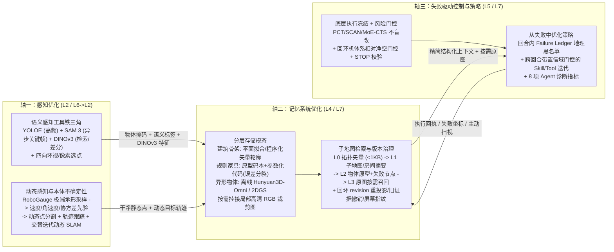

# VLN 评测真相、Agent 弱点解剖与「感知 + 记忆 + 失败驱动控制」演进总纲（2026-11-25）

> 整理日期：2026-11-25 · 活跃开发分支：`exp/live-v4-ba-sliding-window`（`fb35dd8`，807 单测 / 60 回归全绿）
>
> 本文系统沉淀 2026-11-22 至 2026-11-25 关于 **VLN 领域谱系、主流 Benchmark 隐藏 Tricks、免训练 Agent 框架（SuperNav 等）四维拆解、GPT-6.2-Astra 弱点专项审计** 的全部调研结论，并将其收拢为本项目下一阶段清晰的三轴演进蓝图：**感知（动态 + 语义）+ 记忆（表达 / 场景描述 / 子地图检索 / 存储模态 / 失效治理）+ 失败驱动的控制策略**。
>
> 配套文档：[ROADMAP.md](../ROADMAP.md) · [BASELINES.md](../BASELINES.md) · [TASKS.md](../TASKS.md) · [2026-11 学术创新查重与论文方向总评](2026-11-novelty-audit-and-directions.md) · [Agent 教程 01/02](../../agent-tutorial/README.md)

---

## 1. VLN 领域全景与主流 Benchmark 隐藏 Tricks 核查

只看论文表里的 `SR`（成功率）和 `SPL`（路径加权成功率）极易产生误判。审阅或对标任何 VLN 工作前，必须先用 **6 把标尺** 拆穿评测设置里的“保护罩”：
1. **物理动作**：瞬移 / 离散步进且开 `ALLOW_SLIDING = True`（贴墙无摩擦滑行），还是真实物理引擎并计入碰撞与摔倒率（`FR`）？
2. **视野与定位**：单目窄 FOV 还是四向 360° 相机？完美 GPS + 真值深度 + 预计算 NavMesh，还是真实带噪 SLAM？
3. **成功判据**：`3.0 m` 还是 `1.0 m / 0.25 m`？路过即停（Oracle Stop）还是必须主动发 `STOP`？发生碰撞是否直接判负？
4. **环境静态性**：完全静态，还是含动态人群 / 家具搬移 / 屏幕动画 / 光照变化？
5. **抽样与重试**：全量 `val-unseen` 首试，还是 100–200 题抽样子集，抑或同一题集多轮试错（Multi-pass）？
6. **长程连贯性**：每阶段重置单测再相乘，还是不重置、把上段残余偏差和脏记忆直接带入下段？

### 1.1 六类代表任务、隐藏 Tricks 与真实掉分真相

| 任务类型 & 代表 Benchmark | 典型任务形态 | 常见隐藏 Tricks / 评测边界 | 核实到的代表表现与真实掉分 |
| :--- | :--- | :--- | :--- |
| **细粒度路线跟随** `R2R-CE` / `RxR-CE` | 逐步路标指令（走廊、门、楼梯、参照物） | `ALLOW_SLIDING=True`、`3.0 m` 半径、离散步进（0.25 m / 15°）、常见完美深度或 GPS+Compass | `InternVLA-N1 (DualVLN)` R2R-CE RGB 达 `SR 64.3% / SPL 58.5%`；RxR-CE `SR 61.4% / nDTW 70.0%`（改接最短路跟随器后 SR 升至 `63.5%` 但 `nDTW` 跌至 `46.8%`——抄近道不按指令走） |
| **开放词汇寻物** `HM3D-OVON` (379 类) | *“找瑜伽垫 / 打印机 / 红杯”* | 命中任意同类即胜（不考特定实例）；API 模型论文常抽 100–200 题子集；多依赖完美深度/位姿建图 | `HarnessVLN` 在 HM3D-v2 报 `76.0%`、HM3D-OVON 报 `59.3%`；`SuperNav` 在 120 题子集报 `73.33%` |
| **多目标终身记忆** `GOAT-Bench` / `LHPR-VLN` (CVPR 2025) | 同场景不重置，连续执行 3–5 个跨模态目标（类别/描述/照片） | 场景绝对静态，建完真值图后类似查表；测不出物品搬移/门状态变化导致的旧记忆失效 | `GOAT-Bench` (Val Unseen)：显式建图 `Modular GOAT` 为 `SR 24.9% / SPL 17.2%`，纯端到端 `SenseAct-NN` 仅 `12.3% / 6.8%` |
| **物理具身跨本体** `VLN-PE` (ICCV 2025) / `InternNav` | Isaac Sim 真物理动力学（四足/人形/轮式）+ 光照与真碰撞 | 剥掉滑动穿模外挂，计入真碰撞与摔倒率（`FR`） | 同款 `DualVLN` 在简化 `Flash` 控制器为 `SR 63.62% / SPL 56.49%`，**切到真实物理控制组暴跌 12 个点至 `51.6% / 42.49%`**；`Seq2Seq` 跌至 `15.1%` |
| **动态人群交互** `HA-VLN 2.0` (IROS 2026) / `DynaNav` (`TIC-VLA`, ICML 2026) | 医院/办公楼/仓库 10–40 行人（室外 100–200 人）动态避让 | **口径不可直接横比**：`DynaNav` 将 `SR` 与碰撞 `CR` 分开算（见 §1.2）；`HA-VLN 2.0` 直接把零碰撞写进成功判据 | `TIC-VLA` 在 DynaNav 报 `SR 55.29% / CR 28.24%`（同步基线 `32.94% / 41.18%`）；`HA-VLN 2.0` 连续 `val_unseen` 上 `ETPNav` 无碰撞 SR 仅 **`8%`**（人类回合碰撞率 **`71%`**），重训 `HA-VLN-CMA*` 仅 **`10%`**（碰撞率 **`69%`**） |
| **跨楼宇超长程连续** `I2O2I-Nav` (2026-10) | 四阶段连续不重置（室内下楼→室外→进另一楼→找物） | 上段实际终点即下段起点，误差、姿态偏移与脏记忆全程累积 | 模块化 Agent 单阶段 SR 为 `40.5%–76%`，但全链连跑总 SR 仅 **`1.15%`（固定链）** 与 **`4.02%`（模块化调度）** |

### 1.2 上游 DynaNav 源码审计与 `SuperNav` 前提拆解

- **上游 DynaNav 基准（UCLA `TIC-VLA`）实查结论**（本地未入 Git 的上游子集 `benchmark.py` / `benchmark_full.yaml`）：
  - 共 **85 条 Episode**（`hospital.usd` 25、`office.usd` 25、`full_warehouse.usd` 25、`outdoor_small.usd` 10），默认全部为轮式 `nova_carter`（其中 `office.usd` 含 5 条静态 + 20 条动态，且全在 `z = 0.01` 单平面）。
  - **6 处实现局限**：① `NE / SPL / 行人碰撞` 全按 2D `[:2]` 计算，跨楼层上下重叠会误判；② 每帧检测到 `< success_threshold`（默认 `1.5 m`）直接 `return True`，实质测的是 **Oracle Stop（OSR）** 而非主动 `STOP`；③ `SPL` 分子用起终点 2D 直线欧氏距离而非最短可行测地路；④ 物理碰撞需接触力 `>= 10 N` 连续持续 `100` 帧（30 FPS 下 ~3.3 s），漏检瞬时撞墙/磕扶手且无足式摔倒率；⑤ 缺跨楼层楼梯任务与长程链式任务；⑥ 无在线 SLAM 定位误差与推理延迟拆解。
- **`SuperNav`（ZJU3DV，2026-10，[arXiv:2610.12126](https://arxiv.org/abs/2610.12126)）五大前提拆解**：
  1. 冻结通用 MLLM/Coding Agent（Codex / OpenCode / Kimi）+ Markdown Navigation Skills + Progress Tracker + Unified Visual-Point（`PixelGoal`）接口；
  2. **仿真默认几何执行器（`Geo-based Executor`）使用 Oracle 几何、真值深度图、标定外参与预计算 NavMesh**，绕开了真实 SLAM 漂移、建图不全与 3D 爬楼动力学；
  3. **四向 360° 相机（前/右/后/左）视角红利**，显著降低单目主动环视与盲区难度（注：本项目 2026-11-12 已实测过四台 120° 相机环视采集与探索，见 [dynanav-four-camera-120-comparison-20261112.md](../../experiments/dynanav-four-camera-120-comparison-20261112.md)）；
  4. `HM3D-OVON` 报的 `SR 73.33% / SPL 0.4105`（1 m 阈值）与 `68.33%`（0.25 m 阈值）来自 **120-episode 抽样子集**；
  5. 消融证实拿掉手工 Skills 或工具后成功率剧降，且未系统评测密集动态人群、长时带噪 SLAM 回环修订与多层楼梯。

---

## 2. 非训练 Agentic VLN 四维拆解与核心弱点（Skills / Tools / Evolution / Memory）

2026 年下半年，围绕冻结大模型 + 外部模块的非训练 VLN 迅速涌现（`SuperNav`、`ASENA`、`HarnessVLN`、`AgenticNav`、`EvolveNav`、`EvoNav`）。按 Agent 四维展开对比：

| 维度 | 2025–2026 代表做法 | 隐藏弱点与失效根因（审稿视角） |
| :--- | :--- | :--- |
| **技能（Skills）** | `SuperNav` 模块化 Markdown 导航技能；`ASENA` 工作区可执行代码技能库；`HarnessVLN` 固化“提议→校验→执行→STOP 核验”状态机 | 手工先验跨场景迁移脆弱；`ASENA` 在同一 100 题刷 10 遍（R2R `72% → 98%`）属于原题多 pass 收益，不能等同陌生场景首试 |
| **工具（Tools）** | `SuperNav / AgenticNav` RGB 像素选点（`PixelGoal`）+ 按需深度查询；`HarnessVLN` 几何可行性与 `STOP` 校验；`ASENA` 将 4B 专用导航小模型封装为 Tool | 过度依赖单目像素选点在无深度/强遮挡时仍会产生 3D 反投影偏差；缺少对动态物体运动趋势的几何工具 |
| **进化机制（Evolution）** | `EvolveNav` 回合内预反思（Preflection）+ 跨回合 UCB 规则库；`ASENA` 报错诊断→改代码→持久化工作区；`EvoNav` 经验蒸馏为环境知识 | **记忆税（Memory Tax）与负迁移**：纯离散文本上下文把连续概率分布塌缩为无不确定性（无协方差）的点估计规则，新旧规则冲突或跨场景硬套会直接把原本能做对的决策翻错 |
| **记忆（Memory）** | `3D-Mem` 关键帧代表图与前沿快照；`AgenticNav` 按需情景视觉召回；`HarnessVLN` 分层事件记忆 + 含失败节点的时空图；`JanusVLN` 双隐式 KV 记忆 | **`MemoryAgentBench` 实证**：单跳实验在每组检索均已命中最新事实的前提下，将上下文证据预算从 `64` 增至 `512` token，准确率反而从 **`45%` 降至 `32%`**；动态环境中旧信念不失效（Belief Staleness）会压倒最新观测 |

**核心认知结论**：
- **纯 VLN 论文避而不谈的真正瓶颈，恰恰卡在「动态/语义感知」与「结构化且可更新的时空记忆」上**；
- 记忆的本质是**面向下游决策的率失真压缩（压缩即智能）**，且必须突破“纯离散裸文本上下文”的限制，引入**版本管理、置信度/分布门控与过时证据撤销**。

---

## 3. 下一阶段三轴总蓝图：感知（动态 + 语义）+ 记忆（表达 / 检索 / 模态）+ 失败驱动控制

在冻结现有全栈底座（见 [BASELINES.md](../BASELINES.md)：V4 `1.4–2.0 cm` 跨楼层 SLAM、通用 3D PCT/SCAN、Go2 MoE-CTS、807 单测）的前提下，后续优化聚焦于三条互锁但可分包独立验证的主线：

### 3.1 轴一：感知优化（动态感知 + 语义感知）

1. **语义感知（免训练专用模型工具化，绝不从零自训通用视觉模型）**：
   - **YOLOE（`-seg`）**：常驻高频在线工具（`5–15 Hz`，显存 `< 1–2 GB`），负责动态行人/可动物体实时掩码与流式哨兵初筛；
   - **SAM 3**：异步关键帧队列（`0.5–5 Hz`，不进硬实时环），文本概念分割 + 跨帧 ID 跟踪，精准剥离前景物体点云，消除纯几何 Surface Nets 的接触粘连；
   - **DINOv3**：冻结密集特征引擎，专职**同类物体原型去重检索（`< 50 ms`）**、**T0/T1 同视角巡检找不同**与跨视角重定位；
   - **视角与交互升级**：结合已验证的四向环视能力与 `goto_pixel / query_pixel_3d`（标定内参 + 实测 RTX LiDAR 反投影），并将拟合后的**语义墙体、门洞缺口、楼梯箭头与显著路标轮廓**直接叠画到导航地图上。
2. **动态感知（四足本体不确定性 + 交替迭代动态 SLAM）**：
   - **借鉴源头**：航空侧 `AirIMU` / `AirIO`（2025，保留机体系可观性 + 显式姿态编码 + 协方差学习进 EKF）、`AI-IO`（二次阻力动力学因子化），四足侧 `Legolas`（CoRL 2024，大规模仿真学习腿部惯性不确定性传播）；
   - **极端地形本体感知训练**：在 RoboGauge 强化学习仿真环境中做广泛域随机化（扩展资产、IMU 噪声/零偏、以及未见极端地形：**30 cm 台阶、悬崖、凹坑、烂泥高阻力**），采样训练四足本体状态估计器输出 $(\hat{\mathbf{v}}_{\text{prop}}, \hat{\boldsymbol{\omega}}_{\text{prop}}, \Sigma_{\text{prop}})$（注意先核实当前 `MoE-CTS` 包装仅公开 12 维动作，策略隐状态需另行核验导出接口）；
   - **交替迭代动态 SLAM**：以本体预测与协方差为初值 → 执行短时动态点云分割（GNC-IRLS 鲁棒残差选优）与动态点簇速度跟踪 → 用剔除动态点后的静态约束反过来精修本体位姿 → 迭代收敛；干净静态点与动态物体轨迹自然接入记忆层与 3D 重建；
   - **动态屏幕/视频物理指纹**：利用 **“LiDAR 3D 几何残差 ≈ 0（实体不动）+ RGB 外观残差高”** 区分显示屏/闪烁灯与真实移动物体，避免误删静态设施或污染回环。

### 3.2 轴二：记忆系统优化（记忆形式、场景描述、子地图检索、存储模态与失效治理）

1. **为什么混合「程序化场景描述 + 视觉原图」而非单一模态？**
   - LLM 读结构化程序/场景树（`SceneScript` / 轻量 Three.js / USD 骨架）在公制比较、遮挡穿透、跨楼层拓扑与 `diff` 巡检上远强于纯 RGB 读图，且压缩比极高；
   - **但必须牢记 `VSI-Bench`（CVPR 2025）反直觉警告**：给真值图时把网格从 `10×10` 细化到 `20×20` 准确率从 `66% → 78%`，但若位置是估出来的，细化后反而从 `56% → 54%`——**几何有误差时过度细化程序表达会放大幻觉**，且外观异常（漏水、文字、屏幕）必须靠按需挂接局部高清 RGB 裁剪图兜底。
2. **分层存储模态（适配 `16 GB` 显存红线）**：
   - **建筑大骨架（墙/地/顶/门洞/楼梯）**：V4 定向平面拟合 + 参数化几何代码/矢量轮廓（严禁扩散 3D 模型生成墙体）；
   - **规则几何家具（桌/柜/货架/门板）**：LiDAR 尺寸 + 部件级原型码本/参数化短代码，采用**误差驱动的在线原型分裂**（配准残差 `< τ` 直接实例化复用，残差超阈值才分裂新原型），将全楼物体几何压到百 KB 级；
   - **复杂曲面/异形物（转椅/绿植/沙发/器材）**：`SAM 3` 剥离 + `DINOv3` 原型去重 → 离线串行 `Hunyuan3D-Omni`（原生支持点云 + 3D 框 + 骨架 + RGB 裁剪图条件约束）或 `2DGS/PGSR` 联动八叉树；
   - **所有节点强锚定 V4 `keyframe_id`**：支持回环/BA 后 $O(1)$ 刚体随图重投影，并研究**回环后旧自由空间射线证据增量撤销**。
3. **四层子地图检索金字塔与版本失效治理**：
   - `L0 全局语义拓扑与矢量轮廓 (< 1 KB 常驻)` → `L1 子地图/房间/时间摘要向量召回` → `L2 物体原型与历史失败节点图` → `L3 按需关键帧高清原图`；
   - **显式置信度与版本门控**：每条记忆/经验携带 `map_revision`、观测时间戳、空间适用域与置信度，地图发生回环修订或场景物体搬移时主动降权/撤销旧信念，遏制“证据已命中但旧记忆翻错动作”的记忆税。

### 3.3 轴三：控制与策略演进（在失败中优化）

- **底层冻结**：保持 L5/L6（PCT + SCAN + RouteTracker + MoE-CTS）作为可靠物理执行仪器，仅按需叠加 **回环机体系相对净空风险交付门控**（计算 $Y^{(k)} = (T_b^{(k)})^{-1} T_g^{(k)}$ 判断继续/重规划/停稳）与 **前置 `STOP` 几何校验**；
- **失败驱动的策略进化**：
  1. **回合内**：维护 `Attempt & Failure Ledger`（结构化失败地理黑名单，记录卡困/门框/超时坐标与失败码），防止 Agent 反复下发同类必败 `goto`；
  2. **跨回合**：离线复盘 `receipts.jsonl` + 失败帧，将有效恢复模式沉淀为受控的复合 Skill / Tool（如门角脱困、楼梯直通 `maneuver`、主动 360° `scan`），注入时必须过**适用域与置信度门控**，避免负迁移；
- **超越 `SR/SPL` 的 8 项 Agent 诊断指标**（用于定位真实瓶颈，而非堆砌新排行榜）：
  1. 证据已命中仍判错率（对抗记忆污染）；2. 过时经验翻错率（旧地图/旧状态注入对比）；3. 无效重访浪费率；4. 跨房间/跨楼层记忆混淆率；5. 重复踩坑率（衡量是否真进化）；6. 过早/漏停失误（`OSR - SR` 拆解）；7. 长程退化斜率（10→50→150 步）；8. 定位退化落差 $\Delta\text{SR} = \text{SR}_{\text{truth}} - \text{SR}_{\text{live-slam}}$ + 物理安全（`FR` / 瞬时躯干碰撞）。

---

## 4. 打破「全系统内耗」的两条 2 周止损验证实验

工程蓝图上“感知 + 记忆 + 失败驱动控制”是一个完整闭环，但实验验证与论文推进必须严守**单点先证伪、2 周见生死**的纪律（避免同时大改全栈）：

| 优先级 | 独立验证线 | 2 周最小止损实验（严格复用现有冻结底座） | 通过判据 / 止损门 |
| :--- | :--- | :--- | :--- |
| **实验 1（记忆线首选）** | **地图修订 / 场景变化后的旧经验失效与记忆检索对比** | 复用已有 `D-Indoor-2F` 两层录包，在固定路口、固定观测、固定地图版本与候选动作上，只替换/注入 1 条过时经验，测量原本正确决策被翻错的比例；并拿程序化/原型记忆正面硬刚朴素强基线 **“同楼层最新可见证据 + 按需看原图”** | 若新记忆/失效门控在两周内打不赢该朴素基线，立刻停止盲目扩建重型记忆框架 |
| **实验 2（感知动态线并行保留）** | **四足本体运动先验在人群遮挡下的动态点分割上界验证** | 先不急于大改 RL 采样训练；第一步直接把**准确机体运动**喂给扫描匹配器，在 `ref/dynanav-dynamic-pedestrian` 与 `D-Dynamic-M3DGR` 上测：高动态人群遮挡时静态墙面/动态点分割与在线 ATE 到底能提升多少 | 若准确运动先验上界增益显著，再投入 RoboGauge 极端地形本体不确定性训练与交替迭代动态 SLAM |

---

## 5. 核心核实参考文献索引

- **基准与弱点剖析**：`VLN-PE` (ICCV 2025, [arXiv:2507.13019](https://arxiv.org/abs/2507.13019)) · `TIC-VLA / DynaNav` (ICML 2026, [arXiv:2602.02459](https://arxiv.org/abs/2602.02459)) · `HA-VLN 2.0` (IROS 2026, [主页](https://uwmilab.github.io/HA-VLN-webpage/)) · `I2O2I-Nav` (2026-10, [arXiv:2610.18307](https://arxiv.org/abs/2610.18307)) · `LH-VLN / LHPR-VLN` (CVPR 2025, [主页](https://hcplab-sysu.github.io/LH-VLN/)) · `GOAT-Bench` ([arXiv:2404.06609](https://arxiv.org/abs/2404.06609)) · `HM3D-OVON` ([arXiv:2409.14296](https://arxiv.org/abs/2409.14296)) · `TaskSLAM-Bench` (IROS 2025, [arXiv:2409.16573](https://arxiv.org/abs/2409.16573)) · `VSI-Bench` (CVPR 2025, [arXiv:2412.14171](https://arxiv.org/abs/2412.14171)) · `MemoryAgentBench` ([arXiv:2610.36308](https://arxiv.org/abs/2610.36308))
- **Agentic VLN 与记忆框架**：`SuperNav` (2026-10, [arXiv:2610.12126](https://arxiv.org/abs/2610.12126)) · `ASENA` (2026-09, [arXiv:2609.39207](https://arxiv.org/abs/2609.39207)) · `HarnessVLN` (2026-09, [arXiv:2609.15195](https://arxiv.org/abs/2609.15195)) · `AgenticNav` (2026-06, [arXiv:2606.10577](https://arxiv.org/abs/2606.10577)) · `EvoNav` (2026-11, [arXiv:2611.22321](https://arxiv.org/abs/2611.22321)) · `3D-Mem` (CVPR 2025, [arXiv:2411.17735](https://arxiv.org/abs/2411.17735)) · `InternNav / DualVLN` ([GitHub](https://github.com/InternRobotics/InternNav))
- **程序化 3D 与多模态生成**：`MeshCoder` (NeurIPS 2025, [arXiv:2508.14879](https://arxiv.org/abs/2508.14879)) · `SceneScript` ([arXiv:2403.13064](https://arxiv.org/abs/2403.13064)) · `LayoutVLM` (CVPR 2025) · `SuperDec` (CVPR 2025) / `SuperFlex` (2026) · `Hunyuan3D-Omni` (2025–2026)
- **惯性/四足本体里程计**：`AirIMU` / `AirIO` (CMU AirLab, 2025) · `AI-IO` (2025–2026) · `Legolas` (CoRL 2024)
