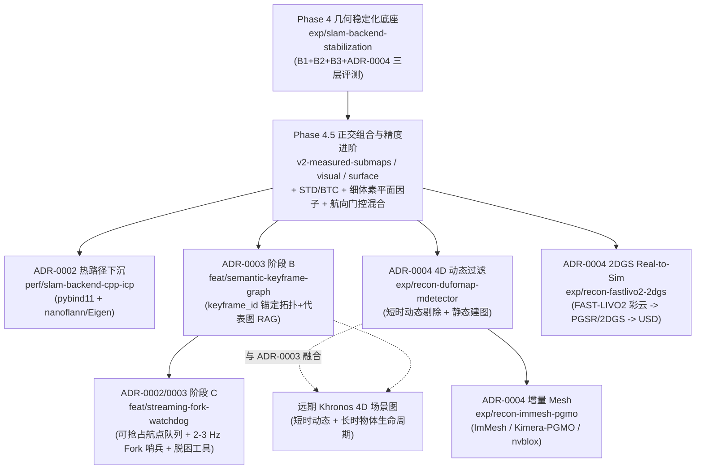

# ADR-0002 / ADR-0003 / ADR-0004 深度调研与分支动工蓝图（2026-11-22）

> [!NOTE]
> 本文面向架构讨论与分支立项，基于本仓库当前真实技术栈（Isaac Sim DynaNav + Unitree Go2 + RoboGauge MoE-CTS + FAST-LIVO2 + PCT A* + SCAN + ROS 2 + 13 话题 MCAP + Phase 4 稳定化后端）梳理论文、开源代码库、工程对接方式与分分支动工顺序。后端实测基线见 [experiments/slam-backend-phase4/REPORT.md](../../../experiments/slam-backend-phase4/REPORT.md) 与 [docs/design/slam-backend-branches-guide.md](../../design/slam-backend-branches-guide.md)。

---

## 0. 全局演进依赖图与动工顺序

**推荐推进节奏（每步均可在现有数据盘跑出可量化收益）**：
1. **立即落地（1~2 天）**：审阅推送 Phase 4 四分支 + 数据盘清理授权 + 将推荐配置接入主启动器并在 Isaac Sim 补录完整双层探索 MCAP。
2. **第一波架构分支（1 周内）**：
   - `perf/slam-backend-cpp-icp`（ADR-0002：把当前 Python 后端最慢的 ICP/法向/体素下沉 C++，使 `D2` 回放从 ~240 s 压至 ~15 s，同时满足在线 2 Hz 无积压）；
   - `feat/semantic-keyframe-graph`（ADR-0003 阶段 B：基于 `3D-Mem` + `HOV-SG` 思路建立 `keyframe_id` 锚定的房间/走廊/楼梯拓扑与代表图数据库，并反哺视觉回环）。
3. **第二波架构分支（2 周内）**：
   - `feat/streaming-fork-watchdog`（ADR-0002/0003 阶段 C：基于 `SGLang RadixAttention` / Prompt Caching 与可抢占航点队列实现 2–3 Hz 阅后即焚 Fork 哨兵）；
   - `exp/recon-fastlivo2-2dgs` 与 `exp/recon-dufomap-mdetector`（ADR-0004：直接复用现有 13 话题 MCAP 跑离线 `DUFOMap` 静态清理与 `FAST-LIVO2 → 2DGS/PGSR → Isaac Sim USD` 首条 Real-to-Sim 闭环）。

---

## 1. ADR-0002 调研：异步具身行动、后端控制协同与 Python→C++ 热路径

### 1.1 代表性论文与开源项目

| 项目 / 论文 | 年份 / 会议 | 核心机制 | 开源仓库 | 对本项目的直接借鉴价值 |
| --- | --- | --- | --- | --- |
| **InternVLA-N1 / InternNav** | 2025–2026 | 异步双系统导航基座：**System 2**（7B VLM，~2 Hz 慢速全局推理输出中程目标）+ **System 1**（轻量扩散策略高频生成局部平滑轨迹）；已在 **Unitree Go2** 实机验证 | [InternRobotics/InternNav](https://github.com/InternRobotics/InternNav) | 最贴近本项目 Go2 形态的双系统参考；其 System 2 输出“中程子目标 + 潜意图”而非底层速度命令，与我们现有 PCT+SCAN+RoboGauge 架构同构 |
| **NaVILA** | 2024–2025 | 足式机器人两级 VLA 框架：高层 VLM 输出离散步进/转向语言指令，底层 LiDAR 感知运动策略负责地形适应与避障（实机测过 **Unitree Go2 / G1**） | [AnjieCheng/NaVILA](https://github.com/AnjieCheng/NaVILA) | 说明在足式机器人上把“语言/视觉决策”和“高频地形/步态控制”解耦是最稳妥路线；也印证需要独立的短距脱困微操原语 |
| **VLingNav** | 2026 | 自适应思维链（AdaCoT）+ 视觉辅助语言记忆，在直行快执行与复杂路口慢思考之间动态切换 | arXiv 2026 | 对应“长走廊低思考快推进、路口/门洞唤醒深度思考”的节奏控制 |
| **VLFM** | ICRA 2024 | 深度图构建前沿占据图 + 预训练 VLM（BLIP-2）对 RGB 打分生成语义价值图，零样本目标搜索（Spot 四足实机验证） | [rai-opensource/vlfm](https://github.com/rai-opensource/vlfm) | 可直接把“前沿语义打分价值图”思路接到 `planning/exploration/` 前沿候选排序中 |
| **Mobility VLA** | CoRL 2024 | 长上下文 VLM 结合历史导览视频与离线拓扑图定位目标帧并驱动导航 | CoRL 2024 | 验证了“拓扑图 + 关键帧代表图”比纯坐标列表更适合 VLM 空间定位 |

### 1.2 本项目三大工程问题与动工方案

1. **异步行动协议（替换文件邮箱回合制）**：
   - **现状瓶颈**：`explore_waypoint_client.py` 走 JSON 文件邮箱 + 同步等 `goto` 到达再思考 10–30 s，既浪费时间又在墙角长停诱发前端漂移。
   - **目标协议**：升级为**可抢占航点队列（Lookahead Preemptable Queue）** + `action_epoch` 乐观锁，结合已在 `exp/startup-walk-imu-bias` 实现的直通脱困 `maneuver`（绕过 PCT+SCAN），在 RoboGauge 姿态安全门内执行短距脱困。
2. **后端位姿修正（`T_world_odom`）与局部控制协同**：
   - **关键红线**：**绝不在局部 B 样条跟踪中途把 `T_world_odom` 跳变直接叠进控制反馈**。
   - **正确边界**：局部控制（SCAN + RouteTracker）始终在平滑连续的 `odom` 系下闭环；每当 `CorrectionAdmission` 采纳新修正 $C_{\text{adopted}}$ 时，仅在**下一拍 PCT 全局重规划或新航点下发边界**将世界系全局路径点通过 $C_{\text{adopted}}^{-1}$ 投影到当前 `odom` 系。
3. **Python → C++ 热路径边界（实测数据驱动）**：
   - 在 `D2`（1,567 关键帧）上，当前纯 Python 后端耗时 `~242 s`，实测 >85% 耗时集中在 `registration.py` 的 `cKDTree` 近邻查询、`_normals` 局部 PCA 与 30 轮 ICP 循环，以及体素降采样与 ZUPT 点云查询。
   - **最小侵入加速方案**：保持编排、配置校验、`CorrectionAdmission` 和评测脚本在 Python，用 `pybind11` + `Eigen` + `nanoflann` 下沉 `voxel_downsample`、`icp_point_to_plane`（含重力先验）与 `PoseGraph.optimize`，预计提速 **15–30×**（`D2` 回放 `< 20 s`，在线单帧 P95 `< 15 ms`）。

### 1.3 建议切出分支

- `perf/slam-backend-cpp-icp`：基于 `exp/slam-backend-stabilization`，以 `tests/unit/test_slam_backend*.py` 与 `D1/D2/D3` 数值误差 `< 1e-4 m` 作为等价验收标准。
- `feat/agent-preemptable-control`：补齐可抢占航点队列与低延迟 IPC（Unix Socket / ROS 2 Action）。

---

## 2. ADR-0003 调研：流式 Fork 哨兵 + 关键帧锚定层次化语义场景图

### 2.1 流式 Speculative Fork（System 1 哨兵）的底层基础设施调研

| 技术 / 项目 | 核心能力 | 开源仓库 / 来源 | 与 ADR-0003 的匹配度 |
| --- | --- | --- | --- |
| **SGLang + RadixAttention** | 将 LLM/VLM 的 KV-Cache 组织为基数树（Radix Tree），天然支持 **Copy-on-Write 零拷贝 Prefix Fork**：主干上下文只需一次 Prefill，2–3 Hz 哨兵分叉直接复用主干记忆，返回 `CONT` 后立即淘汰叶子节点且不污染主干 | [sgl-project/sglang](https://github.com/sgl-project/sglang) | **完美匹配 ADR-0003 §2**；本地部署流式 Fork 哨兵首选 |
| **vLLM Automatic Prefix Caching (APC)** | 按固定块哈希复用公共提示词前缀，云端 API Prompt Caching 提供类似能力 | [vllm-project/vllm](https://github.com/vllm-project/vllm) | 云端 VLM API 或已有 vLLM 服务的替代方案 |
| **DASH（Decoupled Async Execution, 2026）** | 慢速 VLM 编排与快速动作执行解耦，用 `epoch` 版本号与超时作废处理异步并发乱序 | 2026 Robotics/Systems | 验证 `action_epoch` + `(frame_seq, max_age_s=1.2 s)` 防过时抢占机制 |

**关键实现约束**：按 `Δt >= 0.5 s` 或 `Δd >= 0.3 m` 或 `Δyaw >= 10°` 混合触发，限制同时在途 `2–3` 路；结构化极短输出（≤ 20 tokens，`CONT / STOP`）；System 1 严禁越权写 `cmd_vel`。

### 2.2 关键帧锚定 3D 语义场景图与图片数据库调研

| 项目 / 论文 | 年份 / 会议 | 核心机制 | ROS 2 / 开源仓库 | 对本项目的适用性评估 |
| --- | --- | --- | --- | --- |
| **3D-Mem** | **CVPR 2025** | 用 **Memory Snapshots**（共视聚类后的关键帧代表图集合）+ **Frontier Snapshots** 替代脆弱的纯 3D 物体框图喂给 VLM | [UMass-Embodied-AGI/3D-Mem](https://github.com/UMass-Embodied-AGI/3D-Mem) | **与 ADR-0003 §3 契合度最高（95%）**；可直接挂到 `SlamBackend` 的 `keyframe_id` |
| **HOV-SG** | **RSS 2024** | 层次化开放词汇 3D 场景图（Floor → Room → Object）+ **跨楼层 Voronoi 拓扑图**处理楼梯连通 | [hovsg/HOV-SG](https://github.com/hovsg/HOV-SG) | **多层架构最直接参考**（高度直方图切楼层 + 楼梯虫洞边） |
| **Hydra** | IJRR / RSS | MIT SPARK 实时 5 层 3D 场景图（Mesh → Objects → Places → Rooms → Building），联动 `Kimera-PGMO` 回环形变 | [MIT-SPARK/Hydra](https://github.com/MIT-SPARK/Hydra)（原生 ROS 2） | 工程成熟度最高，C++ 依赖较重，适合中后期借鉴/接入 |
| **Clio** | RA-L 2024 | 基于信息瓶颈的任务驱动开放集 3D 场景图，按任务粒度自动聚合/裁剪物体节点 | [MIT-SPARK/Clio](https://github.com/MIT-SPARK/Clio) | 适合作为后期语义节点压缩策略，防止长程探索产生碎片 |
| **Embodied-RAG** | 2024 | 拓扑图 + 层次化语义森林，支持多分辨率空间-语义 RAG 检索 | [quanting-xie/Embodied_RAG](https://github.com/quanting-xie/Embodied_RAG) | 解决长程探索后主干 Agent 的跨房间记忆召回 |
| **GraphEQA / SG-Nav** | NeurIPS 2024 / 2025 | 将实时 3DSG + 关键帧图像作为多模态记忆提示 VLM 做零样本导航与具身问答 | [SaumyaSaxena/graph_eqa](https://github.com/SaumyaSaxena/graph_eqa) / [bagh2178/SG-Nav](https://github.com/bagh2178/SG-Nav) | 可直接复用的“场景图文本摘要 + 精选代表图”Prompt 组织范式 |

### 2.3 双向闭环：语义图片数据库如何反哺 SLAM 后端？

1. **关键帧锚定与回环自动重投影**：每个房间/走廊/楼梯节点只存 `anchor_keyframe_ids` 和 `representative_images[]`，每次 `PoseGraph.optimize()` 后自动随图位姿更新，零漂移撕裂。
2. **三级漏斗语义辅助定位（避免语义质心直塞局部 ICP 的收敛域缺陷）**：语义层只负责**跨层/跨房间防混门控**与**绑架重定位粗候选池**，中间必须由几何/视觉桥（ScanContext / STD-BTC 三角形描述子 / 视觉 3D 验证）产出 `< 0.5 m, < 10°` 粗初值，再交局部点对面 ICP 厘米级精修。

### 2.4 建议切出分支

- `feat/semantic-keyframe-graph`（先做）：扩展 `localization_mapping/semantic_mapping/`，实现轻量 SQLite/JSON 拓扑图 + `3D-Mem` 风格代表图快照 + `keyframe_id` 锚定更新。
- `feat/streaming-fork-watchdog`（后做）：在 `scripts/explore_waypoint_client.py` 之上叠加 `2–3 Hz` 流式 Fork 看门狗。

---

## 3. ADR-0004 调研：增量 Mesh、4D 动态地图与 FAST-LIVO2 + 2DGS/3DGS Real-to-Sim

### 3.1 从点到平面到增量三角网格（Mesh）与回环更新

| 项目 / 论文 | 年份 / 机构 | 几何表征与更新机制 | 开源仓库 | 优势与局限（针对本项目） |
| --- | --- | --- | --- | --- |
| **ImMesh** | T-RO 2023（HKU-MaRS） | 直接在 LiDAR Voxel 局部切平面上做增量 Delaunay 三角化 | [hku-mars/ImMesh](https://github.com/hku-mars/ImMesh) | 建筑棱角（门框、楼梯）锐利，与 FAST-LIVO2 同实验室；大回环形变需结合子图或 PGMO |
| **Kimera-PGMO** | T-RO 2024（MIT SPARK） | **位姿图 + 网格形变图联合优化**：回环时弹性形变已有三角网格，无需退回点云重算 | [MIT-SPARK/Kimera-PGMO](https://github.com/MIT-SPARK/Kimera-PGMO) | 直接解决回环后 Mesh 一致性更新；官方支持 ROS 2 |
| **Isaac ROS nvblox** | NVIDIA | GPU 稀疏 TSDF/ESDF 体素块 + 增量 Marching Cubes 实时出 Mesh 与代价图 | [NVIDIA-ISAAC-ROS/isaac_ros_nvblox](https://github.com/NVIDIA-ISAAC-ROS/isaac_ros_nvblox) | 与 Isaac Sim + ROS 2 生态顺滑；原生缺全局回环子图重对齐 |

### 3.2 4D 时空动态地图（短时动态剔除 + 长时变化）

| 项目 / 论文 | 时间尺度 | 核心原理 | 开源仓库 | 接入难度（本项目） |
| --- | --- | --- | --- | --- |
| **M-detector** | 秒级（短时） | HKU-MaRS 基于射线遮挡事件的点级实时运动检测，微秒级延迟 | [hku-mars/M-detector](https://github.com/hku-mars/M-detector) | 低（恢复 `ref/dynanav-dynamic-pedestrian` 时首选） |
| **DUFOMap** | 秒~分钟级（离线/准实时） | KTH 基于“已观测绝对自由空间（ever-free）”体素射线投射，几乎免调参；提供 `pip install dufomap` | [KTH-RPL/dufomap](https://github.com/KTH-RPL/dufomap) | **极低（1 天内可出 PoC）**，适合离线地图静态清理 |
| **Dynablox** | 秒级（在线） | ETH ASL 基于 TSDF 自由空间一致性的在线动态检测 | [ethz-asl/dynablox](https://github.com/ethz-asl/dynablox) | 中（思路可迁移至 nvblox） |
| **Khronos** | 秒级 + 分钟/天级（完整 4D） | MIT SPARK（RSS 2024 最佳系统论文，原生 ROS 2）：局部快窗口跟踪 + 全局慢因子图维护物体 `[t_first, t_last]` 生命周期 | [MIT-SPARK/Khronos](https://github.com/MIT-SPARK/Khronos) | 中高（远期融合 ADR-0003 场景图与 4D 地图的黄金参考） |

### 3.3 FAST-LIVO2 + 2DGS / 3DGS 融合重建潜力

现有 `D1/D2` 13 话题 MCAP（32 线 RTX LiDAR + 标定 RGB + 带噪 IMU + 外参）配合 Phase 4 稳定化位姿已完整满足 2DGS/3DGS 输入契约：

| 项目 / 论文 | 年份 / 会议 | 核心亮点 | 开源仓库 | 对本项目的最直接用途 |
| --- | --- | --- | --- | --- |
| **Gaussian-LIC / Gaussian-LIC2** | ICRA 2025 / IJRR | 基于 LiDAR-Inertial-Camera 里程计驱动实时 3DGS 建图 | [APRIL-ZJU/Gaussian-LIC](https://github.com/APRIL-ZJU/Gaussian-LIC) / [XingxingZuo/gaussian_lic2](https://github.com/XingxingZuo/gaussian_lic2) | 最直接的在线 LIV + 高斯建图参考 |
| **LIV-GaussMap** | RA-L 2024 | 紧耦合 LiDAR-Inertial-Visual 辐射场高斯建图 | [sheng00125/LIV-GaussMap](https://github.com/sheng00125/LIV-GaussMap) | 验证 LiDAR 平面初始化高斯协方差可大幅压缩训练耗时 |
| **GS-LIVO** | 2025（HKUST） | 改造 FAST-LIVO2 视觉更新管线，用高斯渲染光度残差替代图像块 Warp | arXiv 2025 | 远期前端演进参考 |
| **GS-SDF** | 2025（HKU-MaRS） | 联合 LiDAR 先验、Gaussian Splatting 与神经 SDF | [hku-mars/GS-SDF](https://github.com/hku-mars/GS-SDF) | 兼具渲染质量与几何表面精度 |
| **PGSR / 2DGS** | TVCG 2024 / SIGGRAPH 2024 | 将 3D 椭球压扁为贴合表面的 **2D 平面高斯圆盘**，可经 TSDF 融合导出**水密三角 Mesh** | [zju3dv/PGSR](https://github.com/zju3dv/PGSR) / [hbb1/2d-gaussian-splatting](https://github.com/hbb1/2d-gaussian-splatting) | **短期最快离线 Real-to-Sim 管线**：后端轨迹 + FAST-LIVO2 彩云 + RGB → COLMAP → PGSR/2DGS → Mesh/USD |
| **GS-ICP-SLAM** | ECCV 2024 | G-ICP 跟踪与 3DGS 协方差双向共享（>100 FPS） | [Lab-of-AI-and-Robotics/GS_ICP_SLAM](https://github.com/Lab-of-AI-and-Robotics/GS_ICP_SLAM) | 统一 SLAM 配准与渲染表达的远期参考 |

### 3.4 建议切出分支

- `exp/recon-fastlivo2-2dgs`：在 `D2` 上导出 COLMAP 格式并用 `PGSR/2DGS` 重建纹理室内网格、验证导入 Isaac Sim。
- `exp/recon-dufomap-mdetector`：离线动态点剥离 PoC（配合动态行人回归）。
- `exp/recon-immesh-pgmo`：后端 C++ 化后评估在线回环一致增量 Mesh。

---

## 4. 分支立项优先级汇总表

| 优先级 | 建议分支名 | 对应 ADR | 依赖前置 | 预计 PoC 周期 | 算力要求 | 验收标准 |
| --- | --- | --- | --- | --- | --- | --- |
| **P0** | `feat/agent-preemptable-control` | ADR-0002 / 0003 | `exp/startup-walk-imu-bias` | 1–2 天 | CPU + Isaac | 窄角脱困实机核销；航点支持中途抢占 |
| **P1** | `perf/slam-backend-cpp-icp` | ADR-0002 | Phase 4 定型后端 | 2–3 天 | CPU | `D2` 回放 `< 20 s`，与 Python 版轨迹差 `< 1e-4 m`，全量单测 0 新增失败 |
| **P1** | `feat/semantic-keyframe-graph` | ADR-0003 B | Phase 4 定型后端 | 3–4 天 | CPU / 可选 GPU | `D2` 上产出 `keyframe_id` 锚定房间/走廊/楼梯图 + 代表图库，回环重投影 0 撕裂 |
| **P2** | `exp/recon-fastlivo2-2dgs` | ADR-0004 | `D2` 13 话题 MCAP + 稳定化位姿 | 2–3 天 | 单张 GPU | `D2` 导出 COLMAP 并成功用 2DGS/PGSR 重建彩色室内网格，可导入 Isaac Sim |
| **P2** | `feat/streaming-fork-watchdog` | ADR-0003 C | `agent-preemptable-control` + `semantic-keyframe-graph` | 3–5 天 | 本地 SGLang / API | `2–3 Hz` 哨兵行进中 1 s 内抢占发现新门洞，`CONT` 帧零污染主干历史 |
| **P3** | `exp/recon-dufomap-mdetector` & `exp/recon-immesh-pgmo` | ADR-0004 | 恢复动态行人场景 / C++ 后端 | 1 周 | CPU / GPU | 动态行人场景静态图残影剔除率 >95%；回环后网格形变无重影 |

---

## 5. 数据盘空间体检与待审批清理清单（2026-11-22 只读盘点，未删除任何文件）

- **当前磁盘状态**：数据盘总容量 `804 GB`，已用 `679 GB`（85%），**剩余 `126 GB`**；`$PROJECT_DATA_ROOT/embodied-navigation/` 共占约 **`324 GB`**（其中 `runs/` `286 GB`、`experiments/` `28 GB`）。
- **必须保留（共 ~110 GB）**：`runs/20261121-noisy-imu-rgb-twofloor-explore/`（89 GB，`D1/D2` 唯一 13 话题原始包）、`runs/20261118-return-to-origin/20261118T055338Z/`（14 GB，`D3` 原始包）、`runs/20261119-hba-project-comparison/`（2.3 GB）、`runs/20261117-loop-comparison/`（4.2 GB）、`runs/20261122-slam-backend-phase4*/` & `cache/slam-backend-phase4/`（~0.5 GB）。
- **Tier 1 优先清理候选（`~100.4 GB`，清理后可用升至 `~226 GB`）**：
  - `runs/20261115-two-floor-demo/`（`41 GB`，重构前旧架构调试录包）
  - `runs/20261117-multifloor-recording/preflight-20261117T074703Z/`（`31 GB`，单次预检临时包）
  - `experiments/multicamera_sol_exploration_baseline_20261112/` + `experiments/native_exploration_20261111T111150Z/`（`26 GB`，早期旧架构转储）
  - `build_cache/`（`2.4 GB`，源码可重建）
- **Tier 2 按需清理候选（`~99.5 GB`，合计可释 `~199.9 GB`）**：`runs/20261117-continuous-route/`（30 GB）+ `runs/20261117-pause-corrected/`（27 GB）+ 已结项单项分析旧包（`20261119-rtx-lidar-pitch` 16 GB、`controlled-slam` 9.6 GB、`20261116-stair-analysis` 7.3 GB、`20261117-sensor-exploration` 6.5 GB、`20261117-rtx-native-render` 3.1 GB）。
- 按 `AGENTS.md` 第 6 节规则，全部对象需由用户当场确认后人工触发删除。
