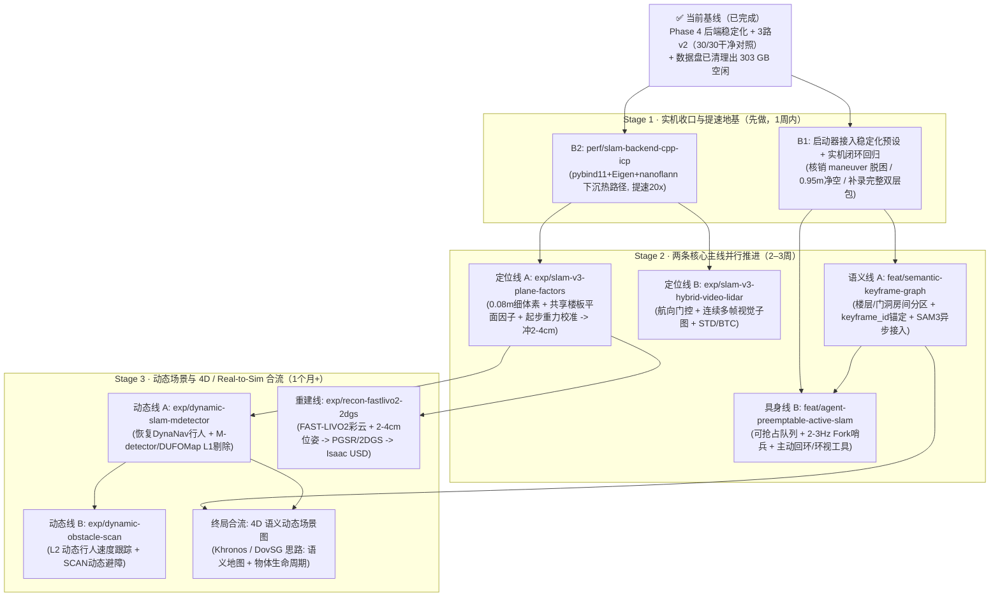

# 四大演进方向入门精讲、2025–2026 前沿调研与全项目施工图（2026-11-22）

> [!NOTE]
> 本文面向**刚入门/半入门具身导航与 SLAM** 的读者编写：每个方向都先用直白语言讲透**“为什么要做、核心直觉是什么、常见误区在哪”**，再给出**经典奠基 + 2025–2026 最新代表工作（含开源代码）**，最后汇总为可直接按图开分支执行的**全局依赖图与分阶段施工蓝图**。
>
> 配套前置文档：[Phase 4 后端评测报告](../../../experiments/slam-backend-phase4/REPORT.md) · [各后端分支机制与公式手册](../../design/slam-backend-branches-guide.md) · [ADR-0002/0003/0004 专项调研](adr-0002-0003-0004-survey.md)。

---

## 0. 开篇先解惑：两个最容易卡住的架构问题

### 问题 A：流式 LLM / SAM3 频率其实能跟上，为什么还要强调“彻底异步”？

你说得非常对——**现代流式模型并不一定很慢**：
- **流式哨兵（System 1）**：基于 `SGLang RadixAttention` 复用了主干上下文的 KV-Cache，输出 10–20 个 token（如 `{"act":"CONT"}` / `{"act":"STOP"}`），实际可以跑到 **2–5 Hz（200–500 ms）**；
- **视频概念分割（SAM 3 / 轻量检测器）**：在单张现代 GPU 上做 512×512 关键帧或视频流跟踪，也能跑到 **5–15 Hz**，**完全跟得上后端 0.5–1 Hz 的关键帧频率**！

那为什么工程上依然必须强调**“架构彻底异步（独立线程/进程 + 队列解耦）”**？核心不是嫌它平均太慢，而是**“硬实时确定性（Determinism）”与“长尾抖动隔离”**：

| 层级 | 典型频率 | 延迟红线 | 一旦卡顿 1 秒的后果 | 是否允许放 LLM / SAM3 |
|---|---:|---:|---|---|
| **System 0（运动反射层）**：`SCAN` + `RouteTracker` + `RoboGauge` | 50–200 Hz | `< 20 ms` | 机器狗踩空楼梯、撞墙或直接摔倒 | **绝对禁止** |
| **里程计前端**：`FAST-LIVO2` | 10 Hz（IMU 200 Hz） | `< 80 ms` | IMU 积分发散、帧间配准飞掉 | **绝对禁止** |
| **System 1（流式快哨兵）+ 视频语义层（SAM 3）** | **2–10 Hz** | 容忍 `0.3–1.5 s` 长尾 | 最多晚半步发现新门洞或晚 1 帧标出沙发，绝不影响步态安全 | **完全可以！异步流式跑** |
| **System 2（慢思考全局大脑）** | 0.1–0.5 Hz | 容忍 `3–15 s` | 思考期间机器狗可边走边看，或触发 `STOP` 停稳再想 | **主力所在** |

**一句话记住**：**频率上流式调用完全跟得上感知与哨兵（2–10 Hz），但架构上必须用消息队列把它和 10 Hz 前端 / 50 Hz 控车彻底隔开**，哪怕某次模型显存抖动卡了 2 秒，机器狗依然稳如泰山。

---

### 问题 B：语义地图怎么分区、怎么命名？一个回环或位姿算天然分区吗？

**直接答案：单靠“回环”或“位姿点”本身，并不能直接切出房间；必须靠“高度分层 + 自由空间瓶颈（门洞）切分 + 语义聚合”三步完成，而“回环”的作用是把重复走到的两个分区合并！**

用一栋两层楼来类比，新手一眼就能懂：

1. **第一步：按高度 $z$ 切楼层（Floor Segmentation）**  
   把所有已建图地面点或关键帧的 $z$ 坐标画直方图，水平楼板会形成明显波峰（如 `z ≈ 0 m` 为 1F、`z ≈ +3.3 m` 为 2F），连接两座波峰之间的连续爬升段就是**楼梯（Stair / Wormhole Edge）**（`HOV-SG` 核心做法）。
2. **第二步：按空间瓶颈切房间（Room / Place Partitioning）**  
   房间和走廊的物理本质不是“绕了一圈”，而是**“空旷区域被门洞/窄口隔开”**：
   - 把机器狗走过的自由空间建成 3D 稀疏拓扑节点（类似 `Hydra` 的 Places 层或 2D/3D Voronoi 骨架，每个节点带一个“到最近墙壁的半径 $r$”）；
   - 房间内部节点半径大（$r > 1.2\text{ m}$）且互相紧密连通，门洞处半径突然收缩成细脖子（$r \approx 0.4\text{ m}$）；
   - 在这个连通图上做**社区发现 / 最小割（Community Detection / Spectral Clustering）**，就能在**还没有闭合回环时**就自动切出一个个房间和走廊！
3. **第三步：稳定机器 ID + 可演化语义命名（Naming）**  
   - **稳定机器 ID（永不改变）**：如 `f1_room_03`、`f1_corridor_01`、`stair_1f_2f_01`，并记录它绑定的观测关键帧列表 `anchor_kf_ids = [40..68]` 与 3–5 张最具代表性的 RGB 截图（`3D-Mem` 思想）；
   - **可读语义别名（允许演化）**：把代表图 + SAM3 检测到的物体列表（如“沙发、茶几、电视”）喂给 VLM，生成中文/英文别名 `"一楼东侧客厅"`。以后机器狗从另一侧看到餐桌，可以更新别名，但机器 ID 不变，外部任务不会断链。
4. **第四步：回环真正干什么？（Loop Closure → Region Merge）**  
   如果机器狗绕了一大圈从另一个门再次走进同一间屋，因为开环漂移，地图里最初可能建出 `f1_room_03` 和 `f1_room_11` 两个分区。一旦 SLAM 后端闭合回环把两段位姿拉到重合，场景图管理器检查“空间交并比（IoU）+ 视觉特征相似度”，就会把两者**原子合并**为一个房间并整合它们的物体与代表图！

---

## 1. 方向一：具身 Agent 工具 / Skill + 异步三系统 + 行为辅助定位（Active SLAM）

### 1.1 通俗理解与核心思路
- **现状痛点**：现在 Agent 是“发一个目标点 → 站着傻等走完 → 停在原地花 15 秒想下一步”。既慢，又在墙角/白墙停驻时诱发前端漂移；且定位完全被动，漂了只能干等碰巧路过旧地方。
- **核心思路（两条腿走路）**：
  1. **边走边看（Async System 2 / 1 / 0）**：大脑（System 2）规划中程路线放进**可抢占航点队列**；运动层（System 0）50 Hz 平滑走路；快哨兵（System 1）以 2–3 Hz 流式看前视画面，一旦发现“左边有个没探索的开门房间”或“前面被椅子卡住了”，立刻发 `PREEMPT/STOP` 唤醒大脑改道。
  2. **主动回环与动作预期（Active SLAM）**：让 SLAM 后端暴露“我有多不确定”（如距上次成环走了 `> 15 m`、刚爬完楼梯、残差升高）。Agent 看到漂移警报，就**主动做一个定位辅助动作**——比如在开阔路口原地慢转 360° 攒多视角全景记忆，或者绕回 5 米外的楼梯口/醒目地标看一眼“钉死坐标”，再继续往前探索！同时把自身动作意图（停驻/原地转向/前进）作为软先验告诉后端（保留点云防打滑校验）。

### 1.2 经典与 2025–2026 代表工作

| 代表工作 | 年份 / 会议 | 核心思想（一句话读懂） | 开源仓库 / 链接 |
|---|---|---|---|
| **Active SLAM 综述与论文索引** | 持续更新 | 系统梳理主动探索、主动重定位与主动回环的“信息增益 vs 定位不确定度”权衡公式 | [DoongLi/Active-SLAM-Paper-List](https://github.com/DoongLi/Active-SLAM-Paper-List) |
| **VLFM** | ICRA 2024 | 实时构建前沿图 + 轻量 VLM 给前沿打语义价值分，在四足机器人 Spot 上零样本找目标 | [rai-opensource/vlfm](https://github.com/rai-opensource/vlfm) |
| **NaVILA** | 2024–2025 | 高层 VLM 发离散移动意图 + 底层 LiDAR 步态策略走地形，在 **Unitree Go2** 实机验证 | [AnjieCheng/NaVILA](https://github.com/AnjieCheng/NaVILA) |
| **InternNav / InternVLA-N1** | 2025–2026 | 双系统异步导航基座（慢 VLM 全局子目标 + 快策略连续轨迹），支持 **Unitree Go2** | [InternRobotics/InternNav](https://github.com/InternRobotics/InternNav) |
| **Nav-R1 / ZR-0** | 2025–2026 | 慢 System 2 做具身思维链推理与拓扑规划 + 快 System 1 动作专家高频执行 | [RUCKBReasoning/ZR-0](https://github.com/RUCKBReasoning/ZR-0) |
| **SGLang RadixAttention** | 2024–2026 | KV-Cache 基数树零拷贝分叉，天然支持 2–5 Hz“阅后即焚”流式哨兵而不污染主干对话 | [sgl-project/sglang](https://github.com/sgl-project/sglang) |

### 1.3 落到本仓库怎么改
- **改造目录**：`scripts/explore_waypoint_client.py`、`simulation/dynanav/native_waypoints.py`、`localization_mapping/backend/node.py`、`.agents/skills/dynanav-explore/`。
- **新增核心工具**：`preemptable_goto`（带 `action_epoch`）、`maneuver`（已有，需实机验收）、`localization_health()`（返回距上次成环里程/当前楼层/漂移警报）、`active_relocalize_spin()`（主动慢速环视攒全景）。

---

## 2. 方向二：语义地图管理（关键帧锚定 3D 场景图 + SAM 3）

### 2.1 通俗理解与核心思路
- **现状痛点**：现在的地图只是一堆无意义的 3D 点云（`map.json` + `kf_*.npz`）。机器人既不知道“哪块是一楼大厅、哪块是二楼卧室”，也不知道“刚才路过的红门在哪”，导致探索容易漏房间、重复绕圈，更无法执行“去二楼沙发旁边看看”这类语义任务。
- **为什么 SAM 3 是 2025–2026 的游戏规则改变者？**
  - 以前做开放集 3D 建图很痛苦：要串 **GroundingDINO（检测框）+ SAM 1/2（抠掩码）+ CLIP（提语义向量）+ ByteTrack（跨帧跟踪 ID）** 四套模型，极易掉帧和 ID 错乱；
  - **Meta SAM 3**（2025 年 11 月发布，*Promptable Concept Segmentation*）把**文本概念检测 + 像素级分割 + 视频流跨帧 ID 记忆跟踪**合进了一个统一骨干网络！你给它一组短语（如 `"door", "stairs", "chair", "sofa", "table", "pedestrian"`），它直接在连续视频流里给出**跨帧 ID 一致的精确像素掩码**，再配合我们已标定好的实测 LiDAR 投影，就能零深度猜测地长出精准 3D 语义物体！

### 2.2 经典与 2025–2026 代表工作

| 代表工作 | 年份 / 会议 | 核心思想（一句话读懂） | 开源仓库 / 链接 |
|---|---|---|---|
| **SAM 3** | 2025.11（Meta AI） | 文本/示例提示词驱动的概念分割 + 内置记忆库视频流跟踪，一次搞定检测、抠图与跨帧 ID | [facebookresearch/sam3](https://github.com/facebookresearch/sam3) |
| **HOV-SG** | RSS 2024 | 高度直方图切楼层 + Voronoi 切房间 + 跨楼层楼梯虫洞边，多层语言导航经典标杆 | [hovsg/HOV-SG](https://github.com/hovsg/HOV-SG) |
| **3D-Mem** | CVPR 2025 | 用“关键帧代表图快照（Memory Snapshots）+ 前沿快照”替代脆弱纯 3D 框喂给 VLM | [UMass-Embodied-AGI/3D-Mem](https://github.com/UMass-Embodied-AGI/3D-Mem) |
| **Hydra / DAAAM** | IJRR / 2025（MIT SPARK） | 实时 5 层 3D 场景图 + 回环后弹性形变；DAAAM 进一步结合基础模型构建 4D 场景图 | [MIT-SPARK/Hydra](https://github.com/MIT-SPARK/Hydra) · [MIT-SPARK/DAAAM](https://github.com/MIT-SPARK/DAAAM) |
| **DovSG** | RA-L 2025 | 支持**局部增量更新**的动态开放词汇 3D 场景图，物体被移动后无需全图重算 | [BJHYZJ/DovSG](https://github.com/BJHYZJ/DovSG) |
| **TRACKGRAPH** | 2026 | 在图像空间先做跨帧掩码跟踪再融合进 3D 场景图，大幅降低在线内存和计算开销 | 2026（见 [Awesome 3D Scene Graphs](https://github.com/dennisrotondi/awesome-3D-scene-graphs)） |

### 2.3 落到本仓库怎么改
- **改造目录**：`src/embodied_navigation/localization_mapping/semantic_mapping/`（已预留该包），对接 `backend/backend.py` 的 `keyframe_id` 与回环回调。
- **数据模型**：轻量 SQLite/JSON 存 4 张表：`floors`（楼层高度区间）、`rooms`（稳定 ID + 动态语义名 + 锚定 `keyframe_ids` + 代表图路径）、`objects`（SAM3 实例 ID + 类别 + 锚定 `keyframe_id` + 局部 3D 包围盒）、`edges`（门洞连通 / 楼梯跨层边）。每次回环优化只需重算 `T_world_kf @ local_box`，毫秒级同步全图。

---

## 3. 方向三：定位继续优化（从 5–18 cm 迈向 2–4 cm 与全天候实时）

### 3.1 结合本仓库历史：我们已经做到哪了？差最后哪几步？
- **已完成（Phase 4，30/30 干净实测）**：
  - 按论文通用口径（Final Umeyama RMSE），`D1/D2/D3` 已全部进入 **`4.4–6.7 cm`**；局部短距 `RPE@5m` 为 **`1.8–4.2 cm`**，完全支撑避障与滑窗建图；
  - 经过 GPT-6.2-Astra 全量审计并修复了机身原点、位姿图精确 $\mathcal{J}_r^{-1}(e)$、同前缀收益与视觉在线加载。
- **剩余 4 个精确瓶颈（按投入产出比排序）**：
  1. **速度瓶颈**：纯 Python 后端在 D2 需 ~242 s、D3 单步峰值 ~2 s，必须先下沉 C++（`pybind11 + Eigen + nanoflann`）提速 15–30×，才能解锁在线实时和细体素配准；
  2. **体素过粗 + 缺建筑平面先验**：当前精 ICP 体素 `25 cm` 把前端本来 `2.3 cm` 的 XY 拉粗到 `5–6 cm`；且没把“同层地板共面水平”写进优化因子；
  3. **D2 vs D3 模态偏科**：单帧纯视觉在 D3 仅 `8.25 cm / 84 s`，但在反向重访居多的 D2 上因前视 FOV 窄仅召回 11 边；单帧 LiDAR 刚好相反；
  4. **前端初窗重力偏置**：D3 起步 5 秒约 `0.5°` 俯仰偏置在 20 m 建筑跨度上杠杆出 ~14 cm Z 误差。

### 3.2 经典与 2025–2026 代表工作

| 代表工作 | 年份 / 会议 | 核心思想（一句话读懂） | 开源仓库 / 链接 |
|---|---|---|---|
| **STD / BTC** | ICRA 2023 / T-RO 2024（HKU-MaRS） | 从点云提取平面边界点构造**3D 空间不变三角形描述子**，天然抗楼梯俯仰与 360° 视角变化，直接取代 ScanContext | [hku-mars/STD](https://github.com/hku-mars/STD) · [hku-mars/btc_descriptor](https://github.com/hku-mars/btc_descriptor) |
| **BALM2 / HBA** | T-RO 2023 / RA-L 2023（HKU-MaRS） | 把多帧共同观测的**自适应平面特征**直接写成位姿优化残差（LiDAR BA），天然锁平楼板与墙面 | [hku-mars/BALM](https://github.com/hku-mars/BALM) · [hku-mars/HBA](https://github.com/hku-mars/HBA) |
| **X-ICP** | T-RO 2023 | 用 ICP 的 $6\times 6$ Hessian 特征值动态识别退化方向（如长走廊滑移），按方向自动调低不可观自由度的权重 | ETH RSL（思想可直接写入 `registration.py` / `pose_graph.py`） |
| **SeqSLAM / ORB-SLAM3 共视子图** | ICRA 2012 / T-RO 2021 | 连续 3–5 帧视频时序一致性筛选 + 多帧视觉-LiDAR 共视局部路标验证，解决单帧视觉漏检与稀疏 | 经典必读（纯 CPU 即可移植到 `v2-visual-retrieval`） |
| **MASt3R-SLAM / VGGT-SLAM** | CVPR 2025 / 2025 | 基于 3D 视觉基础模型对齐连续视频片段，视角差 **`60°–120°`** 仍能匹配，适合做异步低频大视角回环器 | [naver/mast3r-slam](https://github.com/naver/mast3r-slam) · [MIT-SPARK/VGGT-SLAM](https://github.com/MIT-SPARK/VGGT-SLAM) |

### 3.3 落到本仓库怎么改
- 先将 `slam_backend_stabilized.json` 冻结接入 `scripts/run_dynanav_native_exploration.sh` 跑通实机；
- 再分 3 个清晰小分支推进：`perf/slam-backend-cpp-icp`（C++ 提速）→ `exp/slam-v3-plane-factors`（细体素 `0.08 m` + 共享楼板平面因子 + X-ICP 退化协方差）→ `exp/slam-v3-hybrid-video-lidar`（航向门控 + 连续多帧视觉流子图 + STD/BTC）。

---

## 4. 方向四：动态 SLAM 零门槛入门与 2025–2026 前沿

### 4.1 新手先懂底层逻辑：动态物体到底怎么搞坏 SLAM 的？
传统 SLAM 都有一条死假设：**“世界是静止不动的，传感器看到的变化全都是机器人自己动出来的。”**  
当 DynaNav 场景里加上走动的行人后，这条假设瞬间崩塌，引发两重灾难：
1. **带偏定位（跟踪拖曳）**：行人从机器狗前面走过，前端把行人点云当成一面墙去配准，结果机器狗原地没动，里程计却以为自己在往旁边滑移；
2. **幽灵残影（地图污染）**：行人走过的轨迹在点云图里拉出一堵实心的“人墙残影”，后面的全局规划器 PCT 以为走廊被堵死了，回环模块也会把残影错认成墙。

### 4.2 工程上把动态 SLAM 拆成“由易到难的三级阶梯”

> **新手最容易踩的坑**：以为做动态 SLAM 就必须一上来搞复杂的 4D 神经网络。其实工业界和顶会都把它拆成三层，**前两层用纯几何+轻量分割就能解决 90% 的导航痛点**！

1. **Level 1 · 动态点剔除（最快落地，直接保护前后端定位！）**
   - **直觉原理（射线可见性，像手电筒照空房间）**：上一秒激光射线畅通无阻地穿过空间点 $P$ 打到了 10 米外的墙上，说明 $P$ 处原本是**空气**；这一秒 $P$ 处突然冒出一个激光回波点——那它几乎 100% 是刚走过来的**动态物体**！直接把这些点踢掉，剩下的静态点照常喂给 FAST-LIVO2 和稳定化后端。
   - **双保险**：几何射线检测（微秒级、不挑物体类别，连突然推过来的椅子/开门都能检出）+ 语义分割掩码（SAM 3 标出“行人”连站着不动的路人也提前剔除静态建图）。
2. **Level 2 · 动态目标实时跟踪与避障（规划控制层）**
   - Level 1 踢出来的动态点不要扔，单独聚类成障碍物盒子，用卡尔曼滤波算出每个行人的位置和速度向量 $\vec{v}$，喂给局部规划器 `SCAN` 做前瞻避障（同时按 [ADR-0001](../adr/0001-livo-yaw-pipeline-overlap.md) 重审独立 `yaw` 时的 0.2 s 点云融合重叠窗）。
3. **Level 3 · 完整 4D 动态 SLAM（2024–2026 最前沿：兼顾短时移动 + 长时场景变化）**
   - 不仅能剔除“秒级走过的行人”，还能发现“半小时前椅子在门口、现在被人搬到窗边了”，并给每个物体维护存在时间段 `[t_first, t_last]`。2025–2026 年这个方向涌现出两条激动人心的分支：**4D 场景图派（Khronos / DovSG）** 和 **4D 高斯泼溅 SLAM 派（Flow4DGS-SLAM / D4DGS-SLAM）**。

### 4.3 经典与 2025–2026 代表工作

| 代表工作 | 年份 / 会议 | 层级 | 核心思想（一句话读懂） | 开源仓库 / 链接 |
|---|---|---|---|---|
| **M-detector** | T-RO / HKU-MaRS | **L1 在线** | 与 FAST-LIVO2 同实验室！基于单点射线遮挡事件的微秒级 LiDAR 运动点检测，零类别假设 | [hku-mars/M-detector](https://github.com/hku-mars/M-detector) |
| **DUFOMap** | RA-L 2024（KTH） | **L1 离线/准实时** | 基于“绝对自由空间（ever-free）”几乎免调参剥离动态点，`pip install dufomap` 1 天即可出 PoC | [KTH-RPL/dufomap](https://github.com/KTH-RPL/dufomap) |
| **Khronos** | **RSS 2024 最佳系统论文**（MIT SPARK） | **L3 4D 场景图** | 统一短时快窗口（跟踪行人）+ 长时慢因子图（检测家具搬移/增删），**原生 ROS 2** | [MIT-SPARK/Khronos](https://github.com/MIT-SPARK/Khronos) |
| **D4DGS-SLAM** | IROS 2025 | **L3 4DGS SLAM** | 给 3D 高斯加上时间维，用动态感知模块剔除不稳定动态点，兼顾无漂移跟踪与 4D 重建 | [zhicongsun/D4DGS-SLAM](https://github.com/zhicongsun/D4DGS-SLAM) |
| **Flow4DGS-SLAM** | **CVPR 2026** | **L3 4DGS SLAM** | 用光流自运动分解生成不依赖类别的动态掩码，分离静态/动态高斯并用 3D 场景流传播动态物体 | [wangys16/Flow4DGS-SLAM](https://github.com/wangys16/Flow4DGS-SLAM) |
| **RU4D-SLAM** | 2026 | **L3 4DGS SLAM** | 引入不确定度重加权与自适应不透明度，在杂乱动态场景下同步提升跟踪鲁棒性与 4D 重建质量 | arXiv 2026（见 [Awesome Dynamic SLAM](https://github.com/uoip/Awesome_Dynamic_SLAM)） |

### 4.4 落到本仓库怎么改
- **历史参考资产**：本仓库已完整保全 `ref/dynanav-dynamic-pedestrian` 分支（含此前 DynaNav 动态行人仿真环境与分割支线代码）；
- **落地顺序**：先在新底座上用 `DUFOMap` 跑离线动态包验证静态清理 → 接入 `M-detector`（+ 可选 SAM3 行人掩码）进前端/后端滤波保住定位 → 再做 L2 行人速度估计进 SCAN 避障 → 远期将 L3 与方向二的语义场景图合流。

---

## 5. 全项目施工图：全局依赖图与分阶段动工顺序

### 5.1 全局依赖关系图（谁是地基、谁能并行、谁等前置）

### 5.2 分阶段施工清单（逐分支契约、周期与验收红线）

| 阶段 | 建议分支名 | 所属方向 | 前置依赖 | 预计周期 | 算力要求 | 核心交付物与定量验收红线 |
|---|---|---|---|---|---|---|
| **Stage 1.1** | `feat/backend-launcher-wiring` | 方向 3 + 1 | 合并 `exp/startup-walk-imu-bias` & `exp/slam-backend-stabilization` | 1–2 天 | Isaac Sim + GPU | 主启动器显式冻结 `--config slam_backend_stabilized.json`；实机核销 `maneuver` 脱困、`0.95 m` 净空、在线 ROS 发布时延，并新录一份完整双层 13 话题 MCAP |
| **Stage 1.2** | `perf/slam-backend-cpp-icp` | 方向 3（地基） | Phase 4 定型底座 | 2–3 天 | CPU | `pybind11 + Eigen + nanoflann` 加速体素、ICP 与图求解；`D2` 1567 帧回放 `< 20 s`（原 242 s），与 Python 轨迹差 `< 1e-4 m`，全量单测 0 新增失败 |
| **Stage 2.1** | `exp/slam-v3-plane-factors` | 方向 3（物理先验） | Stage 1.2 | 3–5 天 | CPU | 精 ICP 降至 `0.08 m` + 共享楼板/墙面全局平面因子 + X-ICP 退化协方差 + 起步重力精校准；验收：`D2/D3` Init-SE3 终图向 **`2–4 cm`** 收敛且不劣化前端 `2–3 cm` XY |
| **Stage 2.2** | `exp/slam-v3-hybrid-video-lidar` | 方向 3（连续视频流） | Stage 1.2 | 4–5 天 | CPU | `v2-visual` 升级为 3 帧时序一致 + 多帧视觉-LiDAR 共视子图 + 相对航向角门控（同向视觉、反向 360° LiDAR/STD）；验收：**单一预设同时在 D1 `< 10 cm`、D2 `< 5.5 cm`、D3 `< 8.5 cm`** |
| **Stage 2.3** | `feat/semantic-keyframe-graph` | 方向 2（语义地图） | Stage 1.1 | 4–6 天 | GPU（SAM 3） | 高度切楼层 + 自由空间瓶颈切房间 + 稳定 ID/动态别名 + 异步 **SAM 3** 视频概念分割挂 `keyframe_id` + 回环合并分区；验收：`D2` 16 房间自动分区、回环重投影 0 撕裂、暴露 Agent 查询工具 |
| **Stage 2.4** | `feat/agent-preemptable-active-slam` | 方向 1（异步+主动回环） | Stage 1.1 + 2.3 | 4–6 天 | Isaac + VLM/SGLang | 可抢占航点队列（`action_epoch`）+ 2–3 Hz 流式 Fork 哨兵 + `localization_health` 触发主动环视/回访地标；验收：行进中 `< 1 s` 抢占新门洞，主动回环后不确定度显著下降 |
| **Stage 3.1** | `exp/dynamic-slam-mdetector` | 方向 4（L1 动态过滤） | Stage 2.1（静态稳） | 4–5 天 | CPU + Isaac | 从 `ref/dynanav-dynamic-pedestrian` 恢复动态行人测试场；接入 `DUFOMap`（离线）与 `M-detector`（在线，可选叠加 SAM 3 行人掩码）；验收：行人穿行时地图残影剔除 `> 95%`，定位 ATE 相对静态退化 `< 20%` |
| **Stage 3.2** | `exp/dynamic-obstacle-scan` | 方向 4（L2 动态避障） | Stage 3.1 | 4–5 天 | CPU + Isaac | 动态点聚类 + 卡尔曼速度估计喂入 `SCAN`，复核 ADR-0001 `0.2 s` 融合窗；验收：多行人迎面/横穿场景零碰撞通过 |
| **Stage 3.3** | `exp/recon-fastlivo2-2dgs` | Real-to-Sim 闭环 | Stage 2.1 | 2–3 天 | 单张 GPU | `D2` 彩云 + 稳定化位姿导出 COLMAP → `PGSR / 2DGS` 导出纹理 Mesh/USD 导回 Isaac Sim |
| **Stage 3.4** | `exp/4d-semantic-scene-graph` | 方向 2 + 4 终局合流 | Stage 2.3 + 3.1 | 远期（2 周+） | GPU | 借鉴 `Khronos / DovSG` 维护物体 `[t_first, t_last]` 生命周期，实现长短时变化感知的 4D 语义地图 |

---

### 5.3 给初学者的 3 条最重要防踩坑原则

1. **永远先锁死地基再叠上层**：不要在纯 Python 240 s 卡顿、或者启动器还没加载稳定化配置时直接去接动态行人和 SAM 3——先花 3–5 天把 **Stage 1（实机接线 + C++ 热路径）** 打牢，后面 4 个方向的迭代速度都会快 10 倍。
2. **任何大模型（VLM / SAM 3 / MASt3R）只走异步接口，绝不进硬实时环**：它们可以跑 2–10 Hz 跟上关键帧，但必须通过有界队列与超时丢弃机制和 `FAST-LIVO2` / `SCAN` 隔离。
3. **坚持“一个分支验证一个假设”**：每个 Stage 子分支都在同一套 `D1/D2/D3`（以及后续动态行人包）上用统一机身原点打分尺对比基线，有量化净收益才合并进主线，避免把多个没验证好的改动搅成一锅粥。
