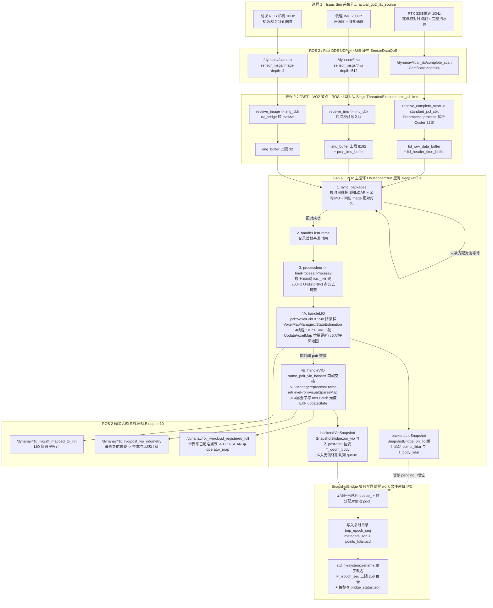

# 01. SLAM 零基础入门与前端 FAST-LIVO2 原理及源码精讲

> **适合读者**：刚接触 SLAM 的初学者，希望结合本仓库真实代码从零理解“机器人是如何边走边建图定位的”，以及前端和后端各自负责什么。  
> **对照代码基线**：`exp/slam-backend-stabilization`（2026-11-22）

---

## 一、给 SLAM 初学者的 5 个必懂概念（大白话版）

在看任何代码前，先用生活类比把 SLAM 里的核心黑话翻译一遍：

### 1. 什么是 SLAM？前端和后端有什么区别？
假设你蒙着眼睛走进一栋陌生的两层办公楼，手里有一根激光测距仪（LiDAR）、一台手机陀螺仪（IMU）和一只手电筒+相机（RGB）：
- **前端（里程计 / Odometry，本项目是 FAST-LIVO2）**：只关心**“刚才这一步（0.1 秒）我往前走了多远、转了多少度”**。它算得飞快（10–200 Hz），能让机器狗立刻知道当前位置来控制走路。但就像蒙眼数步子一样，每一步哪怕只差 1 毫米、0.05 度，走几百步后**误差一定会越积越大（漂移 / Drift）**。
- **后端（回环与图优化，本项目在 `localization_mapping/backend/`）**：慢半拍（每 1–2 秒挑一个**关键帧**），它的任务是**“猛然认出：哎！这个红门/楼梯口我 3 分钟前路过过！（回环检测 Loop Closure）”**，然后把整条走过的轨迹像拉橡皮筋一样整体拉平、把刚才累积的误差分摊消除（**位姿图优化 Pose Graph Optimization**）。

### 2. 坐标系（Frame）与 4×4 变换矩阵 $T_{a,b}$
机器人身上有好几个传感器，每个传感器都以自己为中心看世界，所以本项目有 5 个核心坐标系：
1. **`lidar`**：激光雷达坐标系（点云原始数据在这里）。
2. **`camera`**：相机光学坐标系（$x$ 向右、$y$ 向下、$z$ 向前）。
3. **`body`（`go2_imu`）**：机身/IMU 坐标系，前端和后端实际估计的是它的位置和朝向。
4. **`odom`（`camera_init` / `dynanav_lio_map`）**：前端开机时立下的“临时世界原点”。前端算出来的轨迹都在这个系下，它会随时间慢慢漂移。
5. **`world`（`map`）**：后端维护的“全局修正后的世界原点”。

在代码中，你到处会看到 `T_a_b`（例如 `T_odom_body`、`T_body_lidar`、`T_world_odom`）。**死记一个口诀**：
> **`T_a_b` 既表示“$b$ 在 $a$ 里的位姿”，也表示“把一个点从 $b$ 坐标系变到 $a$ 坐标系的矩阵”**。  
> 两个矩阵相乘时，**相邻字母自动消掉**：
> $$T_{\text{world,body}} = T_{\text{world,odom}} \cdot T_{\text{odom,body}} \qquad \text{（消掉中间的 odom！）}$$
> $$p_{\text{body}} = T_{\text{body,lidar}} \cdot p_{\text{lidar}} \qquad \text{（把激光点从 lidar 系变到 body 系）}$$

每个 $T$ 是一个 $4\times 4$ 齐次矩阵（数学上叫三维刚体变换群 $SE(3)$）：
$$T = \begin{bmatrix} R_{3\times 3} & t_{3\times 1} \\ 0 & 1 \end{bmatrix}$$
其中 $R$ 是旋转矩阵（属于正交群 $SO(3)$，满足 $R^\top R = I,\ \det(R)=1$），$t = [x, y, z]^\top$ 是平移向量（米）。

### 3. 为什么代码里总出现 `se3_exp`、`se3_log`、`hat`？（李代数极简理解）
旋转矩阵 $R$ 有 9 个数，但三维旋转其实只有 **3 个自由度**（Roll 滚转、Pitch 俯仰、Yaw 偏航）。你不能直接对两个旋转矩阵做加减法（$R_1 + R_2$ 不再是旋转矩阵！）。  
所以 SLAM 里优化时，会先把 6 自由度的微小增量写成 6 维向量 $\xi = [\rho_x, \rho_y, \rho_z, \phi_x, \phi_y, \phi_z]^\top \in \mathbb{R}^6$（前 3 维平移，后 3 维旋转轴角），这就是**李代数 $\mathfrak{se}(3)$**：
- **`hat(v)`**（符号 $[v]_\times$）：把 3 维向量变成反对称矩阵，满足 $[a]_\times b = a \times b$（叉乘变矩阵乘法，方便求导）。
- **`se3_exp(xi)`**：把 6 维向量“映射”成合法的 $4\times 4$ 刚体矩阵 $T$（保证更新完依然是正经的旋转+平移）。
- **`se3_log(T)`**：反操作，把两个位姿之间的误差矩阵 $E$ 变回 6 维误差向量 $e \in \mathbb{R}^6$，这样就能算残差大小和求梯度了！

```text
# 数据结构与伪代码：点云坐标变换 & 李代数更新（对照 backend/pose_graph.py）
输入:
  points_b : float64[N, 3]    # b 坐标系下的 N 个三维点 (x, y, z)，单位: 米
  T_a_b    : float64[4, 4]    # 刚体变换矩阵: 左上 [3,3] 为旋转 R，右上 [3,1] 为平移 t
  delta    : float64[6]       # 6 维微小增量 [rho_x, rho_y, rho_z, phi_x, phi_y, phi_z]
输出:
  points_a : float64[N, 3]    # 变换到 a 坐标系后的点云
  T_new    : float64[4, 4]    # 合法更新后的刚体位姿 (保证 R^T R = I, det(R) = 1)

伪代码:
  function transform_points(T_a_b, points_b):
      R = T_a_b[0:3, 0:3]                     # [3, 3]
      t = T_a_b[0:3, 3]                       # [3]
      return points_b @ R.T + t               # 广播加法，输出 [N, 3]

  function se3_exp(delta):
      rho, phi = delta[0:3], delta[3:6]       # 平移分量 [3], 旋转轴角 [3]
      R = Rodrigues(phi)                      # SO(3) 指数映射 -> [3, 3] 旋转矩阵
      J_l = left_jacobian_so3(phi)            # 左雅可比 [3, 3]（旋转耦合平移）
      T = eye(4)
      T[0:3, 0:3] = R
      T[0:3, 3]   = J_l @ rho                 # [3]
      return T

  # 右乘更新位姿（后端 PoseGraph 采用）:
  T_new = T_old @ se3_exp(delta)
```

### 4. 点云降采样（Voxel Downsample）与 KD 树（KD-Tree）
- **体素降采样**：32 线雷达一帧有几万个点，直接算太慢而且近处密、远处疏。把空间切成边长如 `0.2 m` 的小魔方格子（体素 Voxel），每个格子里所有点求平均变成 1 个代表点，既降噪又加速。
- **KD 树（`cKDTree`）**：给点云建一棵空间二分查找树，查“离某一点最近的邻居是谁”可以从 $O(N)$ 加速到 $O(\log N)$。

### 5. 后端输出到底是什么？—— 校正矩阵 $C = T_{\text{world,odom}}$
前端 FAST-LIVO2 一直在高速输出 $T_{\text{odom,body}}$（会漂移）。后端不会去硬改前端内部状态，而是维护一个**坐标系对齐矩阵** $C = T_{\text{world,odom}}$：
$$T_{\text{world,body}} = C \cdot T_{\text{odom,body}}$$
当后端发现前面累积漂了 20 cm，它只要更新 $C$，把整个漂掉的 `odom` 系拉回到正确的 `world` 系即可！

---

## 二、前端 FAST-LIVO2 算法原理与本项目源码拆解

本项目的前端位于 [third_party/fast_livo2/fast_livo2_core/](../../third_party/fast_livo2/fast_livo2_core/)，它是港大 MaRS 实验室的 **FAST-LIVO2**（紧耦合激光-惯性-视觉里程计）。它的最大特点是：**用同一个误差状态卡尔曼滤波器（ESIKF）先后融合 LiDAR 几何残差和相机直接法光度残差**，且**不需要给相机提角点特征**。

### 2.1 核心状态向量：19 维 `StatesGroup`
在 [common_lib.h](../../third_party/fast_livo2/fast_livo2_core/include/fast_livo2_core/core/common_lib.h#L134-L185) 中，前端每一刻都在估计 19 个量：

| 索引 | 成员变量 | 维度 | 物理含义 |
| --- | --- | ---: | --- |
| `0..2` | `rot_end` ($R$) | 3 | 机身在 `odom` 系下的姿态旋转矩阵 |
| `3..5` | `pos_end` ($p$) | 3 | 机身在 `odom` 系下的 3D 位置 |
| `6` | `inv_expo_time` ($\tau$) | 1 | 相机逆曝光时间（补偿画面整体明暗变化） |
| `7..9` | `vel_end` ($v$) | 3 | 机身速度 |
| `10..12` | `bias_g` ($b_g$) | 3 | **陀螺仪零偏**（IMU 静止时角速度也不完全为 0） |
| `13..15` | `bias_a` ($b_a$) | 3 | **加速度计零偏**（IMU 静止时加速度的偏移误差） |
| `16..18` | `gravity` ($g$) | 3 | `odom` 系下的重力向量（长度约 `9.81 m/s²`） |

### 2.2 一帧数据在前端里的完整数据流（含 ROS 回调、通信、缓冲与后台写盘）

下面这张图严格对照 [LIVMapper.cpp](../../third_party/fast_livo2/fast_livo2_core/src/LIVMapper.cpp) 与 [snapshot_bridge.cpp](../../third_party/fast_livo2/fast_livo2_core/src/backend/snapshot_bridge.cpp)，展示了从 Isaac Sim 发布传感器消息，到 FAST-LIVO2 回调入队、主循环同步融合、再到输出导航里程计和落盘关键帧的完整链路：



> **通信与线程关键点速记**：
> 1. **为什么输入用 `SensorDataQoS`（Best-Effort），输出用 `RELIABLE`？** 仿真端 200 Hz IMU 与 10 Hz 大点云走 UDPv4 4 MiB 接收缓冲，强调低延迟不积压；前端融合后的关键里程计和点云频率较低且下游强依赖，故用 `RELIABLE depth=10`。
> 2. **前端与后端为何用“文件系统 Spool + 原子改名”交接？** 后端回环优化偶尔耗时数百毫秒甚至 1–2 秒，用 `SnapshotBridge` 独立线程把关键帧写盘，彻底解耦了前端 10 Hz 实时主循环，绝不会因为后端卡顿拖慢前端 ESIKF！

下面分 4 步拆解每个核心算法的内部原理：

#### ① IMU 前向传播与点云去畸变（[IMU_Processing.cpp](../../third_party/fast_livo2/fast_livo2_core/src/IMU_Processing.cpp)）
- **静止初始化（`IMU_init`）**：机器狗刚启动的前 300 帧 IMU（约 1.5–3 秒）保持静止，用来平均估计初始重力方向（把世界 Z 轴对齐重力）和初始陀螺仪零偏。
- **为什么点云需要去畸变（`UndistortPcl`）？**  
  旋转式 Ouster 32 线雷达转完一圈需要 `0.1 s`。在这 0.1 秒内机器狗正在往前走或转身，导致第 1 个激光点和最后 1 个激光点拍到的是不同时刻的世界，如果不补偿，直墙会变成斜墙！`UndistortPcl` 用 200 Hz IMU 积分出每个激光点的精确时刻姿态，把所有点反推对齐到扫完那一刻的机身坐标系下。

```text
# 数据结构与伪代码：IMU 传播与激光去畸变（对照 IMU_Processing.cpp:UndistortPcl）
输入:
  imu_list  : List[ImuSample(t, gyro[3], acc[3])]  # 覆盖本帧 0.1s 扫描的 ~20 条 200Hz IMU
  raw_cloud : List[Point(x, y, z, dt_offset)]      # 原始雷达点，dt_offset 为相对帧首的时间偏移
  state_in  : StatesGroup (19D: R, p, inv_expo, v, bg, ba, g; cov[19, 19])
输出:
  state_prop: StatesGroup                          # 预测到帧末时刻 t_end 的先验状态与协方差
  pcl_out   : List[Point(x, y, z)]                 # 全部统一补偿到帧末机身系的无畸变点云

伪代码:
  # 1. 正向积分（200 Hz）：按中值积分递推每条 IMU 时刻的 (R_k, p_k, v_k) 与 19x19 协方差 P
  imu_poses = []
  for (imu_prev, imu_curr) in adjacent_pairs(imu_list):
      dt = imu_curr.t - imu_prev.t
      w  = 0.5 * (imu_prev.gyro + imu_curr.gyro) - state.bias_g
      a  = 0.5 * (R_prev @ (imu_prev.acc - bias_a) + R_curr @ (imu_curr.acc - bias_a)) + gravity
      state.rot_end = state.rot_end @ Exp(w * dt)
      state.pos_end += state.vel_end * dt + 0.5 * a * dt^2
      state.vel_end += a * dt
      state.cov = F @ state.cov @ F.T + Q          # 过程噪声由 acc_cov/gyr_cov/b_acc_cov/b_gyr_cov 决定
      imu_poses.append((imu_curr.t, state.rot_end, state.pos_end, state.vel_end))

  # 2. 反向投影去畸变：把每个激光点从它被扫描的时刻 t_i 搬到帧末时刻 t_end
  for pt in raw_cloud:
      (R_i, p_i) = interpolate_pose(imu_poses, pt.t_i)
      p_world = R_i @ (R_body_lidar @ pt.xyz + t_body_lidar) + p_i
      p_end   = R_end.T @ (p_world - p_end)        # 变回帧末机身系
      pcl_out.append(p_end)
```

#### ② LIO 阶段：体素八叉树平面地图 + 迭代卡尔曼滤波（[LIVMapper.cpp#L750-L850](../../third_party/fast_livo2/fast_livo2_core/src/LIVMapper.cpp#L750-L850) & [voxel_map.cpp](../../third_party/fast_livo2/fast_livo2_core/src/voxel_map.cpp)）
1. 先用 PCL 的 `VoxelGrid`（`downSizeFilterSurf`，体素 `0.15 m`）对去畸变点云降采样。
2. 把点云放到**自适应八叉树体素地图**（`voxel_size = 0.5 m`，最多细分 `max_layer = 2` 层）中，每个叶子节点拟合一块局部平面（法向量 $n$ + 中心 $q$ + 平面不确定性协方差）。
3. 调用 `voxelmap_manager->StateEstimation(state_propagat)`：
   - 对每个激光点，算它到对应体素平面的距离残差（**点到面距离**），并用 OpenMP 4 线程并行构造雅可比（`BuildResidualListOMP`）。
   - 做最多 `max_iterations = 5` 次**迭代误差状态卡尔曼更新（ESIKF）**，同时修正位姿、速度和 IMU 零偏。
   - 更新完毕后，把新点云融入体素地图（`UpdateVoxelMap`），并通知 `backendLioSnapshot()`。

```text
# 数据结构与伪代码：LIO 点到面 ESIKF 状态估计（对照 voxel_map.cpp:StateEstimation）
输入:
  state_prop : StatesGroup (19D, 含先验位姿 R_0, p_0 与协方差 P_0[19, 19])
  feats_body : PointCloud[M, 3]                    # 0.15m 降采样后的帧末机身点云
  voxel_map  : HashMap[VoxelKey -> VoxelOctoTree]  # 每个叶节点含 Plane(normal n[3], center q[3], cov)
输出:
  state_lio  : StatesGroup                         # LIO 后验状态与后验协方差 P_lio[19, 19]

伪代码:
  state = state_prop
  for iter in 1..5:                                # max_iterations = 5
      # 1. 4线程 OpenMP 并行查找每个激光点对应的八叉树平面，构造观测方程 H * dx = -z
      residuals = []
      for p_b in feats_body:
          p_w = state.rot_end @ p_b + state.pos_end
          plane = lookup_octree_plane(voxel_map, p_w)
          if plane.is_valid and abs(plane.n . (p_w - plane.q)) < 3 * sigma_pt:
              r_i = plane.n . (p_w - plane.q)      # 点到面距离残差 (标量)
              # 雅可比对旋转/平移求导: J_rot = -n^T R [p_b]_x, J_pos = n^T
              H_i = [ -plane.n.T @ state.rot_end @ hat(p_b),  plane.n.T ]  # [1, 6]
              R_i = point_and_plane_variance(p_b, plane)                   # 测距+平面不确定性方差
              residuals.append((H_i, r_i, R_i))

      # 2. ESIKF 信息形式更新（将 19x19 先验协方差与 M 条观测融合，避免 MxM 求逆！）
      H_T_Rinv_H = sum( H_i.T * (1/R_i) * H_i )    # [19, 19]（仅前 6x6 非零）
      H_T_Rinv_z = sum( H_i.T * (1/R_i) * r_i )    # [19]
      dx_prior   = state_prop ⊖ state              # 当前估计相对先验的偏差 [19]
      dx = solve(H_T_Rinv_H + inv(P_0), -H_T_Rinv_z + inv(P_0) @ dx_prior)
      state = state ⊕ dx                           # 用 StatesGroup::operator+ 更新 19 维状态
      if norm(dx[0:6]) < 1e-4: break

  state.cov = inv(H_T_Rinv_H + inv(P_0))           # 更新后验协方差供后续 VIO 与下一帧使用
  UpdateVoxelMap(voxel_map, transform(state, feats_body))
```

#### ③ VIO 阶段：直接法图像块光度更新（[LIVMapper.cpp#L669-L748](../../third_party/fast_livo2/fast_livo2_core/src/LIVMapper.cpp#L669-L748) & [vio.cpp](../../third_party/fast_livo2/fast_livo2_core/src/vio.cpp)）
1. 从刚更新完的 LIO 体素地图里，挑出视野内有深度且图像梯度大的 3D 点作为视觉地图点（`retrieveFromVisualSparseMap`）。
2. 把历史参考帧里的 `8×8` 像素小块（Patch）做仿射变换投影到当前图像，在 **4 层图像金字塔**（由粗到细）上最小化像素灰度差（**光度残差**）：
   $$r_{\text{photo}} = I_{\text{cur}}(\pi(T_{cw} P_w)) - \tau \cdot I_{\text{ref}}(u_{\text{ref}})$$
3. 在同一个 ESIKF 状态上再做一次最多 5 轮的视觉更新（`updateState`），进一步抑制激光在长走廊/空旷处容易退化的方向漂移。
4. 更新完后调用 `backendVioSnapshot(...)` 并发布给规划与控制用的 `/dynanav/rtx_livo/post_vio_odometry`。

```text
# 数据结构与伪代码：VIO 直接法光度 EKF 更新（对照 vio.cpp:updateState）
输入:
  img_cur    : uint8[512, 512]                     # 当前相机灰度图（构建 4 层金字塔 level=3..0）
  vis_points : List[VisualPoint(P_w[3], ref_patch[64], ref_inv_expo)]  # 视野内检索到的 3D 视觉地图点
  state_lio  : StatesGroup                         # 刚完成 LIO 更新的 19D 状态与协方差 P_lio
输出:
  state_vio  : StatesGroup                         # 经视觉光度精修后的 post-VIO 19D 状态

伪代码:
  state = state_lio
  for level in [3, 2, 1, 0]:                       # 金字塔由粗到细（8x -> 4x -> 2x -> 1x）
      scale = 2^level
      for iter in 1..5:                            # max_iterations = 5
          H_T_H = zeros(7, 7);  H_T_r = zeros(7)   # 同时优化位姿 6 维 + 逆曝光 1 维
          for vp in vis_points:
              p_c = T_cam_body @ inv(T_odom_body) @ vp.P_w
              u_c = project_pinhole(K, p_c) / scale
              J_proj = computeProjectionJacobian(p_c)          # [2, 3] 针孔投影导数
              for pixel_k in 8x8_patch:                        # 64 个像素点
                  I_cur_val, (gx, gy) = bilinear_grad(img_cur, u_c + offset_k)
                  r_k = I_cur_val - (state.inv_expo_time / vp.ref_inv_expo) * vp.ref_patch[k]
                  if abs(r_k) > outlier_threshold: continue    # 剔除遮挡/高光离群像素
                  # 链式法则: dI/d(pose) = [gx, gy] * J_proj * d(p_c)/d(pose)
                  J_k = [ [gx, gy] @ J_proj @ dpc_dpose,  -vp.ref_patch[k] / vp.ref_inv_expo ]
                  H_T_H += J_k.T @ J_k / img_point_cov
                  H_T_r += J_k.T * r_k / img_point_cov
          # 与 LIO 先验融合求解 ESIKF 步长并更新 state
          dx = solve(H_T_H + inv(P_lio_sub), -H_T_r + inv(P_lio_sub) @ (state_lio ⊖ state))
          state = state ⊕ dx
          if norm(dx[0:6]) < 1e-4: break
```

#### ④ 前端调用了哪些第三方 C++ 库与 API？
在 [third_party/fast_livo2/fast_livo2_core/CMakeLists.txt](../../third_party/fast_livo2/fast_livo2_core/CMakeLists.txt) 中可以看到完整依赖栈：
- **Eigen3**：矩阵/向量核心运算、ESIKF 协方差更新、平面 PCA 特征分解（`Eigen::SelfAdjointEigenSolver`）。
- **PCL（Point Cloud Library）**：点云数据结构（`pcl::PointCloud<PointType>`）、体素降采样（`pcl::VoxelGrid`）、ROS 点云转换（`pcl_conversions`）。
- **OpenCV（`cv::Mat`）** + **`cv_bridge`**：接收 ROS 图像、灰度图金字塔插值与图像块提取。
- **Sophus**：李群/李代数 `SE3` / `SO3` 变换工具。
- **vikit（`vikit_common` / `vikit_ros`）**：苏黎世联邦理工（UZH）视觉工具库，提供针孔相机模型 `vk::PinholeCamera`（投影 `world2cam` / 反投影 `cam2world`）和参数加载。
- **OpenMP**：`voxel_map.cpp`（4 线程 LIO 残差）与 `vio.cpp`（4 线程 VIO patch 计算）的 CPU 多核加速。
- **ROS 2 `rclcpp` / `tf2_ros` / `nlohmann_json`**：话题收发、参数声明、状态 JSON 诊断输出。

---

## 三、本项目对 FAST-LIVO2 做了哪些关键补丁与参数配置？

### 3.1 11 个构建期补丁（`third_party/fast_livo2/patches/`）核心摘要
原版 FAST-LIVO2 面向离线数据集或特定硬件，本项目为了对接 Isaac Sim 仿真与后端，打了 11 份补丁（不原地破坏上游代码）：
- `0001-consistent-negative-voxel-floor.patch`：修复负数坐标下体素索引向下取整 bug（原版 C++ 整数截断向 0 取整，会导致坐标 0 附近体素错位）。
- `0005-explicit-post-vio-pose-output.patch`：显式输出 `post_vio_odometry`（区分 LIO-only 与 VIO 更新后的真实导航位姿）。
- `0006-opt-in-timed-ouster.patch` + `0008-certified-complete-scan-watermark.patch`：接入 Isaac RTX 32 线 Ouster 逐点时间戳与完整扫描水位证书，保证去畸变拿到完整一圈扫描。
- `0007-same-pair-vio-handoff.patch`：确保同一时刻的 LiDAR-Image 配对在 LIO 结束后立刻交接给 VIO，不用白等下一帧激光。
- **`0011-imu-bias-covariance-params.patch`**（Phase 3 关键修复）：原版把 IMU 陀螺/加速度偏置随机游走方差 `cov_bias_gyr` / `cov_bias_acc` 写死为 `0.0001`，补丁将它们暴露为 ROS 参数 `imu.b_gyr_cov` 和 `imu.b_acc_cov`，并在 YAML 中可调！

### 3.2 前端核心 YAML 参数为什么这么选？
参考 [configs/simulation/dynanav/fastlivo_livo.yaml](../../configs/simulation/dynanav/fastlivo_livo.yaml) 与 [fastlivo_rtx_os1_32.yaml](../../configs/simulation/dynanav/fastlivo_rtx_os1_32.yaml)：

| 参数 | 本项目取值 | 物理含义 | 为什么这么选？ |
| --- | --- | --- | --- |
| `imu.acc_cov` / `gyr_cov` | `0.2` / `4e-8` | 加速度计/陀螺仪测量噪声方差 | 匹配仿真 Go2 物理 IMU 噪声特性；太小会过度信任带噪 IMU，太大会削弱运动预测 |
| `imu.b_acc_cov` / `b_gyr_cov` | `0.001` / `0.001` | IMU 零偏随时间游走的过程噪声 | 经 `0011` 补丁参数化；带噪 IMU 下调大可让滤波器更快跟踪偏置变化，但过大会在静止无激励时发散 |
| `imu.stationary_initialization_en` | `true`（`imu_int_frame: 300`, `init_min_span: 2.9 s`） | 开机静止初始化 | 收集约 3 秒静止 IMU 平均重力方向，确保 `odom` Z 轴和真实重力对齐 |
| `lio.voxel_size` / `max_layer` | `0.5 m` / `2` | 顶层体素边长与最大八叉树层数 | 室内办公楼走廊/墙面用 0.5 m 顶层、细分为 0.25 m / 0.125 m 能兼顾大墙面平面性和门框细节 |
| `lio.min_eigen_value` | `0.005` | 判定体素内点云为平面的最小特征值上限 | 特征值越小说明点越贴近同一张纸；超过 `0.005` 说明是杂乱点/边角，不当平面用 |
| `preprocess.blind` / `filter_size_surf` | `0.3 m` / `0.15 m` | 激光盲区半径 / 表面滤波体素 | 过滤 0.3 m 内打到机器狗自己身上的自车回波；0.15 m 降采样平衡精度与 10 Hz 实时性 |
| `vio.patch_size` / `patch_pyrimid_level` | `8` / `4` | 视觉直接法块大小 `8×8` 与 4 层金字塔 | 4 层金字塔能容忍更大的帧间位移不陷入局部极小，`8×8` 块在速度和抗噪间均衡 |
| `local_map.map_sliding_en` | `false` | 是否滑窗裁掉远处前端体素地图 | 室内两层楼范围有限（约 70 m×27 m），关闭滑窗避免重返旧房间时硬删除前端地图 |

---

## 四、前后端如何衔接？以及前端为什么一定会需要后端？

### 4.1 关键帧导出桥：[snapshot_bridge.cpp](../../third_party/fast_livo2/fast_livo2_core/src/backend/snapshot_bridge.cpp)
前端 10 Hz 输出太密集，不需要每帧都做回环。FAST-LIVO2 内部集成了一个无锁后台写盘线程 `SnapshotBridge`：
1. **关键帧挑选条件（`SnapshotBridge::selected`）**：
   - 首帧必选；
   - 距离上一关键帧不到 `min_interval_ns`（约 1 s）不选；
   - 超过 `max_interval_ns`（约 2 s）必选；
   - 介于两者之间时，只要平移 $\ge \texttt{min\_translation\_m}$（`0.8 m`）或旋转 $\ge \texttt{min\_rotation\_rad}$（`0.2 rad ≈ 11.5°`）就选为关键帧。
2. **LIO→VIO 同步**：先在 `handleLIO()` 缓存雷达原始点云（`points_lidar`，位于 `lidar` 系，**不做世界变换**）与外参 `T_body_lidar`，等 `handleVIO()` 完成视觉更新后调用 `on_vio()` 填入最终的 `T_odom_body`。
3. **原子落盘防止读到半截文件**：后台线程先写到临时目录 `tmp_<epoch>_<seq>/`（含 `metadata.json` 和 ASCII 点云 `points_lidar.pcd`），全部写完后再用操作系统原子操作 `std::filesystem::rename` 改名为 `kf_<epoch>_<seq>/`。
4. **后端消费（[node.py](../../src/embodied_navigation/localization_mapping/backend/node.py)）**：`BackendNode` 每 `0.2 s` 扫描 spool 目录，按数字 `(epoch, sequence)` 顺序调用 `read_keyframe()` 读入 `SlamBackend.ingest()`，处理完即 `shutil.rmtree()` 删除该临时目录，确保 spool 永远不会写满（上限 256 个）。同时，另一个线程实时监听前端里程计，将每一帧位姿左乘 $C = T_{\text{world,odom}}$ 后发布到 `/dynanav/backend/corrected_odometry` 并广播 TF `map -> camera_init`。

### 4.2 既然 FAST-LIVO2 已经这么强，为什么实测还是会漂移？
在项目最新录制的 3 份黄金数据集（`D1` / `D2` / `D3`）上，我们清晰地看到了**纯前端的三类必然退化**：
1. **停驻发散（数据集 D1）**：机器狗停在一楼窄角/白墙前思考或原地大角度转圈时，IMU 零偏在缺少平移激励的情况下慢慢游走，把 Z 轴拉漂了 **0.19 m**（最大 `0.45 m`）！
2. **长时累积漂移（数据集 D2，46 分钟双层 1567 关键帧）**：纯前端没有回环能力，走完一圈回到老地方，地图还是会错开 `0.08–0.25 m`。
3. **多层爬楼的“拱形 Z 漂移”（数据集 D3，`same-876`）**：机器狗上楼梯时，32 线雷达垂直视场有限、起步俯仰重力初值有约 `0.5°` 微小偏差，乘以十几米水平距离（杠杆臂效应），导致爬到二楼时 Z 轴最高飘出 **`+0.627 m`**，整体前端 ATE 达 `0.2085 m`。

这就是**后端 SLAM 分支**存在的全部意义——接下来在 [02. 公共底座与稳定化分支精讲](02_backend_base_and_stabilization.md) 中，我们将逐行剖析后端是怎么把这些问题一个个解决掉的。
