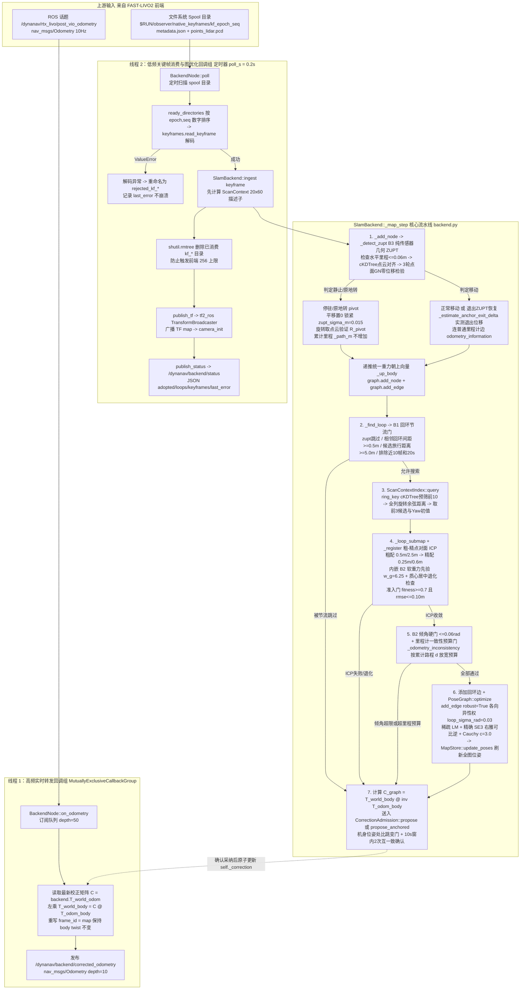

# 02. 公共底座与稳定化分支（`exp/slam-backend-stabilization`）源码、API 与参数精讲

> **对应分支**：`main` 旧基线（`B0_default`）→ 稳定化新底座 `exp/slam-backend-stabilization`（代码提交 `2b77a5d`）  
> **核心代码目录**：[src/embodied_navigation/localization_mapping/backend/](../../src/embodied_navigation/localization_mapping/backend/)  
> **推荐配置文件**：[configs/localization_mapping/slam_backend_stabilized.json](../../configs/localization_mapping/slam_backend_stabilized.json)

---

## 一、后端完整数据流：ROS 通信、双线程调度与 `SlamBackend` 内部流水线

后端进程 [node.py](../../src/embodied_navigation/localization_mapping/backend/node.py) 使用 ROS 2 的 `MultiThreadedExecutor(num_threads=2)` 加两个独立的 `MutuallyExclusiveCallbackGroup`，把**高频实时位姿转发**和**低频耗时的回环图优化**严格隔离在两个线程里（所以即使某次图优化算了 0.5 秒，实时里程计转发依然 10 Hz 丝滑不卡顿！）：



> **看图抓重点**：
> - **虚线箭头是前后端闭环的关键**：线程 2 里经过 `CorrectionAdmission` 两次互一致确认后，才会更新共享引用 `self._correction`；线程 1 的 `on_odometry()` 下一次被 10 Hz 回调触发时，自动用新的 $C$ 左乘前端里程计，零锁竞争、无阻塞！
> - 下文我们逐模块拆解这张图里的 4 个公共底座模块（`ScanContext` / `ICP` / `PoseGraph` / `CorrectionAdmission`）与稳定化新底座的 3 大手术（`B1` / `B2` / `B3`）。

---

## 二、公共底座（`B0`）四大核心模块源码与 API 详解

在理解稳定化升级前，先看懂所有后端分支共享的 4 个底层算法文件（全部纯 Python + **NumPy** + **SciPy**，零黑盒！）。

### 模块 1：地点识别 —— [scan_context.py](../../src/embodied_navigation/localization_mapping/backend/scan_context.py)
**它解决什么问题？** 历史上存了 1000 个关键帧，难道要拿当前点云和 1000 帧挨个做 ICP 吗？太慢了！ScanContext 给每帧点云生成一个轻量“**极坐标高度指纹**”，1 毫秒内筛出最像的几个候选帧，还能顺便猜出两帧之间的**航向角差（Yaw）**！

- **原理与代码**：
  1. `descriptor()`（第 32–42 行）：以机身为中心、半径 `max_range_m = 20 m` 内，按径向切 `rings = 20` 圈（每圈 1 m）、按角度切 `sectors = 60` 个扇区（每扇区 `6°`），组成 `20×60` 矩阵。每个格子记下落进来的点的**最大高度 $z$**（用 `np.maximum.at` 向量化写入，低于 0 截断为 0）。
  2. `ring_key()`（第 45–47 行）：把每一圈的 60 个格子求平均，得到一个 20 维向量。**妙处在于**：不管机器狗面朝哪个方向，同一圈的平均值不变（**旋转不变性**）！
  3. `ScanContextIndex.query()`（第 89–110 行）：
     - 先调用 **`scipy.spatial.cKDTree`** 在 20 维 `ring_key` 空间里快速预筛出前 `scan_context_prefilter = 10` 个候选。
     - 再调用 `distance(a, b)`（第 50–66 行）：把 `20×60` 矩阵按列循环平移 $0..59$ 格（相当于把机器人每 `6°` 转一圈），算列间余弦相似度，找出最像的那个列偏移 `shift`。
     - `shift_to_yaw(shift)` 把列偏移换算成弧度角 `yaw`，作为后面 ICP 的初始朝向猜测！

```text
# 数据结构与伪代码：ScanContext 描述子与旋转搜索（对照 scan_context.py）
输入:
  points_body : float64[N, 3]    # 当前帧机体系激光点云 (x, y, z)
  hist_db     : List[(key, desc: float64[20,60], ring_key: float64[20])]
输出:
  desc        : float64[20, 60]  # 极坐标最大高度矩阵（20 环 x 60 扇区，非负）
  candidates  : List[(key, dist: float in [0,1], yaw_rad: float in (-pi, pi])]

伪代码:
  function descriptor(points_body, rings=20, sectors=60, max_range=20.0):
      desc = zeros((rings, sectors))
      r = hypot(points_body[:, 0], points_body[:, 1])         # 水平距离 [N]
      mask = (r < max_range)
      az = mod(arctan2(y[mask], x[mask]), 2*pi)               # 方位角 [0, 2pi)
      i_ring   = int(r[mask] / max_range * rings)             # 0..19
      j_sector = min(int(az / (2*pi) * sectors), sectors - 1) # 0..59
      maximum_at(desc, (i_ring, j_sector), z[mask])           # 向量化取每格最大 z（下限 0）
      return desc

  function distance(desc_a, desc_b):
      # 把每列做 L2 归一化，枚举全部 60 种列循环偏移 s = 0..59
      best_score = -1; best_shift = 0
      for s in 0..59:
          valid_cols = (norm(a[:, j]) > 0) & (norm(b[:, (j+s)%60]) > 0)
          score = mean_over_valid_cols( cos_sim(a[:, j], b[:, (j+s)%60]) )
          if score > best_score:
              best_score, best_shift = score, s
      return (1.0 - best_score), best_shift                   # yaw = best_shift * 2pi / 60
```

### 模块 2：点云精配准 —— [registration.py](../../src/embodied_navigation/localization_mapping/backend/registration.py)
**它解决什么问题？** 拿到 ScanContext 给的粗略候选帧和 `yaw` 猜想后，精确算出当前点云（`source`）和历史子图（`target`）之间的 6 自由度相对变换 $T_{\text{target,source}}$。

- **为什么用“点对面 ICP”而不是“点对点 ICP”？**  
  激光扫描是离散的线束，两次经过同一面墙时激光点几乎不可能打在完全相同的点上；如果强行拉近“点到点”距离，点云会被卡住滑不动。**点对面（Point-to-Plane）**只惩罚点沿着墙面**法线方向**的距离，允许点沿墙面自由滑动，收敛快得多、精度高得多！
- **源码逐行拆解（`icp_point_to_plane`）**：
  1. **降采样与质心居中（第 59–74 行）**：先把源/目标点云用 `voxel_downsample` 降采样，然后把目标点云减去它的质心 `center = target.mean(axis=0)`。  
     *为什么要质心居中？* 如果机器人在离原点 100 m 的地方做 ICP，点坐标很大，叉乘 $p \times n$ 的数值会比 $n$ 大 100 倍，导致矩阵条件数变差甚至误判退化！移到质心后，算法对世界原点位置**严格平移不变**。
  2. **PCA 估算法向量（`_normals`，第 116–122 行）**：用 **`scipy.spatial.cKDTree.query(points, k=10)`** 找每个目标点周围 10 个邻居，用 `np.einsum` 算协方差矩阵，再调 **`np.linalg.eigh`**（实对称矩阵特征分解）。**最小特征值对应的特征向量**就是该局部平面的法向量 $n_i$（垂直于墙面的方向方差最小）。
  3. **迭代高斯-牛顿求解（第 76–109 行）**：
     - 用 `tree.query(moved, distance_upper_bound=max_correspondence_m)` 找距离内的最近点，计算点到面带符号残差 $r_i = (p'_i - q_i)\cdot n_i$。
     - 构造单点雅可比 $J_i = [n_i^\top,\; (p'_i \times n_i)^\top] \in \mathbb{R}^{1\times 6}$（左扰动线性化），组成正规方程 $H = J^\top J,\; \text{rhs} = J^\top r$。
     - **尺度归一化退化检查（第 95–102 行）**：把旋转列除以点云均方根半径 `scale` 做无量纲化，用 **`np.linalg.eigvalsh`** 检查最小/最大特征值比；若 $\lambda_{\min} \le 10^{-9}\lambda_{\max}$ 说明几何退化（比如只有一面墙、没法确定沿墙方向位置），直接拒收！
     - 调用 **`np.linalg.solve(hessian, -rhs)`** 算出 6 维步长 `step`，左乘更新 $T_c \leftarrow \exp(\text{step}) \cdot T_c$。
  4. **粗-精两阶段策略（`backend.py:_register`，第 861–888 行）**：先粗配（体素 `0.50 m`，搜寻半径 `2.5 m`）把大偏差拉回来，再精配（体素 `0.25 m`，搜寻半径 `0.6 m`）抠出厘米级精度；最后必须同时满足 `converged=True`、`fitness >= 0.7`（至少 70% 源点找到邻居）和 `rmse_m <= 0.10 m`。

```text
# 数据结构与伪代码：质心居中点对面 ICP + B2 软重力先验（对照 registration.py:icp_point_to_plane）
输入:
  source          : float64[N, 3]       # 源点云（机体系）
  target          : float64[M, 3]       # 目标点云（世界系历史子图）
  T_init          : float64[4, 4]       # 初始位姿猜想 T_target_source
  source_up_body  : float64[3] | None   # B2：机体系下单位重力朝上向量 g_b
  gravity_sigma   : float | None        # B2：重力先验标准差 0.02 rad (w_g = (0.05/0.02)^2 = 6.25)
输出:
  IcpResult:
    T_target_source : float64[4, 4]     # 精配后的 6-DoF 变换矩阵
    fitness         : float             # 内点比例 (匹配上的源点数 / 降采样后源点数)
    rmse_m          : float             # 内点点面残差的均方根误差 (米)
    converged       : bool              # 是否在最大迭代次数内收敛且未退化

伪代码:
  function icp_point_to_plane(source, target, T_init, max_dist, voxel_m, g_b, sigma_g):
      src = voxel_downsample(source, voxel_m)                  # [Ns, 3]
      tgt = voxel_downsample(target, voxel_m)                  # [Mt, 3]
      if len(src) < 50 or len(tgt) < 50: return failed

      # 1. 质心居中（消除大坐标带来的旋转杠杆数值病态）
      center = mean(tgt, axis=0)                               # [3]
      tgt_c  = tgt - center
      T_c    = T_init.copy();  T_c[0:3, 3] -= center
      tree   = cKDTree(tgt_c)
      normals = pca_normals(tgt_c, tree, k=10)                 # [Mt, 3] 最小特征值对应特征向量

      # 2. 高斯-牛顿迭代（最多 30 轮）
      for iter in 1..30:
          moved = transform_points(T_c, src)                   # [Ns, 3]
          dist, idx = tree.query(moved, distance_upper_bound=max_dist)
          inlier = isfinite(dist)
          P = moved[inlier];  Q = tgt_c[idx[inlier]];  N = normals[idx[inlier]]
          if len(P) < 50: return failed

          r = row_dot(P - Q, N)                                # [K] 点到面带符号残差
          J = hstack([N, cross(P, N)])                         # [K, 6] 左扰动雅可比
          H = J.T @ J                                          # [6, 6]
          rhs = J.T @ r                                        # [6]

          # B2 可选：叠加精确 MAP 软重力先验（只约束 Roll/Pitch，放开 Yaw 与平移）
          if g_b is not None and sigma_g is not None:
              u   = T_c[0:3, 0:3] @ g_b                        # [3] 预测世界系朝上方向
              J_g = hstack([zeros((3, 3)), -hat(u)])           # [3, 6]
              r_g = u - [0, 0, 1]                              # [3]
              w_g = (0.05 / sigma_g)^2                         # 6.25
              H   += w_g * (J_g.T @ J_g)
              rhs += w_g * (J_g.T @ r_g)

          # 尺度归一化退化检查（防走廊/单墙欠约束）
          scale = max(rms_radius(P), 1.0)
          H_scaled = normalize_rot_blocks(H, scale)
          eig = eigvalsh(H_scaled)                             # 升序特征值 [6]
          if eig[0] <= 1e-9 * eig[-1]: return failed

          step = solve(H, -rhs)                                # [6]
          T_c  = se3_exp(step) @ T_c                           # 左乘更新
          if norm(step[0:3]) < 1e-3 and norm(step[3:6]) < 1e-4:
              break

      T_out = T_c.copy();  T_out[0:3, 3] += center             # 还原世界质心偏移
      return score(T_out, src, tgt, normals, tree, max_dist, converged)
```

### 模块 3：位姿图优化 —— [pose_graph.py](../../src/embodied_navigation/localization_mapping/backend/pose_graph.py)
**它解决什么问题？** 把前端所有关键帧位姿当成“节点”，相邻里程计约束和回环约束当成不同软硬程度的“弹簧边”，找到让所有弹簧总弹性能最小的全局轨迹。

- **核心数学与代码**：
  1. **固定原点（Gauge）**：0 号节点 $T_0$ 钉死不动，只优化节点 `1..N-1`（共 $6(N-1)$ 个未知数）。
  2. **残差与精确 SE(3) 雅可比（第 79–88、198–235 行）**：  
     对边 $(a, b, Z_{ab})$，残差是 $e_{ab} = \log(Z_{ab}^{-1} T_a^{-1} T_b)$。使用右乘更新 $T_i \leftarrow T_i \exp(\delta_i^\wedge)$ 时，精确导数为：
     $$J_b = \mathcal{J}_r^{-1}(e_{ab}), \qquad J_a = -\mathcal{J}_r^{-1}(e_{ab})\,\mathrm{Ad}(T_b^{-1} T_a)$$
     代码里实现了完整的 Barfoot 闭式右雅可比逆 `se3_right_jacobian_inv`（小角度 $\|\phi\|<10^{-2}$ 切到高阶泰勒展开防除零）。*为什么要算这么精确？* 以前近似当成单位阵 $I$ 时，如果某条回环初始残差比较大，梯度方向会偏，导致 LM 还没走到真正最优就停住了（Astra 审计修复的 P0-2）。
  3. **信息矩阵 $\Omega$（弹簧的劲度系数）**：  
     `anisotropic_information` 构造对角 6×6 矩阵 $\Omega = \mathrm{diag}(1/\sigma_{xy}^2, 1/\sigma_{xy}^2, 1/\sigma_z^2, 1/\sigma_{rp}^2, 1/\sigma_{rp}^2, 1/\sigma_{\text{yaw}}^2)$。标准差 $\sigma$ 越小，信息权重 $1/\sigma^2$ 越大，弹簧越硬！
  4. **Cauchy 鲁棒核（防假回环核武器，第 202–218 行）**：  
     普通最小二乘的代价是平方 $s = e^\top \Omega e$，只要混进 1 条错的回环边（$s$ 极大），它的拉力会瞬间把整张地图扯散架！  
     对回环边（`robust=True`），采用 Cauchy 核代价 $c^2 \ln(1 + s/c^2)$，对应 IRLS 降权系数：
     $$w(s) = \frac{1}{1 + s / c^2}$$
     残差越离谱，权重自动趋近于 0，相当于“弹簧自动拉软松手”，保护全图不被拉歪！
  5. **稀疏 Levenberg-Marquardt 求解器（第 176–196、266–269 行）**：  
     - 用 **`scipy.sparse.coo_matrix`** 拼装稀疏海森矩阵 $H$ 再转为 CSR/CSC；
     - 用 **`scipy.sparse.linalg.spsolve`** 解阻尼方程 $(H + \lambda\,\mathrm{diag}(H))\Delta = -g$；
     - 代价下降则接受新位姿并减小阻尼 $\lambda \leftarrow \lambda/10$，否则拒绝并增大阻尼 $\lambda \leftarrow 10\lambda$；
     - 旋转矩阵与轴角互转调用 **`scipy.spatial.transform.Rotation`**。

```text
# 数据结构与伪代码：SE(3) 稀疏 Levenberg-Marquardt 位姿图优化（对照 pose_graph.py:PoseGraph.optimize）
输入:
  poses   : List[float64[4, 4]]              # N 个关键帧当前世界位姿 T_0..T_{N-1}（T_0 固定为 Gauge）
  edges   : List[(a: int, b: int, Z_inv: float64[4,4], Omega: float64[6,6], robust: bool)]
  c       : float                            # Cauchy 鲁棒核尺度（stabilized 为 3.0）
输出:
  poses   : List[float64[4, 4]]              # 全局闭合后的最优 N 个位姿
  summary : dict(converged, iterations, error_before, error_after)

伪代码:
  function optimize(poses, edges, c=3.0, max_iter=20):
      size = 6 * (len(poses) - 1)                              # 自由变量总数（跳过 0 号固定节点）
      damping = 1e-4
      cost = total_cost(poses, edges, c)

      for it in 1..max_iter:
          # 1. 拼装稀疏海森矩阵 H [size, size] 与梯度向量 g [size]
          triplets_H = [];  g = zeros(size)
          for (a, b, Z_inv, Omega, robust) in edges:
              e = se3_log(Z_inv @ invert(poses[a]) @ poses[b]) # [6] 边误差向量
              s = e.T @ Omega @ e                              # 标量马氏距离平方
              w = 1.0 / (1.0 + s / c^2) if robust else 1.0     # Cauchy IRLS 降权系数
              W = w * Omega                                    # [6, 6] 加权信息矩阵

              J_r_inv = se3_right_jacobian_inv(e)              # [6, 6] 精确右雅可比逆
              J_b = J_r_inv                                    # [6, 6] 对节点 b 导数
              J_a = -(J_r_inv @ adjoint(invert(poses[b]) @ poses[a]))  # [6, 6] 对节点 a 导数

              # 把 (J_i^T W J_j) 块和 (J_i^T W e) 累加到自由节点对应 6 维槽位（跳过 0 号节点）
              accumulate_block(triplets_H, g, a, b, J_a, J_b, W, e)

          H = scipy.sparse.coo_matrix(triplets_H, shape=(size, size)).tocsr()

          # 2. 求解稀疏阻尼线性方程 (H + damping * diag(H)) * step = -g
          A = (H + damping * sparse.diags(H.diagonal())).tocsc()
          step = scipy.sparse.linalg.spsolve(A, -g)            # [size]

          # 3. 试探右乘回缩（Retraction）并按真实非线性代价决定是否接受
          trial = [poses[0]] + [poses[i] @ se3_exp(step[6*(i-1) : 6*i]) for i in 1..N-1]
          trial_cost = total_cost(trial, edges, c)
          if trial_cost < cost:
              poses = trial;  damping /= 10.0                  # 接受更新，更接近高斯-牛顿
              if (cost - trial_cost <= 1e-9 * cost) or (max(abs(step)) < 1e-8): break
              cost = trial_cost
          else:
              damping *= 10.0                                  # 拒绝更新，加大阻尼更偏梯度下降
      return poses
```

### 模块 4：安全门与时间窗准入 —— [correction.py](../../src/embodied_navigation/localization_mapping/backend/correction.py)
1. **里程计一致性预算门（`backend.py:_odometry_inconsistency`，第 639–655 行）**：  
   如果候选帧和当前帧之间只走了 $d$ 米，前端就算漂，也不可能漂得太离谱！所以规定 ICP 算出的位姿与当前图位姿的差距不能超过：
   $$\Delta t_{\max}(d) = 0.5 + 0.05\,d \text{（默认）}, \qquad \Delta \theta_{\max}(d) = 0.2 + 0.01\,d$$
   （注：代码默认是 `0.05/m` 与 `0.01 rad/m`）。而且在候选排序**之前**就逐个检查，防止排第一的假候选超预算时连带扔掉排第二的真候选。
2. **CorrectionAdmission（避免控制抖动与杠杆臂 Bug）**：  
   - **机身位姿处比较**：绝对不能直接拿两个矩阵 $C_1$ 和 $C_2$ 的平移列相减！因为如果机器人离 `odom` 原点 30 米，哪怕旋转角只变了 $0.003\text{ rad}$，原点处的平移差就会被杠杆臂放大成 $30 \times 0.003 = 0.09\text{ m}$！正确做法是把它们作用到当前机身位姿上再比较：`pose_difference(C1 @ T_odom_body, C2 @ T_odom_body)`。
   - **多次确认 + 跳变门**：在 `window_s = 10 s` 内连续有 `confirmations = 2` 个彼此一致（差 $\le 0.15\text{ m} / 0.05\text{ rad}$）且没超过单次最大跳变门的候选，才正式替换对外发布的 $C$。

---

## 三、为什么旧基线 `B0_default` 会崩坏？稳定化新底座做了哪 3 大手术？

在真实带噪 IMU 录包上跑旧基线 `B0_default`（默认 `BackendConfig()`），结果非常惨烈：
- **D1（原地转圈 + 带噪 IMU）**：前端原本 `0.1923 m`，跑完 `B0_default` 竟然**劣化到 `0.2206 m`，机身倾角（Tilt）崩塌到 `8.48°`！**（触发了 161 条原地回环，把地基拉歪了！）
- **D2（46 分钟双层 1567 帧）**：前端原本 `0.0772 m`，跑完 `B0_default` **暴跌到 `0.1858 m`（负优化超过 2 倍）**，疯狂添加了 710 条过密回环！

于是，`exp/slam-backend-stabilization` 针对这 3 个病根做了 **B0_aniso + B1 + B2 + B3** 四层手术：

### 手术 0：`B0_aniso`（各向异性信息矩阵 + 强 Cauchy）
对比 `B0_default` 和 [slam_backend_aniso.json](../../configs/localization_mapping/slam_backend_aniso.json)：
- `loop_sigma_rad`（Roll/Pitch）：从 `0.01 rad` 放宽到 **`0.03 rad`**（权重从 $10000$ 降到 $1111$，放松 9 倍！），而 `loop_sigma_yaw_rad` 仍保持 **`0.01 rad`**（硬锁 Yaw）。
  - *为什么？* 32 线雷达垂直分辨率远不如水平方向，单帧 ICP 算出来的 Roll/Pitch 很容易受墙角/地面噪声影响偏个 1–2°；而 IMU 的重力方向本身就很准！放松回环的 Roll/Pitch 权重，就不允许烂 ICP 把水平面拉歪，同时保留它修 Yaw 和 XYZ 的能力。
- `cauchy_scale`：从 `10.0` 压紧到 **`3.0`**，让异常回环边更早触发降权。
- **立竿见影的效果**：仅改这两个数，D2 终图就从 `0.1858 m` 暴降到 `0.0844 m`！

### 手术 1（B1）：回环节流与旅行距离门（`backend.py:_find_loop`，第 664–689 行）
- **病根**：机器人原地不动或慢慢挪步时，每 1 秒就会和 20 秒前的自己连一条回环边。400 条高度相关的错误/退化回环边叠加起来，把正常的里程计边完全淹没！
- **解法**：
  1. `zupt_skip_loop_search = true`：停驻/原地转向帧**直接不做回环搜索**。
  2. `min_loop_travel_m = 5.0 m`：只有自历史帧以来机器人真实走了至少 5 米，才允许连回环（彻底杜绝原地刷回环）。
  3. `min_loop_spacing_m = 0.5 m`（稀疏版 `1.5 m` + `min_loop_interval_s = 4.0 s`）：上次成功闭环后，至少再走 0.5 m 才允许找下一条回环，把 D2 的 710 条冗余边精简到 **65 条精华边**，耗时直接砍半（589 s → 242 s）！

### 手术 2（B2）：ICP 精确 MAP 重力先验 + 倾角硬门（`registration.py:86-94`, `backend.py:786-801`）
- **病根**：在狭窄墙角或单侧障碍物处，6-DoF 点对面 ICP 缺乏大面积地板约束时，会通过“把点云整体歪 5°”来强行凑低残差，直接把地板配成斜坡！
- **解法 1（ICP 内部软重力先验）**：  
  前端每帧都有可信的机体系“朝上方向”单位向量 $g_b$（`backend.py:_up_body`，经由验证后的相对旋转递推维护）。在 ICP 每一步高斯-牛顿里，希望把 $g_b$ 旋转到世界系后仍指向正上方 $e_z = [0, 0, 1]^\top$，即构造三维残差 $r_g = R_c g_b - e_z$，雅可比 $J_g = [0_{3\times 3},\; -[R_c g_b]_\times]$，按**最大后验概率（MAP）精确权重**累加进正规方程：
  $$w_g = \left(\frac{\sigma_p}{\sigma_g}\right)^2 = \left(\frac{0.05\text{ m}}{0.02\text{ rad}}\right)^2 = 6.25$$
  *为什么这个设计非常巧妙？* 因为 $-[u]_\times$ 对绕世界 Z 轴的旋转（Yaw）导数为 0，所以它**只拉住 Roll 和 Pitch 不歪，完全不妨碍 ICP 自由调整 XYZ 和 Yaw**！
  *(踩坑历史：早期版本误把 $w_g$ 乘了 `len(points)`，相当于放大了 500 倍，反而把真实楼梯/楼板点云压死了；Astra 审计发现并去掉后精度立刻恢复。)*
- **解法 2（倾角硬门）**：ICP 跑完后算一下对齐后的机身倾斜角 $\theta_{\text{tilt}}$，超过 `max_loop_tilt_rad = 0.06 rad`（约 `3.44°`）直接一票否决。
- **为什么图级别重力先验 `graph_gravity_sigma_rad` 默认设为 `null`（关闭）？**  
  实测发现，如果在位姿图的所有节点上都加一元重力先验（`0.02 rad`），会把整张图强行锁死在前端起步时那点微小的初始俯仰偏置上，反而妨碍回环去修正整栋楼的微小整体倾斜（D2 终图从 `0.0554 m` 退化为 `0.0752 m`）。所以**只在 ICP 配准与倾角门启用 B2，图级先验默认关**！

### 手术 3（B3）：纯传感器几何 ZUPT（零速修正，`backend.py:387-625`）
- **病根**：机器狗停下来等 Agent 思考 20 秒，或原地转圈环视四周（D1 场景）时，带噪 IMU 零偏漂移会让前端以为机器狗在垂直方向缓缓飘升了 20 cm。
- **为什么叫“纯传感器几何 ZUPT”？**  
  后端拿不到轮速计或足端接触力传感器，**只凭前后帧激光点云自己说话**！
- **四步判定流程（`_detect_zupt`）**：
  1. **锚点比较防缓慢偷爬**：一旦进入静止段，记住第一帧当**锚点（`_zupt_anchor_kf`）**，后面每帧都跟锚点比而不是只跟上一帧比——这样哪怕机器狗极慢地蠕动，累积几帧就会超过阈值、自动退出静止状态，不会被误锁死！
  2. **水平里程预筛**：要求相对上一帧和锚点的里程计水平位移都 $\le \texttt{zupt\_max\_odom\_xy\_m}$（`0.06 m`）。（只看 XY 不看 Z，防止前端 Z 漂移反而骗过检测）。
  3. **点云近邻与旋转检验**：用 `cKDTree` 把当前帧点云按里程计相对旋转转到锚点系，要求内点率 $\ge 85\%$（距离 $\le 0.18\text{ m}$）且中位点距 $\le 0.08\text{ m}$。
  4. **3D 零平移验证（`_estimate_zero_translation_shift`）**：做 3 轮点对面高斯-牛顿求 3D 平移 $\hat{s}$，要求 $H_t = N^\top N$ 满秩（$\lambda_{\min} > 0.02\lambda_{\max}$，确保三个方向几何都可观），并在最终位置重算残差 RMS；只有 $\|\hat{s}\| \le 0.035\text{ m}$ 且小于噪声地板 $2.5\,\mathrm{RMS}+0.005\text{ m}$ 才确认真的没位移！
- **两种模式与为什么默认选 `pivot` 模式（`zupt_full_stop_rot_rad = 0.0`）？**
  - `pivot`（原地转向/零平移）：从锚点连一条边到当前帧，**平移置 0 并用极硬权重 `zupt_sigma_m = 0.015 m` 锁死**，但旋转用点云验证后的 `R_pivot` 并保持普通里程计权重（允许机器人自由原地转圈），同时累计里程 `_path_m` 不增加。
  - `full_stop`：6 自由度全锁死（当 `zupt_full_stop_rot_rad > 0` 时启用）。实践中设为 `0.0`（纯 `pivot` 模式）就能在 D1 检出 138 次、D2 检出 450 次原地静止/转向，既彻底消除停驻 Z 漂移，又绝不会误伤机器狗小幅原地转动。
  - **退出恢复（`_estimate_anchor_exit_delta`）**：当机器狗停完重新起步走动时，用点云重新测出从停驻锚点到退出帧的真实位移，无缝接上正常轨迹！

```text
# 数据结构与伪代码：B3 纯传感器几何 ZUPT 检测（对照 backend.py:_detect_zupt + _estimate_zero_translation_shift）
输入:
  anchor     : Keyframe          # 当前停驻段的起点锚帧（未在停驻中时就是 previous）
  previous   : Keyframe          # 上一关键帧
  curr       : Keyframe          # 当前关键帧
  delta_odom : float64[4, 4]     # 前端里程计帧间增量 inv(T_odom_prev) @ T_odom_curr
输出:
  (mode, R_pivot):
    mode    : "pivot" | "full_stop" | None   # 零速模式（None 表示正常移动）
    R_pivot : float64[3, 3] | None           # 经点云择优验证的相对锚点旋转矩阵

伪代码:
  function detect_zupt(anchor, previous, curr, delta_odom):
      # 1. 水平里程预筛（只看 XY 避免把前端 Z 漂移误当水平运动）
      if hypot(curr.xy - prev.xy) > 0.06 or hypot(curr.xy - anchor.xy) > 0.06:
          return (None, None)

      # 2. 体素降采样并建锚点 KD 树
      A_pts = voxel_downsample(anchor.points_body(), 0.2)     # [Na, 3]
      C_pts = voxel_downsample(curr.points_body(),   0.2)     # [Nc, 3]
      tree  = cKDTree(A_pts)

      # 3. 比较“步进组合旋转 R_prev_step”与“直连里程计旋转 R_odom_anchor”，选点云更贴合者
      P_rot = C_pts @ R_best.T                                # [Nc, 3]
      dists, _ = tree.query(P_rot)                            # [Nc]
      if mean(dists <= 0.18) < 0.85 or median(dists) > 0.08:
          return (None, None)

      # 4. 3 轮点对面高斯-牛顿求 3D 残余平移 shift [3]，验证几何满秩且平移在噪声地板内
      normals = pca_normals(A_pts, tree, k=10)                # [Na, 3]
      shift = zeros(3)
      for _ in 1..3:
          _, res, N = correspondences(P_rot + shift, A_pts, normals, tree, 0.18)
          H_t = N.T @ N                                       # [3, 3] 纯平移海森矩阵
          eig = eigvalsh(H_t)
          if eig[0] <= 0.02 * eig[-1]: return (None, None)    # 某轴几何不可观（如缺地板），不贸然锁死！
          shift += solve(H_t, -(N.T @ res))                   # [3]

      # 在最终位置重算点面残差 RMS，确认真零平移
      _, res_final, _ = correspondences(P_rot + shift, A_pts, normals, tree, 0.18)
      rms = sqrt(mean(res_final^2))
      if norm(shift) <= 0.035 and norm(shift) <= 2.5 * rms + 0.005:
          return ("pivot", R_best)                            # 建边: 平移=0(sigma=0.015m), 旋转=R_best
      return (None, None)
```

---

## 四、稳定化底座关键参数速查表（`slam_backend_stabilized.json`）

| 参数名 | 默认值（`stabilized.json`） | 调大了会怎样？ | 调小了会怎样？ |
| --- | ---: | --- | --- |
| `odometry_sigma_m` / `_rad` | `0.2 m` / `0.02 rad` | 前端弹簧变软，回环拉力更大（易受坏回环影响） | 前端变硬，真回环拉不动漂移 |
| `loop_sigma_m` | `0.05 m` | 回环平移拉力变弱，闭环残差更大 | 回环平移极硬，一旦配偏会撕扯轨迹 |
| `loop_sigma_rad` (R/P) | `0.03 rad` | 更信任 IMU 水平面，更防倾角拉歪 | 回到 `0.01` 会让烂 ICP 把地板拉歪（D1 崩塌） |
| `loop_sigma_yaw_rad` | `0.01 rad` | 航向闭环收敛变松 | 航向强锁定（通常保持 `0.01`） |
| `cauchy_scale` | `3.0` | 回到 `10.0` 对异常回环太宽容，易负优化 | 太小（如 `0.5`）会把大漂移的**真回环**也误当成离群点忽略 |
| `min_loop_travel_m` | `5.0 m` | 过滤掉短距离局部小环 | 太小（`0.0`）会在原地或刚走两步疯狂刷冗余回环 |
| `min_loop_spacing_m` | `0.5 m` | 边更稀疏、更快（`1.5 m` 适合高噪），但 D3 等多层精度略降 | 设为 `0.0` 变密集，D3 精度升 1 cm 但耗时增加 ~30% |
| `icp_gravity_sigma_rad` | `0.02 rad` | 重力软约束变弱 | 约束过硬可能压制真实倾斜（如爬坡体姿态） |
| `graph_gravity_sigma_rad` | `null`（关） | 开启（`0.02`）会把全图锁向前端初始俯仰偏置（D2 劣化） | 保持关闭为当前最优 |
| `max_loop_tilt_rad` | `0.06 rad`（3.44°） | 放过倾角畸变的假回环 | 过小会误杀大坡度或剧烈颠簸下的真回环 |
| `zupt_enabled` / `zupt_full_stop_rot_rad` | `true` / `0.0` | `rot_rad > 0` 会强锁旋转，存在误锁慢速转弯风险 | 关掉 `zupt_enabled` 会复现 D1 停驻 Z 漂移（`0.19 m`） |

**实测战绩总结**：这套稳定化底座在 **D1 从 `0.1923 → 0.0997 m`（降 48.2%，0 误回环）**，在 **D2 从 `0.0772 → 0.0554 m`（降 28.2%，零负跳变）**，成为后续三条正交 v2 分支的共同基石！
