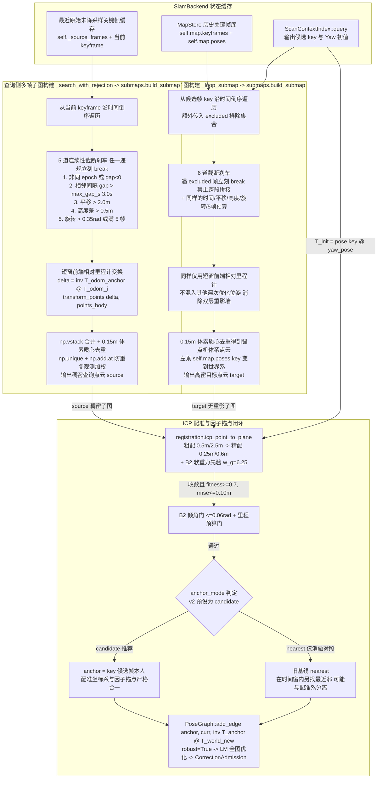

# 03. 正交分支一：实测多帧局部子图（`exp/slam-v2-measured-submaps`）精讲

> **对应分支**：`exp/slam-v2-measured-submaps`（HEAD `59c60a4`，基于稳定化底座 `2b77a5d` 切出）  
> **核心新增代码**：`src/embodied_navigation/localization_mapping/backend/submaps.py`（130 行） + `backend.py` 增量接线  
> **配置文件**：`configs/localization_mapping/slam_v2_measured_submaps.json`（及 `_nospacing` / `_sparse` 变体）

---

## 一、它想解决什么痛点？（为什么单帧点云不够用？）

在稳定化底座（`stabilized.json`）里，我们虽然已经把 D1 和 D2 做得很好了，但在 **D3（两层上下楼 `same-876`）** 上终图误差还停留在 `0.1882 m`。为什么？

想一下 32 线旋转激光雷达（Ouster OS1-32）在**楼梯间、窄门口**拍到的单帧点云是什么样子：
1. **单帧太稀疏**：32 条激光线扫完一圈，垂向线束间距比较宽，在楼梯台阶和近处墙面上只留下一道道稀疏的横条纹；
2. **传统做法的缺陷（全局位姿拼子图会“重影”）**：底座原来的 `_loop_submap()` 是把历史候选帧前后各 5 帧的点云，用它们各自的**全局地图位姿**拼在一起作为目标点云，而**查询侧依然只用单帧**！这样有两个问题：
   - 查询侧只有孤零零 1 帧，点太少，ICP 在楼梯拐角处算出来的 Z 高度和法向量容易抖动；
   - 如果历史窗口里混进了以前经过时的其他遍次位姿，或者中间有跳变，拼出来的目标点云会出现“双层重影墙”。

**本分支的核心思想一句话概括**：
> **不用全局位姿拼，而是只用短时间窗内的“前端原始相对里程计”，把锚点附近连续几帧的实测激光点云拼成一块高密度局部刚体子图（查询侧和历史侧都可以拼！）**。

为什么敢相信短窗内的前端原始里程计？因为 FAST-LIVO2 虽然走 100 米会漂 20 厘米，但在**短短 2 米、几秒钟内**，它的相对精度是毫米~厘米级的，几乎没有重影！

---

## 二、完整数据流、核心数学公式与源码逐行拆解

本分支共享 `02` 文档中的 ROS 通信（`node.py`）、B3 ZUPT、B1 节流、ScanContext、B2 重力先验 ICP 和位姿图优化，**精准介入在“点云构造（步骤 4 之前）”与“回环边锚点绑定（步骤 6）”两处**：



核心实现全在 `submaps.py` 的 `build_submap()` 函数中：

### 2.1 数学公式
给定一个锚点关键帧 $a$，沿着时间往回找它之前的连续关键帧集合 $\mathcal{W}(a)$，将每一帧 $i \in \mathcal{W}(a)$ 的机体系点云 $P_{\text{body}}^{(i)}$ 用**前端原始相对里程计**变到锚点 $a$ 的机体系下，再合并做体素降采样：

$$P_{\text{sub}}^{(a)} = \mathrm{Voxel}_{v}\!\left(\bigcup_{i \in \mathcal{W}(a)} \left(T_{o,a}^{-1} T_{o,i}\right) P_{\text{body}}^{(i)}\right)$$

其中：
- $T_{o,a}$、`T_odom_body` 是锚点帧的前端里程计位姿；
- $T_{o,i}$ 是邻近帧 $i$ 的前端里程计位姿；
- $T_{o,a}^{-1} T_{o,i}$ 就是两帧之间纯粹的局部相对运动，**完全不混入后端优化位姿或其他重访遍次**。

```text
# 数据结构与伪代码：多帧实测局部子图构建（对照 backend/submaps.py:build_submap）
输入:
  keyframes : Iterable[Keyframe]              # 按时间顺序排列的关键帧序列
              # 每帧含 key=(epoch,seq), stamp_ns: int, T_odom_body: float64[4,4], points_lidar: float64[N,3]
  anchor    : Keyframe                        # 锚点帧（查询侧为当前帧，历史侧为候选帧 key）
  config    : SubmapConfig                    # max_frames=5, max_translation_m=2.0, max_height_m=0.5,
                                              # max_rotation_rad=0.35, max_gap_s=3.0, voxel_m=0.15
  excluded  : set[Key] | None                 # 历史侧传入排除窗集合（遇排除帧立刻截断）
输出:
  MeasuredSubmap:
    points_body   : float64[K, 3]             # 锚点机体系下经 0.15m 体素质心去重后的稠密点云
    source_keys   : tuple[Key, ...]           # 实际参与拼接的连续帧 key 列表（长度 1..5）
    point_sources : tuple[tuple[Key,...],...] # 可选：每个输出点分别由哪些帧贡献

伪代码:
  function build_submap(keyframes, anchor, config, excluded):
      idx = index_of(keyframes, anchor.key)
      selected = [];  clouds = []
      prev_frame = anchor

      # 从锚点开始沿时间倒序遍历，遇到任何断点立刻 break
      for frame in reversed(keyframes[0 .. idx]):
          if excluded is not None and frame.key != anchor.key and frame.key in excluded:
              break                                              # 刹车 1：不可跨越排除帧

          delta = invert(anchor.T_odom_body) @ frame.T_odom_body # [4, 4] 相对锚点的纯前端运动
          trans, rot = pose_difference(eye(4), delta)
          dz  = abs(frame.T_odom_body[2, 3] - anchor.T_odom_body[2, 3])
          gap = (prev_frame.stamp_ns - frame.stamp_ns) * 1e-9

          if (epoch(frame) != epoch(anchor)                      # 刹车 2：跨会话/时间倒退
              or gap < 0 or gap > config.max_gap_s               # 刹车 3：帧间间隔 > 3.0s
              or trans > config.max_translation_m                # 刹车 4：平移 > 2.0m
              or dz    > config.max_height_m                     # 刹车 5：高差 > 0.5m
              or rot   > config.max_rotation_rad):               # 刹车 6：旋转 > 0.35rad
              break

          selected.append(frame.key)
          clouds.append(transform_points(delta, frame.points_body()))  # 统一投到锚点机体系
          prev_frame = frame
          if len(selected) >= config.max_frames:
              break

      # 合并多帧并按 0.15m 体素取质心，确保静止多帧重叠处不会重复加权
      merged = vstack(clouds)                                    # [sum(N_i), 3]
      cells  = floor(merged / config.voxel_m).astype(int64)      # [sum(N_i), 3] 体素坐标
      _, inv_idx, counts = unique(cells, axis=0, return_inverse=True, return_counts=True)
      sums = zeros((len(counts), 3))
      add_at(sums, inv_idx, merged)                              # 同体素点坐标求和
      points_sub = sums / counts[:, None]                        # [K, 3] 体素质心
      return MeasuredSubmap(points_sub, tuple(selected), ...)
```

### 2.2 源码里的 5 道“连续性截断刹车”
在 `submaps.py` 中，代码从锚点开始**倒序遍历**历史帧（`for frame in reversed(frames[: index + 1]):`），只要遇到以下任何一条违规，立刻 `break` 截断，**严禁跨过断点把不连续的两段强行拼在一起**：
1. **遇到排除帧**：`frame.key in excluded`（比如已经进入近期排除窗），立刻停！
2. **跨会话 epoch 或时间倒退**：`_epoch_of(frame.key) != anchor_epoch` 或相邻帧时间差 `gap < 0`；
3. **相邻帧时间间隔过大**：`gap > max_gap_s`（默认 `3.0 s`）；
4. **相对锚点运动超预算**：
   - 3D 平移 `> max_translation_m`（`2.0 m`）；
   - 高度差 `|z_i - z_a| > max_height_m`（`0.5 m`，防止把跨层楼梯拉太长）；
   - 旋转角 `> max_rotation_rad`（`0.35 rad ≈ 20°`，防止大转弯时角度误差被杠杆臂放大）；
5. **达到最大帧数**：`len(selected) >= max_frames`（`5` 帧）。

### 2.3 调用了哪些 Python / NumPy API？
本模块极其干净，**只依赖 NumPy**（没有引入任何重型第三方库）：
- `invert(anchor.T_odom_body) @ frame.T_odom_body`：计算局部相对变换矩阵；
- `transform_points(delta, frame.points_body())`：矩阵乘法把历史点云投影到锚点机体系；
- `np.vstack(clouds)`：纵向拼接多帧点云；
- `np.floor(points / c.voxel_m).astype(np.int64)` + **`np.unique(..., axis=0, return_inverse=True, return_counts=True)`** + **`np.add.at(sums, inverse, points)`**：对合并后的多帧点云做**体素质心降采样**（体素 `0.15 m`）。
  - *为什么要取质心而不是直接堆在一起？* 机器狗停在原地时 5 帧全拍同一面墙，如果直接堆叠，这面墙的点数会变成 5 倍，在后续 ICP 里权重被虚假放大 5 倍；取质心后每个体素严格只有 1 个代表点，保证**重复观测不会重复加权**！

### 2.4 `backend.py` 里的 3 处接线与关键修复：`anchor_mode = "candidate"`
1. **历史侧子图（`_loop_submap`）**：如果 `use_history_submap=true`，不再用旧的全局位姿拼接，而是调用 `build_submap` 在候选帧 `key` 的机体系下拼出实测子图，再整体用候选帧当前的世界位姿 `self.map.poses[key]` 变到世界系，交给 ICP 当 `target`！
2. **查询侧子图（`_search_with_rejection`）**：如果 `use_query_submap=true`，用最近缓存的原始未降采样关键帧（`self._source_frames` + 当前帧）拼出查询侧子图，交给 ICP 当 `source`！
3. **为什么要把 `anchor_mode` 设为 `"candidate"`（Astra 审计 P1-8 修复）？**  
   - 在旧基线里，ICP 配准完得到当前帧的世界位姿 `T_world_new` 后，代码会在候选窗口里找空间上离它最近的另一帧作为回环边的起点（`anchor_mode = "nearest"`）。
   - 但在实测子图模式下，目标子图是严格建立在**候选帧 `key` 自己的局部坐标系**上的！如果边却连到窗口里的另一个邻居帧上，就等于“配准参考系”和“位姿图因子锚点”分家了，一旦图优化拉动了邻居帧，相对误差就会扭曲。
   - 改为 `anchor_mode = "candidate"` 后，回环边直接连在 `(key, current_keyframe)` 之间，数学语义严格闭环！

---

## 三、参数选择详解与真实踩坑复盘

参考 `slam_v2_measured_submaps.json`：

| 参数 | 取值 | 物理含义与选择理由 |
| --- | ---: | --- |
| `max_frames` | `5` | 最多拼 5 帧。对 32 线雷达来说，5 帧刚好能把垂直线束缝隙填满，又不至于拖太长引入前端漂移 |
| `max_translation_m` | `2.0 m` | 空间跨度不超过 2 米，确保局部里程计误差在厘米级以内 |
| `max_height_m` | `0.5 m` | 上下楼时限制子图垂直跨度不超过半米，避免把两段不同坡度的楼梯混在一起 |
| `max_rotation_rad` | `0.35 rad`（~20°） | 限制转弯幅度；转弯越大，微小陀螺仪偏置在远处墙面产生的涂抹越明显 |
| `max_gap_s` | `3.0 s` | **非常关键的参数（踩坑复盘见下）**：限制相邻两帧最大时间间隔为 3 秒 |
| `voxel_m` | `0.15 m` | 比基线存储体素 `0.20 m` 更细，保留楼梯台阶与墙角清晰轮廓，同时让后续 ICP（`0.25 m`）有充足点计算法向量 |
| `use_query_submap` / `use_history_submap` | `true` / `true` | 双侧均拼子图（支持拆开做消融实验，单独关掉一侧看收益） |
| `anchor_mode` | `"candidate"` | 因子锚点严格绑定到构建目标子图的候选帧 |

> **给初学者的经典调参教训（为什么 `max_gap_s` 不能拍脑袋改成 `1.0 s`？）**：  
> 有人会想：“为了减少运动模糊，把 `max_gap_s` 从 `3.0 s` 压到 `1.0 s` 不就更稳了吗？”  
> 核查前端 `snapshot_bridge.cpp` 发现，D2 数据集里关键帧的实际导出间隔本来就在 **`1.0–2.1 s`** 之间！如果盲目把 `max_gap_s` 设为 `1.0 s`，会导致 `1471 / 1567` 个锚点一帧都拼不上、直接退化成单帧！调任何时间窗参数前，必须先看上游关键帧的实际采样间隔分布。

---

## 四、实测表现：它什么时候神、什么时候坑？

在 30 组统一干净对照（[REPORT.md](../../experiments/slam-backend-phase4/REPORT.md)）中的表现非常具有教科书意义：

| 数据集 | 稳定化底座（单帧） | `v2_ms` (`spacing=0.5 m`) | `v2_ms_nospacing` (`0.0 m`) | `v2_ms_sparse` (`1.5 m`) | 发生了什么？ |
| --- | ---: | ---: | ---: | ---: | --- |
| **D1**（原地转+噪 IMU） | `0.0997 m` | `0.0997 m` | — | — | B3 ZUPT 生效，0 误回环，完全一致 |
| **D3**（低噪 IMU 两层上下楼） | `0.1882 m` (Z `0.1815`) | **`0.1268 m`** (Z `0.1211`) | **`0.1126 m`** (Z **`0.0990`**) | — | **大获全胜！** 误差暴降 33%–40%，`cum_jitter` 从 `2.605` 降到 `1.661 m` |
| **D2**（高噪 IMU 长停驻） | **`0.0554 m`** | `0.1741 m`（退化） | — | Online **`0.0731 m`** / Final `0.1124 m` | **暴露短板！** 高噪 IMU + 5 帧总跨度中位数 `5.3 s`（最大 `8.1 s`），导致子图本身出现运动涂抹，反而比单帧更模糊 |

### 一句话总结该分支
- **优势**：在 **IMU 质量较好、结构复杂的多层楼梯/走廊（D3）** 上，多帧实测子图能让 32 线雷达变稠密，大幅提升点对面 ICP 精度，而且几乎不增加运行耗时（245.8 s vs 基线 253.1 s）。
- **局限**：它的前提是“局部窗口内的前端里程计很准”。当 **IMU 噪声极大且关键帧间隔拉长（D2）** 时，拼 5 帧横跨 5–8 秒会把前端漂移直接“烤”进子图里造成重影涂抹！
