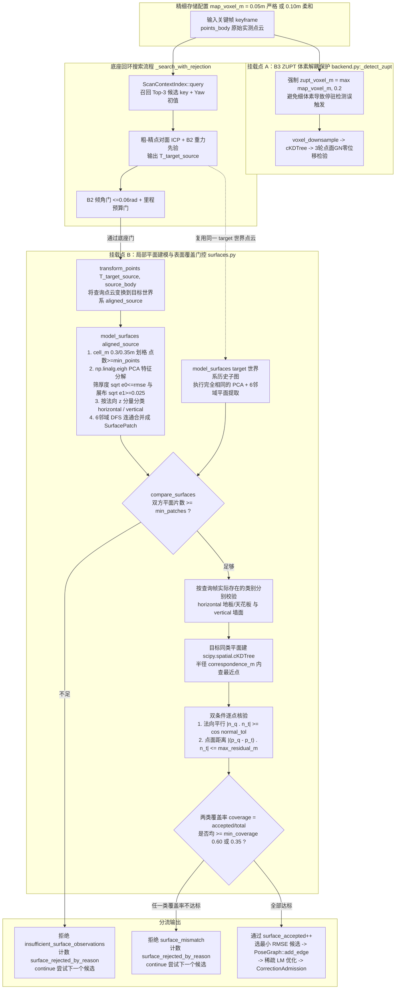

# 04. 正交分支二：局部平面与表面覆盖门控（`exp/slam-v2-surface-gate`）精讲

> **对应分支**：`exp/slam-v2-surface-gate`（HEAD `0e98406`，基于稳定化底座 `2b77a5d` 切出）  
> **核心新增代码**：`src/embodied_navigation/localization_mapping/backend/surfaces.py`（232 行） + `backend.py` 增量接线  
> **配置文件**：`configs/localization_mapping/slam_v2_surface_gate.json`（严格版）与 `slam_v2_surface_gate_soft.json`（柔和版）

---

## 一、它想解决什么痛点？（为什么 ICP 看起来收敛了，却还是假回环？）

初学者经常会有一个直觉：“既然点对面 ICP 已经收敛了，内点率 `fitness >= 0.7` 且均方根误差 `rmse <= 0.10 m`，那这条回环一定是对的吧？”

**其实不一定！** 在室内办公楼场景里，有两类典型的“披着低 RMSE 外衣的烂回环”：
1. **单方向凑合对齐**：比如机器狗在一条长走廊里，当前帧的**地板和天花板**都恰好和 20 米外另一段走廊的地板/天花板贴合了（占了总点数的 75%，所以 `fitness >= 0.7`、`rmse` 很小！），但两侧的**墙面、门洞、立柱**其实错位了半米！
2. **杂乱点云虚假重合**：大量打在桌椅边缘、楼梯扶手、稀疏噪点上的点，凑巧离目标点云很近，拉低了整体 `rmse`，但**真正的建筑结构大平面（地板、墙壁）**法向量歪了，或者根本没覆盖上！

**本分支的核心思想一句话概括**：
> **在 ICP 配准完成后、正式加入位姿图之前，额外加一道“建筑结构质检门（Surface Gate）”：分别检查水平面（地板/天花板）和竖直面（墙面）是不是都真正对上了、法向量是不是平行、贴合覆盖率够不够高！**  
> 注意：本模块**只做准入门控（挑出并拒掉坏回环）**，不修改 ICP 本身，也不往位姿图里加新的地面高度因子。

---

## 二、完整数据流、核心算法原理与源码逐行拆解

本分支共享 `02` 文档的 ROS 通信（`node.py`）、B1/B2/B3、ScanContext、ICP 与位姿图优化，**精准介入在两处**：一是 **ZUPT 体素解耦保护**（防止 `map_voxel_m=0.05/0.10` 破坏停驻检测），二是在 **ICP 收敛 + B2 倾角门 + 里程预算门之后、入图之前** 串入一道建筑平面质检门：



全部核心逻辑在 `surfaces.py` 的两个函数里：`model_surfaces()`（提取实测局部平面）和 `compare_surfaces()`（比对查询平面与目标平面）。

### 步骤 1：体素网格划分 + 局部 PCA 拟合平面（`model_surfaces()`）
> **硬前提**：输入点云必须在**重力对齐的世界坐标系**（配置要求 `gravity_aligned: true`），因为下面要靠法向量的 $z$ 分量区分水平面和竖直面！如果坐标系没和重力对齐，地板法向量就不是 $[0,0,1]^\top$ 了。

1. **按 `cell_m` 划网格**：用 `np.floor(points / c.cell_m).astype(np.int64)` 把 3D 空间切成边长 `0.3 m`（或柔和版 `0.35 m`）的小方格，收集落进每个方格的点。点数 `< min_points`（6 个）的稀疏格子直接丢弃（保持未知，绝不脑补插值）。
2. **PCA 特征值筛选平面（调用 `np.linalg.eigh`）**：  
   对格子里所有点算中心 `center = group.mean(axis=0)` 与协方差矩阵 $C = \frac{1}{m}\sum (p_k - \bar{p})(p_k - \bar{p})^\top$，做实对称特征分解得到 3 个升序特征值 $\lambda_0 \le \lambda_1 \le \lambda_2$ 和对应特征向量：
   - $\sqrt{\lambda_0}$ 表示点云最薄方向的厚度（**平面拟合 RMSE**）：如果 $\lambda_0 > \texttt{max\_plane\_rmse\_m}^2$（$0.025^2$），说明这团点太厚、不是平的（可能是墙角、桌角、扶手），扔掉！
   - $\sqrt{\lambda_1}$ 表示点云第二宽方向的展布：如果 $\lambda_1 < \texttt{min\_spread\_m}^2$（$0.025^2$），说明这些点排成了一根细线（比如单根激光线扫出来的线，或者细栏杆），无法唯一确定一个平面，扔掉！
   - 通过两道检验后，最小特征值对应的特征向量 `normal = vectors[:, 0]` 就是该小方格的**单位法向量**！
3. **按法向分类为“水平面”与“竖直面”**：
   - 若 $|n_z| \ge \cos(\texttt{normal\_tolerance\_rad})$（默认 $0.2\text{ rad} \approx 11.5^\circ$）：归为 **`horizontal`**（地板或天花板）；
   - 若 $|n_z| \le \sin(\texttt{normal\_tolerance\_rad})$：归为 **`vertical`**（竖直墙面）；
   - 介于两者之间（比如斜坡、楼梯斜切面、歪斜家具）：返回 `None`，保持未知、不强行分类！

### 步骤 2：六邻域连通区域生长合并（`model_surfaces()` 后半段）
一个个 `0.3 m` 的小方格太碎了。代码按确定性字典序遍历所有平面方格，使用栈式深度优先搜索（DFS，`frontier`），检查当前方格的 **6 个面相邻格子**（$\pm x, \pm y, \pm z$）：
只要邻居格子满足三个条件，就合并成同一块大 `SurfacePatch`：
1. 类别相同（同为 `horizontal` 或同为 `vertical`）；
2. 法向量夹角接近：$|n_{\text{seed}} \cdot n_{\text{other}}| \ge \cos(\texttt{normal\_tolerance\_rad})$；
3. 共面距离够近：$|(\bar{p}_{\text{other}} - \bar{p}_{\text{seed}}) \cdot n_{\text{seed}}| \le \texttt{merge\_distance\_m}$（`0.04 m`）。
*(细节设计：代码每一步都和种子格 `seed` 比法向与平面距离，避免像“传话游戏”那样沿着曲面慢慢漂移拐弯！)*

```text
# 数据结构与伪代码：局部 PCA 平面提取 + 6 邻域区域生长（对照 backend/surfaces.py:model_surfaces）
输入:
  points_world : float64[N, 3]          # 重力对齐世界系下的实测点云
  config       : SurfaceConfig          # cell_m=0.3, min_points=6, max_plane_rmse_m=0.025,
                                        # min_spread_m=0.025, normal_tolerance_rad=0.2, merge_distance_m=0.04
输出:
  SurfaceModel:
    patches         : tuple[SurfacePatch, ...]   # 每个 Patch 含 kind("horizontal"|"vertical"),
                                                 # centroid[3], normal[3], points[K,3], height_m
    unknown_points  : int                        # 未归类（稀疏/曲面/斜坡）点数
    observed_points : int                        # 总输入点数 N

伪代码:
  function model_surfaces(points_world, config):
      # 1. 划体素方格: Dict[(ix, iy, iz) -> List[point_idx]]
      cells = group_indices_by( floor(points_world / config.cell_m).astype(int64) )

      # 2. 对每个满足 min_points 的方格做 PCA 筛选平面
      planar = {}
      for cell, idxs in cells.items():
          if len(idxs) < config.min_points: continue
          group    = points_world[idxs]                      # [m, 3]
          center   = mean(group, axis=0)                     # [3]
          centered = group - center                          # [m, 3]
          cov      = (centered.T @ centered) / len(group)    # [3, 3]
          eig, vec = eigh(cov)                               # eig[0] <= eig[1] <= eig[2]
          # 平面必须足够薄 (sqrt(eig[0]) <= 2.5cm) 且足够展开 (sqrt(eig[1]) >= 2.5cm)
          if eig[1] < config.min_spread_m^2 or eig[0] > config.max_plane_rmse_m^2:
              continue
          n = vec[:, 0]                                      # [3] 最小特征值对应单位法向量
          kind = ("horizontal" if abs(n[2]) >= cos(config.normal_tolerance_rad)
                  else "vertical" if abs(n[2]) <= sin(config.normal_tolerance_rad)
                  else None)
          if kind is not None:
              planar[cell] = (idxs, center, canonical_sign(n), kind)

      # 3. 确定性顺序 6 邻域 DFS 区域生长合并
      patches = [];  remaining = set(planar.keys())
      for seed in sorted(planar.keys()):
          if seed not in remaining: continue
          remaining.remove(seed)
          seed_idxs, c0, n0, kind0 = planar[seed]
          members = list(seed_idxs);  stack = [seed]
          while stack:
              curr = stack.pop()
              for nb in six_face_neighbors(curr):            # (+-x, +-y, +-z)
                  if nb not in remaining: continue
                  nb_idxs, c1, n1, kind1 = planar[nb]
                  if (kind1 == kind0
                      and abs(dot(n0, n1)) >= cos(config.normal_tolerance_rad)
                      and abs(dot(c1 - c0, n0)) <= config.merge_distance_m):
                      remaining.remove(nb);  stack.append(nb);  members.extend(nb_idxs)
          patches.append(SurfacePatch(kind0, mean(points_world[members]), n0, points_world[members]))
      return SurfaceModel(tuple(patches), N - sum(len(p.points)), N)
```

### 步骤 3：分类型检验覆盖率与面残差（`compare_surfaces()`）
当 ICP 算出变换 `T_target_source` 后，`backend.py` 把当前查询点云变换到目标世界系 `aligned_source = transform_points(result.T_target_source, source_body)`，分别对 `aligned_source` 和 `target` 跑 `model_surfaces()`，再送入 `compare_surfaces()`：
1. 若任意一侧提取出的平面片数 `< min_patches`（1），直接返回拒收原因 **`insufficient_surface_observations`**（观测不足，不贸然放行）。
2. **分别检验 `horizontal` 和 `vertical`（只校验查询帧中实际存在的类别）**：
   - 把目标侧同类平面的所有点建一棵 **`scipy.spatial.cKDTree`**；
   - 查询侧每个平面点在半径 `correspondence_m`（`0.3 m`）内找最近目标点；
   - 只有同时满足 **法向夹角** $|\hat{n}_q^\top \hat{n}_t| \ge \cos(\texttt{normal\_tolerance\_rad})$ **且** **点到面距离残差** $|(p_q - p_t)\cdot \hat{n}_t| \le \texttt{max\_residual\_m}$（`0.06 m`），该点才算匹配成功！
   - 计算该类别的**有效覆盖率** $\text{coverage}_{\text{kind}} = \frac{\text{accepted}}{\text{total}}$。
   - **只要水平面或竖直面中任意一类覆盖率低于 `min_coverage`**（严格版 `0.60`，柔和版 `0.35`），立刻判 **`surface_mismatch`** 拒收该回环！

```text
# 数据结构与伪代码：分类型表面覆盖率检验（对照 backend/surfaces.py:compare_surfaces）
输入:
  query  : SurfaceModel          # ICP 对齐到目标世界系后的查询平面模型
  target : SurfaceModel          # 目标历史子图平面模型
  config : SurfaceConfig         # correspondence_m=0.3, max_residual_m=0.06, min_coverage=0.6 (柔和 0.35)
输出:
  SurfaceComparison:
    accepted         : bool
    reason           : "accepted" | "insufficient_surface_observations" | "surface_mismatch"
    matched_patches  : int
    rmse_m           : float
    coverage_by_kind : dict[str, float]   # 如 {"horizontal": 0.82, "vertical": 0.71}

伪代码:
  function compare_surfaces(query, target, config):
      if len(query.patches) < config.min_patches or len(target.patches) < config.min_patches:
          return SurfaceComparison(False, "insufficient_surface_observations", ...)

      coverage = {};  all_errors = []
      for kind in ("horizontal", "vertical"):
          q_patches = [p for p in query.patches  if p.kind == kind]
          if not q_patches: continue                               # 只检验查询帧实际看到的类别
          t_patches = [p for p in target.patches if p.kind == kind]
          total_q   = sum(len(p.points) for p in q_patches)
          accepted_q = 0

          if t_patches:
              t_pts  = vstack([p.points for p in t_patches])       # [Mt, 3]
              t_norm = vstack([repeat(p.normal, len(p.points)) for p in t_patches])  # [Mt, 3]
              tree   = cKDTree(t_pts)
              for qp in q_patches:
                  dist, idx = tree.query(qp.points, distance_upper_bound=config.correspondence_m)
                  hit = isfinite(dist)
                  # 双条件同时满足：法向量夹角够小 AND 点到面残差够小
                  cos_ang = abs(t_norm[idx[hit]] @ qp.normal)      # [Kh]
                  plane_r = abs(row_dot(qp.points[hit] - t_pts[idx[hit]], t_norm[idx[hit]]))
                  ok = (cos_ang >= cos(config.normal_tolerance_rad)) & (plane_r <= config.max_residual_m)
                  accepted_q += sum(ok)
                  all_errors.extend(plane_r[ok])

          coverage[kind] = accepted_q / total_q
          if coverage[kind] < config.min_coverage:                 # 任意一类覆盖率不达标即拒收！
              return SurfaceComparison(False, "surface_mismatch", ..., coverage)

      return SurfaceComparison(True, "accepted", ..., rmse(all_errors), coverage)
```

---

## 三、一个极其精彩的工程 Bug 复盘：为什么必须解耦 ZUPT 体素？

在 `exp/slam-v2-surface-gate` 的 `backend.py` diff 里，你会看到这样一行看似不起眼的修改（Astra 审计 P1-7 修复）：

```python
zupt_voxel_m = max(c.map_voxel_m, 0.2)
anchor_pts = voxel_downsample(anchor.points_body(), zupt_voxel_m)
curr_pts = voxel_downsample(keyframe.points_body(), zupt_voxel_m)
```

**为什么要专门写这行 `max(c.map_voxel_m, 0.2)`？**
- 表面门为了在 `0.3 m` 格子里凑够 6 个点来拟合平面，必须把地图存储体素 `map_voxel_m` 从默认的 `0.2 m` 加密到 **`0.05 m`**（或 `0.10 m`）！
- 可是底座的 **B3 ZUPT 检测**原本直接复用了 `c.map_voxel_m` 对点云降采样！当 `map_voxel_m` 突然变细 4 倍（`0.20 → 0.05 m`）后，点云变密得多，近邻点距离中位数暴跌，导致 ZUPT 把许多正常慢走的关键帧误判成了原地停驻——在 D3 数据集上，`zupt_pivot` 计数竟然从正常的 **20 次暴涨到了 160 次**，严重干扰了对照实验的正交性！
- 加上 `max(c.map_voxel_m, 0.2)` 把 ZUPT 采样分辨率与表面建模分辨率彻底解耦后，D3 上的 `zupt_pivot` 立刻精确回归基线的 **20 次**！
- **给初学者的启发**：SLAM 系统里不同模块（建图、配准、ZUPT、平面拟合）对体素分辨率的敏感度完全不同，**绝对不要让一个共享超参数偷偷改变另一个不相关模块的物理行为！**

---

## 四、严格版 vs 柔和版参数选择与实测真相

| 参数 | 严格版 `slam_v2_surface_gate.json` | 柔和版 `slam_v2_surface_gate_soft.json` | 物理含义与权衡 |
| --- | ---: | ---: | --- |
| `map_voxel_m` | `0.05 m` | `0.10 m` | 表面拟合需要比 `0.2 m` 更密的点；太稀会在 `0.3 m` 格子里凑不够 6 个点 |
| `cell_m` | `0.30 m` | `0.35 m` | 局部平面拟合体素边长；柔和版稍大一点，更容易在稀疏点云里凑出平面 |
| `min_points` | `6` | `5` | 每格最少点数（数学下限是 3，设 5–6 防噪点凑出假平面） |
| `max_plane_rmse_m` | `0.025 m` | `0.035 m` | 平面厚度容忍度；高噪 IMU 或略带畸变点云用 `3.5 cm` 更合理 |
| `normal_tolerance_rad` | `0.20 rad` (11.5°) | `0.25 rad` (14.3°) | 水平/竖直分类和法向一致性容差（必须 `< π/4` 防止两类重叠） |
| `merge_distance_m` | `0.04 m` | `0.05 m` | 相邻小平面合并的共面高度差阈值 |
| `max_residual_m` | `0.06 m` | `0.08 m` | 查询点到目标平面的最大允许残差 |
| `min_coverage` | **`0.60`** | **`0.35`** | **最核心的松紧阀门**：要求查询侧多少比例的平面点被目标侧覆盖 |

### 实测数据对比（[REPORT.md](../../experiments/slam-backend-phase4/REPORT.md)）

| 数据集 | 稳定化底座 | `v2_sg` (严格 `cov=0.6`) | `v2_sg_soft` (柔和 `cov=0.35`) | 核心发现 |
| --- | ---: | ---: | ---: | --- |
| **D1** | `0.0997 m` | `0.0997 m` | `0.0997 m` | ZUPT 生效，0 误回环 |
| **D2**（已存 `0.2 m` 稀疏离线包） | `0.0554 m` (Tilt `0.37°`) | `0.1013 m`（仅 23 边！） | **`0.0608 m`（Tilt `0.28°` 最低！）** | D2 离线包点云本身是 `0.2 m` 稀疏体素，严格版有 `163/214` 次因“平面观测不足”误拒；柔和版通过 `128/149`、精准踢掉 `21` 次真失配，把机身倾角压到全场最低 **`0.28°`**！ |
| **D3**（原始较密点云） | Online `0.2317` / Final `0.1882` / `IQR95 0.169` | Online **`0.1927`** / Final `0.1774` / **`IQR95 0.073`** | Online `0.2253` / Final `0.1828` | 在点云较密的 D3 上，严格版精准踢掉 `15` 次 `surface_mismatch`，不仅在线和终图都改善，还把历史位姿抖动带宽 `IQR95` 砍掉了一半以上（`0.169 → 0.073 m`）！ |

### 一句话总结该分支
- **优势**：是一个非常纯粹、可解释性极强的**“几何把关人”**，能显著降低姿态倾角（D2 `0.28°`）和历史地图抖动（D3 `IQR95` 减半）。
- **局限与使用注意**：① 它是“减法器”而非“加法器”（只负责拒坏边，不能创造 ScanContext 没召回的好边）；② **高度依赖输入点云密度**——如果输入点云已经被提前降采样到 `0.2 m`，严苛的 `cov=0.6` 会因为提不出足够平面而过度拒检，此时应使用柔和参数 `v2_sg_soft` 或保留更细原始点云。
