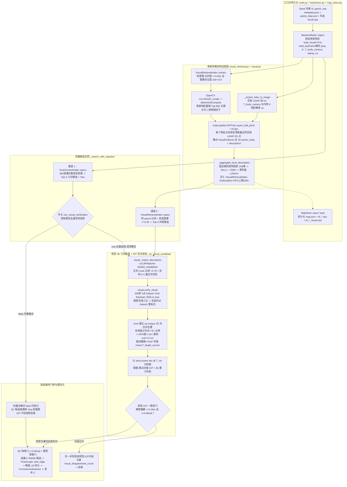

# 05. 正交分支三：视觉检索与 LiDAR 3D 几何验证（`exp/slam-v2-visual-retrieval`）及全分支横向总结

> **对应分支**：`exp/slam-v2-visual-retrieval`（HEAD `2aeea82`，基于稳定化底座 `2b77a5d` 切出）  
> **核心新增代码**：`visual.py`（366 行）+ `visual_retrieval.py`（232 行）+ `backend.py` / `node.py` / `map_store.py` / `keyframes.py` 接入  
> **配置文件**：`slam_v2_visual_akaze.json`（融合模式）与 `slam_v2_visual_akaze_only.json`（全量视觉验真模式）

---

## 一、它想解决什么痛点？（为什么纯激光会“脸盲”？）

在一栋现代办公楼里，两条走廊、两间办公室、甚至一楼和二楼的楼梯间，从激光点云（几何形状）看几乎一模一样：都是“地板 + 天花板 + 两面平行白墙”。ScanContext 光看高度分布很容易**脸盲**，既可能漏掉真回环，又可能把外观相似的楼梯拐角配偏！

但机器狗头顶还有一台 **512×512 标定过的 RGB 相机**！相机眼里能看到激光看不到的丰富语义纹理：红色的消防门、门牌号、海报、办公桌图案、独特地毯纹理……  
不过**纯单目相机有一个致命弱点**：它没有真实米制尺度（一张照片里 1 米外的玩具车和 10 米外的真车长得一样）。

**本分支的绝妙解法一句话概括**：
> **“相机认脸（提取视角不变局部特征 + 找像素匹配） + 实测 LiDAR 给精准尺子（绝不做单目深度猜测） + 3D 刚体 RANSAC 几何验真 + ICP 精修复核”！**

---

## 二、完整数据流、核心机制与调用的库 API（含 OpenCV / SciPy / NumPy）

本分支不仅在 `SlamBackend` 内部增加了**视觉特征提取 + 全局检索 + 3D 刚体 RANSAC 验证**双模态闭环，还打通了在线 ROS Spool 解码（`node.py` / `keyframes.py`）与先验地图持久化（`map_store.py`）。完整数据流如下：



> **为什么模式 B（`use_visual_verification: true`）在 D3 上又快又准？**  
> 看图中的菱形决策节点 `MODE` 就一目了然：在 `true` 模式下，哪怕 ScanContext 召回了 360° 几何候选，也必须先过 `MATCH → RANSAC → DEDUP` 这道极严的视觉 3D 验真关，**既把劣质假激光回环提前踢出局（不再浪费时间做大范围 ICP，耗时从 253 s 骤降到 84 s），又把精确的 6-DoF 视觉位姿喂给 ICP 当初值并做双模态交叉核验**！

下面分 6 步拆解每个核心模块的源码细节：

### 步骤 1：提取视角不变局部特征（`visual.py:extract_visual_features`）
本分支支持 5 种特征前端：
- `patch7x7`：纯 NumPy 基线（不依赖 OpenCV，但对视角旋转敏感）；
- **`orb` / `akaze` / `brisk` / `sift`**：按需导入 **OpenCV (`cv2`)**，具备旋转与尺度不变性（实测推荐 **`akaze`**）。
- **调用的 OpenCV API**：
  - `cv2.AKAZE_create()`（或 `cv2.ORB_create(nfeatures=800)` / `cv2.BRISK_create()` / `cv2.SIFT_create(nfeatures=800)`）
  - `keypoints, desc = detector.detectAndCompute(gray_u8, None)`：从灰度图提取关键点像素坐标 `kp.pt` 和二进制/浮点描述子 `desc`。
  - 若特征数超过 `max_features = 800`，按响应强度 `kp.response` 降序截断，防止高纹理画面拖慢速度。

### 步骤 2：给每个图像特征点绑定“实测 LiDAR 3D 坐标”（`visual.py:_project_lidar_to_image` + `extract_visual_features`）
这一步是连接视觉和激光的灵魂，**绝不猜深度**：
1. **3D → 2D 针孔投影**：把当前关键帧的实测激光点云从机体系经相机外参 $T_{\text{body,cam}}^{-1}$ 转到相机光学系（只保留相机前方 $z > 0.1\text{ m}$ 的点），再左乘相机内参矩阵 $K$ 做透视除法：
   $$u = f_x \frac{X_c}{Z_c} + c_x, \qquad v = f_y \frac{Y_c}{Z_c} + c_y$$
2. **邻域最近深度绑定（调用 `scipy.spatial.cKDTree.query_ball_point`）**：  
   对所有落在画面内的激光点投影像素 $(u, v)$ 建一棵 2D KD 树，对每个图像特征点查询半径 `lidar_px_radius = 6.0 px` 内的激光回波。
   - **关键细节（防前景边缘穿透 Bug）**：如果半径内有多个激光点，**只取深度 `depth` 最小的那个点**（`np.argmin(depth[nbrs_arr])`）！因为图像角点常常长在前景门框/桌角边缘上，取最近深度才能避免误把后面 5 米远的白墙深度绑到前景角点上。
   - 同时严格核对时间同步：`|visual.stamp_ns - keyframe.stamp_ns| <= 0.05 s`，超时直接放弃。

### 步骤 3：无词典全局视觉检索（`visual_retrieval.py:_aggregate_local_descriptors`）
怎么在 2000 帧历史库里瞬间找到“眼熟”的历史图像？传统方法要离线训练视觉词袋（DBoW2 词典），本项目采用了一个非常轻量、**零离线训练、严格确定性**的数学技巧：
1. 生成一个固定随机种子（`np.random.default_rng(42 + dim)`）的列归一化随机投影矩阵 $P \in \mathbb{R}^{d \times 256}$；
2. 把整帧所有局部描述子 $D \in \mathbb{R}^{M \times d}$ 投影到 256 维虚拟“视觉词袋”并做 ReLU 截断 + RMS 聚合 + 零均值 L2 归一化：
   $$\tilde{v}_k = \sqrt{\frac{1}{M}\sum_{m=1}^{M}\max\!\big(0,\,(D P)_{m,k}\big)^2}, \qquad v = \mathrm{L2Norm}\!\left(\tilde{v} - \bar{\tilde{v}}\right)$$
3. `VisualRetrievalIndex.query()` 用矩阵点积算出余弦距离 $1 - V_{\text{hist}} v$，召回距离 $\le \texttt{max\_distance}$ (`0.35`) 的前 `candidates = 3` 个候选帧（并用 `OrderedDict` 实现 `max_entries = 2000` 的 FIFO 有界内存）。

```text
# 数据结构与伪代码：AKAZE 提取 + LiDAR 3D 绑定 + 随机投影全局聚合（对照 visual.py & visual_retrieval.py）
输入:
  keyframe : Keyframe
    points_lidar : float64[N, 3]       # 雷达系点云（经 T_body_lidar 转成 points_body [N, 3]）
    visual       : VisualObservation(gray: float[H,W], K: float[3,3], T_body_camera: float[4,4], stamp_ns: int)
输出:
  VisualFeatures:
    points_body     : float64[M, 3]    # 成功绑定实测 LiDAR 深度的 M 个关键点机体系 3D 坐标
    descriptors     : uint8[M, 61]     # 对应这 M 个点的 AKAZE 二进制描述子（供局部验证匹配）
    all_descriptors : uint8[K, 61]     # 整幅图全部 K 个关键点描述子（K <= 800）
  global_vec        : float32[256]     # L2 归一化全局地点检索向量

伪代码:
  function extract_and_aggregate(keyframe):
      # 1. OpenCV 提取视角不变局部特征（按响应取 Top-800）
      kps, desc = cv2.AKAZE_create().detectAndCompute(uint8(gray), None)   # desc: uint8[K, D]

      # 2. 实测 LiDAR 点投影到相机像面（只保留相机前方 z > 0.1m 且落在画面内的点）
      p_cam = transform_points(invert(T_body_camera), keyframe.points_body())  # [N, 3]
      front = p_cam[:, 2] > 0.1
      proj  = p_cam[front] @ K.T                                           # [Nf, 3]
      uv    = proj[:, 0:2] / proj[:, 2:3]                                  # [Nf, 2] 像素坐标
      depth = p_cam[front, 2]                                              # [Nf] 真实米制深度

      # 3. 2D KD-Tree 半径 6px 内绑定“深度最近”的实测 LiDAR 回波（绝不猜单目深度！）
      tree = cKDTree(uv_in_image)
      nbrs_list = tree.query_ball_point(kp_uv, r=6.0)
      pts3d = [];  keep_idx = []
      for i, nbrs in enumerate(nbrs_list):
          if len(nbrs) == 0: continue
          j_nearest = nbrs[argmin(depth[nbrs])]                            # 取前景最近点防穿透
          pts3d.append(points_body_in_image[j_nearest]);  keep_idx.append(i)

      # 4. 无词典随机投影聚合为 256 维全局向量（固定种子 P: float32[D, 256]）
      D_norm = l2_normalize_rows(float32(desc))                            # [K, D]
      act    = maximum(0.0, D_norm @ P)                                    # [K, 256] ReLU
      v_raw  = sqrt(mean(act^2, axis=0))                                   # [256] RMS 池化
      v_glob = (v_raw - mean(v_raw)) / norm(v_raw - mean(v_raw))           # [256] 零均值单位向量
      return VisualFeatures(pts3d, desc[keep_idx], desc), v_glob
```

### 步骤 4：双向比率检验特征匹配（`visual.py:_match_descriptors`）
拿到一对候选图像特征 `(fa, fb)` 后，调用 OpenCV 暴力匹配器做**双重过滤**：
- `cv2.BFMatcher(cv2.NORM_HAMMING, crossCheck=False)`（AKAZE/ORB/BRISK 是二进制描述子，用汉明距离；SIFT 用 `cv2.NORM_L2`）。
- **正向 Lowe 比率检验**：调 `bf.knnMatch(fa.descriptors, fb.descriptors, k=2)` 找前 2 名邻居 `m1, m2`，要求 `m1.distance < 0.78 * m2.distance`（如果第 1 名和第 2 名差不多像，说明是重复纹理如百叶窗/瓷砖，不可靠，扔掉！）。
- **反向最近邻互检**：调 `bf.knnMatch(fb.descriptors, fa.descriptors, k=1)`，必须满足“A 觉得 B 是真爱，B 也觉得 A 是最像的”，才保留这对 3D 对应点 `(a_i, b_i)`！

### 步骤 5：3 点 Kabsch RANSAC + 1 mm 量化 3D 去重（`visual.py:verify_visual` + `_rigid`）
拿到成对的实测 3D 点 $(A, B)$ 后，怎么求精确的 6-DoF 相对位姿 $T_{\text{target,source}}$ 并剔除误匹配？
1. **Kabsch SVD 刚体求解（`_rigid`，调用 `np.linalg.svd`）**：给定 3 对（或 $N$ 对）3D 点，减去各自质心后算协方差矩阵 $H = A_c^\top B_c$，做奇异值分解 $H = U \Sigma V^\top$，直接闭式解出最优旋转 $R = V \mathrm{diag}(1, 1, \det(V U^\top)) U^\top$（保证 $\det(R)=+1$，防镜像反射！）和平移 $t = \bar{b} - R \bar{a}$。
2. **200 轮 RANSAC 投票**：随机抽 3 对点（先用 `np.linalg.svd` 查第二奇异值 $\ge 0.02$ 剔除共线三点），算 $T$，统计变换后误差 `< verify_inlier_m`（`0.15 m`）的内点数，挑支持度最高的那组，再用全部内点重拟合一次 Kabsch。
3. **关键防作弊修复：1 mm 量化 3D 对应去重（Astra 审计 P1-17）**：  
   *为什么必须去重？* 因为 `lidar_px_radius = 6 px` 范围内可能有 5 个相邻的图像角点都绑定到了**同一颗激光回波点**上！如果不去重，原本只有 2 个真实 3D 点，会被虚增成 10 个“内点”，骗过 `min_inliers = 8` 门限！  
   代码将所有内点 `(a_in, b_in)` 按毫米取整 `np.unique(np.round(...) * 1000)` 去重，再复核：
   - 独立 3D 内点数 $\ge 8$；
   - 独立内点率 $\ge 25\%$ 或总数 $\ge 16$；
   - 独立内点云的几何展布（第二奇异值）$\ge 0.10\text{ m}$（防所有点挤在一小块区域里退化）。

```text
# 数据结构与伪代码：双向匹配 + 3 点 Kabsch SVD RANSAC + 1mm 去重（对照 visual.py:verify_visual）
输入:
  fa, fb : VisualFeatures       # 源/目标帧各自绑定了实测 3D 点的局部特征
                                # fa.points_body: float64[Ma,3], fa.descriptors: uint8[Ma,D]
输出:
  VisualResult:
    status          : "verified" | "insufficient_matches" | "geometry_rejected" | "degenerate_geometry"
    T_target_source : float64[4, 4] | None    # 精确米制 6-DoF 相对位姿（供 ICP 当初值）
    matches         : int                     # 双向匹配总数
    inliers         : int                     # 1mm 去重后的独立 3D 内点数
    rmse_m          : float                   # 独立 3D 内点配准均方根误差 (米)

伪代码:
  function kabsch_rigid(A, B):                             # A, B: float64[k, 3]
      ca, cb = mean(A, axis=0), mean(B, axis=0)            # [3], [3]
      U, _, Vt = svd((A - ca).T @ (B - cb))                # [3, 3] 奇异值分解
      d = det(Vt.T @ U.T)                                  # +1 或 -1（防止产生镜像反射！）
      R = Vt.T @ diag([1.0, 1.0, d]) @ U.T                 # [3, 3] 最优正交旋转
      t = cb - R @ ca                                      # [3] 最优平移
      return [[R, t], [0, 1]]                              # [4, 4]

  function verify_visual(fa, fb):
      # 1. OpenCV BFMatcher 汉明距离：正向 Lowe 比率 < 0.78 + 反向 k=1 互为最近邻
      bf  = cv2.BFMatcher(cv2.NORM_HAMMING, crossCheck=False)
      fwd = bf.knnMatch(fa.descriptors, fb.descriptors, k=2)
      bwd = bf.knnMatch(fb.descriptors, fa.descriptors, k=1)
      a, b = collect_mutual_ratio_pairs(fwd, bwd, ratio=0.78)   # a, b: float64[L, 3]
      if len(a) < 8: return VisualResult("insufficient_matches")

      # 2. 200 轮 3 点刚体 RANSAC 投票
      best_mask = zeros(L, bool)
      for _ in 1..200:
          idx = random_choice(L, 3, replace=False)
          if svd_values(a[idx] - mean(a[idx]))[1] < 0.02: continue   # 剔除共线三点
          T_try = kabsch_rigid(a[idx], b[idx])
          mask  = norm(transform_points(T_try, a) - b, axis=1) < 0.15
          if sum(mask) > sum(best_mask): best_mask = mask

      # 3. 全体内点 Kabsch 重拟合 + 1mm 量化 3D 对应对去重（防同激光点虚增内点！）
      T = kabsch_rigid(a[best_mask], b[best_mask])
      final_mask = norm(transform_points(T, a) - b, axis=1) < 0.15
      a_in, b_in = a[final_mask], b[final_mask]
      _, uniq_idx = unique(round(hstack([a_in, b_in]) * 1000.0).astype(int64), axis=0, return_index=True)
      a_u, b_u = a_in[uniq_idx], b_in[uniq_idx]            # 真正独立的 3D 对应点对

      # 4. 独立内点数、内点率、空间展布（防退化）终审，并重算最终 T
      if len(a_u) < 8 or not (len(a_u)/L >= 0.25 or len(a_u) >= 16):
          return VisualResult("geometry_rejected")
      if min(svd_values(a_u - mean(a_u))[1], svd_values(b_u - mean(b_u))[1]) < 0.10:
          return VisualResult("degenerate_geometry")
      T_final = kabsch_rigid(a_u, b_u)
      res     = norm(transform_points(T_final, a_u) - b_u, axis=1)
      return VisualResult("verified", T_final, L, len(a_u), sqrt(mean(res^2)))
```

### 步骤 6：视觉初值 → ICP 精修 → 视觉-ICP 一致性校验（`backend.py:_try_visual_candidate`）
1. 视觉验证通过后，用视觉算出的精确 6-DoF 初值 `T_init = store.poses[key] @ visual.T_target_source` 送进点对面 ICP 精修（而不是用 ScanContext 粗略的 Yaw 猜想！）。
2. **交叉审问（视觉-ICP 一致性门）**：比较 ICP 精修结果和视觉初值的差距 `pose_difference(T_init, result.T_target_source)`——如果精修把视觉位姿拽偏超过 **`0.30 m`** 或 **`0.08 rad`（4.6°）**，说明视觉和激光意见打架了，宁缺毋滥，直接拒收！
3. **在线 ROS 接入与地图持久化（P0-4）**：`node.py` 按配置自动开启 `read_keyframe(..., load_visual=...)`，`map_store.py` 可选把 `kf_*_visual.npz`（灰度图、内参、外参、时间戳）一起存盘和重载。

---

## 三、两种运行模式对比与惊艳的 D3 实测结果

在 `exp/slam-v2-visual-retrieval` 里，有一个**一字之差、天壤之别**的开关：`use_visual_verification`！

| 模式（预设文件） | 开关含义 | D2（反向重访多） | D3（多层上下楼 `same-876`） | 原因解析 |
| --- | --- | --- | --- | --- |
| **模式 A：并集融合** (`slam_v2_visual_akaze.json`) | `use_visual_verification: false`（ScanContext 候选不经视觉验真直接走 ICP；视觉只额外补充新候选） | `0.0756 m`（67 边，4 视觉边） | `0.2161 m`（176 边，298 s） | **被未验真的低质量 SC 边拖累了！** |
| **模式 B：全量视觉验真** (`slam_v2_visual_akaze_only.json`) | `use_visual_verification: true`（无论 SC 还是视觉召回的候选，**全部必须通过视觉 3D RANSAC 验真**才准入图！） | `0.1837 m`（仅 11 边，`nospacing` 23 边 `0.1348 m`） | **Online `0.1022 m` / Final `0.0825 m` / Z `0.0561 m` / 仅 `84.1 s`！** | **D3 全场冠军！** 踢掉了所有劣质 SC 边，仅靠 77 条高纯度视觉-激光双认证边，精度比底座（`0.1882 m`）翻倍提升、耗时狂砍 67%！ |

> **为什么模式 B 在 D2 上只有 11 条边？**  
> 因为机器狗只有一台**朝前的单目相机**（水平视场角有限）。D2 探索路线里有大量**“去时正着走、回来反着走（180° 反向重访）”**的走廊：360° 激光雷达能轻松认出反向走廊（底座召回 65 边、达到 `0.0554 m`），但前视相机看到的画面完全是背道而驰的另一头，当然认不出来！好在这 11 条视觉边**100% 全是正向好边（0 坏边）**，只是数量不够撑住后半程开环。

---

## 四、全分支终极横向总结 & ADR-0004 三层评测体系速通

### 4.1 怎么读懂报告里的“三层评测指标”？（[ADR-0004](../../docs/plan/adr/0004-incremental-mesh-3dgs-and-layered-backend-eval.md)）
初学者看评测表时，记住这 3 层各自回答什么问题（所有轨迹先统一转换到机身原点 `go2_base`，消除 2 cm 转向杆臂，再用前 5 秒初窗对齐）：
1. **第一层（Online vs Final ATE / Z / Tilt）**：
   - **Online ATE**：实时跑完每帧时机器狗当下以为自己在哪的误差——决定**“导航控车会不会撞墙”**。
   - **Final ATE**：整趟跑完闭合全图后的最终误差——决定**“最后保存下来的 3D 地图准不准”**。
   - **Umeyama**：允许把整条轨迹整体刚性微调贴合真值后的误差（用来判断误差是“起步朝向歪了一点”还是“轨迹本身形状拧巴了”）。
2. **第二层（L2 `-/+`）**：每加入一条回环优化后，对比同一段历史节点优化前后的误差，统计**“有几条回环带来了显著正收益（+）、有几条造成了显著负跳变（-）”**。
3. **第三层（L3 `IQR95 / sh / st / cum`）**：追踪历史地图在反复回环重优化中会不会被反复拉扯抖动（`IQR95` 误差带宽、`sh` 最大偏移、`st` 单步最大跳变、`cum` 累计拉扯路程）。越小说明地图越稳如磐石！

### 4.2 五大方案一图看懂（30 组统一干净对照精华）

| 方案（分支） | 核心武器 | D1 原地转（前端 `0.192`） | D2 46分钟噪IMU（前端 `0.077`） | D3 两层上下楼（前端 `0.209`） | 最适合什么场景？ |
| --- | --- | ---: | ---: | ---: | --- |
| `B0_default` (`main` 旧默认) | 基础 SC+ICP+LM | `0.2206 m` (`8.48°` 崩) | `0.1858 m`（负优化） | `0.1442 m`（抖动 `4.19 m`） | 仅作历史对照组，**不要再用** |
| **`stabilized`** (`exp/slam-backend-stabilization`) | 各向异性权 + B1 节流 + B2 重力先验/倾角门 + B3 ZUPT | **`0.0997 m`** | **`0.0554 m`**（0 负跳变） | `0.1882 m` (253 s) | **全场景最稳默认底座**（无相机/高噪 IMU/反向重访） |
| **`v2_ms`** (`exp/slam-v2-measured-submaps`) | 短窗前端相对里程计拼 5 帧高密子图 + `candidate` 锚点 | **`0.0997 m`** | `0.1741 m`（高噪涂抹） | **`0.1268 m`** (`nospacing` **`0.1126 m`**) | **低噪 IMU 多层楼梯/稀疏雷达场景** |
| **`v2_sg_soft`** (`exp/slam-v2-surface-gate`) | PCA 局部平面提取 + 6 邻域合并 + 水平/竖直覆盖门 | **`0.0997 m`** | **`0.0608 m`**（倾角 **`0.28°`**） | `0.1828 m`（严格版 `IQR95 0.073`） | **需要极低倾角与极稳历史地图的建筑结构场景** |
| **`v2_visual_akaze_only`** (`exp/slam-v2-visual-retrieval`) | AKAZE 特征 + 实测 LiDAR 3D 绑定 + 去重 RANSAC 全量验真 | **`0.0997 m`** | `0.1837 m`（单目 FOV 仅 11 边） | **`0.0825 m`** (Online **`0.1022`**, **`84 s`**) | **有标定同步 RGB 且以同向重访为主的多层复杂场景** |

---

## 五、给初学者的下一步学习与提问建议

这 5 份文档已经把整个项目从 **前端 FAST-LIVO2** → **稳定化后端底座** → **三条正交 v2 后端分支** 的原理、数学公式、调用的 C++/Python 库 API 和参数选型全部打通了。  
而且从上面的对比表你应该一眼就能看出**项目下一阶段（Phase 4.5，向 `2–4 cm` 迈进）最自然的演化思路**：
- **同向重访**用 `v2_visual_akaze_only`（又快又准到 `8 cm`）；
- **反向大视角/弱纹理**自动回退到 360° 激光（`stabilized` + `surface_gate`），正好补齐前视单目在 D2 的盲区！

你可以按顺序阅读这 5 份文档，任何地方有不懂的概念——无论是**某个数学公式（如旋转矩阵求导、李代数、PCA 法向量、Kabsch SVD、Cauchy 核）**、**某一行代码逻辑**、还是**某个参数为什么定这个数**——随时直接截一段来问我，我会用最直白的例子一步步讲透！
