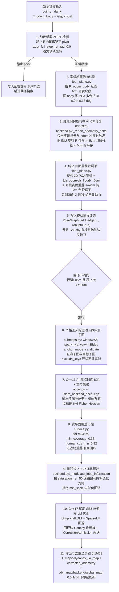

# 06. V3 统一后端组合（`combined_lidar` / `combined_lidar_fine` / `combined_hybrid`）与异常里程计修复

> **整理日期**：2026-11-23  
> **对应代码分支**：
> - `perf/slam-backend-cpp-icp`（`ffd7882`）—— C++17 / Eigen3 热路径加速器  
> - `exp/slam-v3-plane-factors`（`e1ff826`）—— 宽幅地面法向检测、纯 Z 共面里程计调平与饱和式 X-ICP  
> - `exp/slam-v3-surface-submap-gate`（`ed54adc`）—— 运动有界实测子图 + 软平面覆盖门控 + 细体素 ICP  
> - `exp/slam-v3-hybrid-color-visual`（`1c3fb8c`）—— `Color-ScanContext` + 多视角视觉检索 + SeqSLAM + 航向门控混合准入  
> - `exp/slam-v3-combined`（`2fb09c1` 审后版 → `63d6975` 里程计异常 ICP 修复版）—— 统一集成主线  
> - `feat/sliding-window-and-backend-global-map`（`6f1bf63`）—— 前端/规划局部滑窗 + 后端去重 `/dynanav/backend/global_map` + RViz2 零累积  
> **核心配置文件**：`configs/localization_mapping/slam_v3_combined_lidar.json`、`slam_v3_combined_lidar_fine.json`、`slam_v3_combined_hybrid.json`

---

## 一、为什么要从 v2 升级到 v3？

在 [03](03_branch_v2_measured_submaps.md) 至 [05](05_branch_v2_visual_retrieval_and_comparison.md) 中，三条 v2 分支各自只验证了单一维度的改进，尚未融合，且在 **86 分钟真实两层探索数据集 `D4_twofloor`**（1,916 关键帧、283.8 m，前端 Z 轴下沉 `-1.42 m` 后又上飘 `+2.02 m`）上暴露出四个根本问题：

1. **纯 Python ICP 与位姿图太慢**：1,916 帧离线单轮评测超过 5 分钟，无法高频迭代对照；
2. **平地开环段 Z 轴持续漂移**：没有回环的走廊和远翼，仅靠 IMU 重力先验（精度约 `0.3°–1.2°`）仍会累积数十厘米垂直误差；
3. **退化长走廊和单步前端跳变会污染全图**：
   - 走廊沿行进方向几何约束弱（Hessian 最小特征值极小），等权回环边会沿走廊拉歪；
   - `FAST-LIVO2` 前端在 `D4` 平地上突发 3 次单步 `-40 cm` 垂直失锁跳变（`kf 239→240→241` 与 `449→450`），无鲁棒核的 L2 里程计边在回环闭合后反把前段轨迹顶飞 `+68.8 cm`；
4. **纯单向视觉无法覆盖反向重访**：前视 512×512 相机在 `180°` 掉头重访时视野零重叠，而同向重访时纯激光容易在对称走廊里“脸盲”。

v3 体系正是围绕这 4 个痛点，先拆 4 条独立分支消融，再统一收口到 **`exp/slam-v3-combined`**。

---

## 二、`combined_lidar` 与 `combined_lidar_fine` 到底做了哪些后端优化？

### 2.1 一张图看懂完整数据流

### 2.2 八大核心优化逐项精讲

#### 优化 1：C++17 / Eigen3 热路径加速层（`accel.py` + `_cpp/slam_backend_accel.cpp`）
- **干什么**：把后端三大 CPU 瓶颈——体素降采样（`voxel_downsample`）、点对面 ICP + 6×6 Fisher Hessian（`icp_point_to_plane`）、稀疏 SE(3) 位姿图 LM 优化（`PoseGraph.optimize`，`Eigen::SimplicialLDLT` + `SparseLU` 回退）——全部迁入零外部依赖的 C++17 共享库，自动编译到用户缓存目录，失败时无感回退纯 Python。
- **关键工程细节（Astra 审后加固）**：进入 `ctypes` ABI 前严格校验形状 `(N,3)`/`(4,4)`/`(6,6)`、有限性与节点索引边界；使用便携 `-O3 -std=c++17`（去掉 `-march=native`）；C++ 体素量化采用严格 `std::floor(x / voxel_m)` 并防 `int64_t` 溢出。
- **实测收益**：与纯 Python 精度 **0.0000 m 比特级一致**，`D2`（1,567 帧）从 `242.3 s` 降至 **`88.3 s`**，`D4`（1,916 帧）从 `307.8 s` 降至 **`107.1 s`**（约 `2.8×` 加速）。

#### 优化 2：宽幅地面法向检测与纯 Z 共面里程计调平（`floor_plane.py`）
- **踩过的坑**：
  1. Go2 机器狗行走时自带约 **`6.4°` 机身俯仰角**；直接按机体系 `z_body` 切片会斜切远端地面，导致拟合出的法向偏 `3°–4°`。**解法**：仅用粗姿态 `R_odom_body` 把点云转到近似水平系、按 `4 cm` 高度直方图众数选出地面内点，随后**回到原始 `body` 坐标系做 PCA 平面拟合**——实测在 D1–D4 上恢复真实重力的精度达到 **`0.04°–0.13°`**（比带噪 IMU 准 5–8 倍！）。
  2. 曾尝试用地面法向去修正里程计旋转 `R_corr`，结果因 Go2 的 `6.4°` 俯仰角把横滚修正耦合进航向角（Yaw），导致整图漂歪；也曾试过 `FloorSlabTracker` 楼层编号启发式，在楼梯中间平台把二楼拉回地下室（`2.6 m` 错层）。**最终解法**：彻底抛弃楼层编号启发式，只对相邻两帧共面平地边做**纯平移法向投影**（绝不修改旋转 `R`）：
     $$\Delta z_{\text{odom}} = n_a^\top t,\quad \Delta z_{\text{floor}} = h_b - h_a,\quad t_{\text{clean}} = t + (\Delta z_{\text{floor}} - \Delta z_{\text{odom}})\, n_a$$
  3. **防 8 cm 平行台阶误平（Astra P0-3 修正）**：单看 `|dz_odom - dz_floor|` 会把矮台阶当平地抹平；现增加两道硬几何检查——用旋转无关 **2D PCA 展布**（`span_short >= 1.8 m, span_long >= 3.5 m`）拒绝窄楼梯踏板，并把当前帧地面采样点 `inlier_sample_body` 变换到前帧坐标，要求直接点面中位距离 **`<= 0.04 m`** 且 `|dz_odom - dz_floor| <= 0.06 m`，否则拒收调平，完整保留真实台阶。
- **为什么 `floor_normal_graph_sigma_rad` 默认设为 `null`？**  
  消融探测证实：给位姿图每个节点加一元重力因子 `0.02 rad` 能把无初始倾角偏差的 `D3` 压到 **`UM = 3.57 cm / Tilt = 0.19°`**，但对起步首帧 `kf_0` 自带倾角偏置的 `D4`，一元重力会与固定锚点 `kf_0` 冲突拉扯。因此在补齐“`kf_0` 首帧地面法向初始化对齐”之前，预设先保持 `floor_normal_graph_sigma_rad: null`，仅将高精度地面法向用于回环 ICP 重力先验（`floor_normal_gravity_enabled: true`）与相邻共面调平。

#### 优化 3：纯几何保旋转帧间 ICP 异常跳变修复 + 移动里程计边鲁棒核（`backend.py @ 63d6975`）
- **解决的问题**：`D4_twofloor` 拆解发现 65 条回环全部可靠（0 跨层误配），原 `20.26 cm` / 峰值 `68.85 cm` 是由 `FAST-LIVO2` 前端在地下室平地突发 3 次单步 `-40 cm` 垂直跳变（`kf 239→240→241` 掉 `-81 cm`、`kf 449→450` 掉 `-41 cm`）后，纯 L2 里程计边在回环闭合时把前段轨迹反顶飞造成。
- **纯几何机制（零运动学假设）**：
  1. 仅在 `med_odom > 0.20 m`（相邻两帧实测点云按前端 `delta_use` 叠加明显错位）或双侧地面高度差与 `delta_use` 冲突时触发 C++ point-to-plane ICP；
  2. 同时从 `delta_use` 与平地初值 `init_level` 跑 ICP，**严格保留短时精准的 IMU 旋转 `R`**（杜绝单帧 6-DOF ICP 在走廊/楼梯门洞引入 `1.0°–1.5°` 倾角噪声导致 `D2/D3` 退化）；
  3. 仅当修复后的平移变化 `>= 5 cm` 且使全扫描点对点中位距离严格下降 **`>= 4 cm`** 时采纳；
  4. 同时为非 ZUPT 移动里程计边开启 Cauchy 鲁棒核（`odometry_robust: true`）。
- **实测效果**：`D1`/`D2` **0 误修（`rep=0`）**，`D4` 1,915 条边中精准命中全部 3 处前端跳变（`rep=3`），`D4` Final RMSE `20.26 → 12.12 cm`（峰值 `68.85 → 28.43 cm`），Umeyama 3D RMSE `17.28 → 8.52 cm`（峰值 `62.41 → 20.80 cm`）。

#### 优化 4：严格互斥的运动有界实测子图（`submaps.py` + `backend.py`）
- 沿用 v2 的短窗实测子图思路并收紧边界：`submap_window=2`、`submap_max_span_s=4.0`、`submap_max_yaw_span_deg=35.0`、`anchor_mode="candidate"`（子图表达在候选帧自身坐标系下，消除历史图扭曲传递）。
- **Astra P1-6 加固**：先构查询子图并收集其源帧集合 `query_source_keys`，构目标子图时显式 `exclude_keys=query_source_keys`，彻底杜绝查询云与目标云共享同一帧点云造成的虚假高匹配。

#### 优化 5：软平面覆盖门控（`surface.py`）
- 沿用 v2 柔和参数：`cell_m=0.35`、`max_plane_rmse_m=0.035`、`min_coverage=0.35`、`normal_cos_min=0.82`。在 `D4` 消融中关闭它会导致多接受 24 条坏回环、误差从 `20 cm` 暴涨到 `77 cm`，证实它是多层复杂建筑的必需防线。

#### 优化 6：机体系原点精确 Fisher Hessian 饱和式 X-ICP（`registration.py` + `backend.py`）
- **数学修正**：
  1. 早期实现把特征值归一化为 $\lambda_i / \lambda_{\max}$，室内地板+天花板的 Z 方向点面计数（~2000）远大于墙面（~250），导致正常走廊的水平 XY 被误衰减到 `0.15×`；现改为**绝对饱和参考** `saturation_ref = 50.0`（只要某方向点面 Fisher 信息 `>= 50`，即视为充分观测、保持 `1.0×` 权重，只有真正退化轴才按比例衰减至最低 `xicp_min_scale = 0.15`）；
  2. 落实 Astra P1-1：点对面 ICP 返回的 6×6 Fisher Hessian 在 C++ 与 Python 两侧均严格绕**机体系原点**（$p_{\text{shifted}} = p - t_c$，$J_{\text{rot}} = (p - t_c)\times n$）计算，避免大世界坐标的杠杆放大污染旋转块。

#### 优化 7：关键防踩坑参数（`zupt_full_stop_rot_rad: 0.0` 与稳定化权重继承）
- 所有 v3 预设严格继承 `slam_backend_stabilized.json` 的核心权重（`odometry_sigma_m=0.2, loop_sigma_m=0.05, loop_sigma_rad=0.03, loop_sigma_yaw_rad=0.01, cauchy_scale=3.0`）以及 **`zupt_full_stop_rot_rad: 0.0`**——若漏设该项为 `0.0`，机器狗慢速转弯会被误锁成 `full_stop`（旋转归零），在 D2/D4 上直接产生 `0.45–1.64 m` 航向漂移。

#### 优化 8：`combined_lidar` 与 `combined_lidar_fine` 的精确区别

通过 `diff -u` 核对，两份配置**仅在 3 个体素分辨率参数上不同**，其余算法、门控与权重 100% 相同：

| 参数 | `slam_v3_combined_lidar.json` | `slam_v3_combined_lidar_fine.json` | 作用与权衡 |
|---|---:|---:|---|
| `map_voxel_m` | `0.20 m` | **`0.12 m`** | 关键帧入库留存点云密度；`0.12 m` 保留更多墙角、门框与细柱几何，但内存/磁盘体积约增 `2.0–2.5×` |
| `fine_icp_voxel_m` | `0.15 m` | **`0.10 m`** | 回环/修复精配准 ICP 体素；在多层复杂结构（如 `D3`）上 `Umeyama 3D` 更优（`5.97 → 5.33 cm`，`Max 16.79 → 12.65 cm`），每轮总耗时约增 `12–25%` |
| `measured_submap.voxel_m` | `0.15 m` | **`0.12 m`** | 实测多帧子图体素分辨率，与 `map_voxel_m` 匹配 |

**怎么选？**
- 日常在线跑仿真追求更低内存和更快单步响应 → 选 **`slam_v3_combined_lidar.json`**；
- 追求更高多楼层几何内精度与更低水平/峰值误差（如 `D3` `UM_XY = 2.98 cm`、`D4` `UM_XY = 3.46 cm`、多闭 4 个回环）→ 选 **`slam_v3_combined_lidar_fine.json`**。

---

## 三、昨晚全部正交分支与统一主线的完整横向对照（`D1 / D2 / D3 / D4_twofloor`）

> 统一口径：`scripts/eval_slam_backend.py`，base-origin 外参一致；单位：**cm**（`Tilt` 单位 `deg`）。  
> 数据归档：`$PROJECT_DATA_ROOT/embodied-navigation/runs/20261123-phase45-backend-v3/` 下的 `matrix/`、`combined_clean/`、`post_audit_final/` 与 `post_odom_repair/`。

### 3.1 各独立正交分支（融合前单分支消融）

| 方案（分支） | D1 FN / UM | D2 FN / UM / Tilt | D3 FN / UM / Tilt | D4 FN / UM / Tilt | 关键结论 |
|---|---:|---:|---:|---:|---|
| `cpp_stabilized`（基线） | 9.97 / 6.69 | **5.41** / 4.51 / 0.37° | 18.82 / 7.54 / 0.55° | 95.11 / 32.98 / 1.75° | 稳定化底座 + C++17 加速 |
| `v3_plane`（初版，含旧 `zupt_full_stop` 坑） | 10.88 / 7.12 | 88.88 / 27.26 / 0.82° | 123.49 / 66.92 / 3.32° | 247.43 / 138.52 / 1.74° | **反面教材**：漏设 `zupt_full_stop_rot_rad=0.0` + 反转 sigma 导致 215 次慢转被锁死 |
| `v3_plane_clean`（修正配置后 `e1ff826`） | **7.88 / 5.87** | 6.34 / **4.25** / **0.32°** | 19.59 / 7.35 / 0.56° | 71.80 / 26.05 / 1.79° | 纯 Z 共面调平立即把 D1 Z 压到 `1.70 cm`、D2 `Tilt` 压到 `0.32°`，但缺平面门控仍会被 D4 坏回环拖累 |
| `v3_submap_sg`（`ed54adc`） | 9.97 / 6.69 | 9.76 / 4.56 / 0.33° | 15.40 / 6.85 / 0.48° | 31.86 / **14.18** / **0.72°** | **D4 提升最大单分支**：子图 + 软平面门控把 D4 从 `95.1 cm` 直接砍到 `31.9 cm` |
| `v3_submap_fine`（`ed54adc`） | 9.97 / 6.69 | 10.62 / 4.78 / 0.35° | **8.72 / 5.41 / 0.44°** | 31.79 / 14.23 / 0.73° | 细体素 ICP (`0.10 m`) 让 D3 从 `18.82 cm` 暴降至 **`8.72 cm`** |
| `v3_hybrid_vis`（`1c3fb8c`） | 9.97 / 6.69 | 6.97 / 4.80 / **0.31°** | 14.31 / 7.83 / 0.55° | 79.76 / 30.87 / 1.61° | 同向视觉 + `ColorSC` 降低 D2 倾角（`0.31°`）并改善 D3/D4，但需配合子图+平面门控才能拦住 D4 坏回环 |
| `v3_multiview_vis`（`1c3fb8c`） | 9.97 / 6.69 | 7.81 / 4.94 / 0.33° | 20.69 / 8.80 / 0.60° | 83.29 / 29.63 / 1.76° | 多视角召回略降 D4 `UM`（`29.63`），但放宽候选窗口使 D3 略回退 |

### 3.2 统一组合主线演进（`exp/slam-v3-combined`：审前 → 审后 `2fb09c1` → 里程计修复 `63d6975`）

| 数据集 | 基线 `stabilized` (ON / FN / UM / Max) | 审后 `combined_lidar @ 2fb09c1` | **最终 `combined_lidar @ 63d6975`** | **最终 `combined_lidar_fine @ 63d6975`** | **最终 `combined_hybrid @ 63d6975`** |
|---|---|---|---|---|---|
| **D1** | 10.22 / 9.97 / 6.69 / 12.10 | 10.13 / 9.88 / 6.39 / 11.56 | **10.13 / 9.88 / 6.39 / 11.56** | **10.13 / 9.88 / 6.39 / 11.56** | **10.13 / 9.88 / 6.39 / 11.56** |
| **D2** | 8.80 / **5.54** / 4.54 / 16.96 | 12.96 / 11.72 / **3.88** / **14.09** | 12.96 / 11.72 / **3.88** / **14.09** | 12.56 / 11.78 / **3.98** / 14.31 | 20.58 / 21.05 / 5.10 / 20.47 |
| **D3** | 23.17 / 18.82 / 7.54 / 18.50 | **9.71 / 7.76** / 5.39 / 16.04 | **9.72** / 9.40 / 5.97 / 16.79 | 13.30 / 10.33 / **5.33** / **12.65** | 18.35 / 14.59 / 6.21 / 15.24 |
| **D4** | 94.34 / 95.11 / 32.98 / 99.67 | 17.62 / 20.26 / 17.28 / 62.41 | **13.00 / 12.12 / 8.52 / 20.80** | 13.18 / 12.25 / **8.53 / 20.81** | 18.90 / 18.26 / 10.23 / 27.47 |

*(上表 `Max` 列为 `Umeyama 3D` 峰值，`D4` 的 `init` 峰值同步由 `309.17 cm` 降至 `28.43 cm`)*

---

## 四、后续跟踪与演进清单（朝 `RMSE 2–4 cm, 峰值 ≤ 10 cm` 推进）

| 优先级 | 跟踪项 | 当前状态 | 预期收益 |
|---|---|---|---|
| **P0** | **`kf_0` 首帧地面法向重力对齐** | 待做 | 消除起步 `0.2°–0.3°` 初始倾角杠杆，使 `D2/D4` 的 `Final (init)` 与 `Umeyama` 拉齐，并解锁图级重力先验（`D3` 探测已达 `UM = 3.57 cm`） |
| **P0** | **`FAST-LIVO2` 前端 `-40 cm` Z 跳变切片复盘** | 待做（已有 `D4` 原始 13 路 bag） | 从源头消除前端单步垂直失锁，直接压低 `Online RMSE` |
| **P1** | **C++17 全局点云平面 BA（HBA 级精修）** | 待做（可复用 `_cpp/slam_backend_accel.cpp`） | 跨无回环走廊通过共视地板/天花板拉平全楼，冲刺 3D 峰值 `≤ 10 cm` |
| **P1** | **在线彩色关键帧桥接 + `XYZRGB` 全局图发布** | 离线 `ColorSC` 已做，`snapshot_bridge.cpp` 与 `pack_pointcloud2_xyzrgb` 待补 | 打通在线 `combined_hybrid` 视觉混合回环，并在 RViz2 直接渲染回环拉齐后的彩色 3D 全局重建 |
| **已完成** | **前后端/规划滑窗 + `/dynanav/backend/global_map` + RViz 零累积** | 已实现于 `feat/sliding-window-and-backend-global-map @ 6f1bf63` | 解决 RViz 26 GB 内存泄漏，待 Isaac Sim 实机联调验收 |
