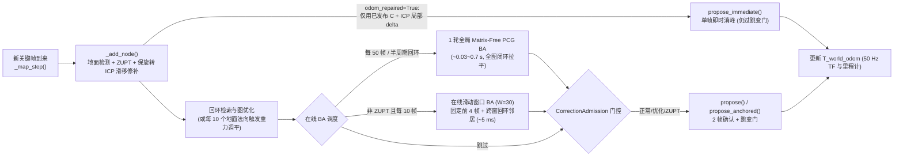

# 07. V4 主线精讲：世界重力校准与在线 Matrix-Free PCG 定向 3D Planar BA

> **对应分支与提交**：
> - **V4a**：`exp/slam-v4-gravity-calibration`（`e459e67`）—— 首帧 `kf_0` 实测地面法向世界重力校准 + 开环周期调平 + 确定性宽倾角地面检测；
> - **V4b**：`exp/slam-v4-oriented-planar-ba`（`639e9dc` 及后续 Codex `gpt-6.2-astra` 审计修复）—— 法向定向 3D 平面 BA（BALM2 充分统计量 + Matrix-Free 隐式 Schur 补 PCG + 多锚点在线滑窗与周期全局 BA + `odom_repaired` 单帧即时采纳）。
> - **核心目标**：在不牺牲跨楼层薄楼板/薄隔墙安全的前提下，把单层与跨两层全场景轨迹打入 **RMSE `1.3–2.6 cm`、地图内部峰值 `< 10 cm`、在线实时运行（单步均值 `~100 ms`）**。

---

## 1. 为什么 V3 之后还会卡在 6–12 cm？（两个隐藏根因）

在 V3（`exp/slam-v3-combined @ 63d6975`）用保旋转帧间 ICP 修复了前端 `-81 cm` Z 轴骤滑之后，四组数据集（`D1 / D2 / D3 / D4_twofloor`）依然卡在 `7–15 cm`，实测定位出两个此前隐蔽的根因：

1. **硬编码世界重力 `[0, 0, 1]` 与前端 `odom` 初始倾角打架**：
   - `FAST-LIVO2` 的世界系原点定义在首帧 IMU 初始化瞬间，由于初始 IMU 噪声与机身姿态，其 `+Z` 轴相对真实重力往往倾斜 `0.14°~0.62°`（`D1/D2` 达 `0.62°`）。
   - V3 里 `PoseGraph` 和 ICP 把目标重力写死成 `[0, 0, 1]`，导致重力先验强行把后续帧往错误方向拧；同时 `PoseGraph.optimize()` 只在回环时才触发，开环行走段（如 `D4` 末段 `kf 1430–1915`）倾角累积到 `3.9°`，再用漂歪的 `T_odom_body` 去切地板点云，反过来又拟合出 `3.9°` 的假地面法向，形成正反馈恶性循环。
2. **纯两帧位姿图（Pose Graph）无法直接消除多帧共面重影**：
   - 里程计边和回环边都只是“帧 $a$ 到帧 $b$”的 6-DoF 相对约束；即便把全部回环拉紧，几十帧共同观测到的同一面墙或同一块地板在世界系下仍可能存在 `2–5 cm` 的细微错位与局部波浪起伏。

---

## 2. V4a：世界重力校准与开环周期调平（`e459e67`）

### 2.1 首帧 `kf_0` 实测地面法向标定 $g_w$
在 `SlamBackend._add_node()` 处理首帧 `kf_0` 时（[backend.py](file:///home/hyh001/projects/1.Project/embodied-navigation/src/embodied_navigation/localization_mapping/backend/backend.py#L1200-L1215)）：
1. 用 LiDAR 点云调用 [detect_floor_plane()](file:///home/hyh001/projects/1.Project/embodied-navigation/src/embodied_navigation/localization_mapping/backend/floor_plane.py#L58-L210) 测出首帧机体坐标系下的真实向上地面法向 $n_{\text{floor},0}$；实测其相对真值重力的误差仅 **`0.010°~0.040°`**（比带噪 IMU 高一个量级）。
2. 将其映射到 `odom` / 地图坐标系，作为全局统一重力目标向量：
   $$
   g_w = \frac{R_{\text{odom},0}\, n_{\text{floor},0}}{\|R_{\text{odom},0}\, n_{\text{floor},0}\|}
   $$
3. 同步传入 `PoseGraph.set_gravity_world(g_w)`、`icp_point_to_plane(..., target_up_world=g_w)` 以及回环倾角门 `_tilt_rejection_reason`。**既不旋转地图首帧坐标轴（保持评测 `A_init` 与外部接口兼容），又彻底消除首帧与重力先验的冲突。**

### 2.2 确定性近中距种子地面检测 + 图稳定姿态提示 `R_floor_hint`
- 废弃在杂乱房间里容易失手的随机 3 点 RANSAC；改用**确定性近中距（$r \le 5\text{ m}$）4 cm 高度直方图主峰种子 + 全域（$1\text{–}15\text{ m}$）宽倾角 4 轮 PCA 扩展**，不让远场地板被微倾角裁掉。
- 每帧喂给 `detect_floor_plane` 的不再是已经漂歪的原始 `T_odom_body`，而是后端图稳定后的预测姿态：
  $$
  R_{\text{floor\_hint}} = \mathrm{Proj}_{SO(3)}\!\left(R_{\text{graph}}(\text{prev}) \cdot R_{\text{step}}\right)
  $$
- 配合 `gravity_optimize_every: 10`，每累计 10 个实测地板法向重力先验就触发一次轻量图优化，彻底掐断开环倾角发散（`D4` 倾角从 `3.9°` 压到 **`0.13°`**）。

---

## 3. V4b：在线 Matrix-Free PCG 定向 3D Planar BA（`639e9dc`）

### 3.1 为什么普通 3D Planar BA 在室内双层楼会“把天花板和地板压扁”？
室内有两个致命的薄双面结构：
- **跨层楼板**：地下室天花板（$z = -0.15\text{ m}$）与二楼地板（$z = +0.01\text{ m}$）仅相隔 `16 cm`；
- **薄室内隔墙**：相邻两房间的同一堵薄墙两面仅相隔 `10–15 cm`。

若只按体素位置和无向法向聚类（`|n_a · n_b| >= 0.85`），这两面落在同一个 `1.0 m` 体素内就会被当成“同一个歪平面”强行拉合压扁，直接毁掉整栋楼层高！

**解法——观测射线法向定向（Oriented Normal）**：
对每一帧 $i$ 落在体素 $v$ 内的局部平面面片（质心 $\bar{p}_w$、PCA 最小特征向量 $n_w$），强制令法向指向观测传感器原点 $t_i$：
$$
\text{ray}_i = \bar{p}_w - t_i, \qquad \text{若 } n_w^\top (-\text{ray}_i) < 0 \text{ 则 } n_w \leftarrow -n_w
$$
聚类时要求**有向点积** $n_{\text{ref}}^\top n_w \ge 0.85$ 且面间距 $|n_{\text{ref}}^\top(\bar{p}_w - \bar{p}_{\text{ref}})| \le 0.15\text{ m}$。这样地下室天花板（法向朝下 `[0,0,-1]`）与二楼地板（法向朝上 `[0,0,+1]`）点积为 $-1.0$，薄隔墙左右两面点积也为 $-1.0$，**数学上绝不会合并**（已在 [test_oriented_planar_ba.py](file:///home/hyh001/projects/1.Project/embodied-navigation/tests/unit/test_oriented_planar_ba.py) 中用 16 cm 薄楼板与 12 cm 薄隔墙单测锁死）。

### 3.2 BALM2 10 标量充分统计量与精确 Schur 补消元
联合目标函数同时包含四项因子（与 `PoseGraph` 目标严格一致）：
$$
E(\{T_i\}, \{\pi_c\}) = \underbrace{\sum_{(a,b)\in\mathcal{E}} \rho_c(\|e_{ab}\|_{\Omega_{ab}}^2)}_{\text{里程计 + 回环边}} + \underbrace{\sum_{g\in\mathcal{G}} \rho_c(w_g\|R_{i_g}u_{b,g}-g_w\|^2)}_{\text{校准重力先验}} + \underbrace{\sum_{z\in\mathcal{Z}} \rho_c(w_z(t_{i_z,z}-z_0)^2)}_{\text{Z 高度先验}} + \underbrace{\sum_{c\in\mathcal{C}} |c|\,\rho_c\!\left(\frac{\lambda_0(c)}{\sigma_p^2}\right)}_{\text{定向 3D 平面一致性}}
$$
每帧在每个体素内只存 10 个 body 系标量 $(n_i, s_{b,i}, M_{b,i})$，并在**体素局部原点 `origin_w`** 下中心化累算一阶/二阶矩（消除大世界坐标相减的浮点精度损失），直接 $O(m)$ 得到最优平面 $(n_c, u_1, u_2, \bar{p}_w)$。在最优平面处，平面梯度 $g_{\pi_c} \equiv 0$、平面海森矩阵严格对角 $D_c = \mathrm{diag}(N_c, N_c\lambda_1, N_c\lambda_2)$，Schur 补消元后位姿正规方程为：
$$
\left(H_{\text{graph}} + \sum_{c} w_c\Big[H_{\xi\xi}^{(c)} - B_c D_c^{-1} B_c^\top\Big] + \lambda D_{\text{damp}}\right)\Delta\xi = -g
$$

### 3.3 为什么能提速 722×：Matrix-Free 隐式 Schur 补 + 位姿图预处理 PCG
如果把 $-B_c D_c^{-1} B_c^\top$ 显式展开成 $m\times m$ 两两耦合块塞进稀疏矩阵并用 `SimplicialLDLT` 直接分解，室内反复重访会让图的树宽暴涨，Cholesky 填充呈 $O(N^3)$（1,916 帧的 `D4` 需要 **1,314 秒 / 22 分钟**）。

在 [slam_backend_accel.cpp](file:///home/hyh001/projects/1.Project/embodied-navigation/src/embodied_navigation/localization_mapping/backend/_cpp/slam_backend_accel.cpp#L1190-L1445) 中，我们改为**完全数学等价、零精度损失**的隐式求解：
1. 只向稀疏矩阵 $M_{\text{damped}} = H_{\text{graph}} + H_{\text{diag,BA}} + \lambda D_{\text{damp}}$ 写入位姿图边与块对角 $H_{ii}$（零 $O(m^2)$ 填充，`SimplicialLDLT` 分解只需 `< 2 ms`）；
2. 用 $M_{\text{damped}}^{-1}$ 作预处理器跑共轭梯度（PCG），每步矩阵-向量乘 $y = (M_{\text{damped}} - S)v$ 用结合律拆成两次 $O(m)$ 扫描：
   ```text
   y = M_damped * v
   for each cluster c:
       u = sum_{i in c} B_{c,i}^T * v_i            # O(m) 规约到 R^3
       z = w_c * (inv_D_c ⊙ u)                     # 3 次标量乘
       for each i in c:
           y_i -= B_{c,i} * z                      # O(m) 广播回各帧
   ```
3. 复杂度从 $O(N^3)$ 直降为 **$O(K_{\text{cg}}(|E| + \sum |c|)) \approx O(N)$**，`D4`（1,916 帧）全图 BA 耗时从 **`1,313.9 s` 降到 `1.82 s`（722× 提速）**！

### 3.4 真正在线运行：多锚点滑窗 + 周期全局 PCG + `odom_repaired` 即时采纳


> **安全边界亮点（经 Codex `gpt-6.2-astra` 审计加固）**：当某帧发生前端突发滑移（如 `D4 kf=241` 前端 Z 轴骤掉 `-81 cm`）且被 `odometry_icp_repair` 修补时，单帧即时通道只基于「**已发布的 `self._correction` + 经前后帧点云 ICP 实锤的局部增量 `delta_use`**」构造 `C_local_repair`，既消除了 1 帧 `87 cm` 在线尖峰，又绝不会把同帧未经多帧确认的回环/BA 图修正夹带进单帧通道。

---

## 4. 四组数据集 `D1 / D2 / D3 / D4` 完整实测对比

| 数据集 | 方案 | **Online RMSE**（p50 / p95 / max） | **Online Graph RMSE** | **Final RMSE**（Max） | **Umeyama RMSE**（Max） | Tilt | 在线单步耗时（mean / p95） |
|---|---|---:|---:|---:|---:|---:|---:|
| **D1**（零回环，219 KF） | `v4_gravity`（无 BA） | 9.78 cm | — | 9.53 cm (19.32) | 6.50 cm (11.45) | 0.76° | 11 / 31 ms |
| **D1** | **`v4_online_ba`（lidar）** | **`4.41 cm`**（2.29 / 9.97 / 21.90） | **`3.93 cm`** | **`3.37 cm`** (10.06) | **`2.08 cm`** (**8.43**) | 0.45° | 12 / 33 ms |
| **D2**（单层 314m，1567 KF） | `v4_gravity`（无 BA） | 13.18 cm | — | 11.87 cm (23.01) | 4.34 cm (17.14) | 0.17° | 96 / 219 ms |
| **D2** | **`v4_online_ba`（lidar）** | 13.55 cm（11.97 / 22.26 / 27.49） | 13.51 cm | **`8.37 cm`** (14.65) | **`2.57 cm`** (**7.27**) | 0.21° | 110 / 232 ms |
| **D3**（423m，876 KF） | `v4_gravity`（无 BA） | 8.84 cm | — | 4.49 cm (14.85) | 3.63 cm (13.81) | 0.15° | 180 / 458 ms |
| **D3** | **`v4_online_ba`（lidar）** | **`7.54 cm`**（5.29 / 11.79 / 23.92） | **`7.46 cm`** | **`3.64 cm`** (**7.93**) | **`1.35 cm`** (**6.42**) | 0.22° | 202 / 489 ms |
| **D4_twofloor**（两层 86min，1916 KF） | 基线 `stabilized` | 95.11 cm (max 309) | — | — | 32.98 cm (99.67) | — | — |
| **D4_twofloor** | `v4_gravity`（无 BA） | 8.55 cm | — | 6.98 cm (13.59) | 4.93 cm (10.38) | 0.13° | 92 / 220 ms |
| **D4_twofloor** | **`v4_online_ba`（lidar）** | **`4.60 cm`**（**4.00 / 7.65 / 17.53**） | **`4.57 cm`** | **`2.28 cm`** (**9.67**) | **`1.39 cm`** (**9.73**) | 0.15° | **105 / 239 ms** |
| **D4_twofloor** | **`v4_online_ba`（fine）** | **`5.96 cm`**（4.09 / 10.09 / 17.99） | **`5.92 cm`** | **`1.70 cm`** (**9.30**) | **`1.34 cm`** (**9.98**) | 0.15° | 115 / 264 ms |

---

## 5. 关键配置参数速查（[slam_combined_lidar_gravity_ba.json](file:///home/hyh001/projects/1.Project/embodied-navigation/configs/localization_mapping/slam_combined_lidar_gravity_ba.json)）

| 参数 | 默认推荐值 | 物理与数值含义 |
|---|---|---|
| `floor_gravity_world_calibration` | `true` | 用 `kf_0` 实测地面法向标定全局重力轴 $g_w$ |
| `gravity_optimize_every` | `10` | 开环期间每新增 10 个地板法向重力先验自动调平一次 |
| `planar_ba_enabled` | `true` | 开启法向定向 3D 平面 BA |
| `planar_ba_voxel_m` | `1.0` | 匹配 `map_voxel_m=0.2 m` 的平面体素尺寸（单面约 25 点，PCA 极稳） |
| `planar_ba_min_normal_cos` | `0.85` | 有向法向夹角余弦门控（$\approx 31.8^\circ$，彻底隔离薄楼板/薄隔墙异面） |
| `planar_ba_max_offset_m` | `0.15` | 同向平行面合并距离上限 |
| `planar_ba_sigma_m` | `0.03` | 平面厚度观测噪声标准差（3 cm） |
| `planar_ba_window_size` / `planar_ba_every` | `30` / `10` | 在线滑窗 BA 窗口大小与触发间隔（移动帧每 10 帧一次，~5 ms） |
| `planar_ba_global_every` | `50` | 在线 1 轮全局 Matrix-Free PCG BA 周期（回环满半周期 25 帧可提前触发） |
| `planar_ba_outer_rounds` / `planar_ba_iterations` | `2` / `8` | 终局 `finalize()` 的外轮重新聚类次数与内轮 LM 迭代上限 |
