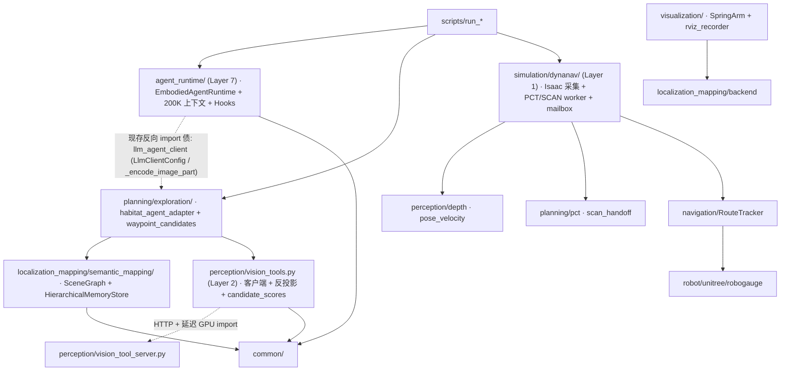

# embodied_navigation 源码包

`src/embodied_navigation/` 是仓库全部自有导航实现的根：按「仿真 → 感知 → 定位建图 → 规划 → 导航跟踪 → 机器人执行 → Agent 运行时 → 可视化」分层组织，公共基础设施 `common/` 单列。第三方算法（FAST-LIVO2、SCAN、PCT、vikit、Livox 驱动）在 `third_party/`，本包只做接入与装配。

盘点日期 2026-11-26（分支 `feat/static-memory-streaming`，HEAD `4f81110`）。

## 模块定位与架构层级

- 架构层级：多层源码根，本身不属于某一层；包根只放包 docstring 与仓库/数据根发现，各层职责由 9 个一层子包承担。
- 输入：ROS 2 话题（仿真侧 `/dynanav/lidar_rtx`、`/dynanav/camera`、`/dynanav/imu`、`/dynanav/nav/approved_cmd`；前端 `/dynanav/rtx_livo/post_vio_odometry`、`/dynanav/rtx_livo/cloud_registered_full`；真值 `/dynanav/truth/*`）、Habitat-Sim HM3D 闭环传感器帧、run 目录冻结配置、`$PROJECT_DATA_ROOT` 下的资产与模型。
- 输出：体坐标系速度指令与关节目标（D 路径仿真执行）、TF 与修正里程计（`/dynanav/backend/corrected_odometry`）、run 目录证据与多轮 CoT/评测报告；产物全部落在数据卷，不进仓库。
- 上游/下游：上游是 `scripts/` 的薄入口与 Isaac Sim / Habitat 宿主进程；下游依赖见下方「包内依赖方向」。
- 边界：不内置第三方算法或 GPU 权重；`perception/vision_tool_server.py` 将 PyTorch/FastAPI 隔离在函数内延迟导入，保证包顶层 100% 纯 CPU；`import embodied_navigation` 只执行 [__init__.py](__init__.py) 的 docstring，不启动进程、不建线程、不读配置。

## 包内依赖方向（含现存技术债标注）



## 当前文件夹结构

```text
src/embodied_navigation/
├── agent_runtime/             # Agent 运行时：Prefix-Stable 200K 上下文、流式 Tool-Calling、Hooks 与压缩
├── common/                    # 横切基础设施：几何/时间、有界写盘、子进程日志、状态契约
│   └── time/
├── localization_mapping/      # 定位建图：FAST-LIVO2 接入、点云 SLAM 后端、语义建图与 L0-L3 记忆
│   ├── backend/
│   └── semantic_mapping/
├── navigation/                # 导航跟踪：RouteTracker、RoboGauge 路线跟踪、yaw 动作
│   └── robogauge/
├── perception/                # 感知适配：RGB-D 反投影、源时间速度窗、纯 CPU 视觉工具客户端与延迟 GPU 服务
├── planning/                  # 规划：PCT 全局、SCAN 局部、交接、探索候选与 Habitat 闭环适配
│   ├── exploration/
│   └── pct/
├── robot/                     # 机器人执行：Go2 观测契约、RoboGauge MoE-CTS 运行时
│   └── unitree/
│       ├── policy/native/
│       └── robogauge/
├── simulation/                # 仿真：DynaNav/Isaac 采集、传感器、真值、operator 地图
│   └── dynanav/
│       └── capture/
├── visualization/             # 可视化：Spring-Arm 防穿墙多机位相机与 RViz2 录制编排
├── README.md                  # 本文件
├── __init__.py                # 1 行：包 docstring
└── project.py                 # 22 行：仓库根/数据根发现
```

规模（`git ls-files` 实测，2026-11-26）：**106 个 `.py` / 45,106 行**，128 个跟踪文件（含 README 与 JSON 契约）。9 个一层子包与包根合计：`agent_runtime` 6/1,235、`common` 7/796、`localization_mapping` 28/13,943、`navigation` 4/883、`perception` 5/1,509、`planning` 15/11,601、`robot` 8/490、`simulation` 27/13,366、`visualization` 4/1,260、包根 2/23。

## 端到端数据流（D 路径唯一主线）

1. **启动**：`scripts/run_dynanav_native_exploration.sh [NEW_RUN_DIRECTORY]` 先占锁、冻结 run 目录与日志预算 `$RUN/configuration/capture_log.json`，再按模式组装后续进程。
2. **仿真与传感**：[simulation](simulation/README.md) 经 `scripts/run_dynanav_experiment.py` 进入 `simulation/dynanav/capture/`，在 Isaac Sim 中生成场景/物理/传感器，发布 `/dynanav/lidar_rtx`、`/dynanav/camera`、`/dynanav/imu`、`/dynanav/truth/*`，并订阅 `/dynanav/nav/approved_cmd`（`geometry_msgs/TwistStamped`）作为速度请求交给 `simulation/dynanav/capture/control.py` 的控制器换算关节目标。
3. **前端**：`scripts/run_dynanav_lio.sh` 启动 `third_party/fast_livo2`，发布 `/dynanav/rtx_livo/post_vio_odometry`、`/dynanav/rtx_livo/cloud_registered_full`、`/dynanav/rtx_livo/aft_mapped_to_init`。
4. **定位建图**：[localization_mapping](localization_mapping/README.md) 的 [backend](localization_mapping/backend/README.md) 消费 FAST-LIVO2 导出的关键帧 spool（`$RUN/observer/native_keyframes`），做 ScanContext + ICP 回环、SE(3) 位姿图、地图保存/先验地图重定位，发布 TF `map → camera_init` 与 `/dynanav/backend/corrected_odometry`；[semantic_mapping](localization_mapping/semantic_mapping/README.md) 是纯 CPU 的语义点层、关键帧场景图与 L0–L3 认知记忆。
5. **规划**：[planning](planning/README.md) 由 `scripts/run_dynanav_pct_scan.py` → `simulation/dynanav/pct_scan_worker.py` 驱动：PCT 生成全局路线（`third_party/pct`），SCAN 做局部规划（`third_party/scan`），`planning/scan_handoff.py` 与 `planning/scan_source.py` 负责交接与点云输入。
6. **跟踪与执行**：[navigation](navigation/README.md) 的 `robogauge/route_tracker.py` 把实测位姿变成有界体速指令，`yaw_action.py` 提供共享 yaw 动作；[robot](robot/README.md) 的 `unitree/robogauge/` 用 RoboGauge MoE-CTS TorchScript 策略把指令变成关节目标。
7. **Agent 感知与控制介入层**：D 路径仍经 `operator_map.py`、`pct_scan_waypoints.py`、`native_waypoints.py`、`scripts/explore_waypoint_client.py` 与 `.agents/skills/dynanav-explore/` 交互；独立多轮运行时 `agent_runtime/` 已先接通 Habitat-Sim HM3D 闭环认知评测支线。
8. **`--truth-pose` 旁路**：跳过 FAST-LIVO2 与后端，用 `/dynanav/truth/control_odometry`、`/dynanav/truth/imu_odometry`、`/dynanav/truth/cloud_deskewed` 驱动 PCT + SCAN。

开发阶段边界见 [docs/plan/ROADMAP.md](../../docs/plan/ROADMAP.md)（[docs/architecture.md](../../docs/architecture.md) 仅作旧版历史参考）。

## 各层入口

| 层 | 子包 | 规模（`.py` / 行） | 关键入口 | 模块 README |
| --- | --- | --- | --- | --- |
| 基础设施 | `common/` | 7 / 796 | 库：`common.geometry`、`common.runtime_io`、`common.process_log`、`common.time` | [common/README.md](common/README.md) |
| 仿真 | `simulation/` | 27 / 13,366 | `scripts/run_dynanav_experiment.py` → `simulation/dynanav/capture_go2_rgbd.py` | [simulation/README.md](simulation/README.md)、[dynanav/README.md](simulation/dynanav/README.md) |
| 感知 | `perception/` | 5 / 1,509 | `perception.depth`、`perception.pose_velocity`、`perception.vision_tools`（纯 CPU）+ `vision_tool_server` | [perception/README.md](perception/README.md) |
| 定位建图 | `localization_mapping/` | 28 / 13,943 | `backend.node` 与 `semantic_mapping`（`KeyframeSceneGraph`、`HierarchicalMemoryStore`） | [localization_mapping/README.md](localization_mapping/README.md) |
| 规划 | `planning/` | 15 / 11,601 | `pct/`、`scan_*`、`exploration/`（DynaNav 候选/mailbox + LLM/Habitat 闭环评测） | [planning/README.md](planning/README.md)、[exploration/README.md](planning/exploration/README.md) |
| Agent 运行时 | `agent_runtime/` | 6 / 1,235 | `EmbodiedAgentRuntime`、`PrefixStableContextManager`、`OpenCodeToolChatClient` | [agent_runtime/README.md](agent_runtime/README.md) |
| 导航跟踪 | `navigation/` | 4 / 883 | `navigation.robogauge.route_tracker.RouteTracker`、`navigation.yaw_action` | [navigation/README.md](navigation/README.md) |
| 机器人执行 | `robot/` | 8 / 490 | `robot.unitree.robogauge.runtime`（TorchScript 策略） | [robot/README.md](robot/README.md) |
| 可视化 | `visualization/` | 4 / 1,260 | `SpringArmCameraController`、`spring_arm_node`、`rviz_recorder` | [visualization/README.md](visualization/README.md) |

更细的 README 还有：`planning/pct/README.md`、`planning/exploration/README.md`、`localization_mapping/semantic_mapping/README.md`、`localization_mapping/backend/README.md`、`navigation/robogauge/README.md`、`robot/unitree/README.md`、`robot/unitree/robogauge/README.md`、`simulation/dynanav/README.md`、`simulation/dynanav/capture/README.md`。脚本入口清单见 [scripts/README.md](../../scripts/README.md)。

## 逐文件职责（包根）

| 文件 | 核心职责 | 关键接口/入口 |
| --- | --- | --- |
| [README.md](README.md) | 本文件：包总索引、端到端数据流、各层入口。 | — |
| [__init__.py](__init__.py) | 包 docstring（1 行），无重导出、无副作用。 | 无 |
| [project.py](project.py) | 仓库根与工程数据根发现，不写死个人路径。 | `project_root()`（`EMBODIED_NAV_ROOT` 覆盖，否则向上找 `pyproject.toml`）、`data_root()`（要求 `PROJECT_DATA_ROOT`，返回 `$PROJECT_DATA_ROOT/embodied-navigation`）；被 `robot/unitree/robogauge/runtime.py` 等模块与脚本导入 |

## 验证与测试入口 / 配置注意

- CPU 测试（仓库根执行，不启 ISAAC/ROS）：`PYTHONPATH=src python3 -B -m unittest discover -s tests/unit` 与 `… -s tests/regression`；当前工作树记录为 **934 条单测通过（0 失败 0 跳过）、60 条回归（57 通过、3 按环境跳过、0 失败），另在 Python 3.9 Habitat 环境跑通 29 条关联单测**。测试索引见 [tests/README.md](../../tests/README.md)。
- 编译检查：`PYTHONPATH=src python3 -B -m compileall -q src scripts`。
- 配置全部在仓库 [configs](../../configs/README.md)，运行时冻结进 `$RUN/configuration/`；本包不含 `src/` 下的配置文件。DynaNav 场景、资产、模型与权重在 `$PROJECT_DATA_ROOT/embodied-navigation/`，缺失时入口会显式报错而不是回退到仓库路径。
- 运行产物（日志、点云、地图、逐帧 JSON）写 `$PROJECT_DATA_ROOT/embodied-navigation/runs/<批次>/<run-id>/` 或 `experiments/<run>/`，不进仓库（`AGENTS.md` 第 6 节）。
- 原生依赖（`third_party/fast_livo2`、`third_party/scan`、`third_party/pct` 等）的构建前置与许可边界见 [docs/dependencies/BUILD.md](../../docs/dependencies/BUILD.md)。

## 未验证边界

端到端 Isaac/DynaNav 运行、真实 FAST-LIVO2 吞吐、回环正确性与实机执行都需要 Linux + Isaac/ROS 环境；本文件依据 2026-11-26 的 `git ls-files`、CPU 测试结论与 Habitat-Sim HM3D 闭环单场景校验编制，`agent_runtime/` 尚未接回 Isaac/DynaNav 主线。
