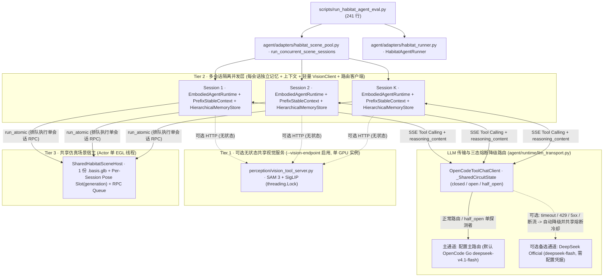
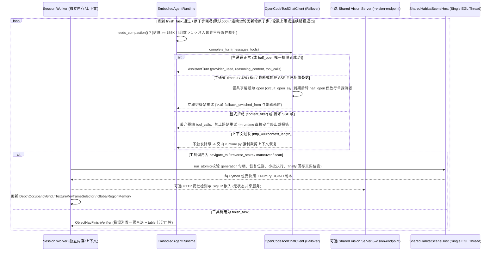

# agent · 顶层具身 Agent 编排层（Layer 7）

> 盘点日期：2026-11-27 · 规模：16 个 `.py` / 5,009 行 · 分支 `feat/static-memory-streaming`

本包是仓库的**顶层独立 Agent 层**，遵循**单向向下依赖**原则：仅向上对接 CLI 入口，单向向下调用 `common/`、`perception/`、`localization_mapping/`、`planning/` 等能力层；底层 8 个子包严禁反向导入 `embodied_navigation.agent` 或 `agent_runtime`（包括包级别名与相对导入），且 `agent/runtime/` 严禁导入任何规划、感知、建图、可视化或仿真模块（由 `tests/unit/test_agent_runtime.py::test_agent_layer_unidirectional_dependency_guard` 做全仓 AST 机器校验）。

## 一、三层解耦并发与超时降级架构图



## 二、单回合多轮推理与降级数据流



## 三、目录结构与逐文件职责

```text
src/embodied_navigation/agent/
├── README.md                     # 本文件
├── __init__.py                   # 77 行：顶层统一导出契约
├── runtime/                      # 纯任务无关、环境无关的多轮执行内核（禁止 import 下层业务/可视化包）
│   ├── __init__.py               # 49 行
│   ├── types.py                  # 90 行：ToolSpec/Call/Result、TurnUsage、AssistantTurn（含降级审计字段）、FinishCheckResult
│   ├── hooks.py                  # 84 行：BeforeTurnHook、AfterToolHook（剥离宿主路径键 + 裁剪）、BeforeFinishHook
│   ├── llm_transport.py          # 716 行：OpenCodeToolChatClient（SSE 流式、三态共享熔断、主备降级链、损坏帧/content_filter 阻断、text-only 图像降级清洗）
│   ├── context.py                # 371 行：PrefixStableContextManager（冻结前缀 + Append-Only + 155K/200K 惰性压缩 + 跨路由测量重置）
│   └── runtime.py                # 338 行：EmbodiedAgentRuntime（默认 max_turns=None 按原子步预算运行 + 连续 12 轮无新增原子步熔断 + content_filter 快速止损）
├── prompts/                      # 系统提示词与事件驱动 VLM 区域摘要器
│   ├── __init__.py               # 13 行
│   └── embodied_prompts.py       # 150 行：AGENT_RUNTIME_SYSTEM_PROMPT、build_vlm_region_summarizer（仅走主路由）
├── tools/                        # 通用具身工具集与可插拔终止验证门
│   ├── __init__.py               # 19 行
│   ├── embodied_tools.py         # 785 行：navigate_to / traverse_stairs / scan / maneuver / inspect_vision / query_world / get_evidence / update_belief / finish_task
│   └── verifiers.py              # 201 行：ObjectNavFinishVerifier（易混淆类一票否决 + table 低分门控）、ReportFinishVerifier
└── adapters/                     # 环境适配器（将底层仿真/机器人栈接入统一 WorldDaemon 接口）
    ├── __init__.py               # 21 行
    ├── habitat_daemon.py         # 618 行：HabitatWorldDaemon（自更新感知、Set-Cover 纹理帧、几何+语义区域记忆、2.5D 平面图）
    ├── habitat_runner.py         # 916 行：HabitatAgentRunner（兼容独占 sim 与 SharedHabitatSceneHost、确定性会话 RNG、逐原子步预算提交、跨层楼梯通行）
    └── habitat_scene_pool.py     # 561 行：SharedHabitatSceneHost（单 EGL 线程 Actor 队列 + generation 句柄 + 重入防护）、HabitatSessionProxy、run_concurrent_scene_sessions
```

## 四、关键工程边界与验证范围

1. **反向依赖彻底清零**：共享的 `LlmClientConfig`、`PROVIDER_PRESETS`（新增支持视觉的 `deepseek_official` 预设，不改动原有 `deepseek` 预设）与安全图编码 `encode_image_part` 位于 `common/llm_config.py`。
2. **线程安全与隔离边界**：
   - `SharedHabitatSceneHost` 隔离**静态 HM3D 场景中的机器人机体位姿（位置与四元数）**，不隔离动态可动物体或独立传感器云台；`sim` 的创建、步进、渲染与 `close()` 全程绑定在单一 EGL 归属线程，并阻止归属线程内重入 RPC 死锁。
   - 固定代理方法（`agents[0].get_state`、`get_sensor_observations`、`step`）将原生对象与 NumPy 观测缓冲复制为线程安全副本后再跨线程返回；每次 `create_session()` 分配单调 `generation` 句柄，拒绝重名活动会话与失效代理调用，且 `finally` 块始终回存真实位姿以防中途异常产生状态分叉。
   - `DepthOccupancyGrid.render_global_floorplan()` / `render_local_map()` 已加 `_MATPLOTLIB_LOCK` 并在 `try/finally` 中执行 `plt.close(fig)`，防止并发渲染触发堆损坏或 figure 泄漏。
3. **当前已验证 vs 待验证范围**：
   - **本版本已验证**：
     - Python 3.12 全仓编译与离线单测/回归：`PYTHONPATH=src python3 -B -m compileall -q src scripts`、`unittest discover -s tests/unit`（**948/948 通过**，含强化 AST 守卫、三态半开并发屏障、损坏 SSE/拒绝阻断、失效代理/目录越界/绘图清理测试）与 `tests/regression`（**60 条：57 通过、3 按环境跳过、0 失败**）；
     - Python 3.9 Habitat 环境单测：`unittest tests.unit.test_agent_runtime`（**20/20 通过**）；
     - Habitat-Sim 实机 `00802` 场景 GT 一致性（独占 vs 共享宿主同参数 `num_samples=260, seed=42, max_view_dist_m=1.8` 对象集合完全一致）与 3 会话并发步进+渲染平面图冒烟；
     - 历史基线对照（提交 `0311bd0`，未含新降级链，数据卷 `runs/20261127-hm3d-val-5scenes-agent-v3-0311bd0/`）：从 `hm3d/val` 选取的 5 栋开发子集（`00800/00802/00803/00808/00810`，共 20 项子任务、16 项有效 GT）整体 SR `11/16 = 68.75%`、OSR `75.00%`、SPL `0.6196`、0 误停；排除 5 项 OpenCode Go 网关超时后的条件成功率为 `11/11 = 100%`。
   - **待下一轮实测**：带自动 `opencode -> deepseek_official` 降级链的 5 栋开发子集复测与其余 31 栋未见 `hm3d/val` 全量盲测；以及通过 `adapters/dynanav_adapter.py` 将本层接回 Isaac Sim / DynaNav（D 路径真实 SLAM + PCT/SCAN 主线）。
