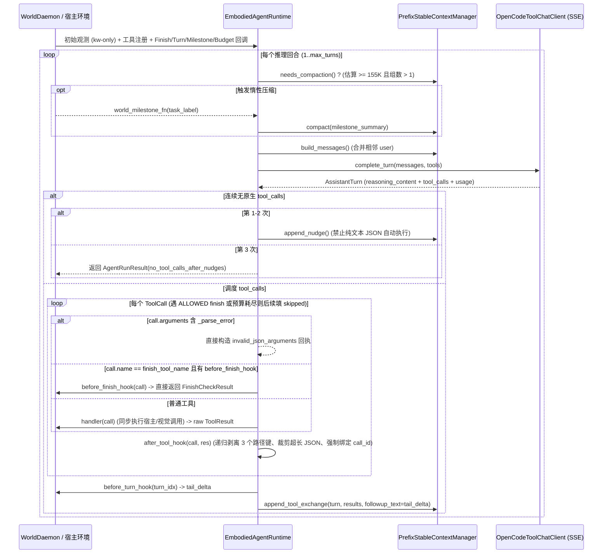

# agent_runtime · 通用具身 Agent 运行时（Layer 7）

> 盘点日期：2026-11-26 · 规模：6 个 `.py` / 1,235 行 · 分支 `feat/static-memory-streaming`（本地实现中，尚未合入 `main`）

本包是与具体导航任务、具体仿真器调度逻辑分离的通用多轮 Tool-Calling 运行时：负责「Agent 对话上下文拼接、工具调度、生命周期 Hooks / 宿主回调与 SSE 流式传输」，不持有传感器采集、SLAM 构图、检测模型或环境 GT 真值。

## 模块定位与设计边界

1. **接口分离与当前同步调度现实**：世界状态保存与感知融合（OCC 栅格、Zone 覆盖、双触发关键帧、图像嵌入与检测）归宿主侧 `WorldDaemon`（当前接在 `planning/exploration/habitat_agent_adapter.py` 的 `HabitatWorldDaemon`），运行时核心通过工具句柄与回调调用宿主；**注意：本版 Habitat 宿主仍在工具回合内同步执行 `handler` 及同步 HTTP 视觉检测，慢视觉请求会直接阻塞延长该工具回合**（尚未做成后台独立异步进程）。
2. **上下文拼接与估算软压缩**：`[System]` 与 `[Initial Task]` 置于消息前部，工具schema 单独传 `tools` 字段；历史 `turn_groups`（`assistant` + `tool` + 尾随观察）向尾部追加；`build_messages()` 发送前会用 `_merge_adjacent_user_messages()` 合并相邻 `role="user"` 消息。仅在字符数+固定图像估算的 `estimate_next_turn_tokens() >= soft_compaction_tokens`（默认 `155,000`，默认预算参数 `200,000`，仅预留 `4,096` 输出而思考模式实际设 `max_tokens >= 16,384`；历史组数 `≤1` 不压缩且压后不做硬拦截），或网关返回 `http_400` 时触发裁剪压缩（400 强压收据未写入本轮 trace，且无视具体 400 原因）。
3. **OpenAI/OpenCode 协议兼容**：`role="tool"` 严格只承载紧凑 JSON 文本，工具产出图像附加在紧随其后的 `role="user"` 消息；`runtime.py` 在 `_parse_error` 或存在 `before_finish_hook` 时直接返回判据而不落回普通 `handler`；连续第 3 个无工具纯文本回合直接提前终止，仅前 2 次追加 `nudge`。



## 当前文件夹结构与逐文件职责

```text
src/embodied_navigation/agent_runtime/
├── README.md        # 本文件
├── __init__.py      # 47 行：对外稳定导出契约
├── types.py         # 87 行：ImageAttachment、ToolSpec/Call/Result、TurnUsage、AssistantTurn、FinishCheckResult
├── hooks.py         # 84 行：BeforeTurnHook、AfterToolHook（strip_host_paths_recursive 剥离 rgb_path/local_map_path/file_path 三键 + default_after_tool_hook 裁剪预览）、BeforeFinishHook
├── llm_transport.py # 360 行：OpenCodeToolChatClient SSE 流式传输、chunk 级截止期读取、SSE 截断检测与 DeepSeek/Qwen 思考参数适配
├── context.py       # 357 行：PrefixStableContextManager、整组裁剪式惰性压缩、相邻 user 合并与启发式 token 估算
└── runtime.py       # 300 行：EmbodiedAgentRuntime.run_task 主循环、AgentRunResult、权威 tool_call_id 绑定与 batch 提前终止补 skipped
```

## 当前依赖、入口与真实局限

- **跨层依赖与可移植性限制**：`llm_transport.py:18` 与 `context.py:16` 仍从 [`planning/exploration/llm_agent_client.py`](../planning/exploration/llm_agent_client.py) 反向导入 `LlmClientConfig` 与 `_encode_image_part`；且 `llm_transport.py` 内置了 DeepSeek/Qwen 思考参数策略与 `x-opencode-session` 路由头，并非完全平台无关的通用传输层。
- **已接入宿主 vs 未接入主线**：目前仅通过 [`habitat_agent_adapter.py`](../planning/exploration/habitat_agent_adapter.py) 与新增评测 CLI [`scripts/run_habitat_agent_eval.py`](../../../scripts/run_habitat_agent_eval.py)（138 行）在 Habitat-Sim HM3D 上做过单场景冒烟；**DynaNav / Isaac Sim（D 路径工程主线）目前仍沿用 `explore_waypoint_client.py` 与文件 mailbox，尚未切换至本 Runtime**。
- **Compaction 尚未在线上长程验证**：`compact()` 生成的 `[COMPACTED_WORLD_MILESTONE]` 由调用方 `world_milestone_fn` 确定性模板拼接；在 `00800` 单房冒烟中峰值 `54,455` tokens，`compactions_count=0`，155K 软线及 HTTP 400 强压在真实网关下的多轮恢复表现仍待实测。
- **单元测试**：[`tests/unit/test_agent_runtime.py`](../../../tests/unit/test_agent_runtime.py)（9 条 CPU 单测，在 Python 3.12 与 Python 3.9 均通过；`ReportFinishVerifier` 仅验证了非空 `summary` 与存在性 `evidence_ids`）。
